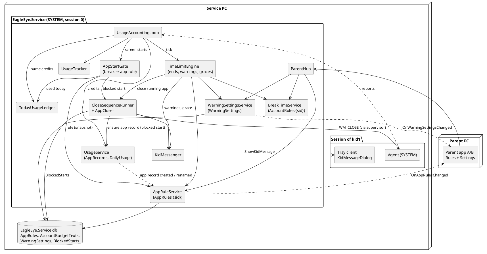
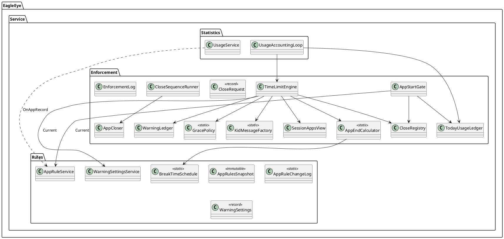
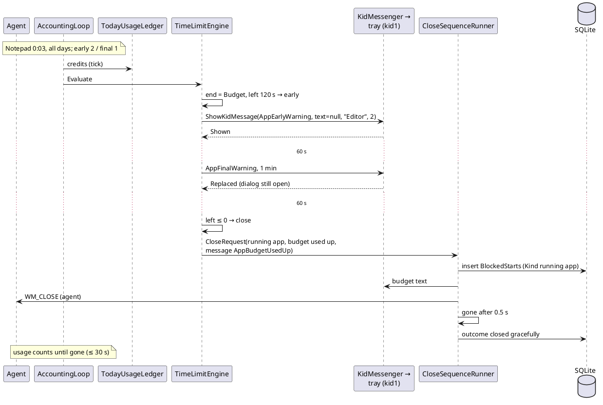

# Implementation Plan: US-006 — App Time Budgets and Time-elapsed Warnings

**Status**: Draft (for approval by Michael)
**Date**: 2026-10-12
**Author**: ARC
**User story**: `02_Implementation/docs/requirements/user-stories/US-006/user-story.md` (approved 2026-10-12, 39 ACs in groups A to J, OQ-1 to OQ-19 resolved)
**Requirements**: `02_Implementation/docs/requirements/general-product-requirements.md` v1.6
**Branch**: `feature/US-006-app-time-budgets`
**New ADRs** (Proposed, approved with this plan):
- ADR-015 — Time limits for running apps (`02_Implementation/docs/architecture/decisions/ADR-015-time-limits-for-running-apps.md`)
- ADR-016 — Default kid texts follow the language of the displaying app (`02_Implementation/docs/architecture/decisions/ADR-016-language-following-default-texts.md`)

**Amended** (approved with this plan): ADR-006, ADR-012, ADR-013 and ADR-014 (amendment blocks at the top of each), arc42 (header, §5.2, §6.3, §8.4, §8.6, §8.7, §8.13, §9, §11), and coding guidelines §10.1.

**Open for Michael**: Q-1 to Q-7 at the end. Q-1 to Q-3 are PRO's three interpretations, and Q-4 is TC-005-26. The design keeps each of them easy to change (one flag, one resource line, or one log template).

---

## Technical Issues and Risks

*Checked against the code on `feature/US-006-app-time-budgets` (= 0.5.0 + story docs). **Summary: the story is feasible on the US-005 base (session agent, close sequence, kid dialog, rules state area). The new pieces are a tick-based time-limit engine, a second rules state area, a global settings area, and language-neutral default texts. No Windows rights change. The biggest real-world risks are the deny-by-default lockout right after the update (accepted, OQ-2) and apps that change their program path with each update (accepted, OQ-12).***

| # | Issue | Impact | Solution in this plan |
|---|---|---|---|
| **TI-1** | **Blocked starts create no app record today.** US-005 removes blocked processes before the tracker, and `BlockedStarts` stores name and path directly (US-005 TI-9). With deny-by-default, a new app is blocked at its first start, so it would never reach the Rules table and the parent could never allow it (story OQ-1). | Blocker for AC-3 and AC-5. | The close sequence of a blocked start calls `IAppInventory.EnsureAppRecordAsync` (implemented by `UsageService`, owner of `AppRecords`). It creates the record without an instance, usage or day row, and notifies the app-rules owner. The new row is broadcast to parent apps (AC-4). Decision 3. |
| **TI-2** | **"Used time" must equal Reports** (OQ-3). The tracker credits in memory. `UsageService` persists whole seconds per tick. The service has no in-memory "today per app". | A second, different counter would let Reports and budgets disagree. | `TodayUsageLedger`: loaded from `DailyUsage` (today) at start, then fed with the **same** `TrackerOutput.Credits` the loop passes to `UsageService` (ADR-015 §2). The loop takes the tracker output once and gives it to both. |
| **TI-3** | **Evaluation order in the loop.** Today `enforcement.OnTickAsync` runs **before** the tick's tracker output is taken, so a budget check there would see stale credits. | Ends detected one tick late (still within 10 s, but needless). | New order per tick: advance and reconcile → take the output → `UsageService.ApplyAsync` → ledger → `TimeLimitEngine.Evaluate` (Decision 5). |
| **TI-4** | **Deny by default for apps already recorded** (OQ-2). Every existing `AppRecords` row must be blocked after the update. | A missed path would leave apps unlimited. | **No row = default rule (0:00, no day).** Migration 5 creates the table and copies no data. Every record, old or new, is blocked until the parent sets a rule (ADR-015 §8). A unit test runs migration 5 on a real version-4 file with app records and checks that all of them evaluate as blocked. |
| **TI-5** | **End of allowed time** is the earliest of the budget end, the next break start and midnight when the next day is not allowed. Budget time runs only while the session is in use, but break and midnight are wall-clock times. | A wrong end would show the wrong warnings (AC-31) or close at the wrong time. | Pure `AppEndCalculator` with a 60-minute horizon. Budget time left is measured in seconds of use. Break and midnight are measured in wall time. Ties go to the break. A budget end after midnight does not count when the next day allows the app (it gets a new budget at midnight). ADR-015 §3, Decision 4. |
| **TI-6** | **Warning de-duplication.** Budget warnings are once per app and day, break warnings once per session and break, and a "matching warning at once" applies at start or after a change (OQ-5, OQ-9, OQ-13). | Repeated or missing warnings. | `WarningLedger` with keys `(account, app, day, level)` and `(session, break start, level)`. A shown lower level also marks the higher one. Break warnings only when a running app has the break as its end. Decision 6. |
| **TI-7** | **Grace period detection** (AC-32, AC-33). The engine has to know that a *parent change* moved an end earlier, not normal use. | Graces at the wrong moment, or none. | The engine keeps per running app the end it computed last, plus the revisions of `AppRules:{sid}` and `AccountRules:{sid}`. On a revision change it compares the old and new end. `GracePolicy` (one flag, Q-2) decides the threshold. Decision 7. |
| **TI-8** | **Running apps must keep counting usage while being closed** (AC-25: up to ~30 s more than the budget). US-005 sequences remove the app from the report. | Wrong Reports, or a re-opened usage instance. | Close requests get a kind. Only `blocked start` removes processes from the report. `running app` leaves them, and the tracker ends the instance normally when the app is gone (Decision 8). |
| **TI-9** | **Kill set of a running app.** `KillSetBuilder` excludes the processes of the account's *other open apps*. The app being closed is itself open, so its own path would be excluded. | Force step would kill nothing. | `AppCloser` passes the open paths **minus the target path**. Unit test with an open target. |
| **TI-10** | **One dialog per session, newer replaces** (AC-34). US-005's presenter answers `AlreadyOpen` and drops the new text. | A final warning could hide behind an early warning. | `KidMessagePresenter` replaces the text of the open dialog and returns `Replaced`. The dialog is brought to the front again (foreground best effort, ADR-014 §3). The contract gets `ShowKidMessage(KidMessageDto)` with a reason. The tray builds the info line in the kid's language (Decision 9). |
| **TI-11** | **Default texts in two languages** (AC-10, AC-14, OQ-8). The service has no UI language. The parent and the kid can use different languages. US-005 sent the German default as text. | Defaults in the wrong language. | ADR-016: the service stores only the parent's text (`null` = default). Defaults live once in `EagleEye.Shared/Resources/DefaultTexts*.resx`. The displaying app renders them in its own UI language. Q-1. |
| **TI-12** | **History table shape.** `BlockedStarts.EntryId`, `EntryStartMinute`, `EntryEndMinute` and `EntryDays` are `NOT NULL`. Budget records have no entry. SQLite cannot drop `NOT NULL` with `ALTER`. | Migration fails or fake values are needed. | Migration 5 rebuilds `BlockedStarts` (create new, copy, drop, rename, re-index) with nullable entry columns plus `Kind`, `Reason` and app-rule columns. Old rows get `Kind = 'blocked start'`, `Reason = 'break time'`. Tested on a version-4 file. |
| **TI-13** | **Hours and minutes edited by two parents at once** (AC-17). A whole-budget write would let A's hours and B's minutes overwrite each other. | Lost change. | Field-level write `SetAppBudget(…, AppBudgetPart part, int value)`. The service combines it with the **stored** other part, as US-005 did for start and end times. |
| **TI-14** | **Service restart during a warning or grace period.** Warnings and graces are in memory. | Repeated warnings. An app in grace is closed at once after the restart. | Accepted (D-5, D-6, ADR-015 §5 and §9). Restarts are rare (installer, crash), and used time is persisted, so no budget is refilled. |
| **TI-15** | **Time-zone and clock changes** (AC-39). `TimeChangeMonitor` (US-005) already finds zone changes and clock jumps > 30 s and stores findings. AC-39 wants the old and new local date and the effect on budgets in the Warning. | Missing information in the log. | The Warning templates are extended (old/new local date, "daily budgets now use the new day"). There is still one Warning and one finding per change, with no new table and no new finding kind (Q-3). Budgets follow the new local date automatically: the ledger is keyed by local day. |
| **TI-16** | **Exclusive full-screen games** draw above every window (ADR-014 §3). | A warning may not be seen until the game is closed. | Known limit (US-005 C-1). The app is still closed on time. TES uses a windowed or borderless game. arc42 R-4. |
| **TI-17** | **Agent token** (TC-005-26, US-004 Q-9, still open). Graceful closes of **running** apps (the main path of US-006) use the agent's `PostMessageW(WM_CLOSE)`. | If posting fails under the real token, every close ends "terminated by force after 20 s". The kid gets no "save?" prompt. | US-005 TC-005-12 proved the graceful close under the real token, so posting works either way. Q-4: TES reruns TC-005-26 in the US-006 run, because enforced closes of running apps now depend on it more. No design change. |
| **TI-18** | **MAUI table with many apps.** A kid account can have 50 to 150 app records. `BindableLayout` rows are created at once. | Slow page switch. | Rows are merged by `AppId` (no rebuild on snapshots). The smoke check measures 100 rows. Fallback, if > 1 s: `CollectionView` (D-9). |

---

## Machine Assignment

**Everything runs on the Windows Developer Machine.** US-006 changes Shared, Service (incl. the agent-free enforcement), TrayClient, `ParentApp.Core`, the ParentApp Windows target and both Windows installers. Shared contract changes land first (Step 1).

| Work | Machine |
|---|---|
| This plan, ADR-015, ADR-016, amendments of ADR-006/012/013/014, arc42, coding guidelines (ARC) | Windows Developer Machine (done here) |
| Steps 0 to 12 (DEV): code, unit tests, `build.ps1` / `test.ps1`, installers, smoke check | **Windows Developer Machine** |
| Manual test run (Michael, guided by TES) | Windows Developer Machine as service PC, with the parent's admin account and `kid1`, `kid2` (controlled) and `kid3` (not controlled); parent apps A and B (B preferably on a second Windows PC). |
| MacBook | **Not needed for this story.** The Shared contract changes (new DTOs, enums, constants, and the new `DefaultTexts` resource with its `en` satellite) and the `ParentApp.Core` changes **are** compiled by the MacBook build (`build.ps1`: Shared + ParentApp Mac Catalyst; `test.ps1`: Shared.Tests + ParentApp.Tests). DEV keeps both free of Windows APIs. The new XAML sections are plain MAUI; the `CheckBox` mapping stays `#if WINDOWS`. Recommended, not required: at the next MacBook session after the merge, `git pull` then `build.ps1` and `test.ps1`. If that fails, it is a regression of this story (an issue for DEV), not a MacBook task. |

The Android target is built by `build.ps1` on Windows and must compile with zero warnings. There is no Android test.

---

## Impact Assessment

| Component | Impact |
|---|---|
| **EagleEye.Shared** | `IParentHub`: 7 new methods. `IParentClientCallback`: `OnAppRulesChanged`, `OnWarningSettingsChanged`. `ITrayClientCallback`: `ShowKidMessage` **replaces** `ShowBreakTimeMessage`. DTOs `AppRulesDto`, `AppRuleDto`, `WarningSettingsDto`, `KidMessageDto`. Enums `AppBudgetPart`, `WarningLevel`, `KidMessageReason`, `DefaultTextKind`; `KidMessageResult.Replaced`. Constants `AppRuleRules`, `WarningRules`. **New resource** `Resources/DefaultTexts.resx` (de) + `DefaultTexts.en.resx` with accessor `DefaultTexts` (ADR-016). `BreakTimeMessageDto` is removed. |
| **EagleEye.Service** | **Data**: migration 5 (`AppRules`, `AccountBudgetTexts`, `WarningSettings`, rebuilt `BlockedStarts`); `AppRuleRepository`, `WarningSettingsRepository`; `BlockedStartRepository` (kind, reason). **Rules**: `AppRuleService` (state owner `AppRules:{sid}`), `WarningSettingsService` (state owner `WarningSettings`), snapshots, change logs, broadcasters; `BreakTimeSchedule.NextBegin`. **Enforcement**: the gate checks app rules; `TodayUsageLedger`, `AppEndCalculator`, `WarningLedger`, `GracePolicy`, `TimeLimitEngine`, `KidMessageFactory`, `CloseRegistry`, `SessionAppsView`; the close request is generalized (kind, reason, message); `TimeChangeMonitor` texts. **Statistics**: `UsageService.EnsureAppRecordAsync` plus app-record notifications; loop order. **Communication**: `ParentHub` (7 methods), `KidMessenger` (`KidMessageDto`, `Replaced`). **UserAccounts**: two more purgers. `Program`: start order. |
| **EagleEye.TrayClient** | `ShowKidMessage` handler; `KidMessagePresenter` (replace instead of drop); `KidMessageDialog` (parent text + info line, text replaceable); `KidMessageText` (default text + info line per reason and culture); new tray texts (de, en). |
| **EagleEye.ParentApp.Core** | Hub client and gateway (2 callbacks, 7 calls). `Rules/AppRulesModel`, `Rules/AppBudgetText` (parsing), `Settings/WarningSettingsModel`, `Settings/WarningEditRules`. `ViewModels/AppRulesSectionViewModel`, `AppRuleRowViewModel`, `WarningSettingsViewModel`, `WarningRowViewModel`, `KidTextEditing` (shared default/commit rules for all kid texts). The US-005 display-text editor follows ADR-016. New texts (de, en). |
| **EagleEye.ParentApp** | `RulesView`: new section "Applikations-Regeln". `SettingsView`: new section "Zeit-Ende Warnungen". `MainPage`: flush pending edits also when leaving Settings. `MauiProgram`: DI. |
| **Installers** | Version 0.6.0. Upgrade 0.5.0 → 0.6.0 applies migration 5 at the first start. The service installer ships the Shared satellite folder `en\` (check that it is in the publish output). No change of Windows rights. |
| **Version** | `Directory.Build.props` → `0.6.0` (service reports `EagleEye_v0.6`). |

---

## Architecture Changes

Applied on the feature branch with this plan, to be approved by Michael:

| Document | Change |
|---|---|
| `docs/architecture/decisions/ADR-015-time-limits-for-running-apps.md` | **New**: one evaluation point (tick), used time = Reports, end of allowed time, warnings, grace periods with a policy flag, start gate extension, enforced closes of running apps, deny by default as "no row", what is not persisted |
| `docs/architecture/decisions/ADR-016-language-following-default-texts.md` | **New**: the service stores only parent texts; defaults in Shared resources; rendered by the displaying app |
| ADR-006 | Amendment: the two global warning levels in the kid dialog; running apps closed with the ADR-013 sequence; the per-category config keys of "Pre-Termination Warnings" are not used |
| ADR-012 | Amendment: blocked starts create the app record (no usage); `TodayUsageLedger` reads the tracker credits; loop order |
| ADR-013 | Amendment: gate order break → app rule; close requests (kind, reason); break begin closes running apps (replaces US-005 AC-25); history columns |
| ADR-014 | Amendment: `ShowKidMessage` with reason and nullable parent text; one dialog per session, a newer message replaces the text (`Replaced`); info line in the kid's language |
| arc42 | Header amendment; §5.2 (Enforcement, Configuration); §6.3 runtime view replaced ("Budget and break-time end of a running app"); §8.4 tables; §8.6 retention; §8.7 budget reset; §8.13 Shared default texts; §9 ADR-015/016; §11 R-14 updated, R-15, R-16 new |
| Coding guidelines | §10.1: folders `ParentApp.Core/Settings`, `Shared/Resources` (default texts, de neutral + en satellite) |

DEV updates the READMEs of Shared, Service, TrayClient, `ParentApp.Core` and ParentApp (Step 12).

---

## New ADRs Required

- **ADR-015 — Time limits for running apps.** Evaluated once per accounting tick after usage is credited. Used time = the Reports figure (ledger fed by the same credits). The end of allowed time is the earliest of budget end, not allowed today, midnight when the next day is not allowed, and the next break start (60-minute horizon, break wins ties). Two global warning levels, de-duplicated per app and day or per session and break. Grace period of the final-warning minutes after a parent change, with the threshold as one policy flag. The start gate checks the break first, then the app rule. A blocked start creates the app record. Running apps are closed with the US-005 close sequence and keep counting usage. Deny by default = no rule row.
- **ADR-016 — Default kid texts follow the language of the displaying app.** `null` = default on the wire and in the database. Defaults in `EagleEye.Shared` resources (de neutral, en). A text equal to any default is stored as default.

---

## API Changes (SignalR Contracts)

*API-first: DEV implements this section first (Step 1). ADR-010 shape: snapshot with revision and correlation id, query, broadcast, field-level write commands with `requestId` returning `StateWriteAckDto`. All parent-hub methods are paired-only.*

### State area `AppRules:{accountSid}` — `EagleEye.Shared/Contracts/IParentHub.cs` (changed)

```csharp
/// <summary>
/// Returns the app records of one account with their app rules and the budget text (state area "AppRules:{sid}").
/// File Explorer and every program of the enforcement ignore list are not included (AC-3).
/// Called after every (re)connect and when the parent selects another account on the Rules page.
/// </summary>
/// <param name="accountSid">SID of a standard account of the inventory (US-003), controlled or not.</param>
Task<AppRulesDto> GetAppRules(string accountSid);

/// <summary>
/// Sets the hours (0..23) or the minutes (0..59) of an app's daily budget. The service combines the value with
/// the stored other part (AC-8, AC-17). Throws <c>HubException</c> ("The app no longer exists.") if the record is gone.
/// </summary>
Task<StateWriteAckDto> SetAppBudget(Guid requestId, string accountSid, long appId, AppBudgetPart part, int value);

/// <summary>Ticks or unticks one weekday of an app rule. Every combination is valid, also none (AC-7).</summary>
Task<StateWriteAckDto> SetAppDay(Guid requestId, string accountSid, long appId, DayOfWeek day, bool isAllowed);

/// <summary>
/// Sets the budget text (FR-APP-053). Line breaks → "\n". Empty, white space only, or equal to a default text of any
/// language → the default is restored (AC-10, ADR-016). At most <see cref="BreakTimeRules.MaxDisplayTextLength"/> code units.
/// </summary>
Task<StateWriteAckDto> SetBudgetText(Guid requestId, string accountSid, string text);
```

### State area `WarningSettings` (global) — `IParentHub` (changed)

```csharp
/// <summary>Returns the two warning levels (state area "WarningSettings", FR-APP-054). Called after every (re)connect.</summary>
Task<WarningSettingsDto> GetWarningSettings();

/// <summary>
/// Sets the minutes of one level (1..59). Validated against the stored other level: early must stay greater than
/// final (AC-15). Throws <c>HubException</c> ("The final warning must be less minutes before the end than the early warning.").
/// </summary>
Task<StateWriteAckDto> SetWarningMinutes(Guid requestId, WarningLevel level, int minutes);

/// <summary>Sets the text of one level; same text rules as <see cref="SetBudgetText"/> (AC-15).</summary>
Task<StateWriteAckDto> SetWarningText(Guid requestId, WarningLevel level, string text);
```

Each accepted write produces exactly one new revision and one broadcast, also for no-op writes (ADR-010 §2). The last write received wins per value. Hub error texts (`HubException`, safe texts): `Invalid request.` (bad SID, `Guid.Empty`, value out of range, unknown enum, text too long or with lone surrogates), `Unknown account.`, `The app no longer exists.`, `The final warning must be less minutes before the end than the early warning.`, `The change could not be saved.`, `The rules are not available.`. The parent app validates before sending and shows its own localized texts. Any rejection shows the AC-12 text.

### `EagleEye.Shared/Contracts/IParentClientCallback.cs` (changed)

```csharp
/// <summary>The app list, an app rule or the budget text of one account changed (state area "AppRules:{sid}"),
/// including a new app record (AC-4). Apply only if the revision is higher than the one held for that account.</summary>
Task OnAppRulesChanged(AppRulesDto snapshot);

/// <summary>The warning levels changed (state area "WarningSettings"). Apply only if the revision is higher.</summary>
Task OnWarningSettingsChanged(WarningSettingsDto snapshot);
```

### `EagleEye.Shared/Contracts/ITrayClientCallback.cs` (changed)

```csharp
/// <summary>
/// Shows a message in the kid dialog (FR-TRAY-020 to FR-TRAY-022, ADR-014 as amended). Sent to one verified tray
/// connection of the session as a request with a result. If a dialog is open, its text is replaced (AC-34).
/// The tray renders a default text (ParentText = null) and the info line in the kid's language (ADR-016).
/// </summary>
Task<KidMessageResult> ShowKidMessage(KidMessageDto message);
```

`ShowBreakTimeMessage` and `BreakTimeMessageDto` are **removed**. The service and the tray client ship in the same installer, so they always have the same version. A 0.5 tray client against a 0.6 service (only during an interrupted upgrade) answers "method not found". The service logs "not shown (tray client did not answer)" and still enforces (AC-35).

### `EagleEye.Shared/Models/` (new or changed)

```csharp
/// <summary>One app record of an account with its app rule (FR-APP-040). No stored rule = 0 minutes, no day (AC-5).</summary>
/// <param name="AppId">The app record (US-004).</param>
/// <param name="DisplayName">As on Reports (AC-2).</param>
/// <param name="ProgramPath">Shown as a tooltip, to tell two records with the same name apart (OQ-12).</param>
/// <param name="BudgetMinutes">0 … 1439 (23:59).</param>
/// <param name="Days">Weekdays on which the app may be used (bit mask, Monday = 1; same type as break times).</param>
public sealed record AppRuleDto(long AppId, string DisplayName, string ProgramPath, int BudgetMinutes, BreakTimeDays Days);

/// <summary>Snapshot of the state area "AppRules:{AccountSid}".</summary>
/// <param name="Apps">Unsorted; the parent app sorts by display name in its culture (AC-2).</param>
/// <param name="BudgetText">The parent's budget text, or null for the default (ADR-016); line breaks "\n".</param>
public sealed record AppRulesDto(
    long Revision, Guid? LastChangeRequestId, string AccountSid, IReadOnlyList<AppRuleDto> Apps, string? BudgetText);

/// <summary>Snapshot of the global state area "WarningSettings" (FR-APP-054).</summary>
/// <param name="EarlyText">The parent's text, or null for the default (ADR-016).</param>
/// <param name="FinalText">The parent's text, or null for the default.</param>
public sealed record WarningSettingsDto(
    long Revision, Guid? LastChangeRequestId, int EarlyMinutes, string? EarlyText, int FinalMinutes, string? FinalText);

public enum AppBudgetPart { Hours, Minutes }
public enum WarningLevel { Early, Final }

/// <summary>Why the kid dialog is shown; decides the default text and the info line (AC-34).</summary>
public enum KidMessageReason
{
    AppEarlyWarning, AppFinalWarning,       // budget or midnight end; text: early/final warning; info: "{App}: {n} minutes left."
    BreakEarlyWarning, BreakFinalWarning,   // text: early/final warning; info: "Break time begins at {start}."
    AppGracePeriod,                         // text: final warning; info: "{App}: your parents changed the rules. {App} closes in {n} minutes."
    BreakGracePeriod,                       // text: final warning; info: "Your parents set a break time. All apps close in {n} minutes."
    AppNotAllowedToday,                     // text: budget text; info: "{App}: not allowed today."
    AppBudgetUsedUp,                        // text: budget text; info: "{App}: time budget used up."
    BreakTime,                              // text: break display text; info: "Break time {start}–{end}."
}

/// <summary>A message for the kid dialog.</summary>
/// <param name="ParentText">The parent's text for this reason, or null → the tray shows its default (ADR-016).</param>
/// <param name="AppName">Display name of the app, for app reasons.</param>
/// <param name="Minutes">Minutes left (rounded up, ≥ 1) for warnings and grace periods.</param>
/// <param name="BreakStartMinute">Start of the break entry (0..1439), for break reasons.</param>
/// <param name="BreakEndMinute">End of the break entry (1..1439; 1439 = midnight), for <see cref="KidMessageReason.BreakTime"/>.</param>
public sealed record KidMessageDto(
    KidMessageReason Reason, string? ParentText, string? AppName, int? Minutes, int? BreakStartMinute, int? BreakEndMinute);

public enum KidMessageResult { Shown, AlreadyOpen /* no longer sent from 0.6 */, Replaced }

public enum DefaultTextKind { BreakDisplayText, BudgetText, EarlyWarningText, FinalWarningText }
```

### `EagleEye.Shared/Constants/` (new)

- `AppRuleRules`: `MaxBudgetMinutes = 1439`, `MaxHours = 23`, `MaxMinutes = 59`, `DefaultBudgetMinutes = 0`, `DefaultDays = BreakTimeDays.None`, `IsAllowedOn(budget, days, DayOfWeek)` (day ticked ∧ budget > 0), `Combine(stored, part, value)`, `Format(minutes)` → "H:MM" for the log.
- `WarningRules`: `MinMinutes = 1`, `MaxMinutes = 59`, `DefaultEarlyMinutes = 5`, `DefaultFinalMinutes = 1`, `IsValidMinutes`, `IsValidPair(early, final)` (early > final).
- `DefaultTexts` (+ resx, ADR-016): `Get(DefaultTextKind, CultureInfo)`, `IsAnyDefault(DefaultTextKind, string normalized)`.
- Text rules are reused: `BreakTimeRules.NormalizeLineBreaks`, `IsValidDisplayText` (500 UTF-16 code units, emojis allowed).
- `BreakTimeRules.DefaultDisplayText` stays (German), for the US-005 DTO field only.

Payload: 150 apps × ~150 bytes ≈ 23 KB per `AppRulesDto` snapshot. It is broadcast only on changes and new app records.

**Version compatibility.** A 0.5 parent app against a 0.6 service ignores the new callbacks and shows the US-005 pages. A 0.6 parent app against a 0.5 service gets "method not found" for the new queries, and the sections show "No data available". Both installers go to 0.6.0 together.

---

## Component Design

### Overview



### Decision 1: two new state areas, field-level writes (AC-1 to AC-18)

**`AppRuleService`** (`Rules/`, state owner of `AppRules:{sid}`, one `SemaphoreSlim`):
- `InitializeAsync()` loads every app record (AccountSid, AppId, path, display name) left-joined with `AppRules`, and every budget text, into an immutable `AppRulesSnapshot`. Per account it holds a dictionary by `AppId` and one by program path (case-insensitive). It is called in `Program` after `UsageService.InitializeAsync` and before the host starts, so enforcement works from the first report (AC-36).
- Writes (`SetBudgetAsync`, `SetDayAsync`, `SetBudgetTextAsync`, each with `requestId` and the parent's device name): validate (account is a standard account of the inventory, the app belongs to the account), check against the **stored** value, store (upsert `AppRules`; a rule equal to the default deletes the row; a budget text equal to a default deletes the text row), swap the snapshot (`Volatile.Write`), revision++, log, broadcast, return the ack.
- `OnAppRecord(sid, appId, path, displayName)` (from `UsageService`, Decision 3): a new record, or a changed display name. It updates the snapshot, revision++, and broadcasts. It is not logged here (US-004 logs "New app"). It never calls back into `UsageService`, so there is no lock cycle.
- Excluded from the snapshot's app list (and so from the table): paths on `EnforcementIgnoreList` (File Explorer, shell hosts), AC-3.
- `Current` is read lock-free by the gate and the engine.
- `IAccountDataPurger`: deletes budget texts of deleted SIDs and drops them from the snapshot. The rules go with `AppRecords` (`ON DELETE CASCADE`), which `UsageService` purges.

**`WarningSettingsService`** (`Rules/`, state owner of `WarningSettings`): `InitializeAsync`, `Current` (minutes and texts; defaults when there is no row), `SetMinutesAsync(level, minutes)` validated against the stored other level (early > final), `SetTextAsync(level, text)`. Same revision, log and broadcast pattern.

The revision counter is one in-memory counter per service run for all rules areas (strictly increasing per area, ADR-010 §4). `BreakTimeService` keeps its own counter, as today.

### Decision 2: the start gate (AC-19 to AC-22, AC-26, AC-27)

`BreakTimeGate` becomes `AppStartGate` (rename in a refactoring-only commit; behaviour of US-005 unchanged). For an app that **becomes open** (US-005 Decision 3, start = first process):

| Order | Check | Result |
|---|---|---|
| 1 | Ignore list, open app, being closed | as US-005 |
| 2 | A break entry in effect at the start's creation time (US-005, unchanged) | blocked, reason `break time`, message `BreakTime` with the break display text |
| 3 | App rule (snapshot by path; missing = default) at the **local time of detection**: day not ticked or budget 0 | blocked, reason `not allowed today`, message `AppNotAllowedToday` |
| 4 | `ledger.UsedSeconds(sid, path, today) ≥ budget × 60` | blocked, reason `budget used up`, message `AppBudgetUsedUp` |
| 5 | otherwise | passes to the tracker (US-004). The engine shows a matching warning at the next tick (AC-22) |

Blocked starts of both kinds are removed from the report (no usage, AC-19), are closed by the same sequence, and create the app record (Decision 3). Today `!accountRules.HasActiveEntry` skips the gate for accounts without break times. With deny by default every controlled account is screened. The cost is one dictionary lookup per newly opened app (AC-38).

Apps found at an agent (re)start (trigger `found at agent start`, also after a service restart) are judged the same way. An app whose budget is used up is blocked here as a start (reason `budget used up`), without a grace period (D-6).

### Decision 3: app records for blocked starts (TI-1, AC-3 to AC-5)

- New `IAppInventory.EnsureAppRecordAsync(sid, path, processName, displayName, nowUtc)` on `UsageService` (under its lock): `repository.GetOrCreateAppAsync` (no instance, no `DailyUsage` row), cache the `AppId`, log "New app …" (US-004 template) if created.
- `UsageService` calls `IAppRecordObserver.OnAppRecord(...)` (implemented by `AppRuleService`, injected as `Lazy<>` to avoid a DI cycle) **after** releasing its lock, for every created record (also normal starts) and for every changed display name.
- The close sequence of a blocked start calls `EnsureAppRecordAsync` at t₀, in parallel with the message and the close command. A failure is logged as a Warning, and the app is still closed.

### Decision 4: end of allowed time (AC-23, AC-25, AC-28 to AC-31, OQ-4, OQ-13)

`AppEndCalculator` (pure, `Enforcement/`) implements ADR-015 §3:

```
input:  rule (budget, days), usedSeconds, break entries, local now (wall), zone, horizon = 60 min
output: AppEnd(Kind ∈ {Budget, NotAllowedToday, Midnight, Break}, SecondsLeft, BreakEntry?, BreakStartLocal?) or null (no end within the horizon)

notAllowedToday  = !AppRuleRules.IsAllowedOn(rule, today)              → SecondsLeft 0
budget           = rule.Budget*60 − used, only if now + budget < next midnight
midnight         = next local midnight − now, only if !IsAllowedOn(rule, tomorrow)
break            = 0 if FirstInEffect(entries, now) else BreakTimeSchedule.NextBegin(entries, now, horizon)
end              = minimum; tie → Break before Midnight before NotAllowedToday before Budget
```

`BreakTimeSchedule.NextBegin(entries, local, horizon)` (new, pure): the earliest local start time *t* with now < *t* ≤ now + horizon at which an active entry with *t*'s weekday ticked comes into effect. It looks at today and tomorrow, and an entry starting at 00:00 counts for the new day. DST: wall times. A start inside a skipped hour does not exist. A repeated hour uses the first pass (unit tests). The kind maps to texts: `Break` → break display text and break warnings; all others → budget text and app warnings (OQ-4: midnight closes with the budget text).

### Decision 5: the accounting loop and the engine (TI-2, TI-3)

Per **tick**: `tracker.Advance`, reconcile sessions and accounts (unchanged) → `output = tracker.TakeOutput(includeUsage: true)` → `usage.ApplyAsync(output)` → `ledger.Apply(output.Credits)` → `enforcement.OnTickAsync(...)`: `TimeZoneInfo.ClearCachedData()`, `TimeChangeMonitor`, gate transition logs (US-005), **`TimeLimitEngine.Evaluate(now)`**. Per **report**: `gate.Screen` → `tracker.ObserveApps` → `SessionAppsView.Update(sessionId, sid, keptApps)` (unchanged otherwise).

`TodayUsageLedger` (`Enforcement/`, loop only): `InitializeAsync` loads today's `DailyUsage` per (sid, path) through `IUsageRepository.GetUsageAsync` (one query per controlled account at start). `Apply(credits)` adds whole seconds per (sid, path, day). `UsedSeconds(sid, path, day)`. It forgets days before today. When an account becomes controlled later, it is loaded on first use.

`TimeLimitEngine` (`Enforcement/`, loop only, never awaits). For each controlled account, each session with a verified agent run, and each **running** app (`SessionAppsView` ∩ open in the tracker, minus ignore list, minus apps with a running close sequence):
1. `end = AppEndCalculator(...)`. If the app is in grace: `left = max(graceLeft, end.left)`, and the grace ends if `end.left ≥ graceLeft`.
2. Grace detection (Decision 7) if the account's `AppRules` or `AccountRules` revision changed since the last tick.
3. Warnings (Decision 6).
4. `left ≤ 0` → close (Decision 8).

Exempt: accounts not controlled, admin accounts (no agent), ignore list, EagleEye's programs (AC-26, AC-27). State per account is cleared when the account leaves the controlled set. State per session is cleared at logoff.

### Decision 6: warnings (AC-22, AC-24, AC-28, AC-30, AC-31, AC-34)

`WarningLedger` (pure): `ShouldShow(key, level)` and `MarkShown(key, level, alsoHigher)`. Keys:
- app end (Budget, NotAllowedToday, Midnight): `(sid, appId-or-path, localDate, level)`;
- break end: `(sessionId, breakStartLocal, level)`.

For each app, with `left` = the effective end's time left: `final` if `0 < left ≤ final×60`, else `early` if `left ≤ early×60`. A level is shown if it was not shown for its key. Showing `final` also marks `early`. Break warnings are collected per session: one message if at least one app of the session has that break as its end. App warnings are one message per app. Within one tick, the engine sends at most one message per session: the most urgent (grace > final > early; break > app at equal level). The others of the same tick are marked shown and logged as "not shown (replaced in the same tick)". A newer message would replace them in the dialog anyway (AC-34).

Minutes in the info line: `ceil(left / 60)`, at least 1.

### Decision 7: grace periods (AC-32, AC-33, OQ-11, Q-2)

`GracePolicy` (pure, one constant `Mode`, ADR-015 §5):
- `Threshold(finalMinutes)` = 0 for `NothingLeft`, `finalMinutes × 60` for `MinimumFinal`.
- A grace starts for a running app when, after a rules revision change of its account, `newEnd.left < Threshold` **and** `newEnd.left < previousEnd.left` (the change moved the end earlier). Apps first seen by the engine (new start, service restart) never get a grace period. They get the matching warning of Decision 6, or are closed when nothing is left.
- Grace end = now (monotonic) + final minutes. Message: `AppGracePeriod` for app ends; `BreakGracePeriod` for break ends, **once per session** for all apps of that change. Both use the final warning text. The final warning of that end is marked shown.
- **With `NothingLeft`** (PRO's text of AC-32 bullet 2): a change that leaves 0 < left < final shows the final warning at once (the "matching warning" of Decision 6) and closes when *left* reaches 0. **With `MinimumFinal`**: such a change gives a grace of the final minutes instead.
- AC-33's "a change that makes a break begin within a warning level (not now) shows the matching warning at once" is covered by Decision 6 with `NothingLeft`. With `MinimumFinal` it gets a grace when the break begins sooner than the final minutes.
- Changing the warning levels never starts a grace (AC-33: they apply to graces that start after the change).

### Decision 8: enforced closes and the close sequence (AC-19, AC-25, AC-29, AC-35, AC-37)

`BlockedStart` → **`CloseRequest`** (renamed and generalized): `Kind` (`blocked start` | `running app`), `Reason` (`break time` | `not allowed today` | `budget used up`), `AfterGrace` (bool), `Trigger` (US-005 values; for running apps `break began` | `budget ran out` | `midnight` | `grace period ended` | `rules changed`), the break entry (nullable), the app rule (nullable: budget, days, used seconds), `Message` (`KidMessageDto`, or `null` when the message is sent by the batch), and `SharedMessageState` (`Task<string>?` for batches). `BlockedStartRunner` → **`CloseSequenceRunner`**: the steps of US-005 Decision 4 are unchanged (20 s, ≤ 3 force rounds, outcome, seconds, message state).

`CloseRegistry` (Enforcement, thread-safe): running sequences per (session, program path). The gate (US-005 `Blocked` dictionary) and the engine both use it, so an app is never closed by two sequences. `RemovesFromReport` is true only for blocked starts.

Running-app closes:
- **Budget, not allowed, midnight**: one request per app, `Message = budget text` (`AppBudgetUsedUp`; `AppNotAllowedToday` for not-allowed and midnight ends).
- **Break begins** (also after a break grace): the engine sends **one** `BreakTime` message per session, then starts one request per running app with `SharedMessageState = that task` (AC-29).
- Targets = the app's window processes from the last report (`SessionAppsView`). The kill set roots = the app's program path in the session; open paths passed to `KillSetBuilder` **exclude the target path** (TI-9).
- The processes stay in the report (TI-8). After a close, the app is still "open" for at most 5 s (merge window). A new start after that is blocked by the gate (budget used up, or break).

### Decision 9: kid dialog (AC-34, AC-35)

Service: `KidMessenger.ShowAsync(sessionId, KidMessageDto)` → `ShowKidMessage`, 3 s, never throws. States: `shown`, `shown (replaced the open message)`, `not shown (tray client not connected)`, `not shown (tray client did not answer)`.

Tray client:
- `KidMessageText` (pure): `ParentText ?? DefaultTexts.Get(kind(reason), CurrentUICulture)` and the info line from `TrayTexts` by reason, with the app name, minutes (singular or plural key), and break times formatted with the kid's culture (`t`, short time). An end of 23:59 means midnight and uses the key `InfoMidnight` (see the localization table).
- `KidMessagePresenter` (replaces `BreakTimeMessagePresenter`): no dialog open → create → `Shown`. Dialog open → `UpdateText` on the UI thread → `Replaced`. The decision is synchronous (`Interlocked`), as in US-005.
- `KidMessageDialog` (renamed `BreakTimeMessageDialog`): the parent's text (Segoe UI Emoji, US-005 D-7) plus, below a separator, the info line in the normal UI font. `UpdateText(parentText, info)` re-lays out the dialog, re-asserts topmost and makes one foreground attempt (`ForegroundHelper`). All other behaviour as ADR-014 §3 (OK/Enter only, never blocks sign-out).

### Decision 10: time-zone and clock changes (AC-39, Q-3)

`TimeChangeMonitor` (US-005) keeps its detection (zone id, base offset, DST flag; clock jump > 30 s; suspend/resume and gaps not judged) and its findings table. Changes:
- It records the **local date** before and after the change. The Warning templates are extended (Logging). When the date changed: "; the local date changed from {OldDate} to {NewDate}; daily budgets now use the new day". When not: "; the local date stays {Date}".
- It names the controlled session in use, as before.
- It still writes **one finding per change** (no new kind, no new columns, Q-3).
- Budgets need no extra action: the ledger, the warning keys and the calculator use the local date of each tick, so the next evaluation uses the new day (within 5 s).

### EagleEye.Service — classes



| Class | Folder | Responsibility | Tests |
|---|---|---|---|
| `IAppRuleService` / `AppRuleService` | Rules | Decision 1: `InitializeAsync`, `GetAsync(sid)`, `SetBudgetAsync`, `SetDayAsync`, `SetBudgetTextAsync`, `OnAppRecord`, `Current`, `PurgeMissingAccountsAsync`. Exceptions: reuse `UnknownAccountException`, new `AppNotFoundException`. | **unit** |
| `AppRulesSnapshot` | Rules | Immutable: per SID the apps by id and by path, the rule (default if none), the budget text; `RuleFor(sid, path)`, `Revision(sid)`. | **unit** |
| `AppRuleChangeLog` | Rules | Pure change texts: "app rule changed: Minecraft, 0:45, Mo Tu We Th Fr", "app rule changed: Editor, 0:00, no day", "budget text changed", "budget text reset to the default". | **unit** |
| `IWarningSettingsService` / `WarningSettingsService` | Rules | Decision 1. | **unit** |
| `WarningSettingsChangeLog` | Rules | "warning levels changed: early 5 min, final 1 min", "early warning text changed", "final warning text reset to the default". | **unit** |
| `AccountRulesBroadcaster` (changed) | Rules | Two more methods: `OnAppRulesChanged`, `OnWarningSettingsChanged` to group `Parents`. | **unit** |
| `BreakTimeSchedule` (changed) | Rules | `NextBegin(entries, local, horizon)`. | **unit** |
| `IAppRuleRepository` / `AppRuleRepository` | Data | Load app list with rules; upsert/delete rule; budget texts; purge texts by SID. | **unit** (in-memory) |
| `IWarningSettingsRepository` / `WarningSettingsRepository` | Data | Load, upsert the single row. | **unit** (in-memory) |
| `BlockedStartRepository` (changed) | Data | New columns (Data Model). | **unit** |
| `ServiceDatabase` (changed) | Data | Migration 5. | **unit** |
| `AppStartGate` (renamed, changed) | Enforcement | Decision 2. | **unit** |
| `TodayUsageLedger` | Enforcement | Decision 5. | **unit** |
| `AppEndCalculator` | Enforcement | Decision 4. | **unit** |
| `WarningLedger` | Enforcement | Decision 6. | **unit** |
| `GracePolicy` | Enforcement | Decision 7 (the `Mode` constant). | **unit** |
| `TimeLimitEngine` | Enforcement | Decisions 5 to 8. | **unit** |
| `KidMessageFactory` | Enforcement | Builds `KidMessageDto` from reason, snapshots (parent text or null), app name, minutes, entry. | **unit** |
| `CloseRegistry` | Enforcement | Running sequences per (session, path). Replaces the gate's private dictionary. | **unit** |
| `SessionAppsView` | Enforcement | Last screened apps per session with their processes. | **unit** |
| `CloseRequest` (was `BlockedStart`) | Enforcement | Record (Decision 8). | — |
| `CloseSequenceRunner` (was `BlockedStartRunner`) | Enforcement | Generalized; app record at t₀ for blocked starts; shared message state for batches. | **unit** |
| `AppCloser` (was `BlockedAppCloser`) | Enforcement | Kill set without the target path in the open paths (TI-9). | **unit** |
| `EnforcementLog` (was `BlockedStartLog`) | Enforcement | Templates of the Logging section; the limiter of US-005 Q-4 also covers budget blocks. Warnings and closes are not limited (at most a few per app and day). | **unit** |
| `AppEnforcement` (was `BreakTimeEnforcement`) | Enforcement | Facade for the loop: `Screen`, `ApplyCredits`, `OnTickAsync` (incl. engine), `SessionEnded`, `PowerChanged`, `PurgeOldDataAsync`, `StopAsync`. | **unit** |
| `TimeChangeMonitor` (changed) | Enforcement | Decision 10. | **unit** |
| `IAppInventory`, `IAppRecordObserver`; `UsageService` (changed) | Statistics | Decision 3. | **unit** |
| `UsageAccountingLoop` (changed) | Statistics | Order of Decision 5. | **unit** |
| `KidMessenger` (changed) | Communication | Decision 9. | **unit** |
| `ParentHub` (changed) | Communication | 7 methods, validation, safe texts, device name. | **unit** |
| `UserAccountService` (unchanged code) | UserAccounts | Calls the new purgers (registered as `IAccountDataPurger`). | **unit** (registration) |
| `Program` (changed) | root | Start order: database → accounts → usage → **app rules** → **warning settings** → break times → **ledger** → dangling history → host. | manual |

### EagleEye.TrayClient

| Class | Responsibility | Tests |
|---|---|---|
| `ServiceConnection` (changed) | `On<KidMessageDto, KidMessageResult>(ShowKidMessage)` → presenter. | manual |
| `UI/KidMessageText` (new) | Decision 9: parent text or the default for the reason; info line by reason, singular/plural, culture-formatted times. | **unit** |
| `UI/KidMessagePresenter` (replaces `BreakTimeMessagePresenter`) | `Shown` / `Replaced`; `\n` → `\r\n`. | **unit** |
| `UI/KidMessageDialog` (renamed, changed) | Info line; `UpdateText`; re-assert topmost and foreground. | manual |
| `UI/TrayTexts` + resx | New keys (Localization). | **unit** |

### EagleEye.ParentApp.Core

| Class | Responsibility | Tests |
|---|---|---|
| `IParentHubClient` / `ParentHubClient`, `ParentHubGateway` (changed) | 7 calls; events `AppRulesChanged`, `WarningSettingsChanged` registered before `StartAsync`. | gateway **unit** |
| `Rules/IAppRulesModel` / `AppRulesModel` (new) | Like `AccountRulesModel` (US-005): one selected account, fetch on connect and on select (15 s, stale results ignored), revision rule, writes with pending/confirm, **4 s** write timeout, refetch when the outcome is unknown. DEV may extract the common replica and write logic of both models into an internal generic base. If so, no behaviour change for break times (their tests stay green unchanged). | **unit** |
| `Rules/AppBudgetText` (new, static) | `TryParseHours` (0..23), `TryParseMinutes` (0..59): ASCII digits only, trimmed, at most 2 digits. Rejects "", "-1", "1.5", "abc", "24", "60", "٣". | **unit** |
| `Settings/IWarningSettingsModel` / `WarningSettingsModel` (new) | Global replica like `UserAccountsModel`: fetch on connect; broadcast; writes; timeout. | **unit** |
| `Settings/WarningEditRules` (new, static) | `TryParseMinutes` (1..59), `IsValidPair` against the confirmed other level. | **unit** |
| `ViewModels/KidTextEditing` (new, static) | ADR-016 for every kid text editor: `ShownText(parentText, kind, culture)`; `Commit(edited, shown, isDefault)` → nothing (unchanged), or the text to send (empty when it equals any default, so the service restores the default). | **unit** |
| `ViewModels/AppRulesSectionViewModel` (new) | Bound in the Rules page. Follows the account selection of `RulesViewModel`. States (NoData, Loading, Ready) like US-005 AC-6; `Rows` (`ObservableCollection<AppRuleRowViewModel>`, **merged by AppId**, sorted by display name with `StringComparer.Create(CurrentCulture, ignoreCase: true)`, then AppId; a new row is inserted in place, AC-4); `ShowNoApps`; `BudgetText` + `CommitBudgetText()`; `ErrorText`; `FlushPendingEdits()`. | **unit** |
| `ViewModels/AppRuleRowViewModel` (new) | `AppId`, `DisplayName`, `ProgramPath` (tooltip), `HoursText`, `MinutesText`, `Monday`…`Sunday`; `CommitHours()`, `CommitMinutes()` (parse → invalid: revert + message; unchanged: nothing; valid: send `SetAppBudget`); day toggles sent at the click; pending/confirmed/reverted; a field being typed in is not overwritten by a snapshot. | **unit** |
| `ViewModels/RulesViewModel` (changed) | Hosts `AppRules` (section VM). Account switch and `FlushPendingEdits` include the section. The display text editor uses `KidTextEditing` (ADR-016). | **unit** |
| `ViewModels/WarningSettingsViewModel`, `WarningRowViewModel` (new) | Settings section: two fixed rows (Early, Final), `MinutesText` + `CommitMinutes()`, `Text` + `CommitText()`, messages (AC-15), states, `FlushPendingEdits()`. | **unit** |
| `ViewModels/MainViewModel` (unchanged) | — | — |
| `AppTexts` + resx | New keys (Localization). | **unit** |

### EagleEye.ParentApp (MAUI head)

| Item | Design |
|---|---|
| `Views/RulesView.xaml` | Below the break-time section and its display text: `SectionHeader` "Applikations-Regeln" (ISSUE-007 style); explanatory `Label` (WordWrap, `MaxWidth` 900); header `Grid` with columns **220 \| 64 \| 64 \| 7 × 48** (≈ 690 units incl. spacing). Header row 1: "Applikation", "Tägliches Zeit-Budget" spanning hours and minutes, day headers. Header row 2: "Stunden", "Minuten". Rows (`BindableLayout`): name `Label` (WordWrap, `ToolTipProperties.Text` = program path), two `Entry` (`Keyboard="Numeric"`, `MaxLength` 2, width 56, `HorizontalTextAlignment="End"`), seven `CheckBox` (MinWidth mapping of US-005). "Noch keine Applikationen aufgezeichnet." when empty. Label "Anzeige Text wenn Budget aufgebraucht:" + `Editor` (`MaxLength` 500, `AutoSize = TextChanges`, word wrap, min height 80). Error label. Theme colours only (AC-6). The outer `ScrollView` scrolls horizontally on narrow windows. |
| `Views/RulesView.xaml.cs` | `Unfocused`/`Completed` of the two entries → row commits. `Unfocused` of the editor → `CommitBudgetText`. |
| `Views/SettingsView.xaml` | After "Benutzerkonten auf dem EagleEye-PC": `SectionHeader` "Zeit-Ende Warnungen"; explanatory label; `Grid` **160 \| 96 \| \*** (min 320) with headers "Zeitpunkt", "Minuten vor Ende", "Anzeigetext"; two rows: fixed label, `Entry` (minutes, `MaxLength` 2, width 56), `Editor` (`MaxLength` 500, AutoSize, wrap). Status and error labels. |
| `Views/SettingsView.xaml.cs` | Wires `Unfocused`/`Completed`. |
| `Views/MainPage.xaml.cs` | Calls `WarningSettingsViewModel.FlushPendingEdits()` before switching away from Settings (as Rules does in US-005). |
| `MauiProgram` | DI: `IAppRulesModel`, `IWarningSettingsModel`, the view models (singletons). |

### Runtime: a running app reaches its budget end



### Installers and scripts

- `Directory.Build.props` → `0.6.0`; `package-windows.ps1` → `EagleEye-Setup-0.6.0.exe`, `EagleEye-ParentApp-Setup-0.6.0.exe`.
- `setup.iss` and `parentapp-setup.iss`: check that the publish output's `en\EagleEye.Shared.resources.dll` is included. Both copy the publish folder recursively today; DEV verifies it in the built installer. No other change.

---

## Data Model Changes

### Service — `EagleEye.Service.db`, migration 5

```sql
CREATE TABLE AppRules (                                 -- no row = default rule: 0:00, no day (AC-5, OQ-2)
    AppId          INTEGER PRIMARY KEY NOT NULL REFERENCES AppRecords (AppId) ON DELETE CASCADE,
    BudgetMinutes  INTEGER NOT NULL CHECK (BudgetMinutes BETWEEN 0 AND 1439),
    Days           INTEGER NOT NULL CHECK (Days BETWEEN 0 AND 127),    -- Monday = 1 … Sunday = 64
    ChangedUtc     TEXT NOT NULL
);

CREATE TABLE AccountBudgetTexts (                       -- no row = default text (ADR-016)
    AccountSid   TEXT PRIMARY KEY NOT NULL,
    Text         TEXT NOT NULL,                         -- "\n" line breaks, ≤ 500 UTF-16 code units
    ChangedUtc   TEXT NOT NULL
);

CREATE TABLE WarningSettings (                          -- at most one row; no row = 5 / 1 min, default texts
    Id            INTEGER PRIMARY KEY NOT NULL CHECK (Id = 1),
    EarlyMinutes  INTEGER NOT NULL CHECK (EarlyMinutes BETWEEN 1 AND 59),
    EarlyText     TEXT NULL,                            -- NULL = default text
    FinalMinutes  INTEGER NOT NULL CHECK (FinalMinutes BETWEEN 1 AND 59),
    FinalText     TEXT NULL,
    ChangedUtc    TEXT NOT NULL,
    CHECK (EarlyMinutes > FinalMinutes)
);

-- BlockedStarts rebuilt (TI-12): entry columns nullable, kind/reason/app-rule columns added
CREATE TABLE BlockedStarts_v5 (
    BlockedStartId   INTEGER PRIMARY KEY AUTOINCREMENT,
    Kind             TEXT NOT NULL CHECK (Kind IN ('blocked start', 'running app')),
    Reason           TEXT NOT NULL CHECK (Reason IN ('break time', 'not allowed today', 'budget used up')),
    AfterGrace       INTEGER NOT NULL DEFAULT 0 CHECK (AfterGrace IN (0, 1)),
    AccountSid       TEXT NOT NULL,
    UserName         TEXT NOT NULL,
    StartedUtc       TEXT NOT NULL,      -- creation time of the app's first process (both kinds)
    StartedLocal     TEXT NOT NULL,
    DetectedUtc      TEXT NOT NULL,      -- blocked start: detection; running app: the moment the close began
    DisplayName      TEXT NOT NULL,
    ProcessName      TEXT NOT NULL,
    ProgramPath      TEXT NOT NULL,
    ProcessId        INTEGER NOT NULL,
    Trigger          TEXT NOT NULL,      -- "app start" | "found at agent start" | "break began" | "budget ran out" |
                                         -- "midnight" | "grace period ended" | "rules changed"
    EntryId          INTEGER NULL,       -- break entry (reason "break time"), else NULL
    EntryStartMinute INTEGER NULL,
    EntryEndMinute   INTEGER NULL,
    EntryDays        INTEGER NULL,
    BudgetMinutes    INTEGER NULL,       -- app rule at that moment (budget reasons), else NULL
    BudgetDays       INTEGER NULL,
    UsedSeconds      INTEGER NULL,       -- used time today at that moment
    Weekday          TEXT NOT NULL,      -- local weekday of DetectedUtc for running apps, of StartedLocal for starts
    Outcome          TEXT NULL,
    SecondsUntilGone REAL NULL,
    MessageState     TEXT NULL,
    CompletedUtc     TEXT NULL
);
INSERT INTO BlockedStarts_v5 (BlockedStartId, Kind, Reason, AfterGrace, AccountSid, UserName, StartedUtc, StartedLocal,
    DetectedUtc, DisplayName, ProcessName, ProgramPath, ProcessId, Trigger, EntryId, EntryStartMinute, EntryEndMinute,
    EntryDays, Weekday, Outcome, SecondsUntilGone, MessageState, CompletedUtc)
SELECT BlockedStartId, 'blocked start', 'break time', 0, AccountSid, UserName, StartedUtc, StartedLocal, DetectedUtc,
    DisplayName, ProcessName, ProgramPath, ProcessId, Trigger, EntryId, EntryStartMinute, EntryEndMinute, EntryDays,
    Weekday, Outcome, SecondsUntilGone, MessageState, CompletedUtc FROM BlockedStarts;
DROP TABLE BlockedStarts;
ALTER TABLE BlockedStarts_v5 RENAME TO BlockedStarts;
CREATE INDEX IX_BlockedStarts_DetectedUtc ON BlockedStarts (DetectedUtc);
CREATE INDEX IX_BlockedStarts_Account ON BlockedStarts (AccountSid);
```

- One migration in one transaction (the `SqliteDatabase` runner). `BlockedStarts` has no foreign keys, so the rebuild is safe with `foreign_keys = ON`.
- **No data copy for app rules**: every existing `AppRecords` row is blocked by the absence of a rule (OQ-2, TI-4).
- Purge: `AppRules` with `AppRecords` (cascade, US-004 purge). `AccountBudgetTexts` by SID (purger). `WarningSettings` is global (never purged). `BlockedStarts` 90 days and by SID, as before (FR-SVC-043, FR-SVC-047).
- The table keeps its name `BlockedStarts` (TES and US-005 docs know it). It now also holds closes of running apps (`Kind`).
- Migrations 1 to 4 unchanged; forward-only.

### Parent app

No database change. The rules and settings are in-memory replicas.

---

## Localization Impact

*German is the neutral language, English the satellite. Wording from the story and the mockups. Differences in wording are notes for TES, not Fails (US-002 Q-11). Every user-facing text below is in a resx file. No hard-coded UI strings (US-001 lesson).*

### Default kid texts — `EagleEye.Shared/Resources/DefaultTexts*.resx` (new, ADR-016)

| Key (`DefaultTextKind`) | German (neutral) | English (`.en`) | AC |
|---|---|---|---|
| `BudgetText` | Du hast deine Zeit aufgebraucht! Leider ist jetzt Schluss. | You have used up your time! Sorry, that's it for now. | AC-10 |
| `EarlyWarningText` | Achtung, du hast nur noch 5 Minuten! Speichere deinen Fortschritt. | Attention, you only have 5 minutes left! Save your progress. | AC-14 |
| `FinalWarningText` | Achtung!!! Nur noch 1 Minute – jetzt aber schnell speichern! | Attention!!! Only 1 minute left – save quickly now! | AC-14 |
| `BreakDisplayText` | (US-005 text of `BreakTimeRules.DefaultDisplayText`, unchanged) | **the same German text** until Q-1 is decided | US-005 AC-15, Q-1 |

Rule (ADR-016): the parent app shows these in the parent's Windows display language, the tray client in the kid's. A parent text is shown exactly as entered.

### Parent app (`ParentApp.Core/Resources/AppTexts*.resx`, new keys)

| Key | German (default) | English | Where / AC |
|---|---|---|---|
| `RulesSectionAppRules` | Applikations-Regeln | Application rules | heading bar, AC-1 |
| `RulesAppRulesExplanation` | Lege hier fest, welche Applikationen an welchen Tagen für wie lange verwendet werden dürfen. Wenn kein Tag aktiv ist oder das tägliche Zeitbudget null ist, kann die Applikation vom Kind nicht verwendet werden. Applikationen können generell nur außerhalb der Ruhezeiten verwendet werden. Es werden nur Applikationen angezeigt, die mindestens ein Mal vom Kind gestartet wurden. | Set here which apps may be used on which days and for how long. If no day is ticked or the daily time budget is zero, your kid cannot use the app. Apps can only be used outside break times. Only apps that your kid has started at least once are listed. | AC-1 (German: mockup with PRO's spelling fixes, story OQ-8) |
| `RulesColumnApp` | Applikation | App | AC-2 |
| `RulesColumnDailyBudget` | Tägliches Zeit-Budget | Daily time budget | AC-2 |
| `RulesColumnHours` | Stunden | Hours | AC-2 |
| `RulesColumnMinutes` | Minuten | Minutes | AC-2 |
| `RulesNoApps` | Noch keine Applikationen aufgezeichnet. | No apps recorded yet. | AC-3 |
| `RulesBudgetTextLabel` | Anzeige Text wenn Budget aufgebraucht: | Display text when budget is used up: | AC-1 |
| `RulesInvalidHours` | Bitte Stunden zwischen 0 und 23 eingeben. | Enter hours between 0 and 23. | AC-8 |
| `RulesInvalidBudgetMinutes` | Bitte Minuten zwischen 0 und 59 eingeben. | Enter minutes between 0 and 59. | AC-8 |
| `SectionTimeWarnings` | Zeit-Ende Warnungen | Time-elapsed warnings | AC-13 |
| `WarningsExplanation` | Hier kannst du 2 Zeitpunkte einstellen, bei denen dein Kind eine Warnung erhält, wenn es bald Zeit wird aufzuhören. Dies gilt, wenn das Zeit-Budget für eine Applikation bald erreicht wird, oder bald eine Ruhezeit ansteht. | Here you can set 2 points in time at which your kid gets a warning that it will soon be time to stop. This applies when the time budget of an app will soon be used up, or when a break time is about to begin. | AC-13 |
| `WarningsColumnPoint` | Zeitpunkt | Point in time | AC-13 |
| `WarningsColumnMinutes` | Minuten vor Ende | Minutes before end | AC-13 |
| `WarningsColumnText` | Anzeigetext | Display text | AC-13 |
| `WarningsEarly` | Frühe Warnung | Early warning | AC-13 |
| `WarningsFinal` | Finale Warnung | Final warning | AC-13 |
| `WarningsInvalidMinutes` | Bitte Minuten zwischen 1 und 59 eingeben. | Enter minutes between 1 and 59. | AC-15 |
| `WarningsFinalNotLess` | Die finale Warnung muss weniger Minuten vor dem Ende liegen als die frühe Warnung. | The final warning must be less minutes before the end than the early warning. | AC-15 |

Reused: day headers `RulesDayMonday` … `RulesDaySunday` ("MO" … "SO" / "Mo" … "Su"), `AccountsNoData`, `AccountsLoading`, `ReportsNoControlledAccounts`, `AccountSaveFailed` (AC-12).

### Tray client (`TrayClient/Resources/TrayTexts*.resx`, new keys)

Info line below the parent's text (AC-34). `{0}` = app display name, `{1}` = minutes, `{2}`/`{3}` = times in the kid's short time pattern; an end of 23:59 is replaced by `InfoMidnight`.

| Key | German (default) | English | Reason |
|---|---|---|---|
| `InfoMinutesLeftOne` | {0}: noch 1 Minute. | {0}: 1 minute left. | App warnings |
| `InfoMinutesLeftMany` | {0}: noch {1} Minuten. | {0}: {1} minutes left. | App warnings |
| `InfoBreakBegins` | Die Ruhezeit beginnt um {2}. | Break time begins at {2}. | Break warnings |
| `InfoAppGraceOne` | {0}: Deine Eltern haben die Regeln geändert. {0} wird in 1 Minute geschlossen. | {0}: your parents changed the rules. {0} closes in 1 minute. | AppGracePeriod |
| `InfoAppGraceMany` | {0}: Deine Eltern haben die Regeln geändert. {0} wird in {1} Minuten geschlossen. | {0}: your parents changed the rules. {0} closes in {1} minutes. | AppGracePeriod |
| `InfoBreakGraceOne` | Deine Eltern haben eine Ruhezeit eingestellt. Alle Apps werden in 1 Minute geschlossen. | Your parents set a break time. All apps close in 1 minute. | BreakGracePeriod |
| `InfoBreakGraceMany` | Deine Eltern haben eine Ruhezeit eingestellt. Alle Apps werden in {1} Minuten geschlossen. | Your parents set a break time. All apps close in {1} minutes. | BreakGracePeriod |
| `InfoNotAllowedToday` | {0}: heute nicht erlaubt. | {0}: not allowed today. | AppNotAllowedToday |
| `InfoBudgetUsedUp` | {0}: Zeit-Budget aufgebraucht. | {0}: time budget used up. | AppBudgetUsedUp |
| `InfoBreakTime` | Ruhezeit von {2} bis {3}. | Break time from {2} to {3}. | BreakTime |
| `InfoMidnight` | 24:00 | midnight | an end of 23:59 in `InfoBreakTime` |

Unchanged: `BreakMessageTitle` ("EagleEye"), `Ok`.

### Service

Log texts stay English (arc42 §8.13). The service has no UI text.

---

## Logging

All entries go to `%ProgramData%\EagleEye\logs\EagleEye.Service-NNN.log`, English, level Information unless noted. Parent texts are never logged. Each rules change entry ends with ` (request {RequestId}, revision {Revision}).` (US-005 D-9).

| When | Template |
|---|---|
| App rule changed (AC-11) | `App rules of account {UserName} ({AccountSid}) changed by {DeviceName}: app rule changed: {DisplayName}, {H:MM}, {Days or "no day"}.` |
| Budget text (AC-11) | `… changed by {DeviceName}: budget text changed.` / `… budget text reset to the default.` |
| Warning settings (AC-16) | `Warning settings changed by {DeviceName}: warning levels changed: early {E} min, final {F} min.` / `… early warning text changed.` / `… final warning text reset to the default.` |
| Rules loaded (start) | `App rules loaded: {Rules} rules of {Apps} apps of {Accounts} accounts, {Texts} changed budget texts; warning levels early {E} min, final {F} min.` |
| Warning shown (AC-37) | `Warning: account {UserName}, {DisplayName} ({ProcessName}), {early\|final} warning, {N} min left ({budget\|not allowed today\|midnight}); message {State}.` and `Warning: account {UserName}, break time {Start}–{End} ({Days}) begins at {HH:MM}, {early\|final} warning, {N} min left; message {State}.` |
| Grace period (AC-37) | `Grace period: account {UserName}, {DisplayName} ({ProcessName}): the rules changed ({reason}); closes in {N} min at {HH:MM:SS}; message {State}.` / `Grace period: account {UserName}, break time {Start}–{End} now in effect; {Count} app(s) close in {N} min; message {State}.` |
| Blocked start, budget (AC-37) | `Blocked start: account {UserName}, {DisplayName} ({ProcessName}, {ProgramPath}), process {Pid}, {not allowed today\|budget used up} (rule {H:MM}, {Days}, used {H:MM:SS}); closing the app.` (break: US-005 template unchanged) |
| Running app closed (AC-37) | `Closing app: account {UserName}, {DisplayName} ({ProcessName}, {ProgramPath}), {budget used up\|not allowed today\|break time {Start}–{End}}{, after grace period}.` and `App closed: account {UserName}, {DisplayName} (…), {reason}: {Outcome}; message {State}.` with the US-005 outcomes `closed gracefully after {S} s` · `terminated by force after 20 s ({S} s until gone)` · … |
| Message states | `shown` · `shown (replaced the open message)` · `not shown (tray client not connected)` · `not shown (tray client did not answer)` · `not shown (replaced in the same tick)` |
| Time zone (AC-39), Warning | `The time zone of the PC changed from {OldZone} to {NewZone}; the local date changed from {OldDate} to {NewDate}; daily budgets now use the new day; break times now use the new local time. Session in use: {UserName}.` (date part: `the local date stays {Date}` when unchanged; dates `MM/dd/yyyy` invariant as in the story's example) |
| Clock (AC-39), Warning | `The clock of the PC changed from {Expected} to {Actual}; the local date changed from …; daily budgets now use the new day; break times now use the new local time.` |
| Errors | Warning: app record for a blocked start could not be created; a message could not be built; ledger load failed (budgets use 0 used seconds until the next restart, logged once). Error: an app could not be ended after 3 rounds (US-005). |

Limiter (US-005 Q-4): at most 30 "Blocked start" entries per account and app per hour, for both reasons together. The history keeps every record.

---

## Implementation Steps

All steps run on the **Windows Developer Machine**, on branch `feature/US-006-app-time-budgets`. Commit after each step (`US-006: …`) and push.

| Step | Content | Machine |
|---|---|---|
| 0 | Preparation, version 0.6.0 | Windows |
| 1 | Shared: contracts, DTOs, enums, constants, `DefaultTexts` + resx (+ minimal stubs so the build stays green) | Windows |
| 2 | Service: refactoring-only renames (gate, runner, closer, log, facade, dialog/presenter in tray), no behaviour change | Windows |
| 3 | Service: migration 5, repositories | Windows |
| 4 | Service: `AppRuleService`, `WarningSettingsService`, change logs, broadcaster, hub methods, purgers, `UsageService` app-record notifications and `EnsureAppRecordAsync` | Windows |
| 5 | Service: gate extension, ledger, loop order, close request generalization, `CloseRegistry`, `SessionAppsView`, `AppCloser` fix | Windows |
| 6 | Service: `AppEndCalculator`, `BreakTimeSchedule.NextBegin`, `WarningLedger`, `GracePolicy`, `KidMessageFactory`, `TimeLimitEngine`, logs; `TimeChangeMonitor` (AC-39) | Windows |
| 7 | Service + Tray: `KidMessenger` / `ShowKidMessage`; tray presenter, dialog, `KidMessageText`, texts | Windows |
| 8 | ParentApp.Core: client, gateway, models, parsers, `KidTextEditing`, view models, texts | Windows |
| 9 | ParentApp (MAUI): Rules section, Settings section, flush on page switch; Windows + Android build | Windows |
| 10 | Installers, smoke check | Windows |
| 11 | Coverage, performance | Windows |
| 12 | Documentation and handover | Windows |

### Step 0: Preparation
1. `git fetch`, `git switch feature/US-006-app-time-budgets`, `git pull`.
2. `Directory.Build.props`: `VersionPrefix` → `0.6.0`.

### Step 1: API-first — EagleEye.Shared
1. Models and enums, `Constants/AppRuleRules`, `Constants/WarningRules`.
2. `Resources/DefaultTexts.resx` (neutral German) and `DefaultTexts.en.resx`; `DefaultTexts` accessor (`ResourceManager`, culture parameter; `IsAnyDefault` compares normalized text with the de and en values). `BreakDisplayText` en = German text (Q-1).
3. `IParentHub` (7 methods), `IParentClientCallback` (2), `ITrayClientCallback.ShowKidMessage` (replacing `ShowBreakTimeMessage`; remove `BreakTimeMessageDto`).
4. Keep the build green: hub members throwing `HubException("The rules are not available.")`; `KidMessenger` maps to the new call; tray handler renamed. Completed in Steps 4, 7, 8.

### Step 2: Refactoring-only renames
`BreakTimeGate` → `AppStartGate`, `BlockedStart` → `CloseRequest`, `BlockedStartRunner` → `CloseSequenceRunner`, `BlockedAppCloser` → `AppCloser`, `BlockedStartLog` → `EnforcementLog`, `BreakTimeEnforcement` → `AppEnforcement`; tray `BreakTimeMessageDialog` → `KidMessageDialog`, `BreakTimeMessagePresenter` → `KidMessagePresenter`. Tests renamed accordingly; all green with no behaviour change. If a rename turns out to be more churn than value, DEV may keep the old name and say so in the report.

### Step 3: Service — data
1. Migration 5 (Data Model).
2. `AppRuleRepository`, `WarningSettingsRepository`; `BlockedStartRepository` with the new columns.

### Step 4: Service — rules state owners
1. `AppRulesSnapshot`, `AppRuleChangeLog`, `WarningSettings`, `WarningSettingsChangeLog`, `AppNotFoundException`.
2. `AppRuleService`, `WarningSettingsService`; broadcaster methods.
3. `ParentHub`: 7 methods.
4. `UsageService`: `IAppInventory.EnsureAppRecordAsync`; `IAppRecordObserver` notifications after the lock.
5. Register purgers; `Program` start order.

### Step 5: Service — gate, ledger, loop, closes
1. `TodayUsageLedger`; `UsageAccountingLoop` order (Decision 5).
2. `AppStartGate` (Decision 2), `CloseRegistry`, `SessionAppsView`.
3. `CloseRequest` fields; `CloseSequenceRunner` (app record at t₀ for blocked starts, shared message state); `AppCloser` (TI-9); history writes.

### Step 6: Service — time-limit engine
1. `BreakTimeSchedule.NextBegin`, `AppEndCalculator`, `WarningLedger`, `GracePolicy` (`Mode` as Michael answers Q-2 with the approval of this plan), `KidMessageFactory`.
2. `TimeLimitEngine` (Decisions 5 to 8), wired in `AppEnforcement.OnTickAsync`.
3. `EnforcementLog` templates.
4. `TimeChangeMonitor` (Decision 10).

### Step 7: Kid message
1. Service: `KidMessenger` with `KidMessageDto` and the new states.
2. Tray: `ServiceConnection` handler, `KidMessageText`, `KidMessagePresenter` (`Replaced`), `KidMessageDialog` (info line, `UpdateText`), texts de/en.

### Step 8: EagleEye.ParentApp.Core
1. Hub client and gateway (2 events, 7 calls).
2. `AppRulesModel`, `AppBudgetText`, `WarningSettingsModel`, `WarningEditRules`, `KidTextEditing`.
3. `AppRulesSectionViewModel`, `AppRuleRowViewModel`, `RulesViewModel` (host section; display text via `KidTextEditing`), `WarningSettingsViewModel`, `WarningRowViewModel`.
4. `AppTexts` + both resx.

### Step 9: EagleEye.ParentApp (MAUI)
1. `RulesView` section, `SettingsView` section, `MainPage` flush for Settings, `MauiProgram`.
2. `build.ps1`: Windows **and Android**, 0 warnings.

### Step 10: Installers and smoke check
1. Versions; `package-windows.ps1`. Check that `en\EagleEye.Shared.resources.dll` is in both installers (list the Inno Setup output or install into a temp folder as in US-005).
2. Smoke check (non-elevated, US-005 setup: console service with `EAGLEEYE_DATA_DIR`, `EAGLEEYE_DEV_WATCH_SID`, `EAGLEEYE_DEV_PORT_OFFSET=10000`, Debug tray and parent app with the same offset and `EAGLEEYE_DEV_APP_DATA_DIR`). Copy a version-4 database with app records into the data dir first (migration and deny by default):
   1. Rules page: all recorded apps listed, alphabetical, 0/0, no day ticked; Explorer missing. Edit hours/minutes (`24`, `abc`, `1.5` → message and revert), ticks; budget text with emojis; empty → default; second parent app instance follows.
   2. Settings page: early 3 / final 3 → message; early 2 / final 1 stored; texts changed and reset.
   3. Notepad with the default rule → blocked with the budget text and info line; the app record row appears (live).
   4. Notepad 0:03, all days, early 2 / final 1 → early warning at once (AC-22), final after 1 min (dialog text replaced), closed at 3 min with the budget text; `BlockedStarts` row `Kind running app`; Reports shows ≈ 3 min (+ ≤ 30 s).
   5. Running Notepad, set 0:00 → grace message (final text + grace info line), closed after 1 min.
   6. Break entry starting in 2 minutes with Notepad running → break warnings, close at the start with the break display text once (two apps running → one dialog).
   7. English texts: DEV checks them with unit tests (culture injected). The real English UI is checked in Michael's run.
   8. Do **not** change the time zone on Michael's workstation.
3. 100 app records (insert into the smoke database): Rules page opens in ≤ 1 s (TI-18); note the time.

### Step 11: Coverage and performance
1. `build.ps1`, `test.ps1`: 0 warnings, all green; 100 % line and branch coverage for every class marked **unit**.
2. With 10 allowed apps running: service and agent CPU as in US-005 (AC-38); record the values.

### Step 12: Documentation and handover
1. READMEs (Shared: default texts; Service: engine, tables, logs; TrayClient; Core; ParentApp).
2. `US-006/implementation-report.md` with deviations, "How to test", UI texts as implemented, log samples; story → `Implemented`; push.

---

## Acceptance Criteria → Steps and Unit Tests

| AC | Implemented by (step) | Unit tests (key) | Manual |
|---|---|---|---|
| AC-1 section layout | `RulesView`, texts (8, 9) | texts de/en | yes |
| AC-2 columns, sorting | row VMs, section VM (8) | culture-aware case-insensitive order; tie by id | yes |
| AC-3 all records, Explorer not listed, empty text | snapshot filter, section VM (4, 8) | ignore-list paths excluded; empty → text | yes |
| AC-4 live new row ≤ 15 s | `OnAppRecord` → broadcast; merge in place (4, 8) | notification → revision + broadcast; row inserted at sorted position, focus rows kept | yes |
| AC-5 default rule, also for old apps | no row = default; migration 5 (3, 4) | migration on v4 file → all records default; new record default | after upgrade |
| AC-6 states, colours, 150 % | section VM, views (8, 9) | NoData / NoControlledAccounts / Loading | light/dark, 150 % |
| AC-7 edit in place, when sent | row VM, view events (8, 9) | ticks sent at click; numbers on commit only; all-unticked allowed | yes |
| AC-8 hours/minutes validation | `AppBudgetText`, row VM, service (4, 8) | all listed invalid inputs → revert + message; service rejects out of range | yes |
| AC-9 0:00 valid, blocks | `AppRuleRules.IsAllowedOn` (1) | 0:00 with all days → not allowed | yes |
| AC-10 budget text, default by language, 500, empty | `KidTextEditing`, service, `DefaultTexts` (1, 4, 8) | default shown in de/en; unchanged → nothing sent; equal to en or de default → stored as default; empty → default; 501 rejected | yes (both languages) |
| AC-11 stored ≤ 5 s, log | services, change logs (4) | one revision + broadcast + log per write; text not logged | log |
| AC-12 failure message | models (8) | rejection/timeout/disconnect → revert + message | disconnect |
| AC-13 Settings section, fixed rows | `SettingsView`, VMs (8, 9) | two rows, labels fixed | yes |
| AC-14 defaults 5/1, texts by language | `WarningRules`, `DefaultTexts` (1) | defaults with no row | yes |
| AC-15 1..59, early > final | `WarningEditRules`, service (4, 8) | "0","60","abc","2.5","" rejected; 3/3 and 3/4 rejected client and service side | yes |
| AC-16 save/confirm/error/log | as AC-7/11/12 (4, 8) | as above | yes |
| AC-17 two apps, LWW | broadcasts, field-level writes (4, 8) | concurrent hours + minutes both kept; dirty field kept | A + B |
| AC-18 per SID, kept, purged, persistent | snapshot by SID, purgers, migration (3, 4) | other SID unaffected; untick keeps; purge drops texts, cascade drops rules; reload | restart, reboot, re-install |
| AC-19 start blocked by rule/budget | gate (5) | not ticked; 0:00; used ≥ budget; default rule; app record ensured; no usage | stopwatch |
| AC-20 allowed start | gate (5) | ticked + remaining → passes | yes |
| AC-21 break wins | gate order (5) | 23:59 all days in a break → break block with break text | yes |
| AC-22 matching warning at start | engine (6) | left 3 min, 5/1 → early; left 40 s → final only | yes |
| AC-23 countdown, pause, reset | ledger, tracker (5) | credits only while active; new day → 0; no carry-over | lock test |
| AC-24 warnings at levels, once per day | engine, `WarningLedger` (6) | each level once; restart of the app same day → not again | yes |
| AC-25 close at 0, usage counts | engine, runner (5, 6) | close at left ≤ 0; processes stay in report; outcome logged | stopwatch, Reports |
| AC-26 accounts separated | engine per account (6) | kid2 and uncontrolled unaffected | switch user |
| AC-27 exemptions | ignore list, EagleEye path (5, 6) | Explorer/shell never warned or closed | yes |
| AC-28 break warnings | calculator, engine (6) | 19:55 early, 19:59 final; only if an app has the break as its end | yes |
| AC-29 close all at break begin, one message | engine batch (6) | two apps → one message, two records same state | yes |
| AC-30 start shortly before break | engine (6) | start 19:58 → early (2 min), final at 19:59 | yes |
| AC-31 one end, one set of warnings | calculator, ledger (6) | budget after break → only break warnings; budget first → only app warnings; tie → break | yes |
| AC-32 grace after app rule change | engine, `GracePolicy` (6) | 0:00 while running → grace, final message, close after final minutes; not running → no grace; raise → grace ends; both policy modes | yes |
| AC-33 grace after break change; level changes | engine (6) | break now → one message per session, close after grace; starts blocked during grace; level change applies to unshown warnings only | yes |
| AC-34 kid dialog, one per session, info line | tray presenter, `KidMessageText` (7) | Replaced; texts per reason de/en; singular/plural; default vs parent text | yes |
| AC-35 tray missing | messenger (7) | not connected → still closed, logged | end tray |
| AC-36 without parent app, restart, reboot | init order, ledger load (4, 5) | ledger loaded from DB; restart does not refill a budget | reboot |
| AC-37 logs and history | `EnforcementLog`, repository (3, 6) | templates; history kind/reason/columns | log, DB |
| AC-38 no slowdown | in-memory evaluation (5, 6) | — | CPU (Step 11) |
| AC-39 time-zone/clock Warning | `TimeChangeMonitor` (6) | date changed / unchanged texts; one finding per change; budgets use the new day at the next tick | change zone as admin |

---

## Unit Test Requirements

100 % line and branch coverage for every class marked **unit** above. **Not unit-tested** (thin Win32 or framework code, verified manually): `KidMessageDialog`, `ServiceConnection`, `ParentHubClient`, `Program`, the MAUI views, the installers. Time-dependent tests use the existing `ManualTimeProvider`/`FakeTimeProvider` and injected zones (`TestZones`, incl. a DST zone and a zone switch). Data tests use in-memory SQLite, including migration 5 on a real version-4 file.

| Class | Test project | Key scenarios |
|---|---|---|
| DTOs, `AppRuleRules`, `WarningRules`, `DefaultTexts` | Shared.Tests | JSON round trip incl. null texts and enums; `IsAllowedOn` for every day and 0:00; `Combine` hours/minutes; pair validity; `DefaultTexts.Get` de and en for every kind; `IsAnyDefault` (de, en, with `\r\n`, with trailing spaces → no, emoji variant → no); the en break text equals the de text (until Q-1) |
| `ServiceDatabase`, repositories | Service.Tests | schema version 5; migration 5 on a v4 file keeps pairings, selections, usage, break times, history (old rows → kind `blocked start`, reason `break time`); all app records evaluate as default; checks (budget 0..1439, days 0..127, early > final, Id = 1, kind/reason values); cascade on app record delete |
| `AppRuleService`, `AppRulesSnapshot`, `AppRuleChangeLog` | Service.Tests | init loads; unknown account / app → exceptions; app of another account → not found; hours/minutes combined with stored part; day ticks; rule equal to default → row deleted; text rules (empty, de default, en default → default); one revision + broadcast + log per write incl. no-op; storage failure → snapshot unchanged; `OnAppRecord` new and renamed → broadcast; ignore-list paths excluded; purge |
| `WarningSettingsService`, change log | Service.Tests | defaults without row; minutes validated against the stored other level; texts; revision/broadcast/log |
| `ParentHub` (changed) | Service.Tests | each method: delegation with device name, invalid input → "Invalid request.", exceptions → safe texts, unpaired → filter |
| `UsageService` (changed) | Service.Tests | `EnsureAppRecordAsync` creates record without instance/day row; existing → no "New app" log; observer called after the lock for new and renamed records, not for unchanged |
| `TodayUsageLedger` | Service.Tests | load; apply credits; other day ignored; new day → 0; case-insensitive path; account loaded later |
| `AppStartGate` (changed) | Service.Tests | all US-005 cases unchanged; order break → rule; not ticked, 0:00, used = budget, used > budget → blocked with reason; remaining → passes; default rule for unknown path; ignore list; reasons in the request; budget-blocked processes removed from the report |
| `BreakTimeSchedule.NextBegin` | Service.Tests | later today; tomorrow 00:00; inactive / unticked day ignored; outside horizon → none; in effect now handled by caller; DST spring (start in the skipped hour → none) and autumn |
| `AppEndCalculator` | Service.Tests | each candidate alone; minimum; ties (break first); budget end after midnight with next day allowed → no end; next day not allowed → midnight; not allowed today → 0; break in effect → 0; horizon |
| `WarningLedger` | Service.Tests | keys per app/day and per session/break; final marks early; new day → again |
| `GracePolicy` | Service.Tests | both modes: thresholds; end moved later → no grace; unchanged revision → no grace; app first seen → no grace |
| `TimeLimitEngine` | Service.Tests | AC-22, AC-24, AC-25, AC-28 to AC-33 as scenarios with a fake clock and fakes for messenger and runner; one message per session per tick (priority); break batch with shared state; app in close sequence skipped; locked session → no budget countdown but break warnings; uncontrolled/admin never; account leaves control → state cleared; after a restart an app with nothing left is closed at once and an app with little left gets the matching warning (D-6); level change applies to unshown warnings |
| `KidMessageFactory` | Service.Tests | each reason: parent text or null; minutes rounding (ceil, ≥ 1); break minutes |
| `CloseRegistry`, `SessionAppsView` | Service.Tests | add/complete/lookup; per session; removal at logoff |
| `CloseSequenceRunner`, `AppCloser`, `EnforcementLog` | Service.Tests | US-005 cases unchanged; running app: processes kept in report, kill set includes the target path; blocked start: app record ensured at t₀ (failure → warning, close goes on); shared message state written to every record of a batch; templates and limiter for both reasons |
| `UsageAccountingLoop` (changed) | Service.Tests | tick order: output → usage → ledger → engine; report path unchanged |
| `TimeChangeMonitor` (changed) | Service.Tests | zone change with and without date change → Warning texts; clock jump across midnight → date texts; one finding per change |
| `KidMessenger` (changed) | Service.Tests | Shown, Replaced, not connected, timeout, exception → states |
| `KidMessageText`, `KidMessagePresenter`, `TrayTexts` | TrayClient.Tests | every reason de/en; default vs parent text; singular/plural; time formats (end 1439 → `InfoMidnight`); first → Shown; open → Replaced (text updated); after OK → Shown |
| `ParentHubGateway` | ParentApp.Tests | both events forwarded only from the current client while connected |
| `AppRulesModel`, `WarningSettingsModel` | ParentApp.Tests | as `AccountRulesModel` / `UserAccountsModel` tests (fetch, stale, revision, writes, timeout 4 s, refetch, disconnect) |
| `AppBudgetText`, `WarningEditRules`, `KidTextEditing` | ParentApp.Tests | all accepted and rejected inputs of AC-8 and AC-15; default shown per culture; commit rules |
| `AppRulesSectionViewModel`, `AppRuleRowViewModel`, `RulesViewModel` (changed), `WarningSettingsViewModel`, `WarningRowViewModel` | ParentApp.Tests | states and texts de/en; sorting and in-place insert; merge by id; pending/confirmed/reverted ticks; commits valid/invalid/unchanged; dirty field not overwritten; flush on account switch and page switch; error text cleared after success |
| `AppTexts` | ParentApp.Tests | every new key in de and en |

---

## Manual Verification Notes

*For TES. What is observable, and what a test run needs. Not test cases.*

| What | Where / how |
|---|---|
| Artifacts | `03_Delivery/windows/EagleEye-Setup-0.6.0.exe` (service + tray, admin) and `03_Delivery/windows/EagleEye-ParentApp-Setup-0.6.0.exe` (both parent PCs). Upgrade over 0.5.0 keeps pairings, selections, usage, break times and history; migration 5 runs at the first start. |
| **Right after the upgrade** (AC-5, OQ-2) | **Every app the kids used before is blocked** (0:00, no day), until the parent sets rules. Start the run by opening Rules for `kid1` and configuring the test apps (e.g. Notepad 0:03 all days, Paint 0:30 only Saturday, Calculator default). Tell Michael before installing, so his kids are not surprised. |
| Test setup | As in the story. Small warning levels (early 2 / final 1) and short budgets. A stopwatch. Times are those of the service PC. Used time counts only while `kid1`'s session is unlocked and in front. |
| Service log | `%ProgramData%\EagleEye\logs\EagleEye.Service-NNN.log` (admin), templates in the Logging section. Search for `Warning: account`, `Grace period`, `Blocked start`, `Closing app`, `App closed`. |
| Timing | Warnings and closes are evaluated every 5 s. Expect a warning within about 1 to 6 s after the level is reached, a close request within about 1 to 6 s after the end. Gone within 30 s. Notepad **with typed text** ignores the close → "terminated by force after 20 s". |
| Kid dialog | One dialog per session. A newer message **replaces** the text (log `shown (replaced the open message)`). Below the parent's text: the info line in the kid's Windows language. Exclusive full-screen games may cover it (known limit, TI-16). Use a windowed or borderless game. |
| Languages (Q-1) | To see the English defaults, `kid1` needs English as Windows display language (sign out and in after the change), or use a second kid account with English. The parent app follows the parent's language independently. Mixed setups show different wording for the same unchanged default by design. The break display text stays German in both languages until Q-1 is decided. |
| Grace (AC-32, AC-33) | With Notepad running and time left, set its budget to 0:00 → final warning with "your parents changed the rules …" at once, closed after the final-warning minutes. With Q-2 = `MinimumFinal`, also a change that leaves e.g. 20 s gives the full final-warning minutes. |
| Break begin (AC-28, AC-29) | Entry starting a few minutes ahead, two apps running: early and final break warnings (one dialog), then one break-text message and both apps closed. Apps started before the break are **closed** now (replaces US-005 AC-25 and its test case). |
| Midnight (OQ-4) | Optional and slow: an app running across midnight with the next day unticked is closed at 00:00 with the budget text. A test with a break entry is quicker for the same code path. |
| Reports (AC-25) | After a budget close, Reports may show up to about 30 s more than the budget. |
| History (AC-37) | As admin, open a copy of `%ProgramData%\EagleEye\EagleEye.Service.db` read-only: `BlockedStarts` now has `Kind` (`blocked start` / `running app`), `Reason`, `AfterGrace`, `Trigger`, `BudgetMinutes`, `BudgetDays`, `UsedSeconds`; break rows keep the entry columns. Rules: `AppRules` (`AppId`, `BudgetMinutes`, `Days` bit mask Mo = 1 … Su = 64; **no row = blocked**), `AccountBudgetTexts`, `WarningSettings` (no row = 5 / 1 and default texts). |
| Time zone (AC-39) | Only as admin, and reset afterwards: change the zone so that the local date changes while `kid1` uses an app → within 5 s a Warning with old/new zone and old/new date; budgets now use the new day (an app may get a fresh budget, by design). `TimeChangeFindings` gets one row, as in US-005. |
| Agent token (Q-4) | Please run TC-005-26 (US-004 TC-004-23) in this run. Graceful closes of running apps depend on the agent's `WM_CLOSE`. |
| Not covered by unit tests | The dialog (topmost, replace, focus, info line font), the MAUI sections (layout, 150 %, light/dark, tooltip), the installers incl. the `en\` satellite, the SYSTEM agent's close under the real token. |

---

## Deviations from the Story and Interpretations

| # | Point | Plan |
|---|---|---|
| D-1 | Timing (OQ-17) | Tick-based: levels and ends detected ≤ 5 s + ≤ 1 s rounding after they are reached; then message and close request at once. Inside the 10 s bounds. |
| D-2 | "Day" of a start check (AC-19) | The app rule is judged at the local time of **detection**; the break at the creation time of the first process (US-005). |
| D-3 | Midnight end (OQ-4) | Uses the budget text and the app warnings; info line "not allowed today". |
| D-4 | Several warnings in one tick | At most one message per session per tick (the most urgent); the others are marked shown and logged "not shown (replaced in the same tick)". |
| D-5 | Service restart | Warnings already shown may be shown again (ledger in memory, ADR-015 §9). |
| D-6 | Service restart, apps without time | Grace periods are not restored. After a restart the gate judges every running app again (found at agent start). An app whose time is used up (it was in a grace period, or a break began while the service was down) is closed at once with its text, without a new grace period. |
| D-7 | History table | Keeps the name `BlockedStarts` and also stores closes of running apps (`Kind`). |
| D-8 | Default texts | Stored as "no text" (ADR-016). A text equal to the German or English default is stored as default. |
| D-9 | Many apps (TI-18) | `BindableLayout` like US-005; if 100 rows take more than 1 s, DEV switches to `CollectionView` and reports it. |
| D-10 | Reason texts in the info line | The story gives English examples for five cases. The plan defines the full set in the Localization section; wording differences are notes. |
| D-11 | `KidMessageResult.AlreadyOpen` | Kept in the enum for wire stability, no longer sent by a 0.6 tray client. |

---

## Open Questions for Michael

| ID | Question | Recommendation | Answer |
|---|---|---|---|
| **Q-1** | **(PRO, OQ-8)** "Supply an English version if the app is installed in English." PRO read this as: **an unchanged default follows the language of the app that shows it** (parent app: parent's Windows language; kid dialog: kid's Windows language). Related: the US-005 **break display text** default is German-only (US-005 OQ-14). Should it get an English default too? | **Accept PRO's reading** (ADR-016): it is the only reading in which both the parent and the kid see their own language. **Give the break display text an English default too** (PRO writes the English wording). The mechanism is the same, and the change is one resource line (`DefaultTexts.en.resx`, `BreakDisplayText`). Until you decide, the English resource holds the German text, so US-005 behaviour is unchanged. | |
| **Q-2** | **(PRO, OQ-11 edge case)** A parent change leaves a running app **more than 0 but less than** the final-warning minutes (e.g. 20 s). PRO wrote: final warning at once, close when those 20 s run out. Alternative: **after any change that moves the end earlier, the kid always gets at least the final-warning minutes** (grace period). | **Alternative (`MinimumFinal`)**. With PRO's reading, lowering the budget a little more (to 0) gives the kid *more* time (a full grace minute) than leaving 20 s. The alternative is monotonic and matches the intent of your OQ-11 answer ("allow a grace period … then close"). It also applies to break changes that make a break begin sooner than the final minutes. It is one constant (`GracePolicy.Mode`), so either choice is cheap. | |
| **Q-3** | **(PRO, OQ-18)** The new time-zone and clock Warnings (AC-39) are **only logged** and not added as extra rows to the findings table of US-005. | **Accept.** Each detected change is the same event that US-005 already stores as one finding (`TimeChangeFindings`). The plan writes one Warning (with the old and new local date added) and keeps one finding, with no new table and no new kind. If a later story wants the dates in the findings, two nullable columns are enough. | |
| **Q-4** | **Agent token (TC-005-26, open since US-004 Q-9).** Graceful closes of **running** apps now depend on the agent's `WM_CLOSE` more than before. | No design change. **TES includes TC-005-26 in the US-006 run**, plus a check that a budget close of Notepad (no text) ends "closed gracefully". | |
| Q-5 | **Warnings after a parent raises a budget.** AC-24: each level at most once per app and day. If the final warning was shown and the parent then adds 30 minutes, the kid gets **no** warning before the new end. | Keep AC-24 literally for now (simplest, as written). If you prefer, the engine re-arms the warnings of an app when a parent change moves its end later than the early level again. That is a small change in `WarningLedger`, and PRO would add a note to AC-24. | |
| Q-6 | **Deny by default right after the upgrade** (OQ-2, accepted). Every app the kids used before is blocked until you configure it, including e.g. a browser needed for school. | No change (your decision). TES starts the run with configuring the rules. Install when the kids do not need the PC. | |
| Q-7 | **Apps that install each update into a new folder** (e.g. some launchers and chat apps) get a new app record, and so a new, blocked row, after each update (OQ-12). | Accept for now (merging records is a later story). The row's tooltip shows the program path, so two rows with the same name can be told apart. | |

---

## Risks

| # | Risk | Probability | Impact | Mitigation |
|---|---|---|---|---|
| R-1 | Deny-by-default lockout after the upgrade (Q-6) | High (certain) | Medium | Accepted by Michael (OQ-2). TES prepares the rules first. Only apps are blocked: Start menu, Explorer, lock and sign-out stay usable (AC-27). |
| R-2 | New blocked record per app update for versioned-folder installers (Q-7) | Medium | Low | Accepted (OQ-12); tooltip with the path; merging is a later story. |
| R-3 | Graceful close of running apps fails under the real agent token (Q-4, TI-17) | Low | Medium | US-005 TC-005-12 passed. The force step still ends the app within 30 s. TES reruns TC-005-26. |
| R-4 | Warnings hidden behind exclusive full-screen games (TI-16) | Medium | Medium | Known limit (ADR-014 §3, arc42 R-4). The app is still closed on time. |
| R-5 | Kid loses unsaved work when an app ignores `WM_CLOSE` ("save?" prompt left open) | Medium | Medium | Two warnings and, after parent changes, a grace period give time to save. Force after 20 s is the agreed behaviour (FR-SVC-022). |
| R-6 | Time-zone change gives a fresh day and budget (AC-39, US-005 Q-2) | Medium | High | Out of scope by Michael's decision: detected and logged as a Warning (and a finding). Hardening (removing the right from *Users*) is a later story (arc42 R-13). |
| R-7 | Window-based enforcement can be evaded (US-005 Q-3) | Medium | Medium | Out of scope. Deny by default reduces it at the app level (arc42 R-14). |
| R-8 | Migration 5 rebuilds `BlockedStarts` | Low | Medium | One transaction; unit test on a real version-4 file; upgrade check in the smoke check and in the TES run. |
| R-9 | Service restart repeats warnings, or ends a running grace period at once (D-5, D-6) | Low | Low | Accepted; restarts are rare (installer, crash). Used time is persisted, so no budget is refilled. |
| R-10 | Missing `en\EagleEye.Shared.resources.dll` in an installer → English defaults fall back to German | Low | Low | Step 10 checks both installers; TES checks the English default in the kid dialog. |
| R-11 | Rules page slow with many app records (TI-18) | Low | Low | Merged rows; measurement in the smoke check; `CollectionView` fallback (D-9). |
| R-12 | Kid pairs an own parent app and raises their own budgets (arc42 R-8) | Medium | High | Accepted (US-005 OQ-15). Every change is logged with the device name. |
| R-13 | Tick-based timing differs by a few seconds from the stopwatch | Medium | Low | Within the story's bounds (D-1). TES measures against the bounds, not to the second. |

---

*End of Implementation Plan*
