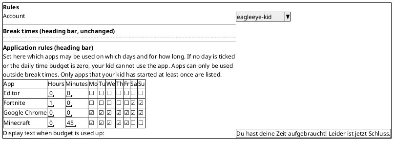
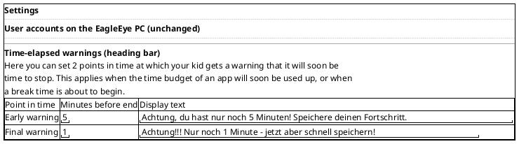
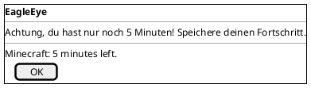
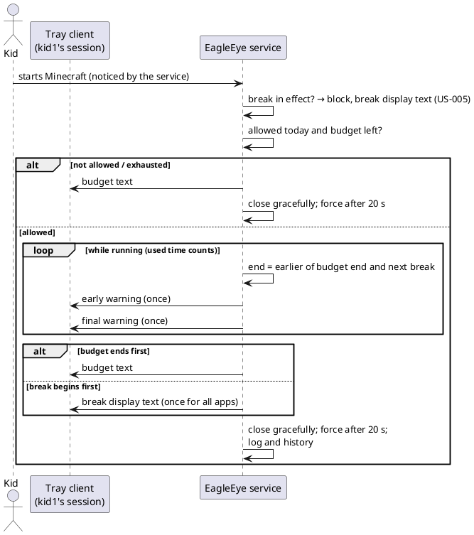

# US-006: App Time Budgets and Time-elapsed Warnings

**Status**: Verified/Closed (closed by Michael, 2026-10-17, "Close as tested, then merge", **without a manual test run**: all 39 ACs are not verified manually; delivered build 0.6.2; see `02_Implementation/docs/testing/US-006/test-report.md`)
**Created**: 2026-10-12
**Approved**: by Michael, 2026-10-12, with his answers to OQ-1 to OQ-19 (changes in OQ-6, OQ-8, OQ-11, OQ-18)
**Component(s)**: EagleEye.Service, EagleEye.TrayClient, EagleEye.ParentApp, EagleEye.Shared
**Platform(s)**: Windows (service and tray client) · ParentApp Windows

---

## User Story

As a **parent**, I want to set for each of my kid's apps on which weekdays it may be used and for how long per day, and I want my kid to be warned twice before an app's time runs out or a break time begins, so that my kid can save its progress and the EagleEye PC then ends the app by itself.

---

## Background

US-004 records which apps each controlled account starts and how long it uses them per day (the Reports page). US-005 added break times: during a break time, app starts are blocked. US-006 is the story Michael announced as "approaching a usage limitation". It adds three things:

1. **Application rules** ("Applikations-Regeln"). A new section on the Rules page lists every app the account has ever started. For each app, the parent sets a **daily time budget** (hours and minutes) and the **weekdays** on which the app may be used. Apps found for the first time are **blocked by default**: their budget is 0:00 and no day is ticked. When an app has no time left today, the service blocks its start and the kid sees a text that the parent sets per account.
2. **Time-elapsed warnings** ("Zeit-Ende Warnungen"). A new section on the Settings page sets two fixed warning levels, **early** and **final**. For each level the parent sets the minutes before the end and a text. The kid sees these warnings before an app's budget runs out and before a break time begins.
3. **Ending running apps.** When an app's budget runs out, or when a break time begins, the service closes the running app gracefully. If it is still open after 20 seconds, the service ends it by force (as in US-005, ADR-006). Break times always win over budgets.

Michael's scope is recorded in `02_Implementation/docs/requirements/user-stories/US-006/input/raw_scope.md`. The mockups are `02_Implementation/docs/requirements/user-stories/US-006/input/new_rules.png` (Rules page) and `02_Implementation/docs/requirements/user-stories/US-006/input/new_settings.png` (Settings page).

All state in the parent app follows ADR-010 (`02_Implementation/docs/architecture/decisions/ADR-010-event-driven-state-propagation.md`). The parent app fetches the data when a page opens and when it (re)connects. The service stores every change and broadcasts it to all connected parent apps. The parent app never polls, and parent apps never exchange data directly.

References: FR-SVC-011, FR-SVC-012, FR-SVC-020 to FR-SVC-025, FR-SVC-032, FR-SVC-044, FR-SVC-047, FR-SVC-053, FR-TRAY-020, FR-TRAY-021, FR-TRAY-022, FR-APP-030, FR-APP-031, FR-APP-040, FR-APP-041, FR-APP-050, FR-APP-051, TC-020 to TC-024, TC-030 to TC-032, TC-040 to TC-042, MU-011, MU-014, NFR-R-011 to NFR-R-013, NFR-U-012, NFR-L-010 to NFR-L-012. The changes to these requirements are listed in the amendment section below.

**Terms used in this story**

- *Service PC*, *account*, *controlled account*: as in US-003 and US-004.
- *App*, *app record*: as in US-004 (Terms, AC-3 to AC-8). An app record identifies one app of one account by its program path (US-004 OQ-2).
- *Start*, *blocked start*, *break time entry*, *in effect*, *display text*: as in US-005. In US-006 the break time's text is called the **break display text**, to tell it apart from the budget text.
- *App rule*: one row of the application rules table. It belongs to one app record and holds the **daily budget** (hours and minutes) and the seven **weekday ticks**.
- *Allowed today*: an app is allowed today when today's weekday is ticked in its app rule **and** its daily budget is greater than 0:00.
- *Used time*: the app's usage of today as US-004 counts it (AC-12 to AC-14 there). It is active time in seconds: the time the app is open while the account's session is in use. It is the same figure the Reports page shows for today.
- *Remaining budget*: the daily budget minus the used time. It is 0 when the app is not allowed today.
- *Budget exhausted*: the remaining budget is 0 or less.
- *Budget text*: the message for the kid when an app is blocked or closed because of its budget. There is one budget text per controlled account ("Anzeige Text wenn Budget aufgebraucht:").
- *Warning levels*: **early warning** ("Frühe Warnung") and **final warning** ("Finale Warnung"). Each level has a number of minutes before the end and a warning text. There are always exactly these two levels.
- *End* (of an app's allowed time): the earlier of (a) the moment the remaining budget reaches 0 and (b) the start of the next break time that will be in effect for the account (OQ-4 covers midnight).
- *Kid dialog*: the topmost dialog of the tray client from US-005 (AC-30 there). It has the title "EagleEye" and an "OK" button. It is not system-modal and closes only with "OK" or Enter.

---

## Product requirement amendment (v1.6, approved with this story)

`02_Implementation/docs/requirements/general-product-requirements.md` gets a v1.6 amendment, approved by Michael together with this story on 2026-10-12 and written into the file.

- **TC-020, FR-APP-040, FR-APP-041** (changed): the budget is configured per app and per account as **one daily budget** (0:00 to 23:59, in hours and minutes) plus one tick per weekday. A ticked day allows the app on that day, up to the budget. An unticked day blocks the app on that day. There are no longer different budgets per weekday (Michael's scope).
- **FR-SVC-011, FR-SVC-020, FR-APP-030, FR-APP-031, §3.1.2, §3.3.3, §4.3 steps 12 and 13, §4.4 step 19** (changed): there is no separate allow-list. The app rule takes its place. The parent configures every app in the account's app inventory (FR-SVC-044). An app is allowed on a day when that day is ticked and its budget is above 0:00. Apps found for the first time are blocked by default (budget 0:00, no day ticked). The list of installed apps (FR-APP-030, FR-SVC-080) and its re-scan (FR-APP-033) are not used for this.
- **FR-SVC-022, TC-032** (made precise): when an app's budget is exhausted, the service closes the app gracefully. If the app has not closed after **20 seconds**, the service ends it by force with all its processes. This is the same sequence as FR-SVC-023 (v1.5).
- **TC-042** (made precise): when a break time begins, the service closes every running app of the account in the same way.
- **TC-030, TC-031, TC-040, TC-041** (changed): there are two fixed warning levels, **early** (default 5 minutes) and **final** (default 1 minute), each with a text set by the parent. Values are whole minutes from 1 to 59, early greater than final; neither level can be switched off. The levels are configured **once for all controlled accounts** (OQ-7) on the Settings page. **The same two levels apply to budget exhaustion and to break times**, so TC-041 ("independently from TC-031") is dropped. "Last warning" becomes "final warning".
- **FR-TRAY-020, FR-TRAY-021** (made precise): warnings and the budget text are shown in the kid dialog (FR-TRAY-022).
- **FR-SVC-024, FR-SVC-032, FR-SVC-047** (made precise): the configuration per account includes the app rules and the budget text. The general configuration of the service includes the two warning levels. Purging an account removes its app rules and budget text.
- **FR-SVC-025** (made precise): the history of blocked starts also records starts blocked by the budget, and it records apps that the service closed because the budget ran out or a break time began. Each record carries the reason (OQ-16).
- **TC-033** (new): a parent change during the day never leaves a running app less than the final-warning minutes. When a change leaves a running app less time than that (budget lowered, today unticked, or a break now in effect or beginning sooner), the app gets a **grace period** of the full final-warning minutes: the final warning is shown at once, and the app is closed when the grace period ends. *(Plan Q-2, 2026-10-12)*
- **FR-APP-052** (made precise, plan Q-1): the default break display text exists in German and English. An unchanged default follows the language of the app that shows it.
- **TC-025** (new): days and budgets follow the local date and time of the service PC. The service detects time-zone and clock changes that affect budgets or the day boundary and logs each as a Warning. No protection against such changes yet (later story).
- **FR-SVC-021** (note): the "configurable timeout, default 30 s" is not built in this story. The timeout stays fixed at 20 s, as in US-005.

---

## Acceptance Criteria

> **Language of UI texts** (NFR-L-010 to NFR-L-012): all UI texts quoted in these criteria and in the mockups are **English examples**. The intended German wording is given in brackets and follows Michael's mockups. The parent app and the tray client show every text of their own, including error messages, in the Windows display language of the user: German (default) or English. The parent's texts (budget text, warning texts, break display text) are **not translated** once the parent has changed them. They are shown exactly as the parent entered them. The **default** budget and warning texts of this story, and from now on the default break display text of US-005, exist in German and English (AC-10, AC-14, OQ-8, plan Q-1). Differences in wording are notes, not Fails (US-002 Decision Q-11).

> **Test setup**: a service PC with the parent's admin account, the standard accounts `kid1` and `kid2` (both under parental control) and `kid3` (not under parental control); EagleEye service and tray client installed; two Windows parent apps A and B paired with the service. `kid1` has already used Notepad ("Editor"), Paint and Calculator ("Rechner") so that they appear on Reports. Short budgets (e.g. 0:03) and small warning levels (e.g. early 2, final 1) keep the tests short. Times are measured with a stopwatch; used time is active time (session unlocked), as in US-004 AC-24.

> **Service log**: entries are checked in the admin-only log folder `%ProgramData%\EagleEye\logs\` (US-003 AC-14), file `EagleEye.Service-NNN.log`.

### A. Application rules section (Rules page)

- [ ] **AC-1**: The Rules page ("Regeln") has a new section below the break times section and its display text. From top to bottom, the section shows:
  - the heading bar "Application rules" ("Applikations-Regeln"), in the style of ISSUE-007, like "Break times";
  - an explanatory text, with line wrap (wording: OQ-8). English example: "Set here which apps may be used on which days and for how long. If no day is ticked or the daily time budget is zero, your kid cannot use the app. Apps can only be used outside break times. Only apps that your kid has started at least once are listed.";
  - the application rules table;
  - the label "Display text when budget is used up:" ("Anzeige Text wenn Budget aufgebraucht:") with the edit box of the budget text.

  The section belongs to the account selected in "Account" ("Konto"). Switching the account changes the table and the budget text.
- [ ] **AC-2**: The table has the columns:
  - "App" ("Applikation"): the app's display name, as on Reports;
  - "Daily time budget" ("Tägliches Zeit-Budget"), as two columns "Hours" ("Stunden") and "Minutes" ("Minuten"), each an input field;
  - one checkbox column per weekday, Monday to Sunday: "Mo", "Tu", "We", "Th", "Fr", "Sa", "Su" ("MO", "DI", "MI", "DO", "FR", "SA", "SO").

  Each row is one app record of the account (OQ-1, OQ-12) and shows the values stored in the service. The rows are sorted alphabetically by display name, ignoring upper and lower case (OQ-15).
- [ ] **AC-3**: The table lists every app record of the selected account (OQ-1). This includes:
  - apps recorded before this story (since US-004);
  - apps whose starts were only ever blocked.

  Windows Explorer ("Windows-Explorer") is never listed, because it is never limited (AC-27). When the account has no app records yet, the table area shows "No apps recorded yet." ("Noch keine Applikationen aufgezeichnet.").
- [ ] **AC-4**: When the kid starts an app for the first time while the Rules page is open for that account, the new row appears within 15 seconds, without any action by the parent (service push, ADR-010). It appears in its place in the alphabetical order.
- [ ] **AC-5**: Every app found for the first time gets the default app rule: budget **0 hours, 0 minutes**, **no weekday ticked**. It is therefore blocked (AC-19). The same default applies to the apps already recorded before this story, when the new version is installed (OQ-2).
- [ ] **AC-6**: The page states of US-005 AC-6 also apply to this section: not connected, no controlled account, and "Loading …" ("Wird geladen …"). The section uses only the standard light and dark colours of the app (FR-APP-083) and the heading bar of ISSUE-007, not the colours of the mockup. All texts, fields and checkboxes are readable and usable in light and dark mode and at 150 % display scaling.

### B. Editing app rules and the budget text

- [ ] **AC-7**: The parent edits all values directly in the table, without a dialog and without a "Save" button:
  - a weekday checkbox is sent to the service when it is clicked;
  - an hours or minutes field is sent when the parent leaves the field or presses Enter.

  Any combination of ticks is valid. All seven days unticked is allowed (unlike break times) and means "blocked every day".
- [ ] **AC-8**: Hours must be a whole number from 0 to 23, and minutes a whole number from 0 to 59. When the parent enters an invalid value and leaves the field, nothing is saved and the field returns to the stored value. Examples: hours "24", "-1", "abc" or empty; minutes "60", "1.5". The app shows "Enter hours between 0 and 23." ("Bitte Stunden zwischen 0 und 23 eingeben.") or "Enter minutes between 0 and 59." ("Bitte Minuten zwischen 0 und 59 eingeben."). The largest budget is therefore 23:59.
- [ ] **AC-9**: A budget of 0 hours 0 minutes is valid. It blocks the app on every day, whatever days are ticked (AC-19).
- [ ] **AC-10**: The budget text is edited in a multi-line edit box with line wrap. It supports emojis like the break display text (US-005 AC-16). It is saved when the parent leaves the box, and before the page or the account selection changes.
  - For an account whose text the parent has never changed, the box shows the default text in the language of the app (OQ-8): German "Du hast deine Zeit aufgebraucht! Leider ist jetzt Schluss." (from the mockup), English "You have used up your time! Sorry, that's it for now." The kid dialog shows an unchanged default in the kid's Windows display language. Once the parent changes the text, it is shown exactly as entered, in every language.
  - The **break display text** of US-005 (AC-15 there) follows the same rule from this story on (plan Q-1): an unchanged default is shown in the language of the app that displays it. German (unchanged, from the US-005 mock): "Hi! Leider haben Deine Eltern eine PC-Pause für diese Uhrzeit eingestellt. Du kannst dieses Programm jetzt nicht verwenden. Tut mir leid. Wie wäre es wenn Du die Zeit nutzt, um ein Buch zu lesen? 😊". English (new): "Hi! Unfortunately, your parents have set a PC break for this time. You can't use this program right now. Sorry. How about using the time to read a book? 😊". A display text the parent has changed stays exactly as entered.
  - The text has at most 500 characters.
  - If the parent leaves the box empty (or with only spaces), the default text is restored and saved (OQ-19).
- [ ] **AC-11**: Every valid change (budget, weekday, budget text) is sent to the service at once. Within 5 seconds the service has stored it. It writes a log entry (level Information) that names the account's user name and the change, e.g. "app rule changed: Minecraft, 0:45, Mo Tu We Th Fr" or "budget text changed". The budget text itself does not have to be logged. The app shows the state the service confirmed.
- [ ] **AC-12**: When the service cannot store a change, the parent app shows "The change could not be saved. Please try again." ("Die Änderung konnte nicht gespeichert werden. Bitte erneut versuchen."), as in US-005 AC-18. The table and the text then return to the state stored in the service.

### C. Time-elapsed warnings section (Settings page)

- [ ] **AC-13**: The Settings page ("Einstellungen") has a new section below "User accounts on the EagleEye PC" ("Benutzerkonten auf dem EagleEye-PC"). From top to bottom, it shows:
  - the heading bar "Time-elapsed warnings" ("Zeit-Ende Warnungen");
  - an explanatory text. English example: "Here you can set 2 points in time at which your kid gets a warning that it will soon be time to stop. This applies when the time budget of an app will soon be used up, or when a break time is about to begin.";
  - a table with the columns "Point in time" ("Zeitpunkt"), "Minutes before end" ("Minuten vor Ende") and "Display text" ("Anzeigetext").

  The table has exactly two rows: "Early warning" ("Frühe Warnung") and "Final warning" ("Finale Warnung"). The labels are fixed. The parent cannot add, delete or rename rows. Minutes and text are editable. The settings apply to all controlled accounts and have no account selection (OQ-7).
- [ ] **AC-14**: Defaults, until the parent changes them:
  - early warning: **5** minutes, text German "Achtung, du hast nur noch 5 Minuten! Speichere deinen Fortschritt." / English "Attention, you only have 5 minutes left! Save your progress.";
  - final warning: **1** minute, text German "Achtung!!! Nur noch 1 Minute – jetzt aber schnell speichern!" / English "Attention!!! Only 1 minute left – save quickly now!".

  The German texts are those of the mockup. As for the budget text (AC-10), an unchanged default text is shown in the language of the parent app, and in the kid dialog in the kid's Windows display language (OQ-8).
- [ ] **AC-15**: Minutes are whole numbers from **1 to 59**, and the early warning must be **greater** than the final warning (OQ-6). Neither level can be switched off. Invalid values are not saved and the field returns to the stored value. Examples: "0", "60", "abc", "2.5", empty; early 3 with final 3 or 4. The app shows "Enter minutes between 1 and 59." ("Bitte Minuten zwischen 1 und 59 eingeben.") or "The final warning must be less minutes before the end than the early warning." ("Die finale Warnung muss weniger Minuten vor dem Ende liegen als die frühe Warnung."). The two warning texts follow the rules of the budget text (AC-10: emojis, 500 characters, an empty text restores the default).
- [ ] **AC-16**: The section follows the save, confirm, error and page-state rules of AC-7, AC-11 and AC-12. Examples of log entries: "warning levels changed: early 5 min, final 1 min" and "early warning text changed".

### D. Several parent apps, accounts, storage

- [ ] **AC-17**: Parent apps A and B are connected at the same time and show the same page (Rules for the same account, or Settings). Every change made in A appears in B within 5 seconds, without any action there and without polling. When both change the same value at about the same time, the last change the service receives wins, and both apps then show the same state.
- [ ] **AC-18**: App rules and budget text are stored per controlled account, identified by the account's Windows identity (as US-005 AC-20):
  - the rules of `kid1` never apply to `kid2`;
  - when an account is unticked or becomes an admin account, its rules are kept but not applied, and they apply again when the account is ticked again;
  - when an account is deleted on the service PC, its rules and budget text are purged within 60 seconds after the service notices the deletion.

  App rules, budget text and warning settings survive a restart of the parent app, a restart of the service, a reboot and a re-install (update) of the service.

### E. Starting an app: budget check

- [ ] **AC-19**: When a controlled account starts an app (US-005 Terms) that is **not allowed today** or whose **budget is exhausted**, the service blocks the start like a break-time block (US-005 AC-22):
  - it detects the start at the latest 10 seconds after it;
  - it closes the app gracefully;
  - if the app has not closed 20 seconds later, it ends the app by force with all its processes;
  - the app is gone at the latest 30 seconds after the start.

  The kid dialog shows the account's **budget text**. "Not allowed today" means today's weekday is not ticked, or the budget is 0:00. Examples:
  - Calculator with the default rule is blocked;
  - Paint with 0:30 and only Saturday ticked is blocked on a Monday;
  - Notepad with 0:03, all days ticked, after 3 minutes of use today is blocked.

  A blocked start adds no used time and no usage-history instance (as US-005 AC-24).
- [ ] **AC-20**: An app that is allowed today and has remaining budget starts normally and counts used time (US-004). Example: Notepad with 0:03 and today ticked starts and stays open.
- [ ] **AC-21**: **Break times win.** When a start happens while a break time is in effect, it is blocked as in US-005, whatever the app's budget is, and the kid dialog shows the **break display text**, not the budget text. This holds even for an app with 23:59 and all days ticked (OQ-13).
- [ ] **AC-22**: When the remaining budget at the start is already at or below a warning level, the kid dialog shows the matching warning when the app starts, at the latest 10 seconds after the start. This is the final warning if the remaining budget is at or below the final level, otherwise the early warning (OQ-5). Example with early 5 / final 1: Notepad with 0:03 and nothing used today shows the early warning on start, then the final warning when 1 minute remains.

### F. Running apps: warnings and the end of the budget

- [ ] **AC-23**: While an app is running, its remaining budget counts down with its used time. The countdown pauses while the session is locked, switched away, or asleep (US-004 AC-12). Several windows and processes of the same app count once (US-004 AC-6). Each app record has its own budget (OQ-12). The day, and with it the budget, resets at local midnight (TC-024, US-004 AC-14). Unused time does not carry over (TC-023).
- [ ] **AC-24**: When an app's remaining budget reaches the **early** warning level, the kid dialog shows the early warning text, at the latest 10 seconds after that moment. When it reaches the **final** level, it shows the final warning text. Each level is shown at most once per app and day (OQ-5, OQ-9); the only exception is the final warning that starts a grace period after a parent change (AC-32). This also holds when the parent raises the budget later that day: a level already shown is not shown again before the new end (plan Q-5). Example with Notepad 0:03, early 2 / final 1: the early warning appears after 1 minute of use (2 left), the final warning after 2 minutes (1 left).
- [ ] **AC-25**: When an app's budget is exhausted while it is running, the service closes it:
  - the graceful close request comes at the latest 10 seconds after the budget reached 0;
  - if the app has not closed 20 seconds after the request, the service ends it by force with all its processes (ADR-006);
  - the app is gone at the latest 30 seconds after the budget reached 0.

  The kid dialog shows the budget text (OQ-10). The time until the app is gone counts as used time, so Reports may show up to about 30 seconds more than the budget (OQ-3). A new start of the app on the same day is blocked (AC-19).
- [ ] **AC-26**: Budgets of one account never affect another account. Apps of `kid3` (not controlled) and of admin accounts are never warned, blocked or closed (MU-014).
- [ ] **AC-27**: The exemptions of US-005 AC-23 also apply to this story. The following are never warned, blocked or closed: background and Windows processes, the Windows shell, File Explorer windows ("Windows Explorer"), and the EagleEye tray client. The kid can always use the Start menu, lock the PC, sign out and shut down.

### G. Break times: warnings and ending running apps

- [ ] **AC-28**: For each break time entry that is about to come into effect for a controlled account, the kid dialog shows the **early** warning text when the break begins in exactly the early number of minutes, and the **final** warning text when it begins in the final number of minutes. Each warning appears at the latest 10 seconds after that moment. This happens only if at least one app of the account (other than the exemptions of AC-27) is running at that moment. Example: entry 20:00–23:59 active today, early 5 / final 1, Paint running: early warning at 19:55, final warning at 19:59.
- [ ] **AC-29**: When a break time comes into effect, the service closes every running app of the account (TC-042), except the exemptions of AC-27:
  - the graceful close request comes at the latest 10 seconds after the break begins;
  - the service ends an app by force after 20 seconds with all its processes;
  - every app is gone at the latest 30 seconds after the break begins.

  The kid dialog shows the **break display text** once, not once per app. Apps that were started before the break no longer keep running; this replaces US-005 AC-25 (OQ-14).
- [ ] **AC-30**: An app started shortly before a break time (fewer minutes before it than a warning level) shows the matching warning when it starts, as in AC-22. Example: Paint started at 19:58 with final 1 shows the early warning, then the final warning at 19:59.
- [ ] **AC-31**: **One end, one set of warnings.** When an app's budget would run out after the next break begins, only the break warnings are shown for it, and it is closed at the break. When the budget runs out first, only that app's budget warnings are shown. No warning is shown twice because of the same end (OQ-13).

### H. Changes during the day

- [ ] **AC-32**: A change of an app rule takes effect for that app within 5 seconds after the parent app shows the confirmed change, also while the app is running (OQ-11). **A parent change never leaves a running app less than the final-warning minutes** (plan Q-2):
  - **Grace period.** A change can move the end of a running app earlier: the app is no longer allowed today, or the new budget leaves no time, or it leaves less time than the final-warning minutes (AC-14, default 1 minute). Then the app gets a **grace period** of the full final-warning minutes, counted from the moment the change takes effect.
    - The kid dialog shows the **final warning** at once, at the latest 10 seconds after the change takes effect.
    - When the grace period ends, the app is closed as in AC-25: graceful close request at the latest 10 seconds after the end of the grace period, force after 20 seconds, gone at the latest 30 seconds after it. The kid dialog shows the budget text.
    - The used time during the grace period counts as usage.
    - Examples with final 1:
      - Notepad is running with 2 minutes left, and the parent sets 0:00. Within 5 seconds the final warning appears, and about 1 minute later Notepad is closed with the budget text.
      - Notepad is running with 3 minutes left, and the parent lowers the budget so that 20 seconds are left. The kid still gets 1 minute, not 20 seconds.
  - If the new remaining budget is at least the final-warning minutes but at or below the early level, the early warning is shown at once (if not yet shown today, AC-24). The app is closed when the budget is used up (AC-24, AC-25).
  - If the app is not running, the change applies to its next start (AC-19, AC-20), with no grace period. A start, or a service restart, never gets a grace period.
  - A higher budget, or ticking today, lets the kid start the app again. A higher budget does not bring back warnings already shown that day (AC-24, plan Q-5).
- [ ] **AC-33**: A change of the break time entries can put a break into effect **now**, or make one begin in less than the final-warning minutes. Then every running app of the account (except the exemptions of AC-27) gets a **grace period** of the full final-warning minutes, counted from the moment the change takes effect (plan Q-2).
  - The kid dialog shows the final warning at once, once and not per app.
  - When the grace period ends, the apps are closed as in AC-29, with the break display text.
  - New app starts are blocked from the moment the break is in effect (AC-21), also during the grace period. Only the apps already running get the grace period.

  A change that makes a break begin later than the final-warning minutes, but within the early level, shows the early warning at once (AC-28). A change of the warning levels never starts a grace period. It applies to warnings that have not yet been shown and to grace periods that start after the change.

### I. Kid dialog, tray client, records

- [ ] **AC-34**: Warnings, the budget text and the break display text all use the kid dialog of US-005 (topmost; closes only with "OK" or Enter; other windows stay usable; exclusive full-screen games may cover it).
  - Only **one** kid dialog is open per session. A newer message replaces the text of a dialog that is still open, and messages are never stacked (OQ-9).
  - Below the parent's text, the dialog shows a line of EagleEye's own text, in the kid's Windows language, that names the reason (OQ-9). English examples: "Notepad: 2 minutes left.", "Break time begins at 20:00.", "Notepad: time budget used up." For a grace period after a parent change (AC-32, AC-33), the line always names the full final-warning minutes, also when less time was left before the change: "Notepad: your parents changed the rules. Notepad closes in 1 minute." and "Your parents set a break time. All apps close in 1 minute."
- [ ] **AC-35**: When the tray client is not running or not connected, the service still blocks and closes apps as in AC-19, AC-25 and AC-29. No warning or message is shown later, and the log entry says that the message was not shown (as US-005 AC-33, NFR-R-012).
- [ ] **AC-36**: Budgets, warnings and break-start closes are enforced without a parent app, after a service restart and after a reboot (NFR-R-011). Used time is kept across service restarts (NFR-R-013), so a restart does not refill a budget.
- [ ] **AC-37**: The service writes a log entry (level Information) for each:
  - warning shown (account, app or break time, level, minutes left), and each grace period started by a parent change (AC-32, AC-33);
  - start blocked by budget (account, app, reason "not allowed today" or "budget used up");
  - app closed because its budget ran out or a break began (account, app, reason, outcome "closed gracefully" or "terminated by force after 20 s", message shown yes/no).

  Blocked starts and enforced closes are also stored in the history of blocked starts of US-005 (AC-35 there) with their reason, kept 90 days and purged with the account (OQ-16). The history is not shown in the parent app.
- [ ] **AC-38**: Starting allowed apps is not noticeably slower than before this story, and the service's load stays within US-004 AC-25 (NFR-P-010).

### J. Time-zone and clock changes

- [ ] **AC-39**: Days and budgets follow the local date and time of the service PC (AC-23). The service **detects** every change of the time zone, and every clock change it can detect, that affects budgets or the day boundary (OQ-18). It does so within 5 seconds. Examples: the local date moves forward or back, so that another day's budget applies; or the local time moves across the start or end of a break time.
  - The service writes each such change to its log as a **Warning**. The Warning names the old and new time zone (or clock time), the old and new local date, and the controlled account in use if known. English example: "The time zone of the PC changed from W. Europe Standard Time to Tokyo Standard Time; the local date changed from 10/12/2026 to 10/13/2026; daily budgets now use the new day."
  - The service does **not** prevent or undo the change, and budgets follow the new local date (no hardening; later story).
  - The findings of US-005 AC-37 are still stored as before.

  *Verification*: as an administrator, change the time zone so that the local date changes while `kid1` uses an app. The Warning appears in the service log.

### Change Log

| Date | Change | Source |
|---|---|---|
| 2026-10-12 | Story created; product requirements v1.6 amendment proposed; OQ-1 to OQ-19 open | Michael's scope and mockups (`US-006/input/`), written by PRO |
| 2026-10-12 | Story approved; OQ-1 to OQ-19 answered (proposals accepted except OQ-6, OQ-8, OQ-11, OQ-18); requirements v1.6 approved and applied. Changed: AC-10 and AC-14 (German and English default texts), AC-15 (range 1..59, early > final, no switching off), AC-24 (exception for the grace period), AC-32 and AC-33 (grace period of the final-warning minutes instead of closing at once), AC-34 (info lines for the grace period), AC-37 (grace periods logged); added: AC-39 (time-zone and clock changes logged as Warning), TC-025, TC-033 | Michael (via the Orchestrator), written by PRO |
| 2026-10-12 | Implementation plan approved (`US-006/implementation-plan.md`) with answers Q-1 to Q-5 (ARC's proposals accepted); status `Analyzed`. Changed: AC-10 (English default of the break display text, Q-1), AC-24 (a raised budget does not bring back warnings already shown, Q-5), AC-32 and AC-33 (a parent change always leaves at least the final-warning minutes, Q-2), AC-34 (the grace info line names the full final-warning minutes); TC-033 and FR-APP-052 in requirements v1.6 adjusted; Related: TC-005-26 rerun in the US-006 test run (Q-4). Q-3 (time-change Warnings log-only, one finding per change) needs no AC change | Michael (via the Orchestrator), written by PRO |
| 2026-10-12 | Implemented as version 0.6.0 (installers `EagleEye-Setup-0.6.0.exe`, `EagleEye-ParentApp-Setup-0.6.0.exe`); status `Implemented`. Report: `US-006/implementation-report.md` | DEV |
| 2026-10-12 to 2026-10-17 | Fixes during live use: ISSUE-008 (0.6.1), ISSUE-009 (0.6.2); delivered build **0.6.2** (`EagleEye-Setup-0.6.2.exe`, `EagleEye-ParentApp-Setup-0.6.2.exe`) | DEV, TES |
| 2026-10-17 | Story closed by Michael without a manual test run ("Close as tested, then merge"): test run 01 not executed, **all 39 ACs not verified manually** (they rest on DEV's unit tests and smoke check); status `Verified/Closed`; see `02_Implementation/docs/testing/US-006/test-report.md` (follow-ups F-1 to F-8) | Michael |

---

## UI / Interaction Notes

### Rules — Application rules section (AC-1 to AC-10)

The break times section above it is unchanged (US-005). "☑" / "☐" stand for checkboxes, quoted numbers for input fields.

Google Chrome is ticked every day but has 0:00, so it is blocked (AC-9). Editor has the default rule (AC-5).

### Settings — Time-elapsed warnings section (AC-13 to AC-15)

### Kid dialog — warning (AC-24, AC-34)

### Flow overview — one app, budget and break

---

## Out of Scope

- **US-005 plan Q-2 (time-zone hardening)**: not covered. Michael's scope does not mention it. Break times, budgets and the midnight reset keep using the local time of the service PC. The service keeps logging and storing time-zone and clock changes (US-005 AC-37). A kid who changes the time zone can still move out of a break time, or into a new day with a fresh budget. The service detects and logs such changes as Warnings (AC-39, OQ-18), but does not prevent them. Removing the time-zone right from *Users* remains a possible later hardening.
- **US-005 plan Q-3 (process-based enforcement)**: not covered. Budgets and blocks act on *apps* as defined by US-004: programs with a window of their own. Programs without an app window (console tools, scripts) are not limited, and the window-trick bypass (TI-8) stays an accepted risk. Because new apps are blocked by default (AC-5), the story is "deny by default" at the app level.
- Different budgets per weekday (one budget per app; days only allow or block, see the v1.6 amendment).
- A remaining-time display in the tray client or a topmost overlay (FR-TRAY-011, FR-TRAY-030).
- Showing "used vs. budget" on Reports (FR-APP-061). Events to the parent app (FR-APP-070), e.g. "budget used up". Showing the history of blocked starts.
- Bonus time, extending a budget on request of the kid, carry-over (§10).
- Per-account warning levels, more than two levels, or renaming the levels (OQ-7, Michael's scope).
- A placeholder for the minutes in the warning texts (OQ-8).
- Budgets for groups of apps or a total daily screen-time budget.
- Removing or hiding app records from the table, or merging two records of the same app (OQ-12).
- A configurable graceful-close timeout (FR-SVC-021). It stays fixed at 20 s.
- Parent app for Android, iOS and macOS. This story covers the **Windows** parent app only (built and tested on the Windows Developer Machine). The new sections must not block the later mobile layout (FR-APP-080, FR-APP-082).
- Protection against a kid who pairs their own parent app and raises their own budgets (accepted risk, US-005 OQ-15).

---

## Open Questions (resolved, answered by Michael, 2026-10-12)

All 19 questions are **resolved**. Michael accepted the proposals except in OQ-6, OQ-8, OQ-11 and OQ-18, where his answer changed the ACs (see the Change Log). His answers are kept as he wrote them. The "Resolution" line in each answer names the resulting ACs.

| ID | Question | Proposed answer | Answer |
|---|---|---|---|
| OQ-1 | **Which apps are listed?** The scope says "each application that ever had an entry under Reports". A blocked start creates no usage (US-005 AC-24), so a new app that is blocked from its first start would never reach Reports, and the parent could never allow it. | List **every app record of the account's inventory** (US-004 AC-7). This includes apps recorded before this story (since US-004) and apps whose starts were only ever blocked (a blocked start creates the app record). Windows Explorer is not listed, because it is never limited (AC-27). | Yes, apps that are on the servers inventory. — **Resolved** (Michael, 2026-10-12): proposal accepted, ACs unchanged. |
| OQ-2 | **Apps already known when the new version is installed.** If the default "0:00, no day ticked" also applies to them, every app the kid used before is blocked right after the update, until the parent configures it. | **Yes, apply the default to them too** (AC-5), as the scope says: "new applications are blocked by default". This keeps the deny-by-default rule simple. The parent should configure the rules right after the update. TES puts this into the test steps. *Alternative*: existing apps start as "23:59, all days ticked" (practically unlimited), and only apps found after the update are blocked. | Yes, keept the all blocked, no problem. — **Resolved** (Michael, 2026-10-12): proposal accepted, ACs unchanged. |
| OQ-3 | **What counts as "used time", and when does it reset?** | The **US-004 usage of today** for that app record, as shown on Reports: active time (open while the session is in use; locked or switched-away time does not count), several windows counted once. It resets at **local midnight**, with no carry-over (AC-23). The up to 30 s of the close sequence count as used time (AC-25). Blocked starts count nothing (AC-19). | yes, keep that definition. It should be the same as how we count usage for the reporting. — **Resolved** (Michael, 2026-10-12): proposal accepted, ACs unchanged. |
| OQ-4 | **Running across midnight.** An app is running at 23:58, and tomorrow is not ticked or has 0:00. | **Midnight counts as an end.** If the app is not allowed on the new day, the warnings come before midnight, and the app is closed at midnight like an exhausted budget, with the budget text. If the new day allows it, the new day's budget starts at midnight and the app keeps running. | Agreed. — **Resolved** (Michael, 2026-10-12): proposal accepted, ACs unchanged. |
| OQ-5 | **A warning level larger than what is left.** E.g. the budget is 3 min and the early warning is 5 min, or the app is started at 19:58 before a 20:00 break. | On start, or when a change puts the remaining time at or below a level, show the **matching warning at once**: the final warning if at or below the final level, otherwise the early warning. Then show the final warning when that level is reached (AC-22, AC-30). Each level is shown **at most once per app and day** (for budgets) or **once per break** (for break times). | yes, agreed. — **Resolved** (Michael, 2026-10-12): proposal accepted, ACs unchanged. |
| OQ-6 | **Validating the two levels.** The scope gives no range and no rule between them. May a level be 0 (switched off)? | Whole minutes **1 to 60**; **final < early** (AC-15). No switching off: the two levels are fixed (Michael's scope). | defaults should be early: 5 and final: 1 minute. Full minutes only, range 1..59. Warning must be greater than final. No switching off. — **Resolved** (Michael, 2026-10-12): changed: range 1..59, early > final, no switching off (AC-15). |
| OQ-7 | **Per account or global?** The mockup puts the warnings on the Settings page, which has no account selection. | **One setting for all controlled accounts** (global for the service PC), as in the mockup. The budget text stays **per account** on the Rules page, like the break display text. | Yes, warning settings are global for all accounts. — **Resolved** (Michael, 2026-10-12): proposal accepted, ACs unchanged. |
| OQ-8 | **Default values and texts.** | Levels **5 and 1 minutes** (TC-030, TC-040, mockup). Default texts **from the mockups, in German, also in an English parent app**, like US-005 OQ-14: budget text "Du hast deine Zeit aufgebraucht! Leider ist jetzt Schluss."; early "Achtung, du hast nur noch 5 Minuten! Speichere deinen Fortschritt."; final "Achtung!!! Nur noch 1 Minute – jetzt aber schnell speichern!". The default warning texts contain the numbers 5 and 1. They are **not** updated when the parent changes the minutes (no placeholder); the info line of AC-34 always shows the real minutes. **Explanatory texts** of the two sections: Michael's German texts, with small spelling fixes on the Rules page ("welche Applikationen … dürfen", "Zeitbudget", "mindestens"). The new texts use "du", while the existing Settings text uses "Sie" ("Markieren Sie …"); we keep Michael's "du" wording as is. | Keep the texts as proposed, they match the default vaulues. Parents are free to change it. Just also supply an english version if the app is installed in english — **Resolved** (Michael, 2026-10-12): changed: default texts in German and English, following the language of the app; English texts in AC-10 and AC-14. |
| OQ-9 | **What does the kid dialog show, and what if several messages come at once?** The parent's warning text does not say which app is meant. | Use the US-005 kid dialog (OK/Enter). Below the parent's text, add **one line of EagleEye text** with the reason, in the kid's language: "Notepad: 2 minutes left.", "Break time begins at 20:00.", "Notepad: time budget used up." (AC-34). **One dialog per session**: a newer message replaces the text of an open dialog, so a final warning is never lost behind an early one. | Agree. — **Resolved** (Michael, 2026-10-12): proposal accepted, ACs unchanged. |
| OQ-10 | **Message when a running app is closed.** The scope names the budget text only for blocked starts. | When the budget runs out: show the **budget text** (AC-25). When a break begins: show the **break display text**, once for all closed apps (AC-29). | agree. — **Resolved** (Michael, 2026-10-12): proposal accepted, ACs unchanged. |
| OQ-11 | **Changes during the day** while apps run: budget lowered to or below the used time, today unticked, a break entry added that is in effect now. | Takes effect **within 5 s**. If nothing is left: the app is **closed at once** (graceful, then force) with the budget text (or break display text), **without warnings first**: this is the parent's explicit decision. If time is left but below a level: the matching warning at once (AC-32, AC-33). | In this case, allow a grace period of "final warning" setting time in minutes and show the final warning to the kid. Then after the final warning time, close the application. — **Resolved** (Michael, 2026-10-12): changed: grace period of the final-warning minutes with the final warning at once, then close (AC-32, AC-33, AC-34, AC-37). |
| OQ-12 | **Several instances, and two records of the same app.** US-004 identifies an app by its program path. An app that installs each update into a new folder gets a new record, and so a new, blocked row. | The budget belongs to the **app record**. All windows and processes of that app share it and are closed together. Two records with the same display name are **two rows with their own rules**. The row shows the program path as a hint (e.g. a tooltip) so the parent can tell them apart. Merging records is a later story. | agree. — **Resolved** (Michael, 2026-10-12): proposal accepted, ACs unchanged. |
| OQ-13 | **Break time and budget together.** | **Break times always win**: during a break every start is blocked with the break display text (AC-21). For a running app, the **earlier end counts** (budget end or break start), and only its warnings are shown (AC-31). Break warnings are shown once per session (not per app), and budget warnings once per app. | agree. — **Resolved** (Michael, 2026-10-12): proposal accepted, ACs unchanged. |
| OQ-14 | **Apps already running when a break begins** (US-005 clarification 1: "next story"). The raw scope only implies it ("same mechanism when a break time is approaching"). | **Included**: warnings before the break, then all running apps are closed at the break start (AC-28, AC-29, TC-042). This replaces US-005 AC-25. | yes, agree. — **Resolved** (Michael, 2026-10-12): proposal accepted, ACs unchanged. |
| OQ-15 | **Row order and live updates.** The mockup order is not alphabetical. | Sorted **alphabetically** by display name. New apps appear **live** (within 15 s) while the page is open (AC-2, AC-4). | yes, agree. — **Resolved** (Michael, 2026-10-12): proposal accepted, ACs unchanged. |
| OQ-16 | **Records of budget blocks and closes.** | Log entries for warnings, blocks and closes, plus records in the **history of blocked starts** (extended by a reason, and by enforced closes of running apps). The records are kept 90 days, purged with the account, and **not shown** in the parent app (AC-37). | yes, agree. — **Resolved** (Michael, 2026-10-12): proposal accepted, ACs unchanged. |
| OQ-17 | **Timing bounds.** | Warning: at the latest **10 s** after the level is reached. Close request: at the latest **10 s** after the budget reaches 0 or the break begins. Force after **20 s**. Gone at the latest **30 s** after the end. These are the US-005 bounds. | yes, agree. — **Resolved** (Michael, 2026-10-12): proposal accepted, ACs unchanged. |
| OQ-18 | **Time-zone and clock changes** (US-005 plan Q-2) now also affect budgets: a kid could move past midnight and get a fresh budget. | Not covered (not in Michael's scope). Keep the US-005 behaviour: local time, changes logged and stored as findings. Hardening is a separate story (Out of Scope). | The server should be able to detect these cases but onyl log them as warning today. We will deal with this in a later story. — **Resolved** (Michael, 2026-10-12): changed: detection and Warning log entry added (AC-39, TC-025); no hardening. |
| OQ-19 | **Text limits.** | The budget text and the warning texts follow US-005 OQ-8: at most **500 characters**, line breaks and emojis allowed, and an **empty text restores the default** (AC-10, AC-15). | 500, yes. — **Resolved** (Michael, 2026-10-12): proposal accepted, ACs unchanged. |

---

## Related

- Prerequisite stories: US-001 (service, tray client, installer), US-002 (Windows parent app, pairing), US-003 (accounts under parental control), US-004 (app inventory, usage, Reports), US-005 (Rules page, break times, kid dialog, history of blocked starts)
- Input: `02_Implementation/docs/requirements/user-stories/US-006/input/raw_scope.md`, `02_Implementation/docs/requirements/user-stories/US-006/input/new_rules.png`, `02_Implementation/docs/requirements/user-stories/US-006/input/new_settings.png`
- General product requirements: v1.6 amendment, approved by Michael together with this story on 2026-10-12 and applied (new: FR-APP-053 budget text, FR-APP-054 warning levels, TC-025, TC-033)
- Architecture: ADR-005 (ignore list), ADR-006 (graceful-then-force termination), ADR-010 (event-driven state propagation), ADR-011 (session agent)
- Open points from US-005: plan Q-2 and Q-3 (see Out of Scope). Agent-token check TC-005-26: TES reruns it in the US-006 test run (plan Q-4), because graceful closes of running apps depend on it
- Follow-ups for PRO from `02_Implementation/docs/testing/US-006/test-report.md` §6 (not yet scheduled):
  - **F-2**: a focused live enforcement run against 0.6.2 (test-run-02, TC-006-12 to -26 and others), or the same cases in the next story that touches enforcement.
  - **F-5**: update the US-002 docs (user story AC-30, Q-3, and the architecture docs) for the ISSUE-009 local "forget pairing" (implementation report D-19). Recorded here only; the US-002 docs are not changed yet.
- Implementation Plan: `US-006/implementation-plan.md` (added by ARC)
- Issues: `US-006/issues/` (added by TES)
- Manual tests: `docs/testing/US-006/` (added by TES)
