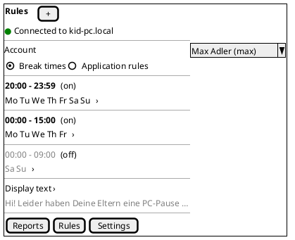
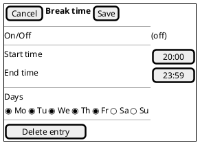
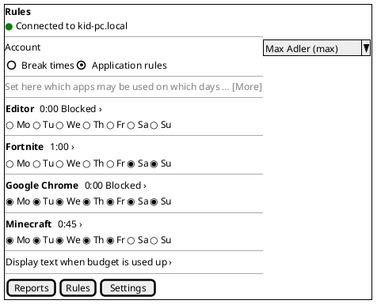
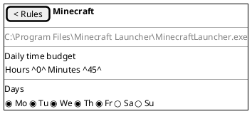

# Deferred to US-008: iPhone Parent App — Rules Page

**Status**: Parked input for **US-008**. This is not a user story yet.
**Origin**: part b of US-007 as approved by Michael on 2026-10-17, together with his decision to split (US-007 OQ-1: "yes, do the split as suggested.").
**Parked**: 2026-10-17, by PRO
**Use**: when US-007 is merged into `main`, PRO creates the branch `feature/US-008-<short-title>` from `main` and writes `02_Implementation/docs/requirements/user-stories/US-008/user-story.md` from this file. Michael already approved the content below as part of US-007. PRO renumbers the ACs and re-checks them against the US-007 implementation as delivered (tab bar, edit patterns, saving rules).

AC numbers below are the **original US-007 numbers** (before the split). References to "AC-41" (saving on touch), "AC-47" (weekday selector) etc. are to these original numbers. In US-007 after the split, AC-1 to AC-41 kept their numbers.

---

## What US-008 adds

The **Rules** page of the iPhone app: account selection, break times with the break display text, and application rules with the budget text. It has the same functions as the Windows app 0.6.2 (US-005, US-006), with portrait layouts. US-007 ships the iPhone app **without** a Rules tab (US-007 AC-42). US-008 adds the tab **between Reports and Settings**, giving the order Reports, Rules, Settings (US-007 OQ-6).

Rules that US-007 already sets and that US-008 has to follow: portrait only, iOS-native look, touch targets of at least 44 × 44 points, safe areas, light and dark mode, Dynamic Type, the number pad with a Done key, saving on touch (US-007 AC-41), pending edits sent before the app goes to the background (US-007 AC-32), refresh on return to the foreground (US-007 AC-33), and the Simulator checks on the iPhone SE size by DEV (US-007 AC-16).

---

## Acceptance criteria (original US-007 numbering)

### F. Rules page: account and break times

- [ ] **AC-42**: The Rules page shows at the top the account selection "Account" ("Konto"), an iOS menu or picker with the controlled accounts (names and order as US-004 AC-17; the first account is selected when the page opens). Below it, a **segmented control** switches between "Break times" ("Ruhezeiten") and "Application rules" ("Applikations-Regeln") (OQ-16). The states "No data available", "No accounts under parental control. Select accounts under Settings." and "Loading …" are shown as in US-005 AC-6.
- [ ] **AC-43**: "Break times" shows the entries of the selected account as a **list of rows** in creation order (US-005 OQ-11), one row per entry, without horizontal scrolling. Each row shows: the time range in 24-hour format (e.g. "20:00 – 23:59"); the weekdays as a compact line of the ticked days (e.g. "Mo Tu We Th Fr", German "MO DI MI DO FR"; when all seven are ticked, all seven days are listed); and an iOS switch for On/Off on the right. An entry that is off is shown dimmed. An account without entries shows "No break times defined." ("Keine Ruhezeiten festgelegt.").
- [ ] **AC-44**: Tapping the On/Off switch in a row saves it at once (AC-41). Tapping the rest of a row opens the **edit view** of that entry (AC-46).
- [ ] **AC-45**: A "+" button in the page's title bar (English label for VoiceOver: "Add new entry", "Eintrag hinzufügen") opens the edit view for a **new** entry, pre-set with the defaults of US-005 AC-7: Off, 20:00, 23:59, all seven days. The entry is created only when the parent taps "Save" ("Sichern"); "Cancel" creates nothing (OQ-17). At 20 entries the "+" button is disabled (US-005 OQ-8).
- [ ] **AC-46**: The **edit view** of a break time entry shows, from top to bottom: an On/Off switch; "Start time" ("Start-Zeit") and "End time" ("End-Zeit"), each set with the iOS time picker in 24-hour format, in steps of one minute; the **weekday selector** (AC-47); and, for an existing entry, the destructive button "Delete entry" ("Eintrag löschen"). The title bar has "Cancel" ("Abbrechen") and "Save" ("Sichern"). "Save" stores the whole entry at once and closes the view; "Cancel" discards the changes (OQ-17).
- [ ] **AC-47**: The **weekday selector** is one row of seven round or rounded buttons, Monday to Sunday, labelled "Mo", "Tu", "We", "Th", "Fr", "Sa", "Su" ("MO", "DI", "MI", "DO", "FR", "SA", "SO"), each at least 44 × 44 points. A ticked day is filled with the accent colour; an unticked day is outlined. It fits in one row on a 375-point-wide screen. The week always starts on Monday, whatever the iPhone's region. With VoiceOver, each button reads the full day name and "selected" / "not selected". The same selector is used for application rules (AC-51).
- [ ] **AC-48**: On "Save", the entry is validated as a whole (start and end together, unlike the field-by-field check on Windows). The end time must be later than the start time (23:59 means until midnight, US-005 AC-21), and at least one day must be ticked. Otherwise nothing is saved, the edit view stays open, and the app shows the messages of US-005 AC-10 and AC-11 ("The end time must be later than the start time.", "Select at least one day."). Times outside 00:00 to 23:59 cannot be entered.
- [ ] **AC-49**: **Deleting**: swiping a row to the left shows "Delete" ("Löschen"). Tapping it deletes the entry at once (iOS list behaviour, like the trash can on Windows). "Delete entry" in the edit view asks for confirmation (iOS action sheet), then deletes the entry and closes the view. When another parent app deletes the entry while its edit view is open on the iPhone, "Save" fails with "The change could not be saved. Please try again.", the view closes, and the entry is gone from the list. When another parent app changes the entry while its edit view is open, "Save" overwrites it (last write wins, US-005 AC-19).
- [ ] **AC-50**: Below the list, the row "Display text" ("Anzeige Text") shows the first lines of the account's break display text. Tapping it opens a full-screen text editor with the text, line wrap and the iOS emoji keyboard. Saving follows AC-41 (closing the editor saves). The text has at most 500 characters, an empty text restores the default, and the default follows the app's language (US-005 AC-15/16, US-006 AC-10, ADR-016).

### G. Rules page: application rules

- [ ] **AC-51**: "Application rules" shows the explanatory text of US-006 AC-1, shortened to two or three lines with "More" ("Mehr") to expand (OQ-18). Below it, one row per app record of the selected account, sorted by display name as in US-006 AC-2/AC-3 (Windows Explorer is never listed; "No apps recorded yet." when the list is empty). Each row has **two lines**:
  - line 1: the app's display name (wrapping if long) and, on the right, the daily budget as "H:MM" (e.g. "0:45", "1:00");
  - line 2: the **weekday selector** of AC-47, which can be tapped directly in the row.

  An app that is not allowed on any day (budget 0:00 or no day ticked) shows the label "Blocked" ("Gesperrt") next to its budget, so the parent sees blocked apps at a glance.
- [ ] **AC-52**: Tapping a weekday in a row saves it at once (AC-41). All seven days unticked is allowed (US-006 AC-7). Tapping the budget (or the app name) opens the **edit view** of the app rule, which shows:
  - the display name;
  - the **program path** in small text (the Windows tooltip, US-006 OQ-12), so two apps with the same name can be told apart;
  - the daily budget, set with an iOS picker of hours (0..23) and minutes (0..59);
  - the weekday selector.

  Budget and days changed in the edit view are saved at once, when the picker is closed or a day is tapped. There is no "Save" button, as on Windows (OQ-17). Invalid budgets cannot be entered; 0:00 is valid (US-006 AC-8/AC-9).
- [ ] **AC-53**: An app found for the first time appears in the list with the default rule (0:00, no day, "Blocked") within 15 seconds while the page is open (US-006 AC-4, AC-5). It appears in its alphabetical place, without the list jumping away from what the parent is editing.
- [ ] **AC-54**: Below the list, the row "Display text when budget is used up" ("Anzeige Text wenn Budget aufgebraucht") opens the budget text editor, with the behaviour of AC-50 and US-006 AC-10.

### Rules part of AC-57 (coexistence)

- [ ] **AC-57 (Rules)**: Every change made in the iPhone app's Rules page (break times, display text, app rules, budget text) appears in a connected Windows app on the same page within 5 seconds. Every change made in the Windows app's Rules page appears in the iPhone app (while it is in the foreground) within 5 seconds, without any action there and without polling. When both apps change the same value at about the same time, the last change the service receives wins, and both apps then show the same state (US-005 AC-19, US-006 AC-17).
- **Background example** (from original AC-34): a break time added in the Windows app while the iPhone app is in the background is shown on the iPhone's Rules page after the app returns (US-007 AC-33).

---

## Layout patterns (Rules rows of the US-007 pattern table)

| Windows (desktop, wide) | iPhone (portrait) |
|---|---|
| Break times table (delete, On/Off, start, end, 7 days) | List rows "20:00 – 23:59 / Mo Tu We Th Fr / switch"; edit view with time pickers, weekday selector, Cancel/Save; swipe to delete |
| Application rules table (app, hours, minutes, 7 days) | Two-line rows: name + budget + "Blocked"; weekday selector in the row; edit view with hours/minutes picker and program path |
| Typed time "HH:MM", saved when leaving the field | iOS time picker (24 h); no invalid input possible |
| Typed hours / minutes | iOS picker wheels 0..23 / 0..59 |
| Display text / budget text edit box beside the table | Row with text preview → full-screen editor |
| Tooltip (program path) | Small text in the edit view |

### Rules — break times list (AC-42 to AC-44, AC-49, AC-50)

Swipe a row to the left for "Delete". "+" opens the edit view for a new entry.

### Rules — break time edit view (AC-45 to AC-48)

### Rules — application rules list (AC-51 to AC-54)

### Rules — app rule edit view (AC-52)

---

## Decisions that apply to US-008 (from the US-007 open questions, answered by Michael, 2026-10-17)

| ID | Question | Proposed answer | Answer |
|---|---|---|---|
| OQ-6 | Tab order | Reports, **Rules**, Settings. | yes, ok! |
| OQ-15 | Number pad or picker | Number pad with a Done key for the warning minutes; **times and budgets use pickers** (AC-46, AC-52). | number pad is ok. |
| OQ-16 | Break times and application rules on one long page, or two segments? | A **segmented control** "Break times \| Application rules" below the account selection (AC-42). | ok, as proposed. |
| OQ-17 | Saving in edit views | **Break time edit view: "Cancel / Save"**, validated as a whole (AC-46, AC-48); new entries are created only on "Save" (AC-45). **App rules: saved immediately** (a weekday tap; the budget when the picker closes) (AC-52). Switches in list rows: immediately. | agree to your proposal. |
| OQ-18 | Long explanatory texts | Shortened to two or three lines with "More" ("Mehr") (AC-51). | ok |
| OQ-19 | Android later | One reusable "phone" layout family where it costs nothing extra. | agreed. |
| OQ-20 | Windows-only features left out | None; the tooltip is replaced by the edit view (AC-52). | ok. |

The other US-007 answers (iOS-native look, iPhone only, light/dark switch, Dynamic Type, SE size in the Simulator, Michael's iPhone 13 and iPhone 16 Plus on iOS 27) apply unchanged: `02_Implementation/docs/requirements/user-stories/US-007/user-story.md`, Open Questions.

## Notes for the US-008 test plan

- US-006 was closed without a manual test run (`02_Implementation/docs/testing/US-006/test-report.md`, F-1 to F-8). The Rules tests on the iPhone run against the same service. Failures in service-side enforcement are not iPhone defects. F-8 (deny by default) applies.
- Shared view-model changes (e.g. a "Blocked" flag) must keep the Windows app's behaviour (regression).
