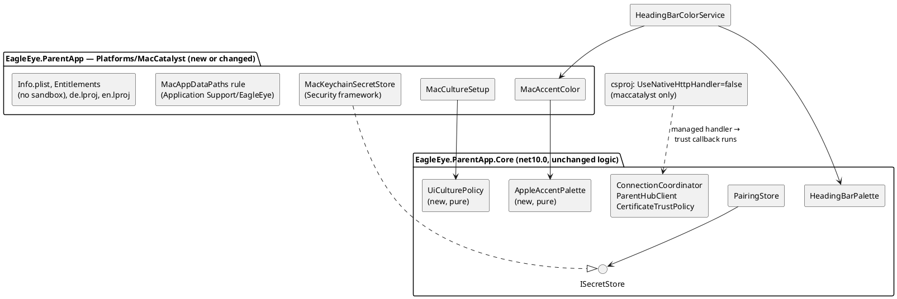

# Implementation Plan: US-007 — macOS Parent App Parity

**Status**: Draft — awaiting Michael's approval
**Date**: 2026-10-20
**Author**: ARC
**User story**: `02_Implementation/docs/requirements/user-stories/US-007/user-story.md` (approved 2026-10-20, 36 ACs in groups A to I, OQ-1 to OQ-4 answered)
**Requirements**: `02_Implementation/docs/requirements/general-product-requirements.md` v1.7 (FR-APP-110 to FR-APP-112, §9.4, §11.1 Q-6, Q-7)
**Branch**: `feature/US-007-macos-parent-app-parity`
**New ADR** (Proposed, approved together with this plan):
- ADR-020 — macOS platform layer under ad-hoc signing (`02_Implementation/docs/architecture/decisions/ADR-020-macos-platform-layer-under-ad-hoc-signing.md`)

**Amended** (proposed with this plan): ADR-019 §4 (amendment note), arc42 (header, §5.5, §7, §7.1.1, §7.4, §8.1, §8.13, §9, §11 R-3), coding guidelines §13.

---

## Summary

Michael wants to **see the Mac app running soon**. The plan therefore starts with a short **"first light"** step: build the Mac target as it is on `main`, launch it on the MacBook, pair it with the service at `192.168.1.37`, and write down every gap. The parity work follows in small steps, each ending with something Michael can try on the MacBook. Packaging (`.dmg`, removal script, instructions) comes after the app works. The Windows regression comes last, on the Windows machine.

**No change to `EagleEye.Shared`, the service or the tray client.** The work is in the Mac platform layer of `EagleEye.ParentApp`, a few small, platform-neutral additions to `EagleEye.ParentApp.Core`, and `package-macos.ps1`.

---

## Technical Issues and Risks

*Checked against the code on `feature/US-007-macos-parent-app-parity` (= `main` after CR-001, build 0.6.2, plus the story). **Summary: feasible as one story. The shared pages, view models and connection logic need no redesign. The real unknowns are the Keychain under ad-hoc signing (TI-1), and the look and feel of the MAUI pages on Mac Catalyst, which only first light shows.***

| # | Issue | Impact | Solution in this plan |
|---|---|---|---|
| **TI-1** | **Keychain under ad-hoc signing.** The Mac target uses MAUI `SecureStorage`, which on Mac Catalyst expects a `keychain-access-groups` entitlement. An ad-hoc build cannot carry it (no provisioning profile, no Apple account). Each build has a new code hash, so the Keychain may prompt, refuse, or lose the item after an update (OQ-3). | Possible blocker for AC-5, AC-24, AC-6. | Observed already in Step 1. **Spike in Step 2**: own `MacKeychainSecretStore` on the Security framework, login keychain preferred (K-1), data-protection keychain as fallback (K-2), each tested across a rebuild. Decision rule in ADR-020 §2. If neither survives an update without re-pairing, the plan stops and Michael decides (story OQ-3, split fallback). |
| **TI-2** | **TLS callback on Apple.** The default `HttpClientHandler` on Apple platforms is the native `NSUrlSessionHandler`, which bypassed the certificate callback in the aborted iOS work. Negotiate would then fail, or (worse) skip the pin. | Blocker for AC-17, AC-19, AC-20. | `UseNativeHttpHandler=false` for the maccatalyst TFM (ADR-020 §3): the managed handler calls `CertificateTrustPolicy` exactly as on Windows. Allowed as a first-light fix if pairing fails without it. |
| **TI-3** | **App Sandbox** is on in `Entitlements.plist`. Container ownership is bound to the code signature, the data folder sits inside the container, and sandbox plus keychain under ad-hoc signing are harder to predict. | Risk for AC-5, AC-6. | Sandbox off (ADR-020 §1). Data in `~/Library/Application Support/EagleEye/`, as arc42 §7.1.1 already states. First light still runs with the sandbox (as on `main`); the removal script also cleans a container left by such dev runs. |
| **TI-4** | **Local network privacy.** macOS asks before an app may connect to devices on the LAN (AC-18). Without an `NSLocalNetworkUsageDescription`, the prompt shows no explanation, or the connection fails silently. | AC-18. | Info.plist key with a German and an English text (`InfoPlist.strings`). The install instructions explain the prompt and the setting. |
| **TI-5** | **Release build trimming.** First light uses a Debug build. A Release build of Mac Catalyst trims the framework. With trimming on, reflection-based `System.Text.Json` (used by the SignalR JSON protocol for the DTOs) is disabled by default. | The packaged app could fail at the first hub call while Debug works. | Step 1 also launches a **Release** build once. If hub calls fail, Step 2 sets `JsonSerializerIsReflectionEnabledByDefault=true` for maccatalyst (or a source-generated context; DEV decides and reports). Packaging always uses Release. |
| **TI-6** | **UI language on the Mac.** .NET on Mac Catalyst takes its cultures from `NSLocale`. macOS offers a per-app language and localizes its standard menus only for bundles that declare `CFBundleLocalizations`. AC-13 wants "first language English → English, anything else → German". | AC-12, AC-13, AC-14, AC-15. | ADR-020 §4: bundle localizations de/en; `UiCulturePolicy` (Core, pure) picks the UI language from the first preferred language; formats from UI language + macOS region. |
| **TI-7** | **Accent colour.** `HeadingBarColorService` has no Mac source and falls back to the fixed primary colour. | AC-10. | `MacAccentColor` (ADR-020 §5), refreshed on window activation as on Windows. |
| **TI-8** | **Window and menu.** On the Mac, closing the last window does not quit by default (OQ-1: it must). Bundle and display name are "EagleEye" today; the story wants "EagleEye Parent App" in Finder, Dock and the menu bar, and "EagleEye" as the window title. About panel needs version and copyright. | AC-4, AC-7, AC-8. | `ApplicationTitle` "EagleEye Parent App" for maccatalyst only; window title stays "EagleEye"; `Destroying` → `Application.Quit()`; `NSHumanReadableCopyright`; the `.app` folder named `EagleEye Parent App.app` by the package script. |
| **TI-9** | **MAUI controls on Mac Catalyst** (iPad idiom, scaled). Fonts, `CheckBox`, `Entry` height, `Editor`, `CollectionView` selection, `BindableLayout` tables and the trash icon were tuned on WinUI only. | AC-7, AC-11, AC-16, AC-29 to AC-31. Unknown until first light. | Gap list from Step 1. Fixes in Steps 5 and 6 with `#if MACCATALYST` handler mappings or `OnPlatform` values, never changing what Windows shows (AC-35). The "Optimize for Mac" idiom is **not** switched on (it changes many MAUI controls); only if first light shows that the scaled idiom cannot meet AC-11 does ARC raise it. |
| **TI-10** | **Reconnect after sleep or Wi-Fi loss** (AC-22). The paired connection retries 0 s, 2 s, 10 s, then every 30 s forever; a dead socket after sleep is detected by the SignalR server timeout (30 s). | AC-22 (60 s). | Expected to pass with the existing schedule. Verified in Step 6. Contingent fix (only if it fails): a small reconnect nudge on wake and network return (Step 6, item 6). |
| **TI-11** | **Gatekeeper on a locally built `.dmg`.** macOS checks unsigned apps only when they carry the quarantine attribute (set by browsers, AirDrop, mail). A `.dmg` built and opened on the same MacBook has none, so the AC-3 block does not appear. | AC-3 not observable as is. | Verification note for TES: give the `.dmg` the quarantine attribute (download or AirDrop, or `xattr -w com.apple.quarantine …`) before the install test. No product change. |
| **TI-12** | **Removal must not depend on the app.** The parent moves the app to the Trash first (AC-6), so the app cannot clean up after itself. | AC-6. | A shell script in the `.dmg` that uses only macOS tools. This works with keychain K-1. With K-2 the `security` tool cannot delete the item (Q-3). |

---

## Machine Assignment

| Work | Machine |
|---|---|
| This plan, ADR-020, amendments (ARC) | MacBook (done here) |
| Step 0 to Step 7 (DEV): Mac code, Core additions, unit tests on the Mac (`test.ps1`: Shared.Tests, ParentApp.Tests), `.dmg` | **MacBook** |
| Step 1 and the checks after Steps 2 to 7 | **MacBook**, with the service PC `192.168.1.37` running service and tray client 0.6.2 (Step 1 to 7) — Michael reads the pairing code there |
| Step 8 (DEV): Windows build, unit tests, both Windows installers 0.7.0, Windows smoke check | **Windows Developer Machine** |
| Step 9: documentation and handover | MacBook (Mac parts) and Windows (Step 8 results), whichever comes last |
| Manual test run (Michael, guided by TES) | MacBook (Mac app) + service PC `192.168.1.37` (service, tray, Windows app as the second parent app) |

**Order across machines.** No `EagleEye.Shared` contract change. The Core additions (Step 2, Step 4) are platform-neutral and compile on both machines; they change nothing that Windows shows. The Windows step runs once, after the last code change (Step 8). Before switching machines: commit and push the branch.

---

## Impact Assessment

| Component | Change |
|---|---|
| `EagleEye.Shared` | None. |
| `EagleEye.Service`, `EagleEye.TrayClient` | None. Version 0.7.0 only (AC-36). |
| `EagleEye.ParentApp.Core` | Small additions: `UiCulturePolicy` (Localization), `AppleAccentPalette` (Appearance), `SecretStoreUnavailableException` (Abstractions), start-up handling of that exception, new texts. No change to communication, models or view-model behaviour. |
| `EagleEye.ParentApp` (MAUI head) | Mac platform layer: `MacKeychainSecretStore` (replaces `MauiSecureStorageSecretStore`), `MacAccentColor`, `MacCultureSetup`, `MacAppDataPaths` path rule, Info.plist, entitlements, `de.lproj` / `en.lproj`, csproj properties for maccatalyst, window quit on close. Gap fixes in views as `#if MACCATALYST` / `OnPlatform`. |
| Scripts | `package-macos.ps1` (from stub to full). New `installer/macos/` with the removal script and the install instructions. |
| Windows installers | Version 0.7.0 only. |

---

## Architecture Changes

- **ADR-020 (new, Proposed)**: no App Sandbox; own Keychain store (login keychain preferred); managed HTTP handler on the Mac; UI language and formats from macOS; accent colour from macOS; close quits; no lifecycle coordinator unless AC-22 needs it.
- **ADR-019 §4** (amendment note): macOS secrets via `MacKeychainSecretStore` (ADR-020), not `MauiSecureStorageSecretStore`.
- **arc42** (marked as proposed with this plan): §5.5 platform services; §7 deployment box (no YAML on the Mac today); §7.1.1 Mac data locations; §7.4 `.dmg` file name and contents; §8.1 managed handler on the Mac; §8.13 Mac language rule; §9 ADR-020; §11 R-3 updated.
- **Coding guidelines §13** (proposed): secret store, handler, sandbox, data path, culture, `#if MACCATALYST` rule for view fixes.

## New ADRs Required

- ADR-020 (above). ADR-017 and ADR-018 stay unused (ADR-019 numbering note).

## API Changes (SignalR Contracts)

None.

## Data Model Changes

None. The Mac app uses the same `EagleEye.ParentApp.db` schema. The `Secrets` table stays empty on the Mac (the token is in the Keychain).

---

## Component Design

### Overview



### Decision 1: first light before design work

The Mac app on `main` has not run since US-001. Designing fixes for gaps nobody has seen would waste time. Step 1 builds and runs it unchanged, pairs it, and records the gaps in `US-007/first-light.md` (one row per gap: ID `G-n`, area, what Michael saw, AC, proposed step). **Allowed fixes in Step 1** are only those needed to reach a paired, connected app, and only from this list: `UseNativeHttpHandler=false` (TI-2), `NSLocalNetworkUsageDescription` (TI-4), `ValidateXcodeVersion` adjustments. Everything else goes into the gap list and into Steps 2 to 6. After Step 1, DEV sends the gap list to Michael; ARC checks it. If a gap changes the design (Keychain unusable, a page that cannot work on Catalyst), ARC amends this plan before Step 2 continues.

### Decision 2: Keychain store and spike (ADR-020 §2)

`Platforms/MacCatalyst/MacKeychainSecretStore : ISecretStore`

- `GetAsync(key)`: `SecItemCopyMatching` (generic password, service `com.adlemich.eagleeye`, account `key`, return data). Found → UTF-8 string. `errSecItemNotFound` → `null`. `errSecAuthFailed`, `errSecUserCanceled`, `errSecInteractionNotAllowed`, any other error → `SecretStoreUnavailableException` (message without the secret).
- `SetAsync(key, value)`: update if present, else add (label "EagleEye Parent App", not synchronisable).
- `RemoveAsync(key)`: `SecItemDelete`; not found is fine.
- Keychain variant as a single constant inside the class (K-1 login keychain or K-2 data-protection keychain), set by the spike result. No runtime switch.

**Spike (Step 2, about half a day)**, each variant with the real app and the real service:
1. pair; quit; start → connects without code;
2. change one line of code, rebuild (new code hash), start → note: silent / one prompt / refused / item lost;
3. after "Always Allow" in 2: rebuild again, start → note whether a prompt comes every build;
4. "Deny" in the prompt → app shows `ErrorKeychainAccess`, pairing row still in the database, next start with "Allow" connects;
5. delete with `security delete-generic-password -s com.adlemich.eagleeye -a pairing-token` → app starts unpaired.

DEV records the results in `US-007/first-light.md` ("Keychain spike") and in the implementation report. Decision rule: ADR-020 §2 table.

**Start-up with a denied Keychain**: `MainPage.OnLoaded` already catches start-up exceptions; it gets one more catch for `SecretStoreUnavailableException` and shows `AppTexts.ErrorKeychainAccess` (OK button). The coordinator is not started, so nothing overwrites the pairing. The parent restarts the app. Windows never throws this exception.

### Decision 3: TLS and network

- `EagleEye.ParentApp.csproj`, maccatalyst property group: `UseNativeHttpHandler=false`, `RuntimeIdentifier=maccatalyst-arm64` (Apple Silicon only, §9.4), and, if TI-5 shows it is needed, `JsonSerializerIsReflectionEnabledByDefault=true`.
- `Entitlements.plist`: no `com.apple.security.app-sandbox`, no `com.apple.security.network.client` (only meaningful inside the sandbox). Empty `<dict/>` is fine.
- `Info.plist`: `NSLocalNetworkUsageDescription` (texts in `InfoPlist.strings`, see Localization).
- `ParentHubClient`, `CertificateTrustPolicy`, `ConnectionCoordinator`: unchanged.

### Decision 4: data paths

`MauiAppDataPaths` gets a Mac branch (`#if MACCATALYST`): `DataDirectory` = `NSFileManager.DefaultManager.GetUrl(NSSearchPathDirectory.ApplicationSupportDirectory, NSSearchPathDomain.User, …)` + `EagleEye`. Windows keeps `LocalApplicationData\EagleEye`. The Debug-only `EAGLEEYE_DEV_APP_DATA_DIR` switch stays and works on both.

### Decision 5: app shell (AC-4, AC-7, AC-8)

| Item | Implementation |
|---|---|
| Name in Finder, Dock, Launchpad, Spotlight, app menu | csproj: `ApplicationTitle` = `EagleEye Parent App` **for maccatalyst only** (the Windows value stays `EagleEye`). The package script names the bundle folder `EagleEye Parent App.app` (renaming the folder does not break the ad-hoc signature). |
| Window title "EagleEye" | `App.WindowTitle`, unchanged. Checked in Step 1 (Mac Catalyst shows the scene title). |
| Icon | Same `appicon.svg` (MAUI generates the Mac icon set). |
| Version | `ApplicationDisplayVersion` = `$(VersionPrefix)` → `CFBundleShortVersionString` (already). Version 0.7.0 for all components (Step 0). |
| Publisher | Info.plist `NSHumanReadableCopyright` = `© 2026 Michael Adler` (shown in About and in Finder *Get Info*). |
| Minimum size 900 × 600 | `Window.MinimumWidth/Height`, unchanged. Checked in Step 3. |
| Close quits (OQ-1) | `App.CreateWindow`, `#if MACCATALYST`: `window.Destroying += (_, _) => Quit();`. Pending edits are flushed before (`MainPage` flush is already called on page change; DEV adds the same flush to `Destroying`, AC-32). If `Application.Quit()` is a no-op on the MAUI version in use, DEV terminates through `UIApplication` (`terminate:` selector) and reports it. |
| Menu bar | The Mac Catalyst default menu (app menu, Edit, View, Window, Help) as is. No `MenuBarItems`. Edit commands work in `Entry`/`Editor` through the UIKit responder chain (checked in Step 3). |
| Single instance | LaunchServices (default). `UIApplicationSupportsMultipleScenes` = false (already). |

### Decision 6: language and formats (ADR-020 §4)

`ParentApp.Core/Localization/UiCulturePolicy` (new, static, pure):

```csharp
/// <summary>UI language rule of the Mac app (NFR-L-011, US-007 AC-13).</summary>
public static class UiCulturePolicy
{
    /// <summary>"en" if the first preferred language is English, otherwise "de".</summary>
    public static CultureInfo ResolveUiCulture(string? firstPreferredLanguage);

    /// <summary>UI language + region (e.g. de-DE, en-US); the UI language alone if the pair is unknown.</summary>
    public static CultureInfo ResolveFormattingCulture(CultureInfo uiCulture, string? regionCode);
}
```

`Platforms/MacCatalyst/MacCultureSetup.Apply()` (called first in `MauiProgram.CreateMauiApp`, `#if MACCATALYST`): reads `NSLocale.PreferredLanguages.FirstOrDefault()` and `NSLocale.CurrentLocale.CountryCode`, sets `CultureInfo.CurrentUICulture`, `CurrentCulture`, `DefaultThreadCurrentUICulture`, `DefaultThreadCurrentCulture`. Everything else (AppTexts, default kid texts per ADR-016, Reports dates with `"d"`, sort order) already follows these cultures.

Bundle: Info.plist `CFBundleDevelopmentRegion` = `de`, `CFBundleLocalizations` = `de`, `en`; `Platforms/MacCatalyst/Resources/de.lproj/InfoPlist.strings` and `en.lproj/InfoPlist.strings`.

### Decision 7: accent colour (AC-10)

- `ParentApp.Core/Appearance/AppleAccentPalette` (new, pure): `RgbColor? FromAppleAccentColor(int? value)` maps the macOS global default `AppleAccentColor` (absent = blue/multicolour, -1 graphite, 0 red, 1 orange, 2 yellow, 3 green, 4 blue, 5 purple, 6 pink) to Apple's palette RGB values.
- `Platforms/MacCatalyst/MacAccentColor.Read()`: first `NSColor.controlAccentColor` via the Objective-C runtime (AppKit is loaded in a Catalyst process), converted to sRGB; if that is not available, `NSUserDefaults` global domain `AppleAccentColor` → `AppleAccentPalette`; else `null` (primary colour). DEV keeps whichever path works and reports it.
- `HeadingBarColorService.ReadPlatformAccent()`: `#elif MACCATALYST return _macAccent.Read();`. Text colour from `HeadingBarPalette` (unchanged): white on blue, dark on yellow.

### Decision 8: look and page fixes (AC-7, AC-11, AC-16, AC-26 to AC-32)

The XAML views are shared. Gaps from Step 1 are fixed in this order of preference:
1. a value that is right on both platforms (only if it changes nothing visible on Windows — otherwise not);
2. `OnPlatform` in XAML or a `#if MACCATALYST` handler mapping in `MauiProgram` (as the existing `#if WINDOWS` `CheckBox` mapping);
3. a Mac-only style in `Styles.xaml` selected by `OnPlatform`.

Never a Mac-only copy of a view. Known candidates to check: `CheckBox` size and contrast in dark mode; `Entry` showing its value (ISSUE-008 equivalent); `Editor` line breaks (Core already normalizes `\r`); the navigation `CollectionView` selection colour; table column widths at "Larger Text"; the trash icon (`AppThemeBinding`); scroll of long pages; `DisplayPromptAsync` host dialog with the URL keyboard.

### Decision 9: packaging (AC-2 to AC-6)

`02_Implementation/scripts/package-macos.ps1` (MacBook only, already refuses other hosts):
1. Read `VersionPrefix` from `02_Implementation/Directory.Build.props`.
2. Check the repo is outside iCloud (`com.apple.FinderInfo` / path check, dev-environments §5) and warn.
3. `dotnet publish src/EagleEye.ParentApp -f net10.0-maccatalyst -c Release` (arm64, ad-hoc signed by the build).
4. Copy the `.app` to a staging folder as `EagleEye Parent App.app`; `codesign --verify --deep --strict` must pass; print `codesign -dv` (shows "adhoc").
5. Check the bundle: `Info.plist` version = product version, `CFBundleDisplayName`, `de.lproj`/`en.lproj`, `en/` satellite assemblies (`EagleEye.ParentApp.Core.resources.dll`, `EagleEye.Shared.resources.dll`), no sandbox entitlement (`codesign -d --entitlements -`).
6. Staging: the app, a symbolic link `Applications` → `/Applications`, `Remove EagleEye Parent App.command` (from `installer/macos/`, executable), `Anleitung - Instructions.txt` (from `installer/macos/`, version filled in).
7. `hdiutil create -volname "EagleEye Parent App <version>" -srcfolder <staging> -format UDZO -ov 03_Delivery/macos/EagleEye-ParentApp-<version>.dmg`.
8. Print the path and the SHA-256 of the `.dmg`. No secrets, no Apple account.

`02_Implementation/installer/macos/` (new):
- `remove-eagleeye-parent-app.command` (zsh, copied into the `.dmg` under the name above). See "Removal script".
- `instructions.txt` (German first, then English): install by dragging; first start and Gatekeeper *Open Anyway*; the Local Network prompt (AC-18); the one-time Keychain prompt after an update (OQ-3: "Always Allow", login password); update by dragging again and "Replace"; removal: 1. "Kopplung aufheben" in the app, 2. if kept in the Dock: right-click → *Options → Remove from Dock*, 3. quit, 4. move the app to the Trash, 5. double-click the removal script (if macOS blocks it: right-click → *Open*).

### Removal script (AC-6, ADR-020)

`remove-eagleeye-parent-app.command`, zsh, uses only macOS tools, no `sudo`:

1. If the app is running (`pgrep -f "EagleEye Parent App.app/Contents/MacOS/"`): print "please quit the app first" (de/en) and stop with exit code 1.
2. If `/Applications/EagleEye Parent App.app` still exists: print a hint to move it to the Trash first, and stop (it does not delete the app itself, so nothing is deleted that the parent did not choose).
3. Delete, each only if present, and print each removed item:

| Item | How |
|---|---|
| `~/Library/Application Support/EagleEye/` | `rm -rf` |
| Preferences `com.adlemich.eagleeye` | `defaults delete com.adlemich.eagleeye` (cfprefsd), then remove `~/Library/Preferences/com.adlemich.eagleeye.plist` if left |
| `~/Library/Caches/com.adlemich.eagleeye/` | `rm -rf` |
| `~/Library/HTTPStorages/com.adlemich.eagleeye/` and `com.adlemich.eagleeye.binarycookies` | `rm -rf` |
| `~/Library/Saved Application State/com.adlemich.eagleeye.savedState/` | `rm -rf` |
| `~/Library/WebKit/com.adlemich.eagleeye/` | `rm -rf` |
| `~/Library/Containers/com.adlemich.eagleeye/`, `~/Library/Application Scripts/com.adlemich.eagleeye/` (only from sandboxed dev builds before Step 2) | `rm -rf` |
| Keychain item service `com.adlemich.eagleeye`, account `pairing-token` | `security delete-generic-password -s com.adlemich.eagleeye -a pairing-token` (repeated until none is left) |
| Keychain items of the MAUI `SecureStorage` dev builds (service name as recorded in Step 1) | `security delete-generic-password -s <name>` |
| Privacy settings of the app | `tccutil reset All com.adlemich.eagleeye` (best effort; output not an error) |

4. Read-only check: if the Dock still has an entry with the bundle ID (`defaults read com.apple.dock persistent-apps`), print how to remove it (D-3). The script does not edit Dock settings.
5. Summary: "removed: n items" or "nothing to remove" (de/en); exit code 0. A second run, or a run on a Mac where the app was never started, prints "nothing to remove" and ends with 0.

The script touches nothing outside the paths above. Every path contains `com.adlemich.eagleeye` or is the folder `Application Support/EagleEye`.

---

## Implementation Steps

All steps on branch `feature/US-007-macos-parent-app-parity`. Commit after each step (`US-007: …`) and push. Each step ends with **"Michael sees"**: what he can try on the MacBook.

| Step | Content | Machine |
|---|---|---|
| 0 | Preparation, version 0.7.0 | MacBook |
| **1** | **First light**: run the Mac app as is, pair with `192.168.1.37`, gap list | **MacBook** (+ service PC for the code) |
| 2 | Connection and secrets: managed handler, no sandbox, data path, Keychain spike and store, denied-access handling, Release check | MacBook |
| 3 | App shell: name, icon, About, window, close quits, Edit menu | MacBook |
| 4 | Language and formats | MacBook |
| 5 | Look: accent bars, light/dark, Larger Text, control fixes | MacBook |
| 6 | Pages parity sweep, sync with the Windows app, reconnect | MacBook (+ service PC, Windows app) |
| 7 | Packaging: `.dmg`, removal script, instructions; install, update, remove | MacBook |
| 8 | Windows build, unit tests, installers 0.7.0, regression smoke | **Windows Developer Machine** |
| 9 | Documentation and handover | MacBook / Windows |

### Step 0: Preparation (MacBook)
1. `git fetch`, `git switch feature/US-007-macos-parent-app-parity`, `git pull`. Run `pwsh 02_Implementation/scripts/env-check.ps1` (host, workload `maui`/`maui-maccatalyst`, Xcode, repo outside iCloud).
2. `Directory.Build.props`: `VersionPrefix` → `0.7.0`.
3. `pwsh 02_Implementation/scripts/build.ps1` and `test.ps1`: green on the Mac.

### Step 1: First light (MacBook) — keep it short (about half a day)
Prerequisites: the service PC `192.168.1.37` runs service and tray 0.6.2; Michael can see its tray client (or Event Log) for the pairing code; MacBook in the same LAN.
1. Build and run Debug: `dotnet build 02_Implementation/src/EagleEye.ParentApp -f net10.0-maccatalyst -t:Run` (or launch the built `.app` with `open`). For console output and exceptions, run the executable inside the bundle from Terminal (`…/EagleEye.ParentApp.app/Contents/MacOS/EagleEye.ParentApp`).
2. Michael enters `192.168.1.37` in the host dialog, the code from the tray, a device name ("Michael's MacBook"). Allowed fixes only per Decision 1.
3. Walk through and note gaps: window (title, size, minimum, resize, full screen, close), menu bar, status bar states, Settings (all four sections, a tick, warning minutes), Rules (account, break table, add/edit/delete, app rules, texts with an emoji), Reports (today, live update), light/dark switch, macOS language (German and English), accent colour.
4. Keychain probe (no code change): quit, start → still paired? Rebuild after a one-line change, start → prompt / silent / lost? Record the Keychain service name MAUI used (*Keychain Access*, search "eagleeye") and the data folder actually used (`find ~/Library -name EagleEye.ParentApp.db`).
5. Release probe: `dotnet build … -c Release`, launch, connect → hub calls work or fail (TI-5).
6. Write `02_Implementation/docs/requirements/user-stories/US-007/first-light.md` (gap table G-1 …, Keychain probe, Release probe, data path, screenshots optional in `US-007/input/`), commit, push, report to Michael. ARC reviews the gap list (Decision 1).

**Michael sees**: the EagleEye window on his MacBook, paired with the service PC, green "Connected to 192.168.1.37", and his real Settings, Rules and Reports data in it, with whatever rough edges first light finds, all listed in `first-light.md`.

### Step 2: Connection and secrets (MacBook)
1. csproj (maccatalyst): `UseNativeHttpHandler=false` (if not already from Step 1), `RuntimeIdentifier=maccatalyst-arm64`, and the TI-5 property if the Release probe failed.
2. `Entitlements.plist` without sandbox and network.client; `Info.plist` `NSLocalNetworkUsageDescription`.
3. `MauiAppDataPaths` Mac branch (Decision 4).
4. Core: `SecretStoreUnavailableException`; `MainPage.OnLoaded` catch → `ErrorKeychainAccess`; texts de/en.
5. `MacKeychainSecretStore` (Decision 2), registered in `MauiProgram` under `#if MACCATALYST`; delete `MauiSecureStorageSecretStore`.
6. Keychain spike (Decision 2), K-1 first; K-2 only if K-1 fails. Results into `first-light.md` and the report. If neither variant is accepted: stop and report (ADR-020 §2).
7. Release launch once more: pairing, restart, rebuild.

**Michael sees**: pairing that survives quitting, restarting the Mac and a rebuild (with at most one "Always Allow" prompt), the item "pairing-token" in *Keychain Access → login*, and the database in `~/Library/Application Support/EagleEye/`.

### Step 3: App shell (MacBook)
1. Decision 5: `ApplicationTitle` for maccatalyst, `NSHumanReadableCopyright`, close quits (with flush), window title, minimum size.
2. Check the Mac Catalyst default menu: About panel (name, 0.7.0, copyright), Hide, Quit (⌘Q), Edit commands and shortcuts in `Entry` and `Editor`.

**Michael sees**: "EagleEye Parent App" in the Dock and menu bar, About with 0.7.0 and "Michael Adler", red close button quits the app, ⌘C/⌘V work in every field.

### Step 4: Language and formats (MacBook)
1. Core: `UiCulturePolicy` + unit tests.
2. `MacCultureSetup`, Info.plist localizations, `de.lproj`/`en.lproj` `InfoPlist.strings`.
3. Check: macOS German / English / French first; per-app language for "EagleEye Parent App"; region US vs Germany on Reports; default kid texts in the app language (AC-14).

**Michael sees**: the app in English when macOS is English, in German otherwise, with macOS's own menu entries in the same language, and dates in his region's format.

### Step 5: Look (MacBook)
1. Core: `AppleAccentPalette` + unit tests. `MacAccentColor`; `HeadingBarColorService` Mac branch.
2. Light/dark: first start follows macOS (with "Auto" the current appearance); switch applies at once and persists (the existing `AppearanceViewModel`, check only).
3. Fix the look gaps from the gap list (Decision 8): dark/light contrast, checkboxes, value fields, trash icon, Larger Text, scrolling below the minimum size.

**Michael sees**: heading bars in his accent colour (white text on blue, dark text on yellow), changing when he switches the accent colour and comes back to the window; all pages readable in light and dark and at "Larger Text".

### Step 6: Pages parity sweep (MacBook, with the service PC and the Windows app)
1. Fix the remaining page gaps from the gap list (Settings, Rules, Reports, dialogs, status bar).
2. Flush before page or account change and before quit (AC-32): check the existing `FlushPendingEdits` paths on Catalyst (`Unfocused` timing differs from WinUI).
3. Emojis via the Character Viewer and pasted (AC-16), through to the Windows app and the kid dialog.
4. Two parent apps (Mac + Windows) on the same page: changes both ways within 5 s (AC-33); remove/forget pairing of one does not affect the other (AC-25).
5. Connection: wrong host, service stopped and started, Local Network denied and allowed (AC-17, AC-18, AC-21).
6. Sleep and Wi-Fi off/on (AC-22). **Contingent**: only if green does not return within 60 s, add `Platforms/MacCatalyst/MacNetworkResume` (network path monitor and app-activation notification) calling a new `IConnectionCoordinator.ReconnectNowAsync()` that skips the current backoff wait of the paired connection. Core change + unit tests. Report it as a deviation.

**Michael sees**: the Mac app and the Windows app side by side, each change appearing in the other within seconds; the Mac app recovering by itself after sleep or Wi-Fi loss.

### Step 7: Packaging (MacBook)
1. `package-macos.ps1` (Decision 9), `installer/macos/remove-eagleeye-parent-app.command`, `installer/macos/instructions.txt`.
2. Run it → `03_Delivery/macos/EagleEye-ParentApp-0.7.0.dmg`.
3. DEV checks on the MacBook: fresh install from the `.dmg` (after running the removal script), with quarantine set (TI-11) → Gatekeeper block → *Open Anyway* → host dialog. Update: build again with a changed build (e.g. the same version rebuilt), drag over, "Replace" → paired, appearance kept (one Keychain prompt at most). Removal: "Remove pairing", quit, Trash, script → list of removed items; second run "nothing to remove"; new install starts unpaired.

**Michael sees**: a `.dmg` that opens with the app, the *Applications* shortcut, the removal script and the instructions; install, update and removal as in the instructions.

### Step 8: Windows regression (Windows Developer Machine)
1. `git switch feature/US-007-macos-parent-app-parity`, `git pull`.
2. `build.ps1` (Windows: 0 warnings), `test.ps1` (all four test projects green).
3. `package-windows.ps1` → `EagleEye-Setup-0.7.0.exe` and `EagleEye-ParentApp-Setup-0.7.0.exe`.
4. Smoke check: install the parent app 0.7.0 over 0.6.2 (pairing and appearance kept), one tick, one break time change, one app rule change, Reports with today's usage; the window shows no menu bar or other Mac-only element; heading bars still in the Windows accent colour; service and tray 0.7.0 start and the Mac app connects to them.

**Michael sees**: the Windows app 0.7.0 unchanged except for the version.

### Step 9: Documentation and handover (MacBook / Windows)
1. READMEs: `src/EagleEye.ParentApp/README.md` (Mac platform layer, data locations, Keychain variant, how to run first light), `src/EagleEye.ParentApp.Core/README.md` (new classes).
2. `dev-environments.md` §5: lessons learned in this story (DEV proposes, Orchestrator owns the file).
3. `US-007/implementation-report.md`: deviations, the gap list with its resolution, the Keychain spike result, "How to test", data locations as implemented; story → `Implemented`; push.

---

## Data Locations (for AC-6 and AC-24)

*Bundle ID `com.adlemich.eagleeye`. TES checks these in Finder (⌘⇧G to go to a folder) and in Keychain Access. The implementation report confirms the list after Step 7.*

| Location | Contents | Created when |
|---|---|---|
| `/Applications/EagleEye Parent App.app` | The app | Install |
| `~/Library/Application Support/EagleEye/EagleEye.ParentApp.db` (+ `-wal`, `-shm`) | Host, device ID, device name, pinned thumbprint, appearance. **No token** (`Secrets` table empty) | First start |
| Keychain Access → *login* → *Passwords*: name "EagleEye Parent App", where `com.adlemich.eagleeye`, account `pairing-token` | The pairing token (kind "application password") | Pairing |
| `~/Library/Preferences/com.adlemich.eagleeye.plist` | UIKit/MAUI window and system preferences | First start (system) |
| `~/Library/Caches/com.adlemich.eagleeye/` | System caches | Possibly |
| `~/Library/HTTPStorages/com.adlemich.eagleeye/` | URL session storage | Possibly (unlikely with the managed handler) |
| `~/Library/Saved Application State/com.adlemich.eagleeye.savedState/` | Window restoration | Possibly |
| `~/Library/Containers/com.adlemich.eagleeye/`, `~/Library/Application Scripts/com.adlemich.eagleeye/` | Only from sandboxed dev builds (Step 1) | Dev only |

AC-24 check without code: in Terminal, `sqlite3 ~/Library/Application\ Support/EagleEye/EagleEye.ParentApp.db "SELECT COUNT(*) FROM Secrets;"` → `0`; the `ServerConnections` row has no token column. In Keychain Access, the item exists; "Show password" asks for the login password (it is the token; TES does not need to read it).

---

## Localization Impact

### Parent app texts (`ParentApp.Core/Resources/AppTexts*.resx`, new key)

| Key | German (neutral) | English |
|---|---|---|
| `ErrorKeychainAccess` | Die Kopplung konnte nicht aus dem macOS-Schlüsselbund gelesen werden. Bitte die App neu starten und den Zugriff mit „Immer erlauben" bestätigen. | The pairing could not be read from the macOS Keychain. Please restart the app and confirm the access with "Always Allow". |

Wording may be adjusted by DEV; differences are notes (US-002 Decision Q-11).

### Bundle texts (`Platforms/MacCatalyst/Resources/<lang>.lproj/InfoPlist.strings`)

| Key | German | English |
|---|---|---|
| `CFBundleDisplayName` | EagleEye Parent App | EagleEye Parent App |
| `NSLocalNetworkUsageDescription` | EagleEye verbindet sich mit dem EagleEye-PC in deinem Heimnetz, um Regeln und Berichte anzuzeigen. | EagleEye connects to the EagleEye PC in your home network to show rules and reports. |
| `NSHumanReadableCopyright` | © 2026 Michael Adler | © 2026 Michael Adler |

The product name is not translated. The standard menu bar entries come from macOS in the bundle's language (de/en). The app defines no menu entries of its own.

### Removal script and instructions
Bilingual (German first, then English) in one file each. No resource mechanism.

### Formats
Reports dates: `"d"` of the formatting culture (UI language + macOS region). Times on Rules: fixed 24-hour HH:MM (unchanged Core code). Usage: HH:MM (unchanged).

---

## Logging

The parent app has no log file today (on Windows neither); this story does not add one. Diagnosis on the Mac: console output when the app is started from Terminal, and `log stream --predicate 'process == "EagleEye.ParentApp"'`. The token is never written anywhere (NFR-S-014); `MacKeychainSecretStore` exceptions carry the OSStatus, never the value.

---

## Acceptance Criteria → Steps and Unit Tests

| AC | Implemented by (step) | Unit tests (key) | Manual |
|---|---|---|---|
| AC-1 parity rule | all (1 to 6) | existing Core tests (unchanged logic) | yes |
| AC-2 `.dmg` contents | 7 | — | yes |
| AC-3 self-contained, Gatekeeper | 7 (Release bundle includes the runtime) | — | yes (quarantine, TI-11) |
| AC-4 name, icon, version, publisher | 3, 7 | — | yes |
| AC-5 update keeps pairing/appearance | 2 (Keychain spike), 7 | — | yes |
| AC-6 removal script | 7 | — | yes |
| AC-7 window layout, size, scroll | 1, 3, 5 | — | yes |
| AC-8 menu bar, close quits, single instance | 3 | — | yes |
| AC-9 light/dark | 5 (check) | existing `AppearanceViewModel` tests | yes |
| AC-10 accent bars | 5 | `AppleAccentPalette`, existing `HeadingBarPalette` | yes |
| AC-11 readability | 5, 6 | — | yes |
| AC-12 all texts de/en | 2, 4 | `ErrorKeychainAccess` de/en (AppTexts tests) | yes |
| AC-13 language from macOS | 4 | `UiCulturePolicy` | yes |
| AC-14 default kid texts | 4 (check) | existing `KidTextEditing` tests | yes |
| AC-15 formats | 4 | `UiCulturePolicy.ResolveFormattingCulture` | yes |
| AC-16 emojis | 6 | — | yes |
| AC-17 host, connection error | 1, 2, 6 | existing coordinator tests | yes |
| AC-18 local network prompt | 2, 7 (instructions) | — | yes |
| AC-19 TLS, no certificate prompts, identity changed | 1, 2 | existing `CertificateTrustPolicy` tests | yes |
| AC-20 pairing | 1, 2 | existing coordinator tests | yes |
| AC-21 status and reconnect | 6 | existing tests | yes |
| AC-22 sleep, Wi-Fi | 6 (contingent nudge) | `ReconnectNowAsync` if added | yes |
| AC-23 remove / forget pairing | 6 | existing tests | yes |
| AC-24 Keychain, no secret in files | 2 | start-up handling of `SecretStoreUnavailableException`; `PairingStore` with a throwing store | yes (Data Locations) |
| AC-25 Mac + Windows paired | 6 | — | yes |
| AC-26 to AC-28 Settings | 1, 5, 6 | existing tests | yes |
| AC-29 to AC-31 Rules, Reports | 1, 5, 6 | existing tests | yes |
| AC-32 flush before switch | 3, 6 | existing tests | yes |
| AC-33 sync both ways | 6 | — | yes |
| AC-34 effect on the service PC | 6 | — | yes |
| AC-35 Windows unchanged | 8 | all Windows tests green | yes |
| AC-36 same version, service/tray regression | 0, 8 | — | yes (REG-001-01 to -05) |

---

## Unit Test Requirements

xUnit + Moq in `02_Implementation/tests/EagleEye.ParentApp.Tests/` (net10.0; runs on both machines). 100 % line and branch coverage for the new Core classes.

| Class | Key scenarios |
|---|---|
| `UiCulturePolicy.ResolveUiCulture` | `en`, `en-US`, `en-GB`, `EN-us` → en; `de`, `de-DE`, `de-CH` → de; `fr-FR`, `zh-Hans-CN`, empty, `null`, garbage → de. |
| `UiCulturePolicy.ResolveFormattingCulture` | de + DE → de-DE; en + US → en-US; en + DE → en-DE; de + `null` → de; unknown region → UI culture. Short date of `2026-10-20` in de-DE is `20.10.2026`, in en-US `10/20/2026`. |
| `AppleAccentPalette` | Every defined value (-1 to 6) gives its colour; `null` (absent) gives blue; an undefined value gives `null`. With `HeadingBarPalette`: blue → white text, yellow → dark text. |
| `SecretStoreUnavailableException` handling | `PairingStore.LoadAsync` with a store that throws → the exception propagates (no `null`, no delete). The start-up path (view-model level where testable) does not call the coordinator and selects `ErrorKeychainAccess`. If the start-up handling stays in `MainPage` (MAUI, not testable), DEV moves the decision into a small Core helper and tests that. |
| `AppTexts` | `ErrorKeychainAccess` exists in de and en, not empty, different. |
| `ConnectionCoordinator.ReconnectNowAsync` | **Only if Step 6 item 6 is needed**: skips the wait of a paired retry loop; no effect when connected, unpaired or pairing; no parallel attempt. |

Not unit-tested (platform code, verified manually): `MacKeychainSecretStore`, `MacCultureSetup`, `MacAccentColor`, the Mac data path, Info.plist/entitlements, window quit, `package-macos.ps1`, the removal script (DEV runs it in Step 7 on the MacBook: first run, second run, never-started case).

---

## Manual Verification Notes

*For TES. What is observable and what the test run needs. Not test cases.*

| What | Where / how |
|---|---|
| Artifacts | `03_Delivery/macos/EagleEye-ParentApp-0.7.0.dmg` (MacBook); `03_Delivery/windows/EagleEye-Setup-0.7.0.exe` and `EagleEye-ParentApp-Setup-0.7.0.exe` (service PC). |
| Setup | As in the story: service PC `192.168.1.37`, `kid1`, `kid2` controlled, `kid3` not; Windows app as the second parent app. Use the **IP address**, not a `.local` name. |
| Gatekeeper (AC-3, TI-11) | A `.dmg` built on the same MacBook is not quarantined, so macOS does not block it. Before the first-install test, transfer the `.dmg` the way a download would (AirDrop to itself, or a browser download), or set the attribute: `xattr -w com.apple.quarantine "0081;$(printf %x $(date +%s));Safari;" <file>.dmg`. Then the block and *Open Anyway* appear. |
| Clean start | Run the removal script first if a dev build ran on the MacBook before (Step 1 builds leave a sandbox container and a MAUI Keychain item). |
| Keychain prompt (AC-5, OQ-3) | After installing a **new build** over an old one, macOS may ask once for the login password so the app can use "EagleEye Parent App" in the keychain. Click **Always Allow**. A prompt per new build is expected; a prompt at every start of the same build is a failure. "Deny" → the app shows the Keychain message and stays paired for the next start. |
| Data and Keychain (AC-6, AC-24) | See "Data Locations". Finder: ⌘⇧G and paste the path. Keychain Access: search "eagleeye". |
| Local network (AC-18) | The prompt appears at the first connection attempt. To repeat it: *System Settings → Privacy & Security → Local Network*, switch the app off (denied) and on. `tccutil` does not reset this list. |
| Language (AC-13) | Change the first language in *Language & Region*, then quit and start the app. Per-app: *Language & Region → Applications → +*. With French first, the app is German; macOS's own menu entries may then be English if English is second in the list (D-2). |
| Accent colour (AC-10) | Change it in *Appearance*, then click into the app window. |
| Sleep (AC-22) | Close the lid for a few minutes, open, log in: red, then green within 60 s. Wi-Fi off/on in the menu bar. |
| Larger Text (AC-11) | *Displays → Larger Text*. The app uses the Catalyst "scaled" look: text is somewhat smaller than in native Mac apps; that is expected, not cut off text. |
| Close vs. quit (AC-8) | Red button → the app quits (no Dock dot). Yellow → minimized. Green → full screen / zoom. |
| Removal (AC-6) | Order: "Kopplung aufheben", Dock entry off, quit, Trash, script. The script lists what it removed; a second run prints "nothing to remove". |
| Not covered by unit tests | All Mac platform behaviour above; the `.dmg`; the removal script. |

---

## Deviations from the Story and Interpretations

| # | Point | Plan |
|---|---|---|
| D-1 | AC-8 "Only one instance" | Provided by macOS LaunchServices for the app bundle; no own mechanism. Starting the executable twice from Terminal is not a user scenario. |
| D-2 | AC-13 language with a third language first | The app is German (story). macOS chooses its own menu entries by matching the whole preferred-language list against de/en, so with e.g. French, English they may be English. App texts follow the story rule. |
| D-3 | AC-6 "no Dock entry" | A Dock entry the parent kept is removed by the parent (instructions, step 2); the script only checks and reminds. Editing the Dock's settings from a script is risky and could touch other entries (Q-2). Launchpad and Spotlight entries disappear with the app. |
| D-4 | AC-15 date format | The format of the culture "UI language + macOS region" as .NET/ICU defines it. Custom date formats set in macOS are not followed. With region Germany and English UI the date shows as `20/10/2026` (en-DE). |
| D-5 | AC-5 Keychain prompt | One prompt **per new build** (new ad-hoc signature), answered once with "Always Allow" (OQ-3). |
| D-6 | AC-2 instructions file | One plain-text file, German then English (`Anleitung - Instructions.txt`), readable in TextEdit; no PDF. |

---

## Open Questions for Michael

| ID | Question | Recommendation (default) |
|---|---|---|
| **Q-1** | **Avoid the Keychain prompt after every update?** With ad-hoc signing, each new build may ask once for your login password ("Always Allow", OQ-3). A **local self-signed code-signing certificate** on the MacBook (created once in Keychain Access, private key stays on the MacBook) would give every build the same identity, so the prompt would not come back. Gatekeeper still blocks the first start (not an Apple certificate). Cost: a one-time setup step and a key to keep. | **No, keep ad-hoc signing** as accepted in OQ-3. Revisit if the prompts during the test run bother you; it can be added later without other changes. |
| **Q-2** | **Dock entry on removal.** If you kept the app in the Dock, a "?" icon stays after removal. The removal script could delete that Dock entry itself (edit the Dock settings and restart the Dock), or the instructions tell you to remove it first. | **Instructions + reminder** (D-3): the script only checks and tells you. It never edits settings that do not belong to the app. |
| **Q-3** | *(Only if the Step 2 spike ends with K-2.)* The data-protection keychain item cannot be deleted by a script. The app would need a "delete my data" function to be run before the app is moved to the Trash. | Not asked now. Raised by ARC with the spike result if it happens. |

---

## Risks

| # | Risk | Probability | Impact | Mitigation |
|---|---|---|---|---|
| R-1 | Keychain unusable or lost after each ad-hoc update (TI-1) | Medium | High | Probe in Step 1, spike in Step 2 with two variants and a decision rule (ADR-020 §2). If both fail: stop, Michael decides (OQ-3), split fallback of the story. Q-1 (local signing identity) is a further way out. |
| R-2 | MAUI pages look or behave differently on Mac Catalyst (TI-9) | High | Medium | First light makes the gaps visible on day one; fixes are platform-scoped (Decision 8). |
| R-3 | Release build fails at hub calls (trimming, TI-5) | Medium | High | Release probe in Step 1; property or source-generated context in Step 2; packaging always Release. |
| R-4 | A Mac fix changes the Windows app (shared XAML) | Low | Medium | `#if MACCATALYST` / `OnPlatform` only (Decision 8); Step 8 Windows smoke check (AC-35). |
| R-5 | Xcode or workload update breaks the build (`ValidateXcodeVersion`) | Medium | Low | dev-environments §5; re-check after updates. |
| R-6 | Gatekeeper behaviour not reproduced in testing (TI-11) | High | Low | Quarantine attribute in the test setup. |
| R-7 | `Application.Quit()` does not end the process on Mac Catalyst | Low | Low | Fallback through `UIApplication` `terminate:` (Decision 5). |
| R-8 | Reconnect after sleep slower than 60 s (TI-10) | Low | Medium | Contingent nudge in Step 6. |
| R-9 | Repo synced by iCloud breaks `codesign` | Low | Medium | Repo at `~/EagleEye` (outside iCloud); the package script checks and warns. |
| R-10 | The story is larger than one iteration | Medium | Medium | Early milestones (Steps 1 to 3 already give a usable, paired app). If Step 2 needs a workaround, the story's split fallback (groups A to E, then F to H) applies, decided by Michael. |

---

*End of Implementation Plan*
