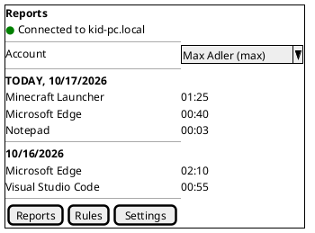
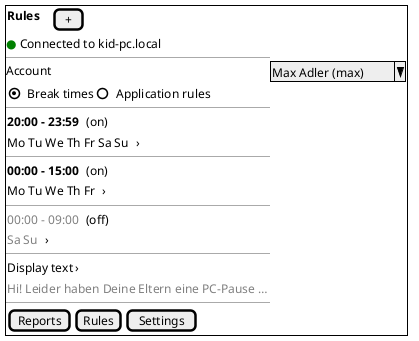
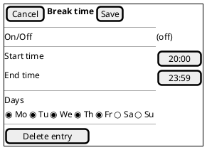
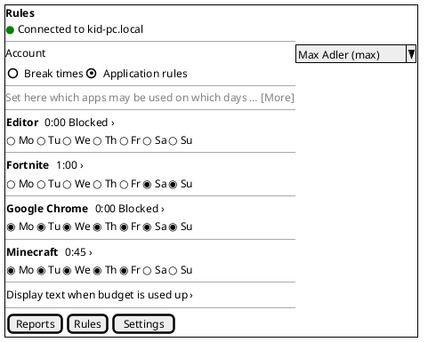
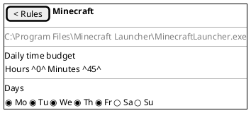
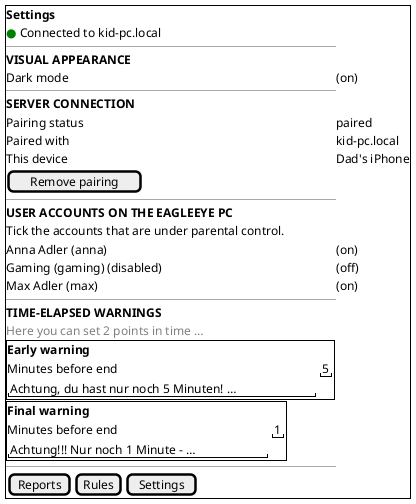
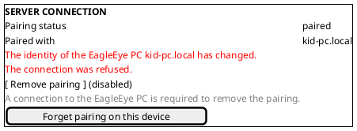
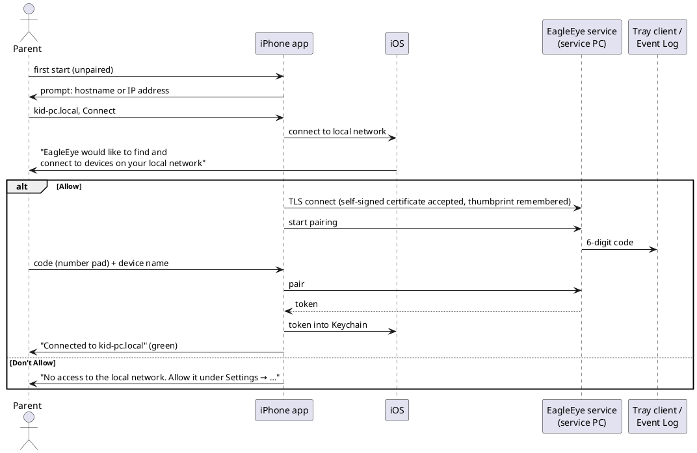
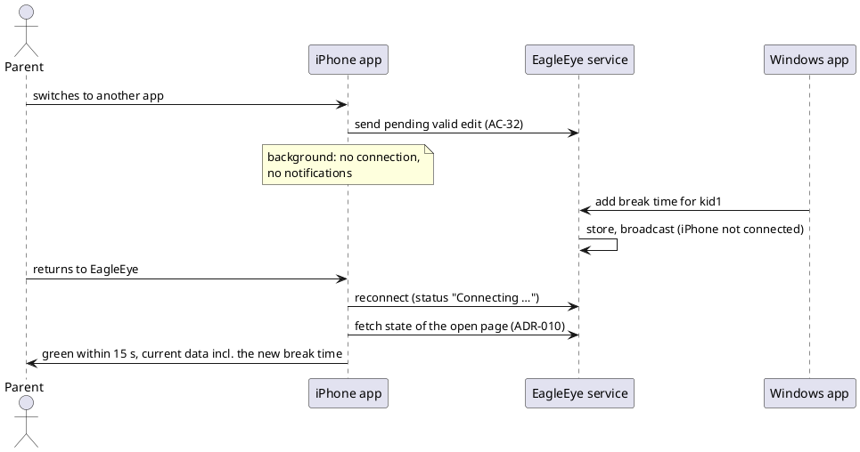

# US-007: iPhone Parent App (Portrait)

**Status**: New
**Created**: 2026-10-17
**Component(s)**: EagleEye.ParentApp (shared MAUI codebase and `EagleEye.ParentApp.Core`); EagleEye.Service, EagleEye.TrayClient and EagleEye.Shared are used as they are (no change expected, see AC-58)
**Platform(s)**: **ParentApp iOS (iPhone)**, built and deployed on the **MacBook**; manually tested on Michael's iPhone against the service on the Windows Developer Machine. ParentApp Windows only for regression (AC-57).

---

## User Story

As a **parent**, I want the EagleEye parent app on my iPhone, with everything the Windows parent app can do, laid out for an upright phone screen, so that I can pair with the EagleEye PC, choose the controlled accounts, set break times, app budgets and warnings, and look at the reports from my phone, wherever I am in the house.

---

## Background

US-002 to US-006 built every parent-side feature in the **Windows parent app**, the initial testing vehicle (general product requirements §3.3). Android and iOS are the primary production platforms (Michael, 2026-10-03). On 2026-10-17 Michael asked for the iPhone app next: "I want an iOS app for my iPhone which has the same functionality as the parent app for windows, just on iPhone. … The app shall be used in portrait mode only, so consider the layout adjustments so that it looks nice."

This changes the order in `01_Intend_and_Constraints/technology_selection.md` ("iOS and Android … in a later stage, after the MacOS application … matured"): iOS now comes before macOS and Android. The product requirements already cover the iPhone app: FR-APP-080 (portrait only, platform-typical look and feel), FR-APP-082 (functionally identical on all platforms), FR-CR-011 (one codebase) and §9.2 (iOS 26 and newer, portrait only, sideloading, no App Store). The proposed v1.7 amendment below makes the iPhone-specific parts precise.

**What the Windows parent app does today (build 0.6.2)**, which is the scope of this story:

| Area | Windows parent app | Source |
|---|---|---|
| Connection and pairing | Host dialog on first start; hostname or IPv4; TLS with the service's self-signed certificate, pinned after pairing; 6-digit code from the tray or Event Log, device name; wrong or expired code; status "Connected to <host>" with a green or red indicator; auto-connect when paired; host read-only while paired; "Remove pairing" online only; **"Forget pairing on this device"** when the PC is unreachable or its identity changed | US-002, ISSUE-009 (`02_Implementation/docs/testing/US-006/issues/ISSUE-009.md`, US-006 implementation report D-19) |
| Settings | Visual appearance (light/dark switch, follows the OS until set); Server connection; User accounts on the EagleEye PC (tick = under parental control); Time-elapsed warnings (early and final: minutes and text) | US-002, US-003, US-006 |
| Rules | Account selection; Break times (table: delete, On/Off, start, end, 7 weekdays; add; display text); Application rules (table: app, hours, minutes, 7 weekdays; program path as tooltip; budget text) | US-005, US-006 |
| Reports | Account selection; per day, today first: app and usage HH:MM; live update | US-004 |
| Texts | German and English; parent's texts never translated; unchanged default texts follow the language of the app that shows them | NFR-L-010..012, ADR-016 |
| Several parent apps | Every change goes through the service, which stores it and broadcasts it; others update within 5 s; last write wins; no polling | US-003 AC-23/24, ADR-010 |

References: FR-APP-010 to FR-APP-015, FR-APP-020 to FR-APP-022, FR-APP-030 to FR-APP-032, FR-APP-040, FR-APP-041, FR-APP-050 to FR-APP-054, FR-APP-060, FR-APP-080, FR-APP-082, FR-APP-083, FR-CR-011, CN-010 to CN-016, NFR-S-013, NFR-S-014, NFR-L-010 to NFR-L-012, NFR-U-011, §9.2; ADR-007, ADR-008, ADR-009, ADR-010, ADR-016; arc42 §11 R-1 ("Self-signed certificate rejected by iOS/Android MAUI clients … validate when those platforms are addressed").

**Terms used in this story**

- *Service PC*, *account*, *controlled account*, *app*, *app rule*, *break time entry*, *display text*, *budget text*, *warning levels*: as in US-003 to US-006.
- *iPhone app*: the EagleEye parent app built for iOS and installed on an iPhone.
- *Windows app*: the EagleEye parent app for Windows (0.6.2 or later).
- *Tab bar*: the iOS bar at the bottom of the screen with one button per page.
- *Edit view*: a screen that opens from a list row to edit one entry or one app rule, and closes back to the list.
- *Done key*: the "Done" ("Fertig") button that iOS shows on or above the keyboard.
- *Foreground / background*: the iPhone app is in the foreground while it is on screen; it goes to the background when the parent switches to another app, goes to the Home Screen, or the iPhone locks.
- *Deploy*: installing or updating the iPhone app from the MacBook (Xcode sideload, §9.2).

---

## Proposed Split (decision for Michael, OQ-1)

The story is big. Two parts carry different risks:

- **Part a: platform, pairing, Settings, Reports.** Toolchain on the MacBook, signing and deploy, the Local Network permission, the pinned self-signed certificate on iOS (arc42 R-1), Keychain, reconnect after background, tab bar and the portrait frame. The Reports page is read-only and small; it proves the data path end to end.
- **Part b: Rules.** Break times and application rules with their texts. This is the largest layout and editing work (tables of 10 and 11 columns become lists with edit views).

**Recommendation**: split into **two** stories, **US-007 = part a** and **US-008 = part b**. Part a removes the technical unknowns first, with little UI. Part b then builds on a working, deployed app. A third story for Reports alone would add a full gate cycle for one read-only page. Until Michael decides, this file stays one story; each AC group below is tagged **[a]** or **[b]**.

---

## Product requirement amendment (v1.7, proposed with this story, not yet applied)

`02_Implementation/docs/requirements/general-product-requirements.md` would get a v1.7 amendment, to be approved by Michael together with this story:

- **§9.2 iOS (ParentApp)** (made precise): **Devices**: iPhone only; iPad is not supported (OQ-2). **Orientation**: portrait, locked; the app does not rotate (also not upside down). **Minimum**: iOS 26. **Build host**: MacBook (ADR-007). **Distribution**: sideload from Xcode on the MacBook, signed with Michael's Apple ID; free or paid Apple Developer account per OQ-4, with the resulting re-sign interval. No App Store.
- **FR-APP-080** (made precise): on iPhone (and later Android), every page has a portrait layout of its own, usable on screens from 375 to 440 points wide; touch targets at least 44 × 44 points; content stays inside the safe area; text follows the iOS text size within the limits of AC-14.
- **FR-APP-010, CN-011** (note): on iOS, a hostname works only if the iPhone can resolve it (e.g. `kid-pc.local` through Bonjour/mDNS, or a name the home router's DNS knows). Windows-only name resolution (NetBIOS, LLMNR) is not available on iOS (OQ-9). An IPv4 address always works.
- **FR-APP-016** (new, also closes US-006 follow-up F-5 on the requirements side): a parent app may forget its pairing **on its own device only** when the service is unreachable or its identity has changed; the device entry may remain on the service (ISSUE-009, D-19). This applies to all parent apps.
- **FR-APP-104** (new, §3.3.10 "iOS parent app"): the iPhone app asks for the iOS Local Network permission with an explanation, and tells the parent how to allow it when it is denied (AC-19, AC-20).
- **FR-APP-105** (new): the pairing token is kept in the iOS Keychain; it never leaves the iPhone in a readable form (AC-28).
- **FR-APP-106** (new): when the app returns to the foreground, it reconnects and refreshes all shown data without action by the parent (AC-33 to AC-36). The app does not keep a connection or receive pushes while in the background.
- **§1.2 / §11** (note): Michael's direction of 2026-10-17: the iPhone app comes before the macOS and Android apps.

---

## Acceptance Criteria

> **Language of UI texts** (NFR-L-010 to NFR-L-012): all UI texts quoted in these criteria and in the mockups are **English examples**, with the intended German wording in brackets. The iPhone app shows every text of its own, including error messages and the Local Network explanation, in the iPhone's language for the app: German if it is German, English if it is English, German for every other language (as the Windows app). The parent's own texts are never translated. Unchanged default texts (break display text, budget text, warning texts) follow the app's language (ADR-016). Dates follow the iPhone's region format. Differences in wording are notes, not Fails (US-002 Decision Q-11). Michael's iPhone is German, so test manuals give German iOS labels (*Einstellungen → Datenschutz & Sicherheit → Lokales Netzwerk*, etc.).

> **Test setup**: the service PC (Windows Developer Machine) with EagleEye 0.6.2 or later, the standard accounts `kid1`, `kid2` (controlled) and `kid3` (not controlled), as in US-006; Michael's iPhone (iOS 26 or later) in the **same Wi-Fi/LAN subnet** as the service PC; the Windows app A paired with the service. The iPhone app is deployed from the MacBook (Prerequisites). Optional: the iOS Simulator on the MacBook for the smallest screen (OQ-11).

### A. Installation, distribution and device support [a]

- [ ] **AC-1**: The iPhone app is built on the MacBook from the same parent app codebase as the Windows app (FR-CR-011) and installed on Michael's iPhone from the MacBook (Xcode sideload, §9.2). No App Store, no TestFlight, no other computer is needed.
- [ ] **AC-2**: The app installs and runs on iPhones with iOS 26 or later. On the Home Screen it has the name "EagleEye" and the EagleEye eye icon (OQ-5).
- [ ] **AC-3**: The app version is visible on the iPhone: *Settings → General → iPhone Storage → EagleEye* ("Einstellungen → Allgemein → iPhone-Speicher → EagleEye") shows the EagleEye product version (e.g. "0.7.0"), the same version scheme as the Windows installers.
- [ ] **AC-4**: Deploying a newer (or the same) version over an installed app keeps the pairing and the appearance choice: afterwards the app connects without a new pairing code.
- [ ] **AC-5**: When the parent deletes the app from the iPhone (*Remove App → Delete App*, "App entfernen → App löschen") and installs it again, the app starts **unpaired**, with the host prompt of AC-17. No earlier pairing, token or host is used, even if iOS kept data elsewhere (e.g. the Keychain). The device entry on the service stays, as with the Windows uninstall (US-002 Q-2).
- [ ] **AC-6**: The app is an iPhone app. On an iPad it is not offered as an iPad app (OQ-2).
- [ ] **AC-7**: When Michael uses a free Apple ID for signing and the signing period ends (7 days), the app no longer starts on the iPhone. After a new deploy from the MacBook it starts again with pairing and settings kept (AC-4). With a paid Apple Developer account the period is one year. *(Verification depends on OQ-4; TES may test it once.)*

### B. App frame, navigation and look [a]

- [ ] **AC-8**: The app runs in **portrait only**. Turning the iPhone sideways or upside down does not rotate any page, dialog or edit view.
- [ ] **AC-9**: The app has a **tab bar** at the bottom with three tabs, each with an icon and a label, in this order: "Reports" ("Berichte"), "Rules" ("Regeln"), "Settings" ("Einstellungen") (OQ-6). There is no side menu. The selected tab is highlighted. Every page has its title at the top, in the iOS style.
- [ ] **AC-10**: When the app starts paired, it opens on **Reports** (as the Windows app, ISSUE-007). When it starts unpaired, it opens on **Settings** and shows the host prompt (AC-17).
- [ ] **AC-11**: Every page shows the **connection status** directly below the page title (OQ-7), with the indicator and texts of US-002 AC-10: green "Connected to <host>" ("Verbunden mit <host>"); red "Connecting to <host> …" ("Verbinde mit <host> …"); red "Not connected" / "Not connected to <host>" ("Nicht verbunden" / "Nicht verbunden mit <host>"). A long host name is shortened with "…", never cut off without it, and never pushes the indicator off screen.
- [ ] **AC-12**: Nothing is hidden behind the notch or Dynamic Island, the iOS status bar (clock, battery) or the home indicator, on iPhones with and without a Home button. Lists scroll under the title area and above the tab bar as usual on iOS; the last row of a list can be scrolled fully into view.
- [ ] **AC-13**: **Light and dark**: on the first start the app follows the iPhone's appearance (*Settings → Display & Brightness*, "Anzeige & Helligkeit"), and the switch of AC-37 shows it. Until the parent sets the switch, the app follows changes of the iPhone's appearance, also while it is open (including automatic switching at sunset). After the parent sets the switch, the app keeps that appearance (FR-APP-083; OQ-8). All pages, the tab bar, the edit views, the pickers, the keyboard and the alerts are readable in both appearances; the iOS status bar (clock, battery) stays readable.
- [ ] **AC-14**: **Text size** (Dynamic Type): the app's texts follow the iPhone's text size (*Settings → Display & Brightness → Text Size*, "Textgröße"). From the smallest size up to the largest size without "Larger Accessibility Sizes", no text is cut off or overlaps another element; long texts wrap. With accessibility sizes, every function stays reachable, but rows may grow and pages may need scrolling (OQ-10).
- [ ] **AC-15**: **Touch**: every control that can be tapped (buttons, switches, weekday selectors, list rows, tabs) has a touch area of at least 44 × 44 points and does not trigger a neighbouring control. The app uses iOS controls with an iOS look and behaviour: switches instead of checkboxes, iOS alerts and action sheets for confirmations, iOS pickers for times and numbers, swipe to delete in lists (FR-APP-080; OQ-3).
- [ ] **AC-16**: **Keyboard**: when the keyboard is shown, the field being edited scrolls into view and stays visible above the keyboard. Every field that opens a number pad (which has no Return key on iPhone) offers a **Done key** ("Fertig") above the keyboard. Tapping outside a field closes the keyboard. Layouts work on screens from 375 to 440 points wide, e.g. iPhone SE (2nd/3rd generation) to iPhone Pro Max (OQ-11).

### C. Connection, permission and pairing [a]

- [ ] **AC-17**: When the app starts unpaired, it asks for the service PC's address in a prompt (English example: "Enter the hostname or IP address of the EagleEye PC", as US-002 AC-11) with a text field, a hint with examples (English example: "e.g. kid-pc.local or 192.168.1.20"), and the buttons "Connect" ("Verbinden") and "Cancel" ("Abbrechen"). The field uses the iOS keyboard for addresses (no auto-capitalization, no autocorrection). After "Cancel", the Settings page shows "not paired", and the parent can enter the host in the "Server connection" section instead.
- [ ] **AC-18**: An IPv4 address always works. A hostname works when the iPhone can resolve it: `<name>.local` of the service PC (Bonjour/mDNS), or a name that the home router's DNS resolves (OQ-9). When the name cannot be resolved or the host cannot be reached, the app shows the connection error of US-002 AC-12 that names the host (English example: "Connection error: could not connect to the EagleEye service at kid-pc"), the indicator stays red, and the parent can correct the input.
- [ ] **AC-19**: **Local Network permission**: the first time the app connects to the service PC, iOS asks whether EagleEye may find and connect to devices on the local network. The prompt shows the app's explanation (English example: "EagleEye connects to the EagleEye PC in your home network to show and change the rules for your kids." / German: "EagleEye verbindet sich mit dem EagleEye-PC in Ihrem Heimnetz, um die Regeln Ihrer Kinder anzuzeigen und zu ändern."). After "Allow" ("Erlauben"), the connection and pairing continue without a restart of the app.
- [ ] **AC-20**: When the Local Network permission is denied (at the prompt or later in the iOS settings), the app does not show a generic connection error. It shows a message that names the cause and the place to change it (English example: "EagleEye has no access to the local network. Allow it under Settings → Privacy & Security → Local Network." / German: "EagleEye hat keinen Zugriff auf das lokale Netzwerk. Erlauben Sie ihn unter Einstellungen → Datenschutz & Sicherheit → Lokales Netzwerk."), and the indicator stays red. When the parent allows it and returns to the app, the app connects without a restart (AC-33).
- [ ] **AC-21**: The connection is encrypted with the service's self-signed certificate (CN-012). At no point is the parent asked to accept, install or trust a certificate or a profile, in the app or in the iOS settings, whether the host is a name or an IP address (CN-013, US-002 AC-7).
- [ ] **AC-22**: Pairing works as in US-002 AC-13 to AC-20: the app asks for the 6-digit code (shown by the tray client or the Event Log on the service PC) and a device name. The code field opens the **number pad** and accepts a pasted code. The device name field is empty with an example as placeholder (English: "e.g. Dad's iPhone"). An empty device name, a wrong code and an expired code (after 5 minutes) give the messages of US-002 AC-17 to AC-19; a new attempt gets a new code.
- [ ] **AC-23**: After a successful pairing, the status shows green "Connected to <host>", the "Server connection" section shows "paired", the host and the device name, and the app stays on Settings so that the parent can tick the accounts next (OQ-6). As long as the app is not paired, it never shows green (US-002 AC-20).
- [ ] **AC-24**: **Pinning**: after pairing, the app accepts only the certificate it saw during pairing (ADR-008 §3). When the service PC presents a different certificate (e.g. EagleEye was reinstalled into a new data folder), the app does not connect and shows the message of the Windows app (English example: "The identity of the EagleEye PC <host> has changed. The connection was refused." / German: "Die Identität des EagleEye-PCs <host> hat sich geändert. Die Verbindung wurde abgelehnt.").
- [ ] **AC-25**: A paired app connects to the stored host by itself, without any input, and shows green within 30 seconds after the app was started (provided the service runs and the iPhone is in the LAN), as US-002 AC-21. When the service is stopped while the app is in the foreground, the app shows red within 30 seconds; when the service runs again, the app reconnects by itself and shows green within 60 seconds (US-002 AC-22).
- [ ] **AC-26**: **Remove pairing** (online): while paired and connected, "Server connection" offers "Remove pairing" ("Kopplung aufheben"). The app asks for confirmation (iOS alert with a destructive button). After confirming, the service no longer accepts this iPhone, the app forgets host and token and returns to "not paired" (red), and a new pairing needs a new code (US-002 AC-26 to AC-29). Other parent apps stay connected.
- [ ] **AC-27**: **Forget pairing on this device** (offline, ISSUE-009 fix): while paired, **not** connected, and the last connection attempt failed because the service PC was unreachable or its identity changed (AC-18, AC-24), "Server connection" shows the disabled "Remove pairing" with the hint "A connection to the EagleEye PC is required to remove the pairing." ("Zum Aufheben der Kopplung ist eine Verbindung zum EagleEye-PC nötig.") and, below it, the button "Forget pairing on this device" ("Kopplung auf diesem Gerät löschen"). Tapping it asks for confirmation with the title and text of the Windows app (ISSUE-009 Resolution, English: "Forget pairing on this device?" / "The EagleEye PC {host} cannot be reached or its identity has changed. The pairing is deleted on this device only. …"). After confirming, the app stops connecting, deletes host, certificate pin and token on the iPhone, returns to "not paired" with the host pre-filled, and shows "The pairing with {host} was deleted on this device. Pairing again requires a new pairing code." After "Cancel" nothing changes. While connected, only "Remove pairing" is offered. The parent is never stuck in "paired" without a way out (the deadlock of ISSUE-009 cannot happen on the iPhone).
- [ ] **AC-28**: The pairing token is stored in the **iOS Keychain**, accessible only to this app on this iPhone (FR-APP-105, NFR-S-014). It is never shown in the app, never written to a log and not part of an iCloud or Finder backup in a form that another iPhone could use (OQ-13). Host, device name and certificate pin may be kept in the app's own storage.
- [ ] **AC-29**: While the app is paired, the host is shown read-only; to use another host the parent removes or forgets the pairing first (US-002 AC-25).
- [ ] **AC-30**: The iPhone app and the Windows app(s) can be paired with the same service at the same time; all show "Connected to <host>" (US-002 AC-24). Removing or forgetting the pairing on the iPhone does not affect the Windows app, and vice versa.

### D. Background and foreground [a]

- [ ] **AC-31**: While the app is in the background (other app, Home Screen, iPhone locked), it needs no connection, does not show notifications and does not run in the background (push notifications are out of scope, OQ-14). It never uses more battery than a closed app because of EagleEye.
- [ ] **AC-32**: Before the app goes to the background, a **valid** change that the parent has typed or picked but not yet confirmed (a text, a number, a time) is sent to the service as if the parent had tapped the Done key. An invalid value is not sent and the field shows the stored value again when the app returns.
- [ ] **AC-33**: When the app returns to the foreground, it reconnects by itself, without any action of the parent. If the service is reachable, the status is green **within 15 seconds** after the app is back on screen (OQ-12), and the open page then shows the data currently stored in the service (ADR-010: fetch on every reconnect). Until then the status shows "Connecting to <host> …" and the page shows "Loading …" ("Wird geladen …") or "No data available" ("Keine Daten verfügbar"), never data that might be outdated as if it were current.
- [ ] **AC-34**: Changes made by another parent app or by the service while the iPhone app was in the background (e.g. a break time added in the Windows app, a new app started by the kid, usage counted) are shown after the return (AC-33), on every page, without pull-to-refresh or a restart.
- [ ] **AC-35**: When the app returns to the foreground on a later day, "Today" on Reports is the current day of the service PC, and the previous day moves down (US-004 AC-18).
- [ ] **AC-36**: When the iPhone leaves the Wi-Fi (e.g. the parent leaves the house) and comes back, the app shows red while away and reconnects by itself within 60 seconds after the iPhone is back in the Wi-Fi and the app is in the foreground.

### E. Settings page [a]

- [ ] **AC-37**: The Settings page is a scrolling list of grouped sections (iOS style), in this order: "Visual appearance" ("Darstellung"), "Server connection" ("Serververbindung"), "User accounts on the EagleEye PC" ("Benutzerkonten auf dem EagleEye-PC"), "Time-elapsed warnings" ("Zeit-Ende Warnungen"). "Visual appearance" has one switch "Dark mode" ("Dunkler Modus"; AC-13) that applies at once, without a restart, and is kept across restarts and deploys.
- [ ] **AC-38**: "Server connection" shows the states of US-002 and ISSUE-009 for portrait: not paired (host field, "Connect"), pairing (code, device name, "Pair", "New code", "Cancel"), paired (status, host, device name, "Remove pairing" / "Forget pairing on this device", AC-26, AC-27). Messages wrap and are never cut off. Buttons are full-width or iOS list buttons, at least 44 points high.
- [ ] **AC-39**: "User accounts on the EagleEye PC" shows the instruction text and one row per standard account (name as US-003 AC-11, "(disabled)" note as AC-12 there) with an iOS **switch** "Under parental control" ("Unter Elternkontrolle") on the right. A long account name wraps; the switch stays visible. Sorting, states ("No data available", "No non-admin accounts available", "Loading …"), immediate save on switching, error and revert, and the 5-second sync behave as in US-003 AC-7 to AC-18 and AC-23/24.
- [ ] **AC-40**: "Time-elapsed warnings" shows the explanatory text and two **cards**, "Early warning" ("Frühe Warnung") and "Final warning" ("Finale Warnung"), one below the other (no three-column table). Each card has "Minutes before end" ("Minuten vor Ende") and the warning text in a multi-line editor below it (OQ-15). Defaults, ranges (1..59, early > final), messages, 500 characters, emojis (iOS emoji keyboard), empty text restores the default: as US-006 AC-13 to AC-16.
- [ ] **AC-41**: **Saving on touch** (Settings and Rules): a switch or a weekday selector is saved when it is tapped. A minutes field is saved when the parent taps the Done key, taps outside the field, changes the page or tab, or the app goes to the background (AC-32). A multi-line text is saved when the parent taps the Done key above the keyboard, leaves the editor, closes the edit view, changes the page, tab or account, or the app goes to the background. Every saved change behaves as on Windows: confirmed state shown, error "The change could not be saved. Please try again." with revert (US-003 AC-16, US-005 AC-18), shown in other parent apps within 5 seconds.

### F. Rules page: account and break times [b]

- [ ] **AC-42**: The Rules page shows at the top the account selection "Account" ("Konto"), an iOS menu or picker with the controlled accounts (names and order as US-004 AC-17; the first account is selected when the page opens). Below it, a **segmented control** switches between "Break times" ("Ruhezeiten") and "Application rules" ("Applikations-Regeln") (OQ-16). The states "No data available", "No accounts under parental control. Select accounts under Settings." and "Loading …" are shown as in US-005 AC-6.
- [ ] **AC-43**: "Break times" shows the entries of the selected account as a **list of rows** in creation order (US-005 OQ-11), one row per entry, without horizontal scrolling. Each row shows: the time range in 24-hour format (e.g. "20:00 – 23:59"), the weekdays as a compact line of the ticked days (e.g. "Mo Tu We Th Fr", German "MO DI MI DO FR"; all seven: the list of all seven days), and an iOS switch for On/Off on the right. An entry that is off is shown dimmed. An account without entries shows "No break times defined." ("Keine Ruhezeiten festgelegt.").
- [ ] **AC-44**: Tapping the On/Off switch in a row saves it at once (AC-41). Tapping the rest of a row opens the **edit view** of that entry (AC-46).
- [ ] **AC-45**: A "+" button in the page's title bar (English label for VoiceOver: "Add new entry", "Eintrag hinzufügen") opens the edit view for a **new** entry, pre-set with the defaults of US-005 AC-7: Off, 20:00, 23:59, all seven days. The entry is created only when the parent taps "Save" ("Sichern"); "Cancel" creates nothing (OQ-17). At 20 entries the "+" button is disabled (US-005 OQ-8).
- [ ] **AC-46**: The **edit view** of a break time entry shows, from top to bottom: an On/Off switch; "Start time" ("Start-Zeit") and "End time" ("End-Zeit"), each set with the iOS time picker in 24-hour format, in steps of one minute; the **weekday selector** (AC-47); for an existing entry the destructive button "Delete entry" ("Eintrag löschen"). The title bar has "Cancel" ("Abbrechen") and "Save" ("Sichern"). "Save" stores the whole entry at once and closes the view; "Cancel" discards the changes (OQ-17).
- [ ] **AC-47**: The **weekday selector** is one row of seven round or rounded buttons, Monday to Sunday, labelled "Mo", "Tu", "We", "Th", "Fr", "Sa", "Su" ("MO", "DI", "MI", "DO", "FR", "SA", "SO"), each at least 44 × 44 points; a ticked day is filled with the accent colour, an unticked day is outlined. It fits in one row on a 375-point-wide screen. The week always starts on Monday, whatever the iPhone's region. With VoiceOver each button reads the full day name and "selected" / "not selected". The same selector is used for application rules (AC-51).
- [ ] **AC-48**: On "Save", the entry is validated as a whole (start and end together, unlike the field-by-field check on Windows): the end time must be later than the start time (23:59 means until midnight, US-005 AC-21), and at least one day must be ticked. Otherwise nothing is saved, the edit view stays open, and the app shows the messages of US-005 AC-10 and AC-11 ("The end time must be later than the start time.", "Select at least one day."). Times outside 00:00 to 23:59 cannot be entered.
- [ ] **AC-49**: **Deleting**: swiping a row to the left shows "Delete" ("Löschen"); tapping it deletes the entry at once (iOS list behaviour, like the trash can on Windows). "Delete entry" in the edit view asks for confirmation (iOS action sheet), then deletes and closes the view. When another parent app deletes the entry while its edit view is open on the iPhone, "Save" fails with "The change could not be saved. Please try again." and the view closes; the entry is gone from the list. When another parent app changes the entry while its edit view is open, "Save" overwrites it (last write wins, US-005 AC-19).
- [ ] **AC-50**: Below the list, the row "Display text" ("Anzeige Text") shows the first lines of the account's break display text; tapping it opens a full-screen text editor with the text, line wrap and the iOS emoji keyboard. Saving follows AC-41 (closing the editor saves); 500 characters; an empty text restores the default; the default follows the app's language (US-005 AC-15/16, US-006 AC-10, ADR-016).

### G. Rules page: application rules [b]

- [ ] **AC-51**: "Application rules" shows the explanatory text of US-006 AC-1 (collapsible or shortened with "More", OQ-18) and then one row per app record of the selected account, sorted by display name as US-006 AC-2/AC-3 (Windows Explorer never listed; "No apps recorded yet." when empty). Each row has **two lines**: line 1 the app's display name (wrapping if long) and, on the right, the daily budget as "H:MM" (e.g. "0:45", "1:00"); line 2 the **weekday selector** of AC-47, which can be tapped directly in the row. An app that is not allowed on any day (budget 0:00 or no day ticked) shows the label "Blocked" ("Gesperrt") next to its budget, so the parent sees blocked apps at a glance.
- [ ] **AC-52**: Tapping a weekday in a row saves it at once (AC-41). All seven days unticked is allowed (US-006 AC-7). Tapping the budget (or the app name) opens the **edit view** of the app rule: the display name, the **program path** in small text (the Windows tooltip, US-006 OQ-12, so two apps with the same name can be told apart), the daily budget with an iOS picker of hours (0..23) and minutes (0..59), and the weekday selector. Budget and days changed in the edit view are saved at once when the picker is closed or a day is tapped (no "Save" button, as on Windows; OQ-17). Invalid budgets cannot be entered; 0:00 is valid (US-006 AC-8/AC-9).
- [ ] **AC-53**: An app found for the first time appears in the list with the default rule (0:00, no day, "Blocked") within 15 seconds while the page is open (US-006 AC-4, AC-5), in its alphabetical place, without the list jumping away from what the parent is editing.
- [ ] **AC-54**: Below the list, the row "Display text when budget is used up" ("Anzeige Text wenn Budget aufgebraucht") opens the budget text editor, with the behaviour of AC-50 and US-006 AC-10.

### H. Reports page [a]

- [ ] **AC-55**: The Reports page shows the account selection (as AC-42) and below it the usage of the selected account as a grouped list: one section per day, **today first** (heading as US-004 AC-18, e.g. "Today, 10/17/2026", German "Heute, 17.10.2026"), and in each section one row per app with the display name on the left (wrapping if long) and the usage "HH:MM" on the right, sorted by usage, longest first. The column header line "App | Usage (HH:MM)" may be shown once per section or once at the top. Empty states and "No usage recorded today" as US-004 AC-19/AC-20.
- [ ] **AC-56**: While the Reports page is in the foreground and connected, it updates by itself through the service's push, at most 15 seconds behind the real active time, and a new app appears within 15 seconds (US-004 AC-22). Switching the account and the account list changes behave as US-004 AC-21/AC-23.

### I. Coexistence with the Windows app and the service [a] and [b]

- [ ] **AC-57**: Every change made in the iPhone app (account ticks, warnings, break times, app rules, texts) appears in a connected Windows app on the same page within 5 seconds, and every change made in the Windows app appears in the iPhone app (in the foreground) within 5 seconds, without any action there and without polling. When both change the same value at about the same time, the last change the service receives wins, and both apps then show the same state (US-003 AC-24, US-005 AC-19, US-006 AC-17). **[a]** for Settings and Reports, **[b]** for Rules.
- [ ] **AC-58**: The iPhone app needs no change on the service PC: the same service (0.6.2 or later), port, firewall rule and certificate as for the Windows app; no new installer step. The service log shows changes from the iPhone app with the same entries as changes from the Windows app (US-003 AC-14, US-005 AC-12, US-006 AC-11).
- [ ] **AC-59**: The **Windows app** keeps its desktop layout and behaviour (FR-APP-081): no visible change on the Settings, Rules and Reports pages compared with 0.6.2, except the version number. Checked with the regression checklist (`02_Implementation/docs/testing/regression-checklist.md`).

### Change Log

| Date | Change | Source |
|---|---|---|
| 2026-10-17 | Story created; split proposal; product requirements v1.7 amendment proposed (not applied); OQ-1 to OQ-20 open | Michael's request (2026-10-17), written by PRO |

---

## UI / Interaction Notes

Portrait mockups for an iPhone about 390 points wide. "◉" is a filled weekday button, "○" an outlined one; "(on)" / "(off)" are iOS switches; "›" opens an edit view. Colours follow the app's light/dark appearance and the accent colour of ISSUE-007; the heading bars of the Windows app become iOS section headers.

### Pattern overview: Windows table → iPhone

| Windows (desktop, wide) | iPhone (portrait) |
|---|---|
| Left navigation menu: Settings, Rules, Reports | Tab bar at the bottom: Reports, Rules, Settings |
| Status bar at the bottom of the window | Status line below the page title (AC-11) |
| Checkbox "Under parental control" | iOS switch in the account row |
| Break times table (delete, On/Off, start, end, 7 days) | List rows "20:00 – 23:59 / Mo Tu We Th Fr / switch"; edit view with time pickers, weekday selector, Cancel/Save; swipe to delete |
| Application rules table (app, hours, minutes, 7 days) | Two-line rows: name + budget + "Blocked"; weekday selector in the row; edit view with hours/minutes picker and program path |
| Typed time "HH:MM", saved when leaving the field | iOS time picker (24 h); no invalid input possible |
| Typed hours / minutes | iOS picker wheels 0..23 / 0..59 |
| Display text / budget text edit box beside the table | Row with text preview → full-screen editor |
| Warnings table (3 columns, 2 rows) | Two cards, minutes field with number pad and Done key, text editor below |
| Reports: day heading + 2-column table | Grouped list, one section per day, name left, HH:MM right |
| Tooltip (program path) | Small text in the edit view |
| Windows emoji panel (Win + .) | iOS emoji keyboard |
| 150 % display scaling | Dynamic Type (AC-14) |

### Reports (tab bar, status line, grouped list) — AC-9, AC-11, AC-55

### Rules — break times list — AC-42 to AC-44, AC-49, AC-50

Swipe a row to the left for "Delete". "+" opens the edit view for a new entry.

### Rules — break time edit view — AC-45 to AC-48

Tapping a time opens the iOS time picker (24 h). The weekday buttons are at least 44 × 44 points and fit in one row on a 375-point screen.

### Rules — application rules list — AC-51 to AC-54

### Rules — app rule edit view — AC-52

### Settings — AC-37 to AC-40

### Settings — paired, not reachable or identity changed — AC-27

### Flow: first start, Local Network permission, pairing — AC-17 to AC-23

### Flow: background and foreground — AC-31 to AC-36

---

## Out of Scope

- **iPad** as a supported device, landscape layouts, Split View, Stage Manager (OQ-2).
- **Android** parent app and **macOS** parent app (separate stories; the portrait layouts should be reusable for Android, OQ-19).
- **Push notifications**, background refresh, widgets, Live Activities, Siri/Shortcuts, Apple Watch (OQ-14).
- **App Store, TestFlight**, enterprise distribution, MDM (§10).
- Features the Windows app does not have either: device management for other devices (rest of FR-APP-015), events (FR-APP-070), "used vs. budget" on Reports (FR-APP-061), the history of blocked starts, debug-mode switch (FR-SVC-102), re-scan of installed apps (FR-APP-033), a configurable close timeout (FR-SVC-021).
- Automatic discovery of the service PC (Bonjour browsing, QR code), remote access outside the LAN (CN-017).
- Face ID / passcode lock for the app, a parent PIN, and protection against a kid who pairs their own parent app (accepted risk, US-005 OQ-15).
- Editing while not connected (offline cache; US-005 OQ-4 applies: "No data available").
- Changes to the service, the tray client or the SignalR contracts, unless ARC finds one is needed for iOS (then it is named in the plan).
- A "System" option for the appearance in addition to Light/Dark (OQ-8).
- Pull-to-refresh (OQ-14).
- Updating the US-002 user story and arc42 for the ISSUE-009 local forget pairing (US-006 follow-up F-5); only the v1.7 requirement FR-APP-016 is proposed here.

---

## Open Questions

Each question has a proposed answer. Michael answers in the "Answer" column. If he accepts a proposal, the ACs stay as written.

| ID | Question | Proposed answer | Answer |
|---|---|---|---|
| OQ-1 | **Split the story?** | Two stories: **US-007** = part a (platform, toolchain, deploy, pairing, Local Network, Keychain, background/foreground, Settings, Reports; groups A to E, H, AC-57 to AC-59 for these pages) and **US-008** = part b (Rules: break times, app rules, texts; groups F and G). See "Proposed Split". Alternative: three stories (Reports separate) or one big story. | |
| OQ-2 | **iPhone only, or iPad too?** | **iPhone only.** An iPad would need its own layouts (landscape, wider screens) and testing. The app is not offered as an iPad app (AC-6). | |
| OQ-3 | **iOS-native look, or the look of the Windows app?** | **iOS-native** (FR-APP-080: "platform-typical look and feel"): tab bar, grouped lists, switches, pickers, swipe to delete, iOS alerts, iOS fonts. Same texts, colours (accent colour of ISSUE-007) and functions as Windows (FR-APP-082). | |
| OQ-4 | **Apple Developer account.** With a free Apple ID, a sideloaded app stops starting after **7 days** and must be deployed again from the MacBook (also: at most 3 sideloaded apps per device, App IDs limited per week). A paid **Apple Developer Program** membership (99 USD/EUR per year) extends this to one year and would later allow TestFlight/App Store. | Start with Michael's **free Apple ID** for development and testing; re-deploy weekly from the MacBook (data is kept, AC-4, AC-7). Decide on the paid account before daily use by the family. Which Apple ID/team is used is stored only in `secrets/secrets.json` on the MacBook if a script needs it. | |
| OQ-5 | **App name and icon on the Home Screen.** | Name **"EagleEye"** (fits under the icon; the Windows product name "EagleEye Parent App" stays for Windows, US-002 Q-10). Icon: the existing EagleEye eye motif (`02_Implementation/src/EagleEye.ParentApp/Resources/AppIcon/appicon.svg`, green background), also for the launch screen. | |
| OQ-6 | **Tab order and pages after start and pairing.** Windows order is Settings, Rules, Reports. | iOS order **Reports, Rules, Settings** (most-used first, settings last, iOS convention). Start on Reports when paired, on Settings when unpaired (AC-10). After a successful pairing the app **stays on Settings**, so the parent can tick the accounts next (AC-23). | |
| OQ-7 | **Where does the connection status go?** The Windows status bar at the bottom would collide with the tab bar. | A one-line status directly **below the page title** on every page (AC-11), always visible. Alternative: show it only when not connected (banner) — rejected, because the host name and the green state are useful during tests. | |
| OQ-8 | **Theme switch or follow the system?** On iPhones dark mode often switches automatically at sunset. | **Keep the switch** (FR-APP-083, FR-APP-082: functionally identical). Until the parent touches it, the app follows the iPhone, including automatic switching (AC-13). A third option "System" ("Automatisch") for all platforms can be a later small story. | |
| OQ-9 | **Hostname on iOS.** The Windows app resolves "kid-pc" through Windows name resolution (NetBIOS/LLMNR), which iOS does not have. iOS resolves `kid-pc.local` (Bonjour, answered by Windows 10/11) and names known to the router's DNS (e.g. a FRITZ!Box knows "kid-pc" and "kid-pc.fritz.box"). | Accept this: IPv4 always works, hostnames work when the iPhone can resolve them (AC-18). The host prompt shows the hint "e.g. kid-pc.local or 192.168.1.20" (AC-17). No change to the Windows app's behaviour; the hint text may appear there as well, since texts are shared. TES tests `<name>.local`, the plain name and the IP. | |
| OQ-10 | **Dynamic Type: how far?** | All standard text sizes without cut-off (AC-14); accessibility sizes best effort (everything reachable, scrolling allowed). | |
| OQ-11 | **Small screens (iPhone SE, 375 × 667 points).** Michael probably tests on one iPhone only. | Layouts are designed for 375 to 440 points wide (AC-16, AC-47). Michael tests on his iPhone; DEV checks the SE size in the iOS Simulator on the MacBook (screenshots in the implementation report); TES may add an optional Simulator case. Which iPhone model and iOS version does Michael use? (needed for the test plan) | |
| OQ-12 | **Reconnect time after returning to the foreground.** | Green within **15 seconds** when the service is reachable (AC-33); 60 seconds after the iPhone is back in the Wi-Fi (AC-36). | |
| OQ-13 | **Keychain and backups / new iPhone.** If the parent restores a backup to a new iPhone, should the pairing move along? | **No.** The token is bound to this iPhone (AC-28). After a restore to another iPhone the app must not get stuck: if the stored pairing cannot authenticate, the app offers "Forget pairing on this device" or behaves as unpaired, and the parent pairs again. ARC to confirm which of the two is simpler; the AC then names it. | |
| OQ-14 | **Push notifications, background work, pull-to-refresh.** | **None** in this story (AC-31). Data is fetched on return to the foreground (AC-33) and pushed live while in the foreground. Pull-to-refresh is not needed because the page is live; it can be added if Michael misses it in testing. Event notifications to the parent (FR-APP-070) are a separate story for all platforms. | |
| OQ-15 | **Warning minutes: number pad or picker?** | **Number pad with Done key** (AC-16, AC-40), because the Windows rules (1..59, early > final, messages) stay the same and Michael asked for the numeric keyboard. Times and budgets use pickers (AC-46, AC-52), so invalid values cannot occur there. Alternative: an iOS stepper or picker for the minutes too. | |
| OQ-16 | **Break times and application rules on one long page, or two segments?** | A **segmented control** "Break times | Application rules" below the account selection (AC-42). One long page with up to 20 break times and dozens of apps is hard to scroll on a phone. The account selection stays the same for both segments. | |
| OQ-17 | **Saving in edit views: immediately, or "Cancel / Save"?** On Windows every value is saved when the field is left. On a phone, moving an entry from 08:00–09:00 to 10:00–11:00 field by field fails the "end after start" check (US-005 AC-10 note). | **Break time edit view: "Cancel / Save"** (as the iOS Clock alarm editor), validated as a whole (AC-46, AC-48); new entries are created only on "Save" (AC-45). **App rules: saved immediately** (weekday tap; budget when the picker closes), because each value is valid on its own (AC-52). Switches in list rows: immediately. | |
| OQ-18 | **Long explanatory texts** (application rules, warnings) take half an iPhone screen. | Show them shortened to two or three lines with "More" ("Mehr") to expand (AC-51); the wording stays as on Windows. | |
| OQ-19 | **Android later.** Should the portrait layouts be built so that the Android app can reuse them? | **Yes, as far as it costs nothing extra**: ARC plans one "phone" layout family in the shared codebase with iOS-specific details where needed. Android itself is not built or tested in this story. | |
| OQ-20 | **Windows-only features to leave out on the iPhone?** | **None.** Every function of the Windows app 0.6.2 is in the iPhone app (table in Background). Only the installer (replaced by the Xcode deploy, group A), the tooltip (replaced by the edit view, AC-52) and the Windows emoji panel (replaced by the iOS emoji keyboard) have iPhone equivalents. | |

---

## Prerequisites and Notes for ARC

**MacBook (all iOS builds, deploys and the Simulator run there; flagged for Michael's go):**

1. **.NET MAUI workloads are not installed on the MacBook** (orchestrator memory, toolchain of 2026-10-04: no `maui` / `maui-maccatalyst` / `maui-ios`). Installing them (`dotnet workload install maui`, or `maui-ios` plus `maui-maccatalyst`) **needs internet access and Michael's explicit go**. The first restore of the Microsoft packages at 10.0.13 on the MacBook also needs internet (`02_Implementation/docs/dev-process/dependency-log.md`).
2. **Xcode version vs. the .NET iOS workload**: the MacBook has macOS 27 and Xcode 27. Each .NET iOS workload release supports a specific Xcode version; ARC must check that the workload for .NET 10 accepts Xcode 27 (or name the Xcode version to install side by side). The iOS platform (device support and Simulator runtime) must be downloaded in Xcode (*Settings → Components*), and the Xcode license accepted.
3. **Signing**: Michael's Apple ID added in Xcode (*Settings → Accounts*) and a team chosen (Personal Team for a free Apple ID, OQ-4). The bundle identifier (`com.adlemich.eagleeye` in the csproj) must be accepted for that team.
4. **iPhone setup**: connected to the MacBook by cable (or paired for wireless debugging) and "Trust This Computer" confirmed; **Developer Mode** switched on (*Settings → Privacy & Security → Developer Mode*, restart); with a free Apple ID the developer certificate trusted once (*Settings → General → VPN & Device Management*).
5. **Project and scripts**: `EagleEye.ParentApp.csproj` selects target frameworks by host; on macOS it currently builds only `net10.0-maccatalyst` ("iOS is added here when iOS work starts"). `build.ps1`, `test.ps1` and a deploy script for iOS need to be planned (ARC); `package-macos.ps1` is unrelated. `02_Implementation/docs/dev-process/dev-environments.md` §5/§6 and `02_Implementation/docs/testing/README.md` §2 do not yet list the iPhone as a test device; the Orchestrator/TES update them.
6. **Network**: the iPhone must be in the same subnet as the service PC (the firewall rule allows `LocalSubnet` only, ADR-008 §7). A guest Wi-Fi or a separate mesh subnet will not work. ARC to check whether `<name>.local` may resolve to an IPv6 link-local address that the firewall rule or the service binding does not accept.

**Notes for ARC (HOW is ARC's choice; listed so that nothing is forgotten):**

- arc42 §11 **R-1**: certificate pinning with the .NET HTTP and WebSocket stack on iOS (the native URL session handler, App Transport Security). AC-21 requires no certificate prompt and no profile. ATS exceptions, if needed, should be limited to the local network (e.g. `NSAllowsLocalNetworking`) and must not switch off ATS globally; the pinned thumbprint stays the only trust decision (ADR-008 §3). The certificate's names (machine name, `localhost`) do not match `kid-pc.local` or an IP address, so the check must rely on the pin, as on Windows.
- **Local Network permission**: `NSLocalNetworkUsageDescription` in `Info.plist`, localized (German and English). iOS gives no direct "denied" status; ARC to define how AC-20 detects it.
- **Keychain** (`MauiSecureStorageSecretStore` is already registered for non-Windows platforms, ADR-009 D-2): accessibility "this device only" for AC-28; handling of a Keychain item that survives app deletion (AC-5).
- **App lifecycle**: SignalR connection on background/foreground (AC-31 to AC-36), revisions reset and fetch on every reconnect (ADR-010 §7).
- **Localization**: the app declares German and English as supported languages so that iOS offers the per-app language setting and `NSLocalNetworkUsageDescription` is localized; resx stays German neutral with `.en` satellite (US-001 lessons).
- **Orientation lock** and iPhone-only device family in `Info.plist`; launch screen.
- **US-006 is closed without a manual test run** (F-1 to F-8 in `02_Implementation/docs/testing/US-006/test-report.md`). The iPhone tests of the Rules page will run against the same service; failures in service-side enforcement are not iPhone defects. F-8 (deny by default) applies.
- The Windows app is the regression reference (AC-59). Shared view-model changes (e.g. a "Blocked" flag, or saving pending edits on background) must keep Windows behaviour.

---

## Related

- Prerequisite stories: US-002 (pairing, Windows app), US-003 (accounts), US-004 (Reports), US-005 (break times), US-006 (app rules, warnings; ISSUE-009 forget pairing, build 0.6.2)
- General product requirements: v1.7 amendment proposed with this story (§9.2, FR-APP-080, FR-APP-010/CN-011 note, FR-APP-016, FR-APP-104 to FR-APP-106); not applied before approval
- Architecture: ADR-007 (two machines), ADR-008 (TLS, pinning, pairing), ADR-009 (ParentApp.Core, secret storage), ADR-010 (fetch on reconnect, push), ADR-016 (default texts); arc42 §11 R-1
- Follow-ups from US-006: F-5 (US-002 docs for forget pairing) partly addressed by FR-APP-016; F-8 (rules for every controlled account) applies to the test setup
- Implementation Plan: `02_Implementation/docs/requirements/user-stories/US-007/implementation-plan.md` (added by ARC)
- Issues: `02_Implementation/docs/testing/US-007/issues/` (added by TES)
- Manual tests: `02_Implementation/docs/testing/US-007/` (added by TES)
