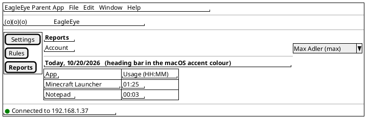
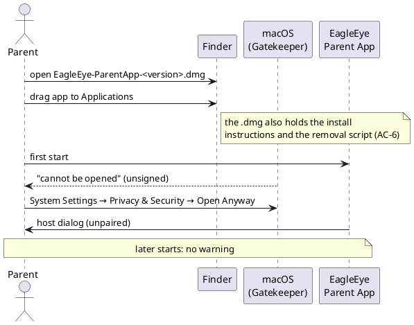

# US-007: macOS Parent App Parity

**Status**: Analyzed
**Created**: 2026-10-20
**Approved**: by Michael, 2026-10-20, with his answers to OQ-1 to OQ-4 (change in OQ-2); implementation plan approved 2026-10-20 (status `Analyzed`)
**Component(s)**: EagleEye.ParentApp (incl. EagleEye.ParentApp.Core). EagleEye.Service, EagleEye.TrayClient and EagleEye.Shared: no behaviour change expected (regression only, group I)
**Platform(s)**: ParentApp macOS (new, MacBook) · ParentApp Windows (unchanged, regression) · Windows (service/tray, unchanged, regression)

---

## User Story

As a **parent**, I want to install the EagleEye parent app on my Mac from a `.dmg` and use it exactly like the Windows parent app (pair it with the EagleEye PC, see the connection state, choose the look and the language, select the accounts under parental control, edit break times, app rules and warnings, and read the daily usage reports), so that I can manage my kids' rules from my Mac just as well as from a Windows PC.

---

## Background

CR-001 (`02_Implementation/docs/requirements/change-requests/CR-001-remove-mobile-platforms.md`) removed the iOS and Android parent apps. The parent app now ships as two production apps: the **Windows parent app** (own installer) and the **macOS parent app** (Mac Catalyst, `.dmg`, ADR-019). Michael decided that the Mac app must reach **full parity** with the Windows parent app (CR-001 Q-6, requirements §11.1 Q-6, FR-APP-082, FR-APP-110). This story closes that gap. The number US-007 is reused: the aborted iOS US-007 never reached `main`.

US-002 to US-006 were built and tested in the Windows parent app only. The Mac Catalyst target compiles from the same code on `main`, but it has not been built, run or tested on a Mac since US-001. Mac-specific gaps are therefore unknown. Candidates named by Michael and in arc42 risk R-3: window and menu behaviour, secure storage in the Keychain, TLS and WebSocket on the Mac, localization, light/dark appearance and `.dmg` packaging (`02_Implementation/scripts/package-macos.ps1` is still a stub).

The Mac app is **not distributed**. It runs on Michael's MacBook only. The `.dmg` is ad-hoc signed only, with no Developer-ID signature and no notarisation, and Michael allows it once in the macOS settings (CR-001 Q-7, ADR-019 §3, requirements §9.4).

From this story on, **every parent-app story names both apps** (CR-001 Q-6).

**What the Windows parent app does today (build 0.6.2), i.e. the parity reference**

| Capability | Defined in |
|---|---|
| Installation, update, uninstall; publisher, version | US-002 AC-1 to AC-5 |
| Desktop main window: menu (Settings, Rules, Reports), content, status bar; start page Reports when paired (Settings when not) | US-002 AC-8, AC-10; US-005 AC-1; ISSUE-007 |
| Light/dark switch, OS default on first start | US-002 AC-9 |
| Accent-coloured heading bars | ISSUE-007 |
| Connection by host name or IPv4, TLS without certificate steps, connection errors naming the host | US-002 AC-7, AC-11, AC-12 |
| Pairing with a 6-digit code and a device name; wrong, expired and empty-name cases | US-002 AC-13 to AC-20 |
| Automatic connect and reconnect, status texts | US-002 AC-10, AC-21, AC-22 |
| Host read-only while paired; "Remove pairing" (online) | US-002 AC-25 to AC-30 |
| "Forget pairing on this device" (offline, identity changed or unreachable) | ISSUE-009 (0.6.2) |
| Account list with ticks "Under parental control", as a table with column headers | US-003 AC-6 to AC-24; ISSUE-006 |
| Reports: daily usage per account and day, live update | US-004 AC-17 to AC-23; ISSUE-007 |
| Rules: break times and break display text | US-005 AC-1 to AC-20 |
| Rules: application rules (daily budget, weekdays) and budget text | US-006 AC-1 to AC-12, AC-17, AC-18; ISSUE-008 |
| Settings: time-elapsed warnings (early, final) | US-006 AC-13 to AC-17; ISSUE-008 |
| German and English UI, default kid texts in the app's language | NFR-L-010 to NFR-L-012; US-006 AC-10, AC-14 |
| Synchronisation between parent apps through the service (ADR-010) | US-003 AC-23, AC-24; US-005 AC-19; US-006 AC-17 |

References: FR-APP-010 to FR-APP-014, FR-APP-015 (own device only, as in US-002), FR-APP-020 to FR-APP-022, FR-APP-030 to FR-APP-032, FR-APP-040, FR-APP-041, FR-APP-050 to FR-APP-054, FR-APP-060, FR-APP-081, FR-APP-082, FR-APP-083, FR-APP-090, FR-APP-091, **FR-APP-110, FR-APP-111, FR-APP-112**, FR-CR-011, CN-010 to CN-014, CN-016, NFR-P-012, NFR-S-013, NFR-S-014, NFR-U-011, NFR-L-010 to NFR-L-012, §9.4, §9.5, §11.1 Q-6 and Q-7. Architecture: ADR-004, ADR-008, ADR-009, ADR-010, ADR-016, ADR-019; arc42 risk R-3.

**Terms used in this story**

- *Mac app*: the EagleEye parent app for macOS built by this story (Mac Catalyst).
- *Windows app*: the EagleEye parent app for Windows (US-002 to US-006, build 0.6.2 or the build of this story).
- *Mac*: a Mac with Apple Silicon and macOS 26 or newer (§9.4). For the tests: Michael's MacBook.
- *Service PC*, *account*, *controlled account*, *app*, *app rule*, *break time entry*, *display text*, *budget text*, *warning levels*, *kid dialog*: as in US-003 to US-006.
- *Parity rule*: AC-1 below.

---

## Acceptance Criteria

> **Language of UI texts** (NFR-L-010 to NFR-L-012): all UI texts quoted in these criteria are **English examples**, with the German wording in brackets where it exists in the Windows app. The Mac app shows every text, including error messages, in the language of macOS (AC-13): German (default) or English. The parent's own texts are never translated. Differences in wording are notes, not Fails (US-002 Decision Q-11). Test manuals use the German UI labels.

> **Test setup**: the service PC at the IPv4 address `192.168.1.37` (Windows 11, EagleEye service and tray client of this story's build) with the parent's admin account, the standard accounts `kid1` and `kid2` (under parental control) and `kid3` (not under parental control); the Mac app on Michael's MacBook in the same LAN; a Windows app paired with the same service as the second parent app (on the service PC or on the second Windows PC). Names ending in `.local` do not resolve on Michael's network, so the tests use the IP address. Short budgets and warning levels keep the tests short, as in US-006.

> **Service log**: entries are checked in the admin-only log folder `%ProgramData%\EagleEye\logs\` on the service PC (US-003 AC-14).

> **Mac equivalents of Windows terms** used in the referenced ACs:
>
> | In the Windows ACs | For the Mac app |
> |---|---|
> | Windows display language | the macOS language (AC-13) |
> | Windows app mode (light/dark) | the macOS appearance (*System Settings → Appearance*: Light, Dark, Auto) |
> | Windows accent colour | the macOS accent colour (*System Settings → Appearance → Accent colour*) |
> | 150 % display scaling | the scaled resolution "Larger Text" (*System Settings → Displays*) |
> | Windows emoji panel (Windows key + .) | the macOS Character Viewer (Globe/fn + E, or Control + Command + Space) |
> | Windows date format | the date format of the macOS region (*System Settings → General → Language & Region*) |
> | Installer, Start menu, *Settings → Apps → Installed apps* | `.dmg`, *Applications* folder, Launchpad and Dock, Finder *Get Info* (group A) |
> | Enter / leaving a field with Tab or a click | Return / leaving a field with Tab or a click |

### A. Parity rule

- [ ] **AC-1**: Every parent-app acceptance criterion of US-002 to US-006 (as listed in the Background table, including the fixes of ISSUE-006, ISSUE-007, ISSUE-008 and ISSUE-009) also holds for the Mac app, read with the Mac equivalents above. Exceptions are only the ones this story states explicitly (installation in group B, menu and window in group C). Where an AC refers to "the Windows parent app" as one of two parent apps (e.g. apps A and B), the Mac app can take either role. Groups B to H spell out the checks for the Mac app; where they quote a referenced AC, that AC's limits and texts apply unchanged.

### B. Package, installation, update, removal (FR-APP-112, §9.4)

- [ ] **AC-2**: The Mac app is delivered as a `.dmg` disk image in `03_Delivery/macos/`, built on the MacBook by `02_Implementation/scripts/package-macos.ps1`. The file name contains the product version (e.g. `EagleEye-ParentApp-0.7.0.dmg`). Opening the `.dmg` shows the app "EagleEye Parent App", a shortcut to *Applications*, the removal script of AC-6 and the install instructions (which also explain the removal, AC-6). The parent installs it by dragging the app onto that shortcut. No installer program, no admin password and no Apple account are needed.
- [ ] **AC-3**: On a Mac with no other software installed for EagleEye (in particular no separately installed .NET runtime), the app starts from *Applications*, Launchpad or Spotlight without any further installation step. On the very first start macOS blocks the unsigned app (Gatekeeper). After the parent allows it once (*System Settings → Privacy & Security → Open Anyway*, confirmed once), the app starts, and every later start happens without a warning. The install instructions for the parent describe this step (ADR-019 §3).
- [ ] **AC-4**: The app is shown as "EagleEye Parent App" in Finder, Launchpad, Spotlight and the Dock, with the EagleEye app icon (the same icon as the Windows app). Its window title is "EagleEye", as on Windows. Finder *Get Info* and the "About EagleEye Parent App" panel of the app menu (AC-8) show the product version of the build (the same version number as the Windows app of the same build, AC-36) and "Michael Adler" as the publisher (copyright line).
- [ ] **AC-5**: When the parent installs the `.dmg` of the same or a newer version over an existing installation (drag to *Applications*, "Replace"), the app starts afterwards with its pairing and its appearance setting kept: it connects without a new pairing code (US-002 AC-4). See OQ-3 for a possible one-time macOS Keychain prompt.
- [ ] **AC-6**: There is no uninstaller app. The `.dmg` also contains a **removal script** (OQ-2). The install instructions explain how to run it and recommend using "Remove pairing" ("Kopplung aufheben", AC-23) first, so that the service forgets the device. When the parent quits the app, moves "EagleEye Parent App" from *Applications* to the Trash and runs the removal script as described:
  - the script deletes the app's data folder (pairing, appearance), its Keychain entry and every other leftover of the app, such as preferences and caches, and reports what it removed;
  - afterwards no program files, Dock or Launchpad entry, stored connection or pairing data, Keychain entry, preferences or caches of the app remain on the Mac (the implementation plan lists the locations that TES checks in Finder and in *Keychain Access*);
  - running the script a second time, or when the app was never started, ends without an error;
  - the script removes nothing that does not belong to the app;
  - after a new installation, the app starts unpaired with the host dialog (US-002 AC-11).

  As on Windows, the script does not remove the device entry on the service (US-002 Decision Q-2); that is what "Remove pairing" before the removal is for.

### C. Window, menu and look (FR-APP-081, FR-APP-083)

- [ ] **AC-7**: The Mac app opens a desktop-style main window with the same layout as the Windows app: navigation menu on the left with "Settings", "Rules", "Reports" ("Einstellungen", "Regeln", "Berichte") in this order, the page on the right, the status bar at the bottom. When paired, it opens on Reports with that menu entry selected; when not paired, on Settings with the host dialog (ISSUE-007, US-002 AC-11). The window can be resized, moved, minimised to the Dock and zoomed or put into full screen with the window buttons. It cannot be made smaller than the Windows app's minimum size (900 × 600). When the window is smaller than a page, the page scrolls; no control becomes unreachable.
- [ ] **AC-8**: The Mac app has a standard macOS menu bar: an app menu "EagleEye Parent App" with at least "About EagleEye Parent App", "Hide", and "Quit" (Command + Q); and an "Edit" menu whose Undo, Cut, Copy, Paste and Select All work in every text and number field of the app, also with the keyboard shortcuts (Command + Z, X, C, V, A). Closing the window with its red close button quits the app (OQ-1). Only one instance of the app runs at a time.
- [ ] **AC-9**: The appearance switch "Light" / "Dark" ("Hell" / "Dunkel") in "Visual appearance" works as in US-002 AC-9: changing it applies the mode to the whole app at once, without a restart, and the choice is kept across restarts and updates (AC-5). On the very first start the app uses the current macOS appearance (with "Auto": the appearance active at that moment), and the switch shows it.
- [ ] **AC-10**: Every Settings section heading, Rules section heading and Reports day heading is a full-width heading bar in the **macOS accent colour**, with a text colour that stays readable on it (ISSUE-007): with the default accent colour (blue) the text is white; with a light accent colour (e.g. yellow) the text is dark. When the parent changes the accent colour while the app runs, the bars follow at the latest when the app window is activated again. *(Change against 0.6.2: the not-yet-built Mac target used a fixed green; ISSUE-007 asked for the platform accent colour where one exists.)*
- [ ] **AC-11**: All pages (Settings, Rules, Reports), dialogs and the status bar are readable and usable in light and in dark appearance, at the default display resolution and at "Larger Text", without text being cut off (US-005 AC-4, US-006 AC-6). Number and time fields show their values (ISSUE-008), ticked and unticked checkboxes are clearly distinguishable, and the trash-can icon of the break time table is visible. The pages use the app's standard colours only.

### D. Language, formats, emojis (NFR-L-010 to NFR-L-012)

- [ ] **AC-12**: Every text of the Mac app comes in German and English, like the Windows app: menu entries, page titles, section headings, column headers, buttons, states ("No data available", "Loading …"), validation and error messages, dialogs, status bar texts and the macOS menu bar entries of AC-8 that the app defines. No text appears in a third language or as an internal key.
- [ ] **AC-13**: The Mac app chooses its language from macOS: when German is the first preferred language (*System Settings → General → Language & Region*), the app is German; when English is first, it is English; with any other first language it is German (NFR-L-011, the default). When the parent sets a language for "EagleEye Parent App" only (*Language & Region → Applications*), the app uses that language after a restart.
- [ ] **AC-14**: Unchanged default kid texts (break display text, budget text, early and final warning text) are shown in the Mac app in the Mac app's language (US-006 AC-10, AC-14, ADR-016): e.g. "You have used up your time! Sorry, that's it for now." in an English Mac app, while a German Windows app shows "Du hast deine Zeit aufgebraucht! Leider ist jetzt Schluss." for the same account at the same time. Texts the parent has changed are shown exactly as entered, in every app.
- [ ] **AC-15**: Dates on Reports follow the date format of the macOS region (e.g. "Today, 10/20/2026" with region United States; "Heute, 20.10.2026" with region Germany). Times on the Rules page are always shown and entered as 24-hour HH:MM (e.g. "20:00"), as on Windows. Usage is shown as HH:MM (US-004 AC-18).
- [ ] **AC-16**: Emojis in the break display text, the budget text and the warning texts work as in US-005 AC-16: an emoji entered with the Character Viewer or pasted (e.g. "😊", "📚", "👍") is shown in the Mac app's edit box, stored by the service, shown again after reopening the page, shown in the Windows app, and shown in the kid dialog on the service PC, each time as the same emoji. An emoji entered in the Windows app is shown correctly in the Mac app.

### E. Connection, TLS and pairing (FR-APP-010 to FR-APP-015, FR-APP-111, CN-010 to CN-014)

- [ ] **AC-17**: When the Mac app starts unpaired, it shows the host dialog of US-002 AC-11. Entering the IPv4 address `192.168.1.37` connects and continues with pairing. A host name works as well when it resolves on the Mac (this depends on the home network's name service; not required on Michael's network). When the host cannot be reached, the app shows the connection error that names the host (US-002 AC-12, e.g. "Connection error: could not connect to the EagleEye service at 192.168.1.37"), the indicator stays red, and the parent can correct the input.
- [ ] **AC-18**: If macOS asks whether "EagleEye Parent App" may find and connect to devices on the local network, then after "Allow" the connection works and macOS does not ask again. If the parent denies it, the app shows the connection error of AC-17 (red indicator) and works once the parent allows the app under *System Settings → Privacy & Security → Local Network*. The install instructions describe this.
- [ ] **AC-19**: The connection is TLS-encrypted, and at no point does the Mac app or macOS show a certificate warning or ask the parent to accept, import, trust or manage a certificate, also not in the Keychain (US-002 AC-7, CN-013). After pairing, the app accepts only the service it was paired with: when the service's identity changes, the app refuses the connection with the "identity changed" message of the Windows app (US-002 AC-12, ISSUE-009).
- [ ] **AC-20**: Pairing works as in US-002 AC-13 to AC-20: the 6-digit code appears in the tray client on the service PC (or in its Event Log when no tray client is connected); the parent enters the code and a device name (e.g. "Michael's MacBook"); the correct code within 5 minutes pairs the app ("Connected to 192.168.1.37", green; Settings shows "paired", host and device name); an empty device name, a wrong code and an expired code are rejected with the Windows app's messages, and a new attempt gets a new code. While unpaired, the app never shows green.
- [ ] **AC-21**: The status bar shows the states and texts of US-002 AC-10 (green "Connected to <host>", red "Connecting to <host> …", red "Not connected to <host>"). A paired Mac app connects on its own within 30 seconds after start (US-002 AC-21). When the service is stopped, the indicator turns red within 30 seconds; when it is started again, the app reconnects without user action and shows green within 60 seconds (US-002 AC-22).
- [ ] **AC-22**: Mac-specific reconnect: when the Mac wakes from sleep, or when its network connection returns (e.g. Wi-Fi switched off and on again), the app shows red while there is no connection and reconnects without user action, showing green at the latest 60 seconds after the network is available again. Pages that showed "No data available" meanwhile show the current data again (US-003 AC-13, US-004 AC-21, US-005 AC-5).
- [ ] **AC-23**: While paired, the host is read-only (US-002 AC-25). "Remove pairing" ("Kopplung aufheben") works as in US-002 AC-26 to AC-30 (confirmation, only while connected, the service no longer accepts the Mac app, the app returns to unpaired, a new code is needed, another paired app is not affected). "Forget pairing on this device" ("Kopplung auf diesem Gerät löschen") works as in ISSUE-009 (offered only when paired, not connected, and the last attempt failed with "identity changed" or "unreachable"; confirmation; afterwards unpaired with the host pre-filled and the info text).
- [ ] **AC-24**: The pairing secret of the Mac app is kept in the macOS Keychain, not in a readable file, and is never shown in the UI or written to a log (NFR-S-014). The pairing survives quitting and restarting the app and restarting the Mac. *Verification*: the implementation plan names how TES can check, without reading code, that the app's data folder holds no readable pairing secret and that a Keychain entry exists.
- [ ] **AC-25**: The Mac app and a Windows app can be paired with the same service at the same time; both show "Connected to <host>" (US-002 AC-24). Removing or forgetting the pairing of one of them does not affect the other (US-002 AC-29).

### F. Settings page (US-003, US-006 group C)

- [ ] **AC-26**: The Settings page of the Mac app has the sections of the Windows app, in this order, each with its heading bar (AC-10): "Visual appearance" ("Darstellung"), "Server connection" ("Serververbindung"), "User accounts on the EagleEye PC" ("Benutzerkonten auf dem EagleEye-PC") and "Time-elapsed warnings" ("Zeit-Ende Warnungen").
- [ ] **AC-27**: The account section behaves as in US-003 AC-7 to AC-18 and ISSUE-006: table with the column headers "Account" / "Under parental control" ("Konto" / "Unter Elternkontrolle"); states "No data available", "No non-admin accounts available", "Loading …"; names as "Full Name (username)", "(disabled)" marker, sorted alphabetically; a tick or untick is saved at once, the app shows the state confirmed by the service, and a failed save shows "The change could not be saved. Please try again." and reverts the tick.
- [ ] **AC-28**: The time-elapsed warnings section behaves as in US-006 AC-13 to AC-16: two fixed rows "Early warning" / "Final warning" ("Frühe Warnung" / "Finale Warnung"), defaults 5 and 1 minutes with the default texts (AC-14), minutes 1 to 59 with early greater than final, the validation messages of US-006 AC-15, saved when the parent leaves the field or presses Return.

### G. Rules and Reports pages (US-004 group D, US-005 groups A and B, US-006 groups A and B)

- [ ] **AC-29**: The Rules page behaves as in US-005 AC-1 to AC-18: account selection; heading bar "Break times" ("Ruhezeiten"); "Add new entry" ("Eintrag hinzufügen") adds a row (off, 20:00–23:59, all days) at the bottom, at most 20 entries; edit in place with checkboxes saved at the click and times saved when the parent leaves the field or presses Return; the validation messages for invalid times, end not after start, and no day ticked; delete with the trash can, without confirmation; display text in a multi-line box (at most 500 characters, an empty text restores the default), saved when the parent leaves the box and before the page or the account changes; page states as in US-005 AC-6.
- [ ] **AC-30**: The "Application rules" ("Applikations-Regeln") section behaves as in US-006 AC-1 to AC-12: explanatory text; table "App" / "Hours" / "Minutes" / Mo to Su ("Applikation" / "Stunden" / "Minuten" / MO to SO), sorted by name; Windows Explorer not listed; "No apps recorded yet." when empty; a new app started by the kid appears within 15 seconds; hours 0 to 23 and minutes 0 to 59 with the validation messages of US-006 AC-8; budget text with the rules of US-006 AC-10.
- [ ] **AC-31**: The Reports page behaves as in US-004 AC-17 to AC-23: account selection; one block per day, today first, with a heading bar per day ("Today, …" / "Heute, …"); table "App" / "Usage (HH:MM)" ("App" / "Nutzung (HH:MM)") sorted by usage; "No usage recorded today"; the page states of US-004 AC-20; while open and connected, today's usage of an active app follows the real time with at most 15 seconds lag, without any action of the parent.
- [ ] **AC-32**: Values typed in the Mac app are not lost when the parent switches the page or the account right after typing: a time, hours, minutes, minutes-before-end or text field that the parent has changed is saved (or rejected with its validation message) before the page or the account changes, as in the Windows app (US-005 OQ-12).

### H. Synchronisation and effect on the service PC (CN-014, ADR-010)

- [ ] **AC-33**: When the Mac app and a Windows app are connected at the same time and show the same page (Settings; Rules for the same account; Reports for the same account), every change made in one of them appears in the other within 5 seconds, without any action there, **in both directions**: account ticks, break time entries, break display text, app rules, budget text, warning minutes and warning texts (US-003 AC-23, US-005 AC-19, US-006 AC-17). When both change the same value at about the same time, the last change the service receives wins and both apps then show the same state.
- [ ] **AC-34**: Changes made in the Mac app take effect on the service PC exactly as changes from the Windows app, within the limits of the referenced ACs, and the service writes the same log entries (naming the account and the change). Samples:
  1. ticking `kid2` in the Mac app puts it under parental control: its app usage appears on the Mac app's Reports page (US-004 AC-2);
  2. a break time entry created and switched on in the Mac app that covers the current time blocks Notepad ("Editor") for `kid1` within the limits of US-005 AC-22, and the kid dialog shows the display text set in the Mac app (US-005 AC-26, AC-30, AC-31);
  3. an app rule set in the Mac app (e.g. Paint, 0:03, today ticked) lets `kid1` start Paint, shows the early and final warnings set in the Mac app, and closes Paint when the budget is used up (US-006 AC-20, AC-24, AC-25).

### I. Windows parent app, service and tray client unchanged (regression)

- [ ] **AC-35**: The Windows app of this story's build behaves as build 0.6.2, apart from the version number: installing it over 0.6.2 keeps the pairing and the appearance (US-002 AC-4), and Settings, Rules and Reports show and edit the same data as before (spot check: one tick, one break time change, one app rule change, Reports with today's usage). No Mac-specific change is visible in the Windows app.
- [ ] **AC-36**: The Mac app and the Windows app of one build carry the same product version number. The service and the tray client of this build behave as in 0.6.2 (US-001 regression cases REG-001-01 to REG-001-05 of `02_Implementation/docs/testing/regression-checklist.md` pass), and the Mac app works with them.

### Change Log

| Date | Change | Source |
|---|---|---|
| 2026-10-20 | Story created (status `New`) | Michael's scope (CR-001 Q-6, Orchestrator brief 2026-10-20), written by PRO |
| 2026-10-20 | Story approved; OQ-1, OQ-3, OQ-4 answered as proposed; OQ-2 changed: the `.dmg` also delivers a removal script for the leftover data (data folder, Keychain entry, preferences, caches), explained in the install instructions with "Remove pairing" first. Changed: AC-2, AC-6, UI notes (install flow). Status stays `New` until ARC's plan is approved (then `Analyzed`) | Michael (via the Orchestrator), written by PRO |
| 2026-10-20 | Implementation plan and ADR-020 approved (plan Q-1, Q-2 as recommended); status → `Analyzed` | Michael (via the Orchestrator), recorded by ARC |

---

## UI / Interaction Notes

The pages, sections, tables and texts are those of the Windows app (mockups in US-002 to US-006). Only the Mac frame differs.

### Mac app window, paired (AC-4, AC-7, AC-8, AC-10)

The menu bar entries other than the app menu and "Edit" are what macOS adds by default; AC-8 only requires the app menu and "Edit".

### Installing from the `.dmg` (AC-2, AC-3)

---

## Out of Scope

- New parent-app features. The Mac app gets exactly the features of the Windows app 0.6.2. Features the Windows app does not have stay out for both apps: the list of all paired devices and removing other devices (rest of FR-APP-015), the re-scan of installed applications (FR-APP-033), "used vs. budget" on Reports (FR-APP-061), events to the parent (FR-APP-070), showing the history of blocked starts.
- Developer-ID signing, notarisation, the Mac App Store, distribution to other people, automatic updates (ADR-019, §10).
- Intel Macs and macOS versions older than 26 (§9.4).
- Mac-only extras: menu bar icon, macOS notifications, widgets, Touch ID, Shortcuts, Handoff, several windows.
- Finding the service PC automatically (Bonjour, network scan); remote access outside the LAN (CN-017).
- A full accessibility review (VoiceOver); the Windows app had none either.
- Changes to the service or the tray client. If ARC finds that the Mac app needs one, it is raised with Michael before the plan is approved.
- Manual verification of the US-006 service behaviour that was never tested manually (US-006 test report: AC-1 to AC-39 not verified), beyond the samples of AC-34. See OQ-4.
- The open agent-token check TC-005-26 / TC-006-34 (US-006 test report F-1).
- Protection against a kid who pairs their own parent app (accepted risk, US-005 OQ-15).

---

## Split Assessment

The story is large in **ACs and test effort**, but most of the parent app's logic and all page layouts are shared code (ParentApp.Core, the same XAML views, FR-CR-011). The new work is the Mac platform layer (window, menu, Keychain, TLS/WebSocket, accent colour, language), packaging, and verifying that the shared pages behave the same on the Mac. PRO therefore keeps **one story**.

Fallback, only if ARC's analysis shows that the Mac platform work is much larger than expected (e.g. TLS/WebSocket or Keychain need a spike or a workaround): split into **US-007 "macOS parent app: install, connect, pair"** (groups A to E, AC-1 to AC-25, plus AC-35, AC-36) and **US-008 "macOS parent app: Settings, Rules and Reports parity"** (groups F to H, AC-26 to AC-34). The first part is useful on its own: it proves that the Mac can be a parent app at all.

---

## Open Questions (answered by Michael, 2026-10-20)

Answered by Michael on 2026-10-20: OQ-1, OQ-3 and OQ-4 as proposed; OQ-2 changed (removal script in the `.dmg`, AC-2 and AC-6 adjusted).

| ID | Question | Proposed default | Answer |
|---|---|---|---|
| OQ-1 | **Closing the window.** On the Mac, closing the last window can either quit the app (as on Windows) or keep it running in the Dock until Command + Q. The app has no background function. | **Closing the window quits the app** (AC-8), like the Windows app and like single-window Mac apps such as System Settings. | Answer (Michael, 2026-10-20): proposed default accepted |
| OQ-2 | **Removing the app.** macOS has no uninstaller: dragging the app to the Trash leaves its data (pairing, appearance) and its Keychain entry on the Mac. On Windows, uninstalling removes all data (US-002 AC-5). | **No uninstaller.** The install instructions list the remaining items (data folder, Keychain entry) and how to delete them by hand (AC-6). Before removing the app, the parent can use "Remove pairing" so that the service forgets the device. | Answer (Michael, 2026-10-20): **changed**. No uninstaller app, but the `.dmg` also delivers a **removal script** that deletes the leftover data: the data folder, the Keychain entry and any other app leftovers such as preferences or caches. The install instructions explain how to run it and recommend "Remove pairing" first so that the service forgets the device. → AC-2, AC-6, UI notes |
| OQ-3 | **Updates and the Keychain.** The app is only ad-hoc signed, and each build has a new signature. macOS may then ask once after an update whether the new version may use the stored Keychain entry, or it may refuse access, so that the pairing is lost. Which outcome is acceptable? | A **one-time macOS prompt after an update is acceptable** (the parent clicks "Always Allow"); after that the app connects without a new pairing code. Having to pair again after every update is **not** acceptable (AC-5). If ARC finds that only re-pairing is possible, the question comes back to Michael. | Answer (Michael, 2026-10-20): proposed default accepted |
| OQ-4 | **Test scope for US-006.** All 39 ACs of US-006 were never tested manually (closed without a test run). The Mac test run will exercise the Rules and Settings pages and the samples of AC-34 against the service, but not the full US-006 enforcement (grace periods, midnight, break-start closes, time-zone detection). | **Not part of US-007.** US-007 tests the Mac app and the samples of AC-34. A full manual verification of US-006 is planned separately when Michael wants it. | Answer (Michael, 2026-10-20): proposed default accepted; US-006 verification is skipped for now |

---

## Related

- Prerequisite: CR-001 (merged into `main`), ADR-019; stories US-001 to US-006 (parity reference)
- Requirements: `02_Implementation/docs/requirements/general-product-requirements.md` v1.7, §3.3.10 (FR-APP-110 to FR-APP-112), §9.4, §11.1 Q-6 and Q-7
- Architecture: arc42 risk R-3 (MAUI on Mac Catalyst), ADR-009 (ParentApp.Core), ADR-016 (default kid texts), `02_Implementation/docs/dev-process/dev-environments.md` §5 (MacBook, `ValidateXcodeVersion`)
- Packaging script: `02_Implementation/scripts/package-macos.ps1` (stub until this story)
- Implementation Plan: `US-007/implementation-plan.md` (added by ARC)
- Issues: `US-007/issues/` (added by TES)
- Manual tests: `docs/testing/US-007/` (added by TES)
