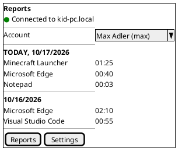
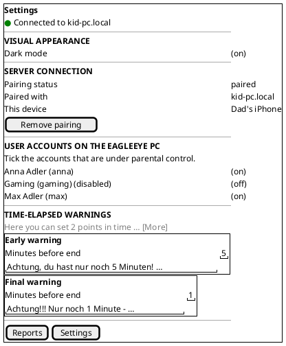
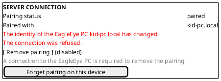
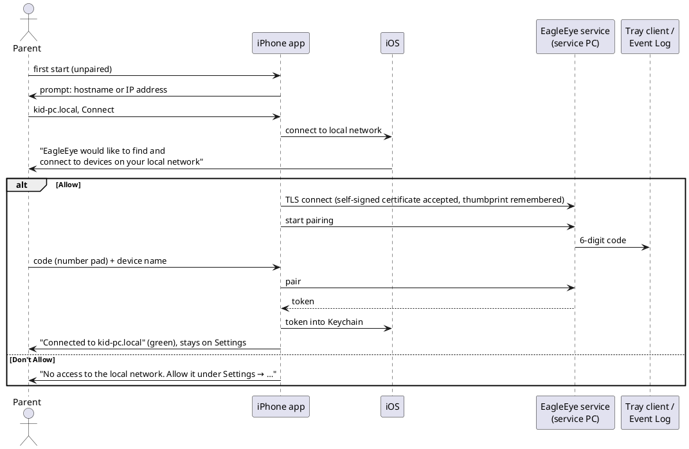
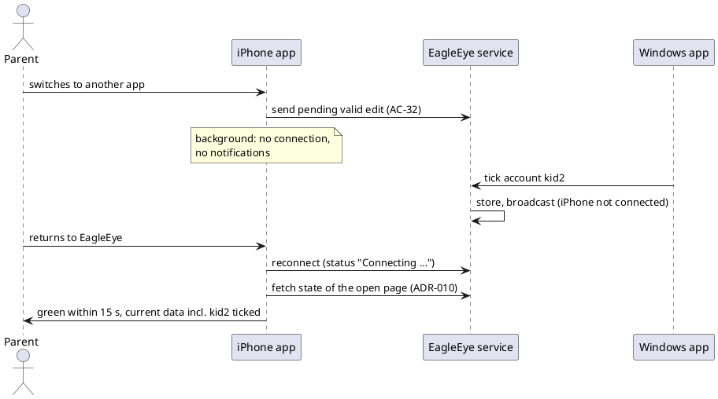

# US-007: iPhone Parent App — Platform, Pairing, Settings and Reports

**Status**: New
**Created**: 2026-10-17
**Approved**: by Michael, 2026-10-17, with his answers to OQ-1 to OQ-20 and the split (OQ-1). The status becomes `Analyzed` when the implementation plan is approved.
**Component(s)**: EagleEye.ParentApp (shared MAUI codebase and `EagleEye.ParentApp.Core`). EagleEye.Service, EagleEye.TrayClient and EagleEye.Shared are used as they are; no change is expected (AC-46).
**Platform(s)**:

- **ParentApp iOS (iPhone)**: built, deployed and checked in the iOS Simulator on the **MacBook**.
- Manual tests on Michael's **iPhone 13** and **iPhone 16 Plus** (both iOS 27), against the service on the Windows Developer Machine.
- ParentApp Windows only for regression (AC-47).

---

## User Story

As a **parent**, I want the EagleEye parent app on my iPhone, laid out for an upright phone screen. I want to pair it with the EagleEye PC, choose the controlled accounts, set the time-elapsed warnings and look at the reports from my phone, wherever I am in the house. The Rules page follows in US-008.

---

## Background

US-002 to US-006 built every parent-side feature in the **Windows parent app**, the initial testing vehicle (general product requirements §3.3). Android and iOS are the primary production platforms (Michael, 2026-10-03). On 2026-10-17 Michael asked for the iPhone app next: "I want an iOS app for my iPhone which has the same functionality as the parent app for windows, just on iPhone. … The app shall be used in portrait mode only, so consider the layout adjustments so that it looks nice."

Michael approved the split of that request into two stories (OQ-1):

- **US-007 (this story)**: the platform (toolchain, deploy, portrait frame, look), connection and pairing (Local Network permission, pinned certificate, Keychain, forget pairing), background and foreground behaviour, and the **Settings** and **Reports** pages.
- **US-008 (next story)**: the **Rules** page (break times, application rules, their texts). Its approved content is parked in `02_Implementation/docs/requirements/user-stories/US-007/deferred-to-US-008.md`. US-008 gets its own branch from `main` after US-007 is merged.

This changes the order in `01_Intend_and_Constraints/technology_selection.md`, which planned iOS and Android "in a later stage, after the MacOS application … matured". The iPhone app now comes before the macOS and Android apps (requirements v1.7, §1.2 note). FR-APP-080, FR-APP-082, FR-CR-011 and §9.2 already cover the iPhone app. Requirements v1.7, applied with this story, makes the iPhone-specific parts precise.

**What the Windows parent app does today (build 0.6.2)**; this story covers the rows marked US-007:

| Area | Windows parent app | Source | iPhone |
|---|---|---|---|
| Connection and pairing | Host dialog on first start; hostname or IPv4; TLS with the service's self-signed certificate, pinned after pairing; 6-digit code from the tray or the Event Log, plus a device name; wrong or expired code; status "Connected to <host>" with a green or red indicator; auto-connect when paired; host read-only while paired; "Remove pairing" online only; **"Forget pairing on this device"** when the PC is unreachable or its identity changed | US-002, ISSUE-009 (`02_Implementation/docs/testing/US-006/issues/ISSUE-009.md`, US-006 implementation report D-19) | US-007 |
| Settings | Visual appearance (light/dark switch, follows the OS until set); Server connection; User accounts on the EagleEye PC (tick = under parental control); Time-elapsed warnings (early and final: minutes and text) | US-002, US-003, US-006 | US-007 |
| Reports | Account selection; per day, today first: app and usage HH:MM; live update | US-004 | US-007 |
| Rules | Account selection; break times with display text; application rules with budget text | US-005, US-006 | **US-008** |
| Texts | German and English; the parent's texts are never translated; unchanged default texts follow the language of the app that shows them | NFR-L-010..012, ADR-016 | US-007 (Settings), US-008 (Rules) |
| Several parent apps | Every change goes through the service, which stores it and broadcasts it; other apps update within 5 s; last write wins; no polling | US-003 AC-23/24, ADR-010 | US-007 (Settings, Reports), US-008 (Rules) |

References: FR-APP-010 to FR-APP-016 (FR-APP-016 new in v1.7), FR-APP-020 to FR-APP-022, FR-APP-054, FR-APP-060, FR-APP-080 (v1.7), FR-APP-082, FR-APP-083, FR-APP-100 to FR-APP-102 (new in v1.7), FR-CR-011, CN-010 to CN-016, NFR-S-013, NFR-S-014, NFR-L-010 to NFR-L-012, NFR-U-011, §9.2 (v1.7). Architecture: ADR-007, ADR-008, ADR-009, ADR-010, ADR-016; arc42 §11 R-1 ("Self-signed certificate rejected by iOS/Android MAUI clients … validate when those platforms are addressed").

**Terms used in this story**

- *Service PC*, *account*, *controlled account*, *warning levels*: as in US-003 to US-006.
- *iPhone app*: the EagleEye parent app built for iOS and installed on an iPhone.
- *Windows app*: the EagleEye parent app for Windows (0.6.2 or later).
- *Test iPhones*: Michael's iPhone 13 (6.1", 390 × 844 points) and iPhone 16 Plus (6.7", 430 × 932 points), both on iOS 27. iOS 27 is above the minimum of iOS 26.
- *SE size*: the screen of the iPhone SE (2nd and 3rd generation), 375 × 667 points, with a Home button and no notch. It is the smallest iPhone screen that iOS 26 supports. It is checked in the iOS Simulator only (AC-16).
- *Tab bar*: the iOS bar at the bottom of the screen with one button per page.
- *Done key*: the "Done" ("Fertig") button that iOS shows on or above the keyboard.
- *Foreground / background*: the iPhone app is in the foreground while it is on screen. It goes to the background when the parent switches to another app or to the Home Screen, or the iPhone locks.
- *Deploy*: installing or updating the iPhone app from the MacBook (Xcode sideload, §9.2).

---

## Product requirement amendment (v1.7, approved with this story)

Michael approved the v1.7 amendment of `02_Implementation/docs/requirements/general-product-requirements.md` together with this story on 2026-10-17, and it is now written into the file. It is adjusted to the split and to Michael's answers:

- **§9.2 iOS (ParentApp)** (made precise):
  - Devices: iPhone only.
  - Orientation: portrait, locked.
  - Minimum version: iOS 26.
  - Build host: the MacBook.
  - Distribution: sideload from Xcode, signed with Michael's free Apple ID first (re-deploy every 7 days). A paid account is a later decision.
- **FR-APP-080** (made precise): phone portrait layouts for screens 375 to 440 points wide; touch targets of at least 44 × 44 points; safe areas; Dynamic Type.
- **FR-APP-010 / CN-011** (note): on iOS a hostname works only when the iPhone can resolve it (`<name>.local`, or a name the router's DNS knows). An IPv4 address always works.
- **FR-APP-016** (new): a parent app may forget its pairing on its own device only. This applies on all platforms (ISSUE-009, D-19; requirements side of US-006 follow-up F-5).
- **FR-APP-100 to FR-APP-102** (new, §3.3.10 "iOS parent app"):
  - FR-APP-100: Local Network permission with an explanation, and guidance when it is denied.
  - FR-APP-101: the token is kept in the Keychain, on this device only.
  - FR-APP-102: the app reconnects and refreshes when it returns to the foreground; no background work and no push notifications.

  The story draft called these FR-APP-104 to FR-APP-106; they were renumbered when the amendment was applied.
- **§1.2 / §11** (note): Michael's direction of 2026-10-17: the iPhone app comes before the macOS and Android apps.

---

## Acceptance Criteria

> **Language of UI texts** (NFR-L-010 to NFR-L-012): all UI texts quoted in these criteria and in the mockups are **English examples**, with the intended German wording in brackets.
> - The iPhone app shows every text of its own in the iPhone's language for the app, including error messages and the Local Network explanation: German if that language is German, English if it is English, and German for every other language (as the Windows app does).
> - The parent's own texts are never translated. Unchanged default texts (the warning texts) follow the app's language (ADR-016).
> - Dates follow the iPhone's region format.
> - Differences in wording are notes, not Fails (US-002 Decision Q-11).
> - Michael's iPhones are German, so test manuals give German iOS labels (*Einstellungen → Datenschutz & Sicherheit → Lokales Netzwerk*, etc.).

> **Test setup**:
> - The service PC (Windows Developer Machine) with EagleEye 0.6.2 or later, and the standard accounts `kid1`, `kid2` (controlled) and `kid3` (not controlled), as in US-006.
> - The **test iPhones** (iPhone 13 and iPhone 16 Plus, iOS 27), in the **same Wi-Fi/LAN subnet** as the service PC.
> - The Windows app A, paired with the service.
> - The iPhone app is deployed from the MacBook (see Prerequisites).
> - Michael runs the manual cases on **both** iPhones. TES may split cases between them, but every layout case (groups B, E, G) runs on both.
> - The SE size is covered by DEV's Simulator checks (AC-16), not by Michael.

### A. Installation, distribution and device support

- [ ] **AC-1**: The iPhone app is built on the MacBook from the same parent app codebase as the Windows app (FR-CR-011) and installed on the test iPhones from the MacBook (Xcode sideload, §9.2). No App Store, no TestFlight and no other computer are needed.
- [ ] **AC-2**: The app installs and runs on iPhones with iOS 26 or later, in particular on both test iPhones with iOS 27. On the Home Screen it has the name "EagleEye" and the EagleEye eye icon (OQ-5). The launch screen uses the same motif.
- [ ] **AC-3**: The app version is visible on the iPhone. *Settings → General → iPhone Storage → EagleEye* ("Einstellungen → Allgemein → iPhone-Speicher → EagleEye") shows the EagleEye product version (e.g. "0.7.0"), with the same version scheme as the Windows installers.
- [ ] **AC-4**: Deploying a newer version, or the same version, over an installed app keeps the pairing and the appearance choice. Afterwards the app connects without a new pairing code.
- [ ] **AC-5**: When the parent deletes the app from the iPhone (*Remove App → Delete App*, "App entfernen → App löschen") and installs it again, the app starts **unpaired**, with the host prompt of AC-17. It uses no earlier pairing, token or host, even if iOS kept data elsewhere (e.g. in the Keychain). The device entry on the service stays, as with the Windows uninstall (US-002 Q-2).
- [ ] **AC-6**: The app is an iPhone app. On an iPad it is not offered as an iPad app (OQ-2).
- [ ] **AC-7**: The app is signed with Michael's **free Apple ID** (OQ-4). When the 7-day signing period ends, the app no longer starts. After a new deploy from the MacBook it starts again, with the pairing and settings kept (AC-4). TES tests this once, on one test iPhone.

### B. App frame, navigation and look

- [ ] **AC-8**: The app runs in **portrait only**. Turning the iPhone sideways or upside down does not rotate any page, prompt or alert.
- [ ] **AC-9**: The app has a **tab bar** at the bottom with two tabs, each with an icon and a label, in this order: "Reports" ("Berichte") and "Settings" ("Einstellungen"). There is no side menu. The selected tab is highlighted. Every page has its title at the top, in the iOS style. US-008 adds "Rules" ("Regeln") between the two (OQ-6); AC-42 covers Rules in this story.
- [ ] **AC-10**: When the app starts paired, it opens on **Reports** (as the Windows app does, ISSUE-007). When it starts unpaired, it opens on **Settings** and shows the host prompt (AC-17).
- [ ] **AC-11**: Every page shows the **connection status** on one line directly below the page title (OQ-7), with the indicator and texts of US-002 AC-10:
  - green: "Connected to <host>" ("Verbunden mit <host>");
  - red: "Connecting to <host> …" ("Verbinde mit <host> …");
  - red: "Not connected" / "Not connected to <host>" ("Nicht verbunden" / "Nicht verbunden mit <host>").

  A long host name is shortened with "…". It is never cut off without "…" and never pushes the indicator off screen.
- [ ] **AC-12**: Nothing is hidden behind the notch or Dynamic Island, the iOS status bar (clock, battery) or the home indicator. This holds on the test iPhones (notch, Dynamic Island) and at the SE size (Home button, AC-16). Lists scroll under the title area and above the tab bar, as usual on iOS. The last row of a list can be scrolled fully into view.
- [ ] **AC-13**: **Light and dark**:
  - On the first start, the app follows the iPhone's appearance (*Settings → Display & Brightness*, "Anzeige & Helligkeit"), and the switch of AC-37 shows it.
  - Until the parent sets the switch, the app follows changes of the iPhone's appearance, also while it is open, including automatic switching at sunset.
  - After the parent sets the switch, the app keeps that appearance (FR-APP-083; OQ-8).
  - All pages, the tab bar, the prompts, the keyboard and the alerts are readable in both appearances, and the iOS status bar (clock, battery) stays readable.
- [ ] **AC-14**: **Text size** (Dynamic Type): the app's texts follow the iPhone's text size (*Settings → Display & Brightness → Text Size*, "Textgröße").
  - From the smallest size up to the largest size without "Larger Accessibility Sizes", no text is cut off or overlaps another element, and long texts wrap.
  - With accessibility sizes, every function stays reachable, but rows may grow and pages may need scrolling (OQ-10).
- [ ] **AC-15**: **Touch**: every control that can be tapped (buttons, switches, list rows, tabs, the account selection) has a touch area of at least 44 × 44 points and does not trigger a neighbouring control. The app uses iOS controls with an iOS look and behaviour (FR-APP-080; OQ-3): switches instead of checkboxes, grouped lists, iOS menus or pickers for selections, and iOS alerts and action sheets for confirmations.
- [ ] **AC-16**: **Keyboard and screen sizes**:
  - When the keyboard is shown, the field being edited scrolls into view and stays visible above the keyboard.
  - Every field that opens a number pad (which has no Return key on the iPhone) has a **Done key** ("Fertig") above the keyboard.
  - Tapping outside a field closes the keyboard.
  - Layouts work on screens 375 to 440 points wide.
  - **SE size, checked by DEV in the iOS Simulator on the MacBook** (OQ-11), on an iPhone SE (3rd generation) simulator, 375 × 667 points, running iOS 26 or later. DEV runs a **scripted check**: build, install and start the app in the Simulator, open each page (Reports, Settings with every section and the pairing states that can be reached), and capture screenshots in light and dark mode, at the default text size and at the largest standard text size (AC-14). No text may be cut off or overlap, and nothing may lie under the status bar or the tab bar.
  - The script and the screenshots go into the implementation report. TES reviews the screenshots. This check is DEV's tooling, like unit tests: it does not replace Michael's manual tests on the test iPhones.

### C. Connection, permission and pairing

- [ ] **AC-17**: When the app starts unpaired, a prompt asks for the service PC's address (English example: "Enter the hostname or IP address of the EagleEye PC", as in US-002 AC-11). The prompt has a text field, a hint with examples (English example: "e.g. kid-pc.local or 192.168.1.20"), and the buttons "Connect" ("Verbinden") and "Cancel" ("Abbrechen"). The field uses the iOS keyboard for addresses, without auto-capitalization or autocorrection. After "Cancel", the Settings page shows "not paired", and the parent can enter the host in the "Server connection" section instead.
- [ ] **AC-18**: An IPv4 address always works. A hostname works when the iPhone can resolve it: `<name>.local` of the service PC (Bonjour/mDNS), or a name that the home router's DNS resolves (OQ-9). When the name cannot be resolved or the host cannot be reached:
  - the app shows the connection error of US-002 AC-12, which names the host (English example: "Connection error: could not connect to the EagleEye service at kid-pc");
  - the indicator stays red;
  - the parent can correct the input.
- [ ] **AC-19**: **Local Network permission**: the first time the app connects to the service PC, iOS asks whether EagleEye may find and connect to devices on the local network. The prompt shows the app's explanation:
  - English example: "EagleEye connects to the EagleEye PC in your home network to show and change the rules for your kids."
  - German: "EagleEye verbindet sich mit dem EagleEye-PC in Ihrem Heimnetz, um die Regeln Ihrer Kinder anzuzeigen und zu ändern."

  After "Allow" ("Erlauben"), connection and pairing continue without restarting the app.
- [ ] **AC-20**: When the Local Network permission is denied, at the prompt or later in the iOS settings, the app does not show a generic connection error. Instead it shows a message that names the cause and where to change it, and the indicator stays red:
  - English example: "EagleEye has no access to the local network. Allow it under Settings → Privacy & Security → Local Network."
  - German: "EagleEye hat keinen Zugriff auf das lokale Netzwerk. Erlauben Sie ihn unter Einstellungen → Datenschutz & Sicherheit → Lokales Netzwerk."

  When the parent allows access and returns to the app, the app connects without a restart (AC-33).
- [ ] **AC-21**: The connection is encrypted with the service's self-signed certificate (CN-012). At no point is the parent asked to accept, install or trust a certificate or a profile, in the app or in the iOS settings, whether the host is a name or an IP address (CN-013, US-002 AC-7).
- [ ] **AC-22**: Pairing works as in US-002 AC-13 to AC-20. The app asks for the 6-digit code (shown by the tray client or in the Event Log on the service PC) and for a device name.
  - The code field opens the **number pad**, has a Done key, and accepts a pasted code.
  - The device name field starts empty, with an example as placeholder (English: "e.g. Dad's iPhone").
  - An empty device name, a wrong code and an expired code (after 5 minutes) give the messages of US-002 AC-17 to AC-19. A new attempt gets a new code.
- [ ] **AC-23**: After a successful pairing:
  - the status shows green "Connected to <host>";
  - the "Server connection" section shows "paired", the host and the device name;
  - the app stays on Settings, so the parent can tick the accounts next (OQ-6).

  As long as the app is not paired, it never shows green (US-002 AC-20).
- [ ] **AC-24**: **Pinning**: after pairing, the app accepts only the certificate it saw during pairing (ADR-008 §3). When the service PC presents a different certificate (e.g. EagleEye was reinstalled into a new data folder), the app does not connect and shows the Windows app's message (English example: "The identity of the EagleEye PC <host> has changed. The connection was refused." / German: "Die Identität des EagleEye-PCs <host> hat sich geändert. Die Verbindung wurde abgelehnt.").
- [ ] **AC-25**: A paired app connects to the stored host by itself, without any input. It shows green within 30 seconds after the app starts, provided the service runs and the iPhone is in the LAN (US-002 AC-21). When the service is stopped while the app is in the foreground, the app shows red within 30 seconds. When the service runs again, the app reconnects by itself and shows green within 60 seconds (US-002 AC-22).
- [ ] **AC-26**: **Remove pairing** (online): while the app is paired and connected, "Server connection" offers "Remove pairing" ("Kopplung aufheben"). The app asks for confirmation in an iOS alert with a destructive button. After the parent confirms:
  - the service no longer accepts this iPhone;
  - the app forgets the host and the token and returns to "not paired" (red);
  - a new pairing needs a new code (US-002 AC-26 to AC-29).

  Other parent apps stay connected.
- [ ] **AC-27**: **Forget pairing on this device** (offline, the ISSUE-009 fix, FR-APP-016). The button appears while the app is paired but **not** connected, and the last connection attempt failed because the service PC was unreachable or its identity changed (AC-18, AC-24). In that state, "Server connection" shows:
  - the disabled "Remove pairing", with the hint "A connection to the EagleEye PC is required to remove the pairing." ("Zum Aufheben der Kopplung ist eine Verbindung zum EagleEye-PC nötig.");
  - below it, the button "Forget pairing on this device" ("Kopplung auf diesem Gerät löschen").

  Tapping the button asks for confirmation, with the title and text of the Windows app (ISSUE-009 Resolution; English: "Forget pairing on this device?" / "The EagleEye PC {host} cannot be reached or its identity has changed. The pairing is deleted on this device only. …").
  - After the parent confirms, the app stops connecting, deletes the host, the certificate pin and the token on the iPhone, and returns to "not paired" with the host pre-filled. It shows "The pairing with {host} was deleted on this device. Pairing again requires a new pairing code."
  - After "Cancel", nothing changes.
  - While the app is connected, only "Remove pairing" is offered.

  The parent is never stuck in "paired" without a way out: the deadlock of ISSUE-009 cannot happen on the iPhone. This also covers a pairing restored from a backup onto another iPhone (OQ-13, AC-28).
- [ ] **AC-28**: The pairing token is stored in the **iOS Keychain**, and only this app on this iPhone can read it (FR-APP-101, NFR-S-014). The token:
  - is never shown in the app;
  - is never written to a log;
  - is not part of an iCloud or Finder backup in a form that another iPhone could use.

  The host, device name and certificate pin may be kept in the app's own storage. After a backup is restored onto another iPhone, the app does not get stuck there (OQ-13). It either behaves as unpaired or offers "Forget pairing on this device" (AC-27); ARC chooses which in the plan.
- [ ] **AC-29**: While the app is paired, the host is shown read-only. To use another host, the parent first removes or forgets the pairing (US-002 AC-25).
- [ ] **AC-30**: Both test iPhones and the Windows app(s) can be paired with the same service at the same time, and all of them show "Connected to <host>" (US-002 AC-24). Removing or forgetting the pairing on one iPhone does not affect the other iPhone or the Windows app, and the other way round.

### D. Background and foreground

- [ ] **AC-31**: While the app is in the background (another app, the Home Screen, or the iPhone locked), it needs no connection, shows no notifications and does not run in the background. Push notifications are out of scope (OQ-14). EagleEye never uses more battery in the background than a closed app does.
- [ ] **AC-32**: Before the app goes to the background, it sends a **valid** change that the parent has typed but not yet confirmed (a warning text or a minutes value) to the service, as if the parent had tapped the Done key. An invalid value is not sent, and the field shows the stored value again when the app returns.
- [ ] **AC-33**: When the app returns to the foreground, it reconnects by itself, without any action of the parent.
  - If the service is reachable, the status turns green **within 15 seconds** after the app is back on screen (OQ-12).
  - The open page then shows the data currently stored in the service (ADR-010: fetch on every reconnect).
  - Until then, the status shows "Connecting to <host> …" and the page shows "Loading …" ("Wird geladen …") or "No data available" ("Keine Daten verfügbar"). It never shows data that might be outdated as if it were current.
- [ ] **AC-34**: Changes made while the iPhone app was in the background are shown after the app returns (AC-33), on every page, without pull-to-refresh or a restart. Examples: an account ticked or a warning text changed in the Windows app, an app started by the kid, usage counted.
- [ ] **AC-35**: When the app returns to the foreground on a later day, "Today" on Reports is the current day of the service PC, and the previous day moves down (US-004 AC-18).
- [ ] **AC-36**: When the iPhone leaves the Wi-Fi (e.g. the parent leaves the house), the app shows red while it is away. When the iPhone is back in the Wi-Fi and the app is in the foreground, the app reconnects by itself within 60 seconds.

### E. Settings page

- [ ] **AC-37**: The Settings page is a scrolling list of grouped sections in the iOS style, in this order:
  1. "Visual appearance" ("Darstellung")
  2. "Server connection" ("Serververbindung")
  3. "User accounts on the EagleEye PC" ("Benutzerkonten auf dem EagleEye-PC")
  4. "Time-elapsed warnings" ("Zeit-Ende Warnungen")

  "Visual appearance" has one switch, "Dark mode" ("Dunkler Modus"; AC-13). It applies at once, without a restart, and is kept across restarts and deploys.
- [ ] **AC-38**: "Server connection" shows the states of US-002 and ISSUE-009 in the portrait layout:
  - not paired: host field, "Connect";
  - pairing: code, device name, "Pair", "New code", "Cancel";
  - paired: status, host, device name, and "Remove pairing" / "Forget pairing on this device" (AC-26, AC-27).

  Messages wrap and are never cut off. Buttons are full-width or iOS list buttons, at least 44 points high.
- [ ] **AC-39**: "User accounts on the EagleEye PC" shows the instruction text and one row per standard account: the name as in US-003 AC-11 (with the "(disabled)" note as in AC-12 there) and, on the right, an iOS **switch** "Under parental control" ("Unter Elternkontrolle"). A long account name wraps, and the switch stays visible. The following behave as in US-003 AC-7 to AC-18 and AC-23/24:
  - the sorting;
  - the states "No data available", "No non-admin accounts available" and "Loading …";
  - saving at once when the switch is tapped;
  - the error message and revert;
  - the 5-second sync with other parent apps.
- [ ] **AC-40**: "Time-elapsed warnings" shows the explanatory text and two **cards** below it, "Early warning" ("Frühe Warnung") and "Final warning" ("Finale Warnung"), one below the other, instead of a three-column table.
  - The explanatory text is shortened to two or three lines, with "More" ("Mehr") to expand it (OQ-18).
  - Each card has "Minutes before end" ("Minuten vor Ende"), entered with the number pad and its Done key (OQ-15), and below it the warning text in a multi-line editor.
  - Defaults, ranges (1..59, early greater than final), messages, the 500-character limit, emojis (iOS emoji keyboard) and "an empty text restores the default" are as in US-006 AC-13 to AC-16.
- [ ] **AC-41**: **Saving on touch**:
  - A switch is saved when it is tapped.
  - A minutes field is saved when the parent taps the Done key, taps outside the field, changes the tab, or the app goes to the background (AC-32).
  - A multi-line text is saved when the parent taps the Done key above the keyboard, leaves the editor, changes the tab, or the app goes to the background.

  Every saved change behaves as on Windows: the app shows the confirmed state. On failure it shows "The change could not be saved. Please try again." and reverts (US-003 AC-16, US-006 AC-12). Other parent apps show the change within 5 seconds.

### F. Rules on the iPhone (deferred to US-008)

- [ ] **AC-42**: The iPhone app of this story has **no Rules tab and no Rules page**: the tab bar shows only Reports and Settings (AC-9). Nothing in the app links to break times, application rules, the break display text or the budget text. The parent keeps editing rules in the Windows app. Rules set there are enforced as before, whether or not the iPhone app is used. US-008 adds the Rules tab between Reports and Settings.

### G. Reports page

- [ ] **AC-43**: The Reports page shows at the top the account selection "Account" ("Konto"), an iOS menu or picker with the controlled accounts. The names and order are as in US-004 AC-17, and the first account is selected when the page opens. Below it, the usage of the selected account is a grouped list:
  - one section per day, **today first**, with the heading as in US-004 AC-18 (e.g. "Today, 10/17/2026", German "Heute, 17.10.2026");
  - in each section, one row per app: the display name on the left (wrapping if long) and the usage "HH:MM" on the right, sorted by usage, longest first;
  - the column header line "App | Usage (HH:MM)" may be shown once per section or once at the top.

  The empty states and "No usage recorded today" are as in US-004 AC-19/AC-20.
- [ ] **AC-44**: While the Reports page is in the foreground and connected, it updates by itself through the service's push. It is at most 15 seconds behind the real active time, and a new app appears within 15 seconds (US-004 AC-22). Switching the account and changes of the account list behave as in US-004 AC-21/AC-23.

### H. Coexistence with the Windows app and the service

- [ ] **AC-45**: Every change made in the iPhone app's Settings (account switches, warning minutes and texts) appears in a connected Windows app within 5 seconds. Every Settings change made in the Windows app appears in the iPhone app, while it is in the foreground, within 5 seconds. Neither app needs any action, and neither polls. When both change the same value at about the same time, the last change the service receives wins, and both apps then show the same state (US-003 AC-24, US-006 AC-17). The same holds between the two test iPhones. Reports in both apps show the same usage figures (AC-44).
- [ ] **AC-46**: The iPhone app needs no change on the service PC: it uses the same service (0.6.2 or later), port, firewall rule and certificate as the Windows app, with no new installer step. The service log shows changes from the iPhone app with the same entries as changes from the Windows app (US-003 AC-14, US-006 AC-11).
- [ ] **AC-47**: The **Windows app** keeps its desktop layout and behaviour (FR-APP-081). The Settings, Rules and Reports pages show no visible change compared with 0.6.2, except the version number. This is checked with the regression checklist (`02_Implementation/docs/testing/regression-checklist.md`).

### Change Log

| Date | Change | Source |
|---|---|---|
| 2026-10-17 | Story created (59 ACs, one file, parts a and b); split proposed; requirements v1.7 proposed; OQ-1 to OQ-20 open | Michael's request (2026-10-17), written by PRO |
| 2026-10-17 | Michael's answers to OQ-1 to OQ-20 (commit e99a71b) | Michael |
| 2026-10-17 | **Story approved and split.** This story keeps part a, renamed "iPhone Parent App — Platform, Pairing, Settings and Reports". Part b (Rules) is parked in `US-007/deferred-to-US-008.md` for US-008. All OQs resolved. Requirements **v1.7 applied**, adjusted to the split (FR-APP-016, FR-APP-080, FR-APP-100 to FR-APP-102, §9.2, FR-APP-010/CN-011 note, §1.2/§11 note). OQ-11: test iPhones (iPhone 13, iPhone 16 Plus, iOS 27) and DEV's scripted Simulator check at the SE size (AC-16) added to Platform(s), Terms, Test setup, AC-2, AC-7, AC-12, AC-16, AC-30 and AC-45. AC-13, AC-15, AC-32, AC-34 and AC-41 no longer mention Rules elements; AC-40 gets the "More" text (OQ-18) and the number pad (OQ-15). New AC-42 (no Rules tab). **AC numbering, old → new**: AC-1…AC-41 → unchanged; (new) → AC-42; AC-42…AC-54 → deferred to US-008 (`deferred-to-US-008.md`, original numbers kept); AC-55 → AC-43; AC-56 → AC-44; AC-57 (Settings/Reports part) → AC-45, Rules part deferred; AC-58 → AC-46; AC-59 → AC-47. Total: 47 ACs. | Michael (via the Orchestrator), written by PRO |

---

## UI / Interaction Notes

Portrait mockups for an iPhone about 390 points wide (iPhone 13). "(on)" / "(off)" are iOS switches. Colours follow the app's light/dark appearance and the accent colour of ISSUE-007. The heading bars of the Windows app become iOS section headers. The mockups for the Rules page are in `deferred-to-US-008.md`.

### Pattern overview: Windows → iPhone (this story)

| Windows (desktop, wide) | iPhone (portrait) |
|---|---|
| Left navigation menu: Settings, Rules, Reports | Tab bar at the bottom: Reports, Settings (Rules added by US-008 in between) |
| Status bar at the bottom of the window | Status line below the page title (AC-11) |
| Host dialog on first start | iOS prompt with a text field and an example hint (AC-17) |
| Checkbox "Under parental control" | iOS switch in the account row |
| Warnings table (3 columns, 2 rows) | Two cards, minutes field with number pad and Done key, text editor below |
| Reports: day heading + 2-column table | Grouped list, one section per day, name on the left, HH:MM on the right |
| Account combo box | iOS menu or picker |
| Confirmation dialogs | iOS alerts with a destructive button |
| Windows emoji panel (Win + .) | iOS emoji keyboard |
| 150 % display scaling | Dynamic Type (AC-14) |

### Reports (tab bar, status line, grouped list): AC-9, AC-11, AC-43

### Settings: AC-37 to AC-40

### Settings: paired, not reachable or identity changed (AC-27)

### Flow: first start, Local Network permission, pairing (AC-17 to AC-23)

### Flow: background and foreground (AC-31 to AC-36)

---

## Out of Scope

- **The Rules page on the iPhone** (break times, display text, application rules, budget text): deferred to **US-008**. The approved content (original AC-42 to AC-54, the Rules part of AC-57, layout patterns, mockups, decisions) is parked in `02_Implementation/docs/requirements/user-stories/US-007/deferred-to-US-008.md`. In this story the iPhone app has no Rules tab (AC-42).
- **iPad** as a supported device; landscape layouts; Split View; Stage Manager (OQ-2).
- The **Android** and **macOS** parent apps (separate stories). The portrait layouts should be reusable for Android (OQ-19).
- **Push notifications**, background refresh, widgets, Live Activities, Siri/Shortcuts, Apple Watch (OQ-14).
- **App Store, TestFlight**, enterprise distribution, MDM (§10). A paid Apple Developer account is a later decision (OQ-4).
- Features that the Windows app does not have either:
  - device management for other devices (the rest of FR-APP-015);
  - events (FR-APP-070);
  - "used vs. budget" on Reports (FR-APP-061);
  - the history of blocked starts;
  - the debug-mode switch (FR-SVC-102);
  - re-scan of installed apps (FR-APP-033);
  - a configurable close timeout (FR-SVC-021).
- Automatic discovery of the service PC (Bonjour browsing, QR code) and remote access outside the LAN (CN-017).
- Face ID or passcode lock for the app, a parent PIN, and protection against a kid who pairs their own parent app (accepted risk, US-005 OQ-15).
- Editing while not connected: there is no offline cache, and US-005 OQ-4 ("No data available") applies.
- Changes to the service, the tray client or the SignalR contracts, unless ARC finds one is needed for iOS (the plan then names it).
- A "System" option for the appearance in addition to Light/Dark: a later story (OQ-8).
- Pull-to-refresh (OQ-14).
- Physical testing on an iPhone SE: the SE size is covered by the Simulator check only (AC-16).
- Updating the US-002 user story and arc42 for the ISSUE-009 local forget pairing (US-006 follow-up F-5). Requirements v1.7 adds FR-APP-016; the US-002 and arc42 texts stay as they are.

---

## Open Questions (resolved, answered by Michael, 2026-10-17)

All 20 questions are **resolved**. Michael accepted every proposal. OQ-11 adds his test devices and the request for automated checks at the SE size. His answers are kept as he wrote them. The "Resolution" line in each answer names the resulting ACs. The proposed answers quote the AC numbers from before the split (mapping in the Change Log); the resolutions use the current numbers. The answers to OQ-6 and OQ-15 to OQ-20 also apply to US-008 and are copied into `deferred-to-US-008.md`.

| ID | Question | Proposed answer | Answer |
|---|---|---|---|
| OQ-1 | **Split the story?** | Two stories: **US-007** = part a (platform, toolchain, deploy, pairing, Local Network, Keychain, background/foreground, Settings, Reports; groups A to E, H, and AC-57 to AC-59 for these pages) and **US-008** = part b (Rules: break times, app rules, texts; groups F and G). See "Proposed Split". Alternative: three stories (Reports separate) or one big story. | yes, do the split as suggested. — **Resolved**: split done. This story is part a; part b is parked in `deferred-to-US-008.md`; new AC-42 (no Rules tab); ACs renumbered (Change Log). |
| OQ-2 | **iPhone only, or iPad too?** | **iPhone only.** An iPad would need its own layouts (landscape, wider screens) and testing. The app is not offered as an iPad app (AC-6). | iPhone only, yes. — **Resolved**: AC-6, §9.2 (v1.7). |
| OQ-3 | **iOS-native look, or the look of the Windows app?** | **iOS-native** (FR-APP-080: "platform-typical look and feel"): tab bar, grouped lists, switches, pickers, swipe to delete, iOS alerts, iOS fonts. Same texts, colours (accent colour of ISSUE-007) and functions as Windows (FR-APP-082). | iOS native, yes. — **Resolved**: AC-15, pattern table. |
| OQ-4 | **Apple Developer account.** With a free Apple ID, a sideloaded app stops starting after **7 days** and must be deployed again from the MacBook (also: at most 3 sideloaded apps per device, App IDs limited per week). A paid **Apple Developer Program** membership (99 USD/EUR per year) extends this to one year and would later allow TestFlight/App Store. | Start with Michael's **free Apple ID** for development and testing; re-deploy weekly from the MacBook (data is kept, AC-4, AC-7). Decide on the paid account before daily use by the family. Which Apple ID/team is used is stored only in `secrets/secrets.json` on the MacBook if a script needs it. | ok — **Resolved**: free Apple ID first; AC-7, §9.2 (v1.7); paid account a later decision (Out of Scope). |
| OQ-5 | **App name and icon on the Home Screen.** | Name **"EagleEye"** (fits under the icon; the Windows product name "EagleEye Parent App" stays for Windows, US-002 Q-10). Icon: the existing EagleEye eye motif (`02_Implementation/src/EagleEye.ParentApp/Resources/AppIcon/appicon.svg`, green background), also for the launch screen. | ok. — **Resolved**: AC-2. |
| OQ-6 | **Tab order and pages after start and pairing.** Windows order is Settings, Rules, Reports. | iOS order **Reports, Rules, Settings** (most-used first, settings last, iOS convention). Start on Reports when paired, on Settings when unpaired (AC-10). After a successful pairing the app **stays on Settings**, so the parent can tick the accounts next (AC-23). | yes, ok! — **Resolved**: AC-9 (Reports, Settings; Rules in between with US-008), AC-10, AC-23. |
| OQ-7 | **Where does the connection status go?** The Windows status bar at the bottom would collide with the tab bar. | A one-line status directly **below the page title** on every page (AC-11), always visible. Alternative: show it only when not connected (banner) — rejected, because the host name and the green state are useful during tests. | Yes, on the top under the title is good. — **Resolved**: AC-11. |
| OQ-8 | **Theme switch or follow the system?** On iPhones dark mode often switches automatically at sunset. | **Keep the switch** (FR-APP-083, FR-APP-082: functionally identical). Until the parent touches it, the app follows the iPhone, including automatic switching (AC-13). A third option "System" ("Automatisch") for all platforms can be a later small story. | yes, do as proposed. A system option can be done later. — **Resolved**: AC-13, AC-37; "System" option in Out of Scope (later story). |
| OQ-9 | **Hostname on iOS.** The Windows app resolves "kid-pc" through Windows name resolution (NetBIOS/LLMNR), which iOS does not have. iOS resolves `kid-pc.local` (Bonjour, answered by Windows 10/11) and names known to the router's DNS (e.g. a FRITZ!Box knows "kid-pc" and "kid-pc.fritz.box"). | Accept this: IPv4 always works, hostnames work when the iPhone can resolve them (AC-18). The host prompt shows the hint "e.g. kid-pc.local or 192.168.1.20" (AC-17). No change to the Windows app's behaviour; the hint text may appear there as well, since texts are shared. TES tests `<name>.local`, the plain name and the IP. | ok. — **Resolved**: AC-17, AC-18; FR-APP-010/CN-011 note (v1.7). |
| OQ-10 | **Dynamic Type: how far?** | All standard text sizes without cut-off (AC-14); accessibility sizes best effort (everything reachable, scrolling allowed). | ok. — **Resolved**: AC-14. |
| OQ-11 | **Small screens (iPhone SE, 375 × 667 points).** Michael probably tests on one iPhone only. | Layouts are designed for 375 to 440 points wide (AC-16, AC-47). Michael tests on his iPhone; DEV checks the SE size in the iOS Simulator on the MacBook (screenshots in the implementation report); TES may add an optional Simulator case. Which iPhone model and iOS version does Michael use? (needed for the test plan) | I have an iPhone 13 and an iPhone 16 Plus, both on iOS 27. I can do physical testing on both. Do automated testing on the SE as well. — **Resolved**: the test iPhones (iPhone 13, 390 × 844 pt; iPhone 16 Plus, 430 × 932 pt; iOS 27, above the iOS 26 minimum) are the physical test devices, and every layout case runs on both (Test setup, AC-2, AC-30). The SE size (375 × 667 pt) is covered by DEV's **scripted Simulator check** with screenshots (AC-16), as DEV tooling next to the unit tests. It is not an automated E2E test, so manual acceptance testing stays with Michael (root `CLAUDE.md` rule 7). |
| OQ-12 | **Reconnect time after returning to the foreground.** | Green within **15 seconds** when the service is reachable (AC-33); 60 seconds after the iPhone is back in the Wi-Fi (AC-36). | ok — **Resolved**: AC-33, AC-36. |
| OQ-13 | **Keychain and backups / new iPhone.** If the parent restores a backup to a new iPhone, should the pairing move along? | **No.** The token is bound to this iPhone (AC-28). After a restore to another iPhone the app must not get stuck: if the stored pairing cannot authenticate, the app offers "Forget pairing on this device" or behaves as unpaired, and the parent pairs again. ARC to confirm which of the two is simpler; the AC then names it. | agree. — **Resolved**: AC-27, AC-28; ARC picks one of the two behaviours in the plan. |
| OQ-14 | **Push notifications, background work, pull-to-refresh.** | **None** in this story (AC-31). Data is fetched on return to the foreground (AC-33) and pushed live while in the foreground. Pull-to-refresh is not needed because the page is live; it can be added if Michael misses it in testing. Event notifications to the parent (FR-APP-070) are a separate story for all platforms. | yes. — **Resolved**: AC-31, AC-33; Out of Scope; FR-APP-102 (v1.7). |
| OQ-15 | **Warning minutes: number pad or picker?** | **Number pad with Done key** (AC-16, AC-40), because the Windows rules (1..59, early > final, messages) stay the same and Michael asked for the numeric keyboard. Times and budgets use pickers (AC-46, AC-52), so invalid values cannot occur there. Alternative: an iOS stepper or picker for the minutes too. | number pad is ok. — **Resolved**: AC-16, AC-40. Pickers for times and budgets: US-008 (`deferred-to-US-008.md`). |
| OQ-16 | **Break times and application rules on one long page, or two segments?** | A **segmented control** "Break times \| Application rules" below the account selection (AC-42). One long page with up to 20 break times and dozens of apps is hard to scroll on a phone. The account selection stays the same for both segments. | ok, as proposed. — **Resolved**: applies to US-008 (`deferred-to-US-008.md`). |
| OQ-17 | **Saving in edit views: immediately, or "Cancel / Save"?** On Windows every value is saved when the field is left. On a phone, moving an entry from 08:00–09:00 to 10:00–11:00 field by field fails the "end after start" check (US-005 AC-10 note). | **Break time edit view: "Cancel / Save"** (as the iOS Clock alarm editor), validated as a whole (AC-46, AC-48); new entries are created only on "Save" (AC-45). **App rules: saved immediately** (weekday tap; budget when the picker closes), because each value is valid on its own (AC-52). Switches in list rows: immediately. | agree to your proposal. — **Resolved**: applies to US-008 (`deferred-to-US-008.md`). In this story, switches and fields save as in AC-41. |
| OQ-18 | **Long explanatory texts** (application rules, warnings) take half an iPhone screen. | Show them shortened to two or three lines with "More" ("Mehr") to expand (AC-51); the wording stays as on Windows. | ok — **Resolved**: AC-40 (warnings); application rules in US-008. |
| OQ-19 | **Android later.** Should the portrait layouts be built so that the Android app can reuse them? | **Yes, as far as it costs nothing extra**: ARC plans one "phone" layout family in the shared codebase with iOS-specific details where needed. Android itself is not built or tested in this story. | agreed. — **Resolved**: note for ARC; Out of Scope. |
| OQ-20 | **Windows-only features to leave out on the iPhone?** | **None.** Every function of the Windows app 0.6.2 is in the iPhone app (table in Background). Only the installer (replaced by the Xcode deploy, group A), the tooltip (replaced by the edit view, AC-52) and the Windows emoji panel (replaced by the iOS emoji keyboard) have iPhone equivalents. | ok. — **Resolved**: nothing is left out. The Rules functions follow with US-008. |

---

## Prerequisites and Notes for ARC

**MacBook**: all iOS builds, deploys and Simulator checks run there. Items 1 and 2 need Michael's go.

1. **.NET MAUI workloads are not installed on the MacBook.** The orchestrator memory (toolchain as of 2026-10-04) lists no `maui`, `maui-maccatalyst` or `maui-ios`. Installing them (`dotnet workload install maui`, or `maui-ios` plus `maui-maccatalyst`) **needs internet access and Michael's explicit go**. The first restore of the Microsoft packages at 10.0.13 on the MacBook also needs internet (`02_Implementation/docs/dev-process/dependency-log.md`).
2. **Xcode version and the .NET iOS workload**: the MacBook has macOS 27 and Xcode 27. Each .NET iOS workload release supports a specific Xcode version. ARC must check that the .NET 10 workload accepts Xcode 27, or name the Xcode version to install side by side. In Xcode (*Settings → Components*), download:
   - the iOS platform, with device support for **iOS 27** (the test iPhones);
   - an **iPhone SE (3rd generation)** Simulator runtime with iOS 26 or later (AC-16).

   The Xcode license must be accepted.
3. **Signing**: add Michael's **free Apple ID** in Xcode (*Settings → Accounts*) and use its Personal Team (OQ-4). The bundle identifier (`com.adlemich.eagleeye` in the csproj) must be accepted for that team. Both test iPhones count against the free account's device limits.
4. **Setup on each test iPhone** (iPhone 13 and iPhone 16 Plus):
   - connect it to the MacBook by cable (or pair it for wireless debugging) and confirm "Trust This Computer";
   - switch on **Developer Mode** (*Settings → Privacy & Security → Developer Mode*, then restart);
   - trust the developer certificate once (*Settings → General → VPN & Device Management*).
5. **Project and scripts**:
   - `EagleEye.ParentApp.csproj` selects target frameworks by host. On macOS it currently builds only `net10.0-maccatalyst` ("iOS is added here when iOS work starts").
   - ARC plans `build.ps1`, `test.ps1`, an iOS deploy script and the **scripted Simulator check** at the SE size (AC-16).
   - `02_Implementation/docs/dev-process/dev-environments.md` §5/§6 and `02_Implementation/docs/testing/README.md` §2 do not yet list the test iPhones or the Simulator check. The Orchestrator and TES update them.
6. **Network**: both test iPhones must be in the same subnet as the service PC, because the firewall rule allows `LocalSubnet` only (ADR-008 §7). A guest Wi-Fi or a separate mesh subnet will not work. ARC checks whether `<name>.local` may resolve to an IPv6 link-local address that the firewall rule or the service binding does not accept.

**Notes for ARC** (how to build it is ARC's choice; they are listed so that nothing is forgotten):

- **arc42 §11 R-1**: certificate pinning with the .NET HTTP and WebSocket stack on iOS (the native URL session handler, App Transport Security).
  - AC-21 requires no certificate prompt and no profile.
  - ATS exceptions, if needed, are limited to the local network (e.g. `NSAllowsLocalNetworking`) and must not switch off ATS globally.
  - The pinned thumbprint stays the only trust decision (ADR-008 §3).
  - The certificate's names (machine name, `localhost`) do not match `kid-pc.local` or an IP address, so the check must rely on the pin, as it does on Windows.
- **Local Network permission**: `NSLocalNetworkUsageDescription` in `Info.plist`, localized in German and English. iOS reports no direct "denied" status, so ARC defines how AC-20 detects a denial.
- **Keychain**: `MauiSecureStorageSecretStore` is already registered for non-Windows platforms (ADR-009 D-2).
  - Use the accessibility "this device only" for AC-28.
  - Handle a Keychain item that survives app deletion (AC-5).
  - Choose the restore behaviour of OQ-13.
- **App lifecycle**: the SignalR connection on background and foreground (AC-31 to AC-36). Revisions are reset and fetched on every reconnect (ADR-010 §7).
- **Localization**: the app declares German and English as supported languages, so that iOS offers the per-app language setting and `NSLocalNetworkUsageDescription` is localized. The resx files stay German neutral with an `.en` satellite (US-001 lessons).
- **Info.plist and launch**: orientation lock, the iPhone-only device family, and a launch screen.
- **Navigation for US-008**: plan the tab bar so that US-008 can add the Rules tab between Reports and Settings without rework (AC-9, AC-42).
- **Android reuse**: plan one "phone" layout family that Android can reuse later where this costs nothing extra (OQ-19).
- **Windows regression**: the Windows app is the regression reference (AC-47). Shared view-model changes (e.g. sending pending edits before the app goes to the background) must keep the Windows behaviour.

---

## Related

- Prerequisite stories: US-002 (pairing, Windows app), US-003 (accounts), US-004 (Reports), US-006 (warnings; ISSUE-009 forget pairing, build 0.6.2)
- Next story: **US-008**, the Rules page on the iPhone. Input: `02_Implementation/docs/requirements/user-stories/US-007/deferred-to-US-008.md`
- General product requirements: v1.7 amendment, approved by Michael together with this story on 2026-10-17 and applied (§9.2, FR-APP-080, FR-APP-010/CN-011 note, FR-APP-016, FR-APP-100 to FR-APP-102, §1.2/§11 note)
- Architecture: ADR-007 (two machines), ADR-008 (TLS, pinning, pairing), ADR-009 (ParentApp.Core, secret storage), ADR-010 (fetch on reconnect, push), ADR-016 (default texts); arc42 §11 R-1
- Follow-ups from US-006: F-5 (US-002 docs for forget pairing): requirements side covered by FR-APP-016
- Implementation Plan: `02_Implementation/docs/requirements/user-stories/US-007/implementation-plan.md` (added by ARC)
- Issues: `02_Implementation/docs/testing/US-007/issues/` (added by TES)
- Manual tests: `02_Implementation/docs/testing/US-007/` (added by TES)
