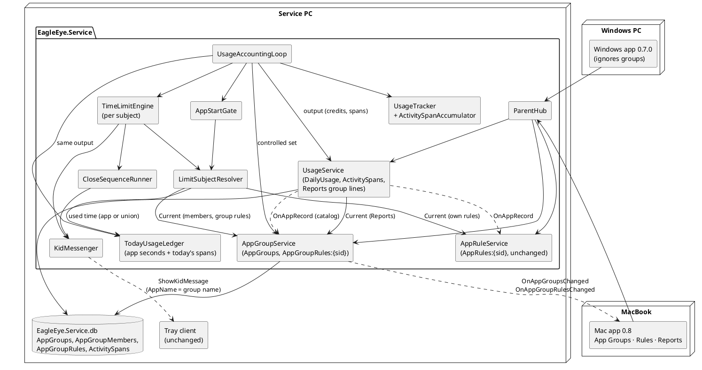
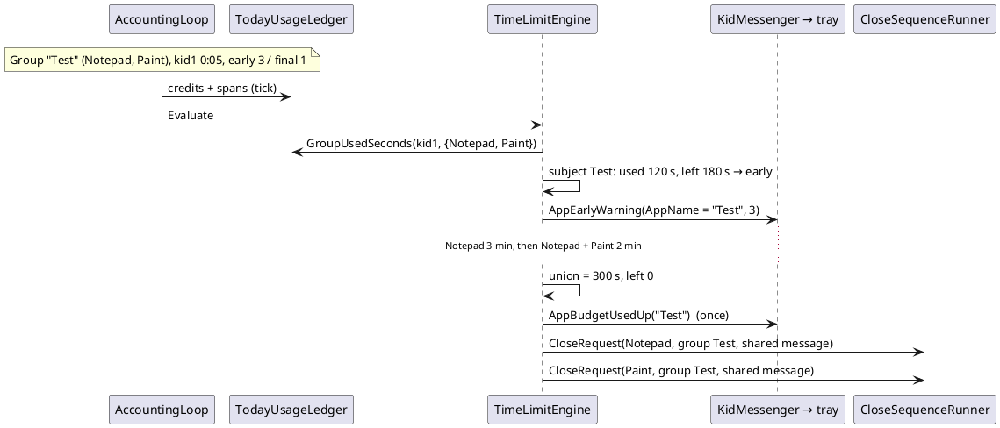

# Implementation Plan: US-008 — App Groups with a Shared Daily Budget (service and Mac app)

**Status**: Draft (for Michael's approval)
**Date**: 2026-10-31
**Author**: ARC
**User story**: `02_Implementation/docs/requirements/user-stories/US-008/user-story.md` (approved by Michael 2026-10-31, commit 43e5296; 44 ACs in groups A to K; OQ-1 to OQ-5 answered as proposed)
**Requirements**: `02_Implementation/docs/requirements/general-product-requirements.md` v1.8 amendment (FR-APP-042 to FR-APP-044, FR-APP-062, TC-026; TC-020, TC-033, FR-SVC-011/020/022/032/047 changed)
**Branch**: `feature/US-008-app-groups`
**New ADR** (Proposed, for approval with this plan):
- ADR-021 — App groups: shared budgets computed from activity spans, enforced per limit subject (`02_Implementation/docs/architecture/decisions/ADR-021-app-groups-and-activity-spans.md`)

**Amendments to apply after approval** (ARC, on the branch, before Step 3): ADR-012 (activity spans, estimated backfill), ADR-015 (§2 group used time, §4 warning keys per subject, §5 grace per subject, §7 group close batch), ADR-010 (two new state areas, refetch of usage on a group change), arc42 (header, §5.2, §5.5, §8.4, §8.6, §9, §11), coding guidelines §10.1 (folders `Service/Groups`, `ParentApp.Core/Groups`).

---

## Summary

The service learns **app groups**: it stores groups once per PC, records **activity spans** (when each app was active), computes a group's used time as the **union** of its current members' spans, and enforces group rules with the US-006 engine, reorganized around **limit subjects** (an app, or the group it belongs to). The Mac app gets the **App Groups** page (drag-and-drop and a "Move to …" menu), an **App group rules** section on Rules, and **group lines** on Reports. The **tray client needs no code change**: kid messages reuse the US-006 reasons with the group name in place of the app name.

**Compatibility (AC-44)** comes from additive contracts: every existing hub method, callback and DTO field keeps its meaning; the Mac app hides grouped apps itself; the Windows parent app 0.7.0 ignores what it does not know. The Windows parent app is **not** rebuilt for delivery; a feature switch keeps the group UI off in any Windows build until US-009.

**Order**: a short **drag-and-drop spike on the MacBook** first (Michael is on the MacBook now, and it is the biggest UI unknown). Then the **Windows** block: the open 0.7.0 regression (US-007 F-1, precondition), Shared contracts, service, installer 0.8.0, AC-44 check. Then the **MacBook** block: Core, Mac views, `.dmg` 0.8.0, the US-007 Step 9 documentation (F-2). Then a short **Windows** close-out.

---

## Technical Issues and Risks

*Checked against the code on `feature/US-008-app-groups` (= `main` 0.7.0 + story docs). **Summary: feasible as one story. The real new piece is the activity-span recording that the union needs (TI-1). The engine change is a reorganization, not a new mechanism. The biggest UI unknown is MAUI drag-and-drop on Mac Catalyst (TI-12, spike first).***

| # | Issue | Impact | Solution in this plan |
|---|---|---|---|
| **TI-1** | **The union cannot be computed from today's data.** Usage is stored as seconds per app and day (`DailyUsage`); `AppInstances` include locked and sleep time. AC-22 (time before joining) and AC-36 (past days with current members) need the union for **any** member set, later. | Blocker for AC-19 to AC-22, AC-35, AC-36. | **Activity spans** (ADR-021 §2): the tracker records when each app record was credited; `UsageService` persists the spans per tick; the group time is the union of the current members' spans (Decision 3). Per-app usage is unchanged (AC-23). |
| **TI-2** | **No spans before the update** (AC-6 upgrade day, AC-36 past days, AC-22 for today's time before the update). | Group times of those days would be 0. | One-time **estimated spans** at the first 0.8 start: one per `DailyUsage` row, placed at the day's start (Decision 2). Group time of those days = the largest member's time. Q-2. |
| **TI-3** | **The engine evaluates apps, not groups.** Warnings, closes and graces are keyed per app (ADR-015). AC-26, AC-27, AC-32 want them once per group. | Repeated messages per member; one close message per app. | **Limit subjects** (ADR-021 §4, Decision 6). Close of a group = one message shared by all member close requests (the existing break-batch pattern). |
| **TI-4** | **Grace detection after a membership change.** Moving an app changes its subject *and* the group's used time (pre-join time counts, AC-22). | Missed or wrong grace periods (AC-32). | Per running app: end under the **previous** snapshots (incl. used time with the previous members) vs end under the current ones; `GracePolicy` unchanged. The app takes part in the grace of its **new** subject (Decision 6). |
| **TI-5** | **AC-34 vs AC-22.** Moving a *not running* app into a group with running members can end that group's time (its pre-join time is added). AC-34 says such a move never starts a grace period or shows a dialog. Taken literally, the running members would be closed at once, which also shows a dialog. | Contradiction in the story. | Q-1: recommendation **grace** (the AC-32 rule applies whenever a running app's end moves earlier). PRO aligns AC-34. |
| **TI-6** | **AC-44 compatibility.** The Windows app 0.7.0 deserializes `DayUsageDto` and receives every broadcast to the `Parents` group. | Errors or wrong data in the old app. | Additive only (Decision 1): new trailing `DayUsageDto.Groups` (ignored by System.Text.Json in the old app), new callbacks (the SignalR client logs "no handler", no error), `AppRulesDto` unchanged (still all apps). **Wire tests** with frozen 0.7 DTO copies (Step 3) and a manual check with the real 0.7.0 app (Step 8). |
| **TI-7** | **App list of the App Groups page** spans accounts: one entry per program path with a record in at least one **controlled** account (AC-3). Ticking/unticking an account changes the list. | List not updated. | `AppGroupService` keeps an app catalog (from `AppRecords`, kept current by the app-record observer) and the controlled set (from the accounting loop each tick). The listed set is recomputed and broadcast only when it changes (Decision 4). |
| **TI-8** | **Group lines on Reports after a group change** (AC-36, AC-37): every day of every account may change. | Stale Reports. | No re-broadcast of past days: the Mac app's Reports model **fetches the account's usage again** when an `AppGroups` change arrives (ADR-021 §5). Today's line updates with the normal 5 s push. |
| **TI-9** | **Group name rules** (AC-8): trimmed, 1 to 40 characters, emojis allowed, unique ignoring case. SQLite `NOCASE` folds ASCII only. | "Ä" vs "ä" duplicates; emoji counted as 2. | `AppGroupNames` in Shared: NFC, trim, length in **text elements** (`StringInfo`), no control characters, key = `ToUpperInvariant`; stored `NameKey` column `UNIQUE`. Same code in the service and the Mac app. |
| **TI-10** | **History** (AC-31): the group name "in the reason". `BlockedStarts.Reason` has a `CHECK` with three values. | Migration conflict. | Two new nullable columns `GroupId`, `GroupName` (migration 6, `ALTER TABLE ADD COLUMN`); `BudgetMinutes`, `BudgetDays`, `UsedSeconds` hold the group rule and group time. D-6. |
| **TI-11** | **Windows parent app built from shared code.** Core and XAML are shared; group sections would also appear in a Windows build (untested, US-009 scope). | Unplanned Windows UI change on `main` after the merge. | `ParentAppFeatures.AppGroups` (Core), `true` on Mac Catalyst only; `package-windows.ps1 -Target Service` (Windows parent app not packaged in 0.8.0). Q-3. |
| **TI-12** | **MAUI drag-and-drop on Mac Catalyst** (AC-11): `DragGestureRecognizer`/`DropGestureRecognizer` map to `UIDragInteraction`/`UIDropInteraction`. Unknown: drags inside a `ScrollView` with the trackpad, drop highlight repaint, in-app data, empty sections as targets, right-click menus next to drags. | AC-11, AC-12. | **Step 1 spike** on the MacBook before any other work, with a decision rule (Decision 9). Fallbacks: native interactions through a Mac-only handler, or the menu only (Michael decides). |
| **TI-13** | **Catalyst repaint lesson (US-007).** A visual state that sets a background needs an explicit background in "Normal"; unset backgrounds do not repaint. The Mac `Button` style has an empty "Normal" next to a "Disabled" background. | Highlight or disabled colour stuck. | Every new state with a background sets "Normal" explicitly (drop highlight, heading-bar buttons). The Mac `Button` style gets explicit "Normal" setters too (Mac only). DEV verifies on screen and keeps screenshots (Step 10). |
| **TI-14** | **Buttons on heading bars.** On the Mac, buttons already use the accent colour (US-007 G-11); "Rename" and "Delete" sit on an accent-coloured heading bar (AC-2) and would vanish. | Invisible buttons. | Mac-only style `HeadingBarButton`: transparent fill, border and text in the heading-bar text colour, explicit "Normal". |
| **TI-15** | **Name dialog must stay open with an inline message** (AC-8). MAUI `DisplayPromptAsync` closes on OK. A custom modal page needs its own Escape handling on Catalyst. | AC-7 to AC-9. | Re-prompt: on an invalid name the prompt opens again at once with the message as its text and the typed name prefilled (Decision 8). Escape and Cancel are native. Spike checks the feel; a modal page is the fallback. |
| **TI-16** | **US-007 F-1**: `main` carries 0.7.0 Core code that was never built or tested on Windows. The story requires the regression first. | Unknown Windows defects block the Windows steps. | Step 2 (precondition). If it finds a defect: Q-5. |

---

## Machine Assignment

| Work | Machine |
|---|---|
| This plan and ADR-021 (ARC) | MacBook (done here) |
| **Step 1**: drag-and-drop spike | **MacBook** |
| **Steps 2 to 8**: 0.7.0 regression (F-1), Shared contracts, service, tray version, installer 0.8.0, smoke check, install on the service PC, AC-44 check | **Windows Developer Machine** (service PC `192.168.1.37`) |
| **Steps 9 to 11**: `ParentApp.Core`, Mac views, `.dmg` 0.8.0, F-2 documentation | **MacBook**, connected to the service 0.8.0 on the service PC |
| **Step 12**: Windows build and tests of the final branch, implementation report | **Windows Developer Machine** |
| Manual test run (Michael, guided by TES) | Service PC (service, tray, Windows app 0.7.0 for group K) + MacBook (Mac app 0.8.0) |

**Handover points** (commit, push, Michael switches machines, `git pull` on the other machine):

| # | After | From → To | What must be pushed |
|---|---|---|---|
| H1 | Step 1 | MacBook → Windows | `US-008/spike-drag-drop.md` (result and chosen technique) |
| H2 | Step 8 | Windows → MacBook | Shared contracts, service, installer built; `implementation-report.md` §Windows; service 0.8.0 **installed** on the service PC |
| H3 | Step 11 | MacBook → Windows | Core, Mac views, READMEs, report §Mac (the `.dmg` stays on the MacBook: `03_Delivery` binaries are git-ignored, as the installers on Windows) |

`EagleEye.Shared/Contracts/` changes land first, on Windows (Step 3, ADR-007). The MacBook builds Shared and `ParentApp.Tests`; DEV keeps Shared and Core free of Windows APIs.

---

## Impact Assessment

| Component | Impact |
|---|---|
| **EagleEye.Shared** | `IParentHub`: 8 new methods. `IParentClientCallback`: `OnAppGroupsChanged`, `OnAppGroupRulesChanged`. New DTOs `AppGroupsDto`, `AppGroupDto`, `GroupableAppDto`, `AppGroupRulesDto`, `AppGroupRuleDto`, `GroupUsageDto`. `DayUsageDto`: new trailing `Groups`. Constants `AppGroupNames`. Doc change only: `KidMessageDto.AppName` may hold a group name. |
| **EagleEye.Service** | **Data**: migration 6 (`AppGroups`, `AppGroupMembers`, `AppGroupRules`, `ActivitySpans`, `PendingBackfills`; `BlockedStarts` + 2 columns), `AppGroupRepository`, `UsageRepository` (spans, backfill, purge), `BlockedStartRepository`. **Statistics**: `ActivitySpanAccumulator`, tracker spans, `UsageService` (persist spans, backfill, group lines on Reports, several app-record observers). **Groups** (new folder): `AppGroupService`, `AppGroupsSnapshot`, `AppGroupChangeLog`, `SpanUnion`, `GroupUsageCalculator`. **Enforcement**: `LimitSubject`, `LimitSubjectResolver`, `TodayUsageLedger` (spans, group used time), `AppStartGate`, `TimeLimitEngine`, `AppEndCalculator` (rule parameter), `WarningLedger` (subject key), `KidMessageFactory`, `CloseRequest`, `EnforcementLog`. **Communication**: `ParentHub` (8 methods), broadcaster. **Rules**: `AppRuleChangeLog` (note for grouped apps). `Program`: start order. |
| **EagleEye.TrayClient** | **No code change.** Version 0.8.0. Unit tests added for info lines with a group name. |
| **EagleEye.ParentApp.Core** | Hub client and gateway (2 events, 8 calls). `ParentAppFeatures`. `Groups/AppGroupsModel`, `Groups/AppGroupNameRules`, `Rules/AppGroupRulesModel`. View models: `AppGroupsViewModel`, `AppGroupSectionViewModel`, `GroupableAppViewModel`, `AppGroupRulesSectionViewModel`, `AppGroupRuleRowViewModel`; `AppRulesSectionViewModel` (hide grouped apps), `DayUsageViewModel` (group rows), `ReportsViewModel` (refetch on group change), `MainViewModel` (menu). `IDialogService` (text prompt options, choice sheet). Texts de/en. |
| **EagleEye.ParentApp** | New `Views/AppGroupsView`; `RulesView` (group rules section, hint label), `ReportsView` (group table), `MainPage` (fourth page); `MauiDialogService`; Mac styles (`HeadingBarButton`, drop highlight, explicit "Normal" of `Button`); drag-and-drop per spike (`#if MACCATALYST` only if needed). |
| **Installers** | Version 0.8.0. `EagleEye-Setup-0.8.0.exe` (service + tray) and `EagleEye-ParentApp-0.8.0.dmg`. **No** Windows parent app installer 0.8.0 (Q-3). Migration 6 and the backfill run at the first service start. |
| **Version** | `Directory.Build.props` → `0.8.0`. |

---

## Architecture Changes

| Document | Change (after approval) |
|---|---|
| ADR-021 (new, Proposed) | Groups by program path, activity spans, union with current members, estimated backfill, limit subjects, additive contracts, feature switch |
| ADR-010 | Amendment: state areas `AppGroups` and `AppGroupRules:{sid}`; a parent app refetches the account usage on an `AppGroups` change (not polling) |
| ADR-012 | Amendment: activity spans recorded and persisted with the tick; backfill; retention |
| ADR-015 | Amendment: subject instead of app in §2 to §7; group close as a batch; grace per subject |
| arc42 | Header; §5.2 (Groups component, spans); §5.5 (App Groups page, feature switch); §8.4 tables; §8.6 retention of spans; §9 ADR-021; §11 new risks (R-1, R-4 below) |
| Coding guidelines §10.1 | Folders `Service/Groups`, `ParentApp.Core/Groups` |

---

## New ADRs Required

- **ADR-021** (draft, Proposed): see the file. One decision record for the data basis (spans), the computation (union, current members), the enforcement model (subjects) and the compatibility strategy, because they only work together.

---

## API Changes (SignalR Contracts)

*API-first: Step 3. ADR-010 shape: snapshot with revision and correlation id, query, broadcast to all paired apps, field-level writes with `requestId` returning `StateWriteAckDto`. All methods are paired-only. Each accepted write produces exactly one new revision and one broadcast, also for no-op writes.*

### State area `AppGroups` (global) — `IParentHub` (new methods)

```csharp
/// <summary>Returns the groups and the listed apps (state area "AppGroups", FR-APP-042). Listed: every program path with an
/// app record in at least one controlled account, once, without the enforcement ignore list (US-008 AC-3). Called after
/// every (re)connect.</summary>
Task<AppGroupsDto> GetAppGroups();

/// <summary>Creates an empty group. The name is normalized with <see cref="AppGroupNames.Normalize"/> (AC-8). Throws
/// HubException ("A group with this name already exists.") for a duplicate ignoring case.</summary>
Task<StateWriteAckDto> CreateAppGroup(Guid requestId, string name);

/// <summary>Renames a group (AC-9); the unchanged or only re-cased own name is valid. "The group no longer exists." if gone.</summary>
Task<StateWriteAckDto> RenameAppGroup(Guid requestId, long groupId, string name);

/// <summary>Deletes a group with its members and the group rules of all accounts (AC-10).</summary>
Task<StateWriteAckDto> DeleteAppGroup(Guid requestId, long groupId);

/// <summary>Moves a listed app (by program path) into a group, or out of every group with <paramref name="groupId"/> = null
/// (AC-11 to AC-13). "The app no longer exists." if the path is not listed; "The group no longer exists." if gone.</summary>
Task<StateWriteAckDto> MoveAppToGroup(Guid requestId, string programPath, long? groupId);
```

### State area `AppGroupRules:{accountSid}` — `IParentHub` (new methods)

```csharp
/// <summary>Returns the group rules of one account: one row for every group, default 0:00 and no day when not stored
/// (AC-7, AC-15, AC-39). Called after every (re)connect and when the parent selects another account on Rules.</summary>
Task<AppGroupRulesDto> GetAppGroupRules(string accountSid);

/// <summary>Sets the hours or minutes of a group's budget, combined with the stored other part (as SetAppBudget).</summary>
Task<StateWriteAckDto> SetAppGroupBudget(Guid requestId, string accountSid, long groupId, AppBudgetPart part, int value);

/// <summary>Ticks or unticks one weekday of a group rule; every combination is valid, also none.</summary>
Task<StateWriteAckDto> SetAppGroupDay(Guid requestId, string accountSid, long groupId, DayOfWeek day, bool isAllowed);
```

Hub error texts (`HubException`, safe texts): `Invalid request.` (bad SID, `Guid.Empty`, invalid name, ignored path, value out of range), `Unknown account.`, `A group with this name already exists.`, `The group no longer exists.`, `The app no longer exists.`, `The change could not be saved.`, `The app groups are not available.`. The Mac app validates before sending and shows its own localized texts; any rejection shows "The change could not be saved. Please try again." (AC-14).

### `IParentClientCallback` (new)

```csharp
/// <summary>Groups, names, members or the listed apps changed (state area "AppGroups"), incl. a new listed app (AC-4).
/// Apply only if the revision is higher. A parent app showing Reports fetches the selected account's usage again.</summary>
Task OnAppGroupsChanged(AppGroupsDto snapshot);

/// <summary>The group rules of one account changed, or a group was created or deleted (state area "AppGroupRules:{sid}").</summary>
Task OnAppGroupRulesChanged(AppGroupRulesDto snapshot);
```

### `EagleEye.Shared/Models/` (new or changed)

```csharp
/// <summary>A group (FR-APP-042).</summary>
public sealed record AppGroupDto(long GroupId, string Name);

/// <summary>A listed app of the App Groups page (AC-3): one per program path.</summary>
/// <param name="DisplayName">As on Reports; of the most recently seen record when accounts differ.</param>
/// <param name="GroupId">The app's group, or null for "Not in any group".</param>
public sealed record GroupableAppDto(string ProgramPath, string DisplayName, long? GroupId);

/// <summary>Snapshot of the global state area "AppGroups". Both lists unsorted (the app sorts in its culture, AC-2, AC-3).</summary>
public sealed record AppGroupsDto(long Revision, Guid? LastChangeRequestId, IReadOnlyList<AppGroupDto> Groups, IReadOnlyList<GroupableAppDto> Apps);

/// <summary>The rule of one group for one account (as AppRuleDto, AC-16).</summary>
public sealed record AppGroupRuleDto(long GroupId, int BudgetMinutes, BreakTimeDays Days);

/// <summary>Snapshot of "AppGroupRules:{AccountSid}": a row for every group.</summary>
public sealed record AppGroupRulesDto(long Revision, Guid? LastChangeRequestId, string AccountSid, IReadOnlyList<AppGroupRuleDto> Rules);

/// <summary>Used time of one group on one day (AC-35): union of the current members' activity (TC-026).</summary>
public sealed record GroupUsageDto(long GroupId, string Name, long Seconds);

// Changed: trailing list, null from a service older than 0.8 (the Mac app treats null as empty).
public sealed record DayUsageDto(
    long Revision, Guid? LastChangeRequestId, string AccountSid, DateOnly Day, DateOnly ServiceToday,
    IReadOnlyList<AppUsageDto> Apps, IReadOnlyList<GroupUsageDto>? Groups = null);
```

`EagleEye.Shared/Constants/AppGroupNames` (new): `MaxLength = 40` (text elements), `MaxCodeUnits = 160`, `Normalize(string)` → NFC + trim (`char.IsWhiteSpace`), `IsValid(normalized)` (1..40 text elements, no control characters, ≤ 160 code units), `Key(normalized)` = `ToUpperInvariant()`. Budget values reuse `AppRuleRules` (0..23 h, 0..59 min, `Combine`, `IsAllowedOn`, `Format`).

`KidMessageDto` (doc only): `AppName` = "display name of the app, or the name of the app group for a group subject (US-008)".

**Version compatibility.**
- **Windows parent app 0.7.0 ↔ service 0.8.0 (AC-44)**: all 0.7 calls unchanged; the new property `groups` in `DayUsageDto` is ignored by the default SignalR JSON protocol; the two new callbacks have no handler in 0.7 (the client logs a warning, no exception, the old app has no log file); `AppRulesDto` still lists grouped apps with their own rules, editable, without effect while grouped (AC-44 as written). Ensured by the wire tests of Step 3 and checked with the real app in Step 8.
- **Mac app 0.8 ↔ service 0.7** (out of scope): the new queries fail with "method not found"; the App Groups page and the group sections show "No data available"; `Groups` is null → no group lines.
- **Tray 0.8 = service 0.8**: same installer.

Payload: 100 apps × ~150 bytes + 20 groups ≈ 16 KB per `AppGroupsDto`, broadcast only on changes.

---

## Component Design

### Overview



### Decision 1: compatibility by addition (AC-44)

No existing contract member changes meaning. The Mac app joins areas on the client: grouped apps (by path from `AppGroupsDto.Apps`) are hidden from "Application rules"; group names and members on Rules come from `AppGroupsDto`; group rules from `AppGroupRulesDto`. The service never filters `AppRulesDto`, so the Windows app 0.7.0 sees and edits what it saw before. `AppRuleChangeLog` adds a note when the edited app is grouped: "app rule changed: Paint, 0:30, Mo; not used while the app is in group Test." (observability for AC-44).

### Decision 2: activity spans (ADR-021 §2, TI-1, TI-2)

**Tracker.** `UsageTracker.Credit(sid, app, length, wallNow)` already splits `[wallNow − length, wallNow]` per local day. It now also passes each part (day, start, end) to `ActivitySpanAccumulator` (new, `Statistics/`, pure): per (sid, path) one open span; a part that starts no more than **1 s** after the open span's end (and not before its start) extends it, otherwise the open span is closed and a new one opens (new day, gap, clock jump). `TakeOutput(includeUsage: true)` adds `Spans`: `SpanUpdate(SpanKey, AccountSid, ProgramPath, Day, StartUtc, EndUtc)` for every span created or extended since the last output. All apps of an account credited in one `Advance` end at the same instant, so overlaps are exact.

**Persistence.** `UsageService.ApplyAsync` maps `SpanKey` → `SpanId` (in memory, like instance keys) and passes inserts and end updates to `IUsageRepository.ApplyAsync(increments, seen, spans)` in the **same transaction** as `DailyUsage`. A failed write keeps them for the next tick (as today). After a service restart, old spans are simply closed (no open state is stored).

**Backfill (once).** Migration 6 inserts the marker `PendingBackfills('ActivitySpans')`. `UsageService.InitializeAsync` sees it and, in one transaction, inserts for every `DailyUsage` row with `Seconds > 0` of the last 90 days an estimated span `[StartOfDay(day), StartOfDay(day) + Seconds]` (`DaySplitter.StartOfDay`, local zone) and deletes the marker. Log: "Estimated activity spans for {Rows} daily entries recorded before the update; group times of those days use the largest app's time." For today, real spans start later than the estimated one ends (used ≤ time since midnight), so nothing overlaps twice.

**Retention.** `PurgeOlderThanAsync` deletes spans with `Day < cutoff`; app record deletion cascades.

### Decision 3: group used time (TC-026, AC-19 to AC-23)

`Groups/SpanUnion` (pure): `Length(IEnumerable<(long StartMs, long EndMs)>)` → sort by start, merge, sum; whole seconds (floor). `Groups/GroupUsageCalculator` (pure): from spans per app record, the account's records (`AppId → path`), and the current memberships, the seconds per group and day.

- **Enforcement**: `TodayUsageLedger` additionally keeps today's spans per (sid, path), loaded with the account (`IUsageRepository.GetSpansAsync(sid, today, today)`) and fed by `ApplySpans(output.Spans)` in the same loop step as the credits. New: `GroupUsedSeconds(sid, IReadOnlyCollection<string> memberPaths, day)`. App subjects keep `UsedSeconds(sid, path, day)` (Reports figure, ADR-015 §2).
- **Reports**: `UsageService.GetAccountUsageAsync` loads the account's spans of the 90 days (one query), `PublishDayAsync` the spans of that day; both fill `DayUsageDto.Groups` with `IAppGroupsView.Current`. A group is listed on a day when at least one current member is in that day's app table (so "00:00" appears for less than a minute, AC-35); a deleted group is gone (AC-36).

Michael's examples (AC-19): together 5 min → 5; Notepad 2 then both 10 → 12; Notepad 3, then Paint 4 → 7. AC-22: Paint 50 min alone, moved into "Test" (1:00) → 50 used, 10 left. Per-app usage unchanged (AC-23).

### Decision 4: `AppGroupService` — state owner (AC-2 to AC-18, AC-38 to AC-40)

`Groups/AppGroupService` (one `SemaphoreSlim`, one revision counter for both areas, ADR-010 §4):
- `InitializeAsync()` (in `Program` after `AppRuleService`, before break times and the ledger): loads groups, members, rules and the **app catalog** (`AppRecords`: sid, path, display name, last seen; ignore list excluded) into an immutable `AppGroupsSnapshot`. Log: "App groups loaded: {Groups} groups with {Members} apps, {Rules} group rules."
- `Current` (lock-free, `IAppGroupsView`): `GroupOf(path)`, `Members(groupId)`, `RuleFor(groupId, sid)` (default 0:00, no day), `NameOf(groupId)`.
- Writes (each with `requestId`, device name): validate (name via `AppGroupNames`, duplicate by `NameKey`, group exists, path listed, account in the inventory) → store → swap snapshot → revision++ → log → broadcast → ack. **Create/delete** also broadcast `AppGroupRulesDto` for every standard account of the inventory (each snapshot has a row per group). **Move** writes or deletes the `AppGroupMembers` row (moving into the current group = no-op write).
- `IAppRecordObserver.OnAppRecordAsync` (second observer of `UsageService`; `UsageService` now takes `IEnumerable<IAppRecordObserver>`): new path or new display name → catalog updated; broadcast if the listed set or a listed name changed (AC-4, ≤ 15 s: the observer runs after the tick that created the record).
- `IControlledAccountsListener.OnControlledAccounts(sids)`: called by the accounting loop each tick with the controlled set it already reads; broadcast only if the listed set changed. The set is passed in, so the service never calls `IUserAccountService` from inside a call that the account service makes under its own lock.
- `IAccountDataPurger`: deletes `AppGroupRules` of deleted SIDs and drops their catalog records; groups and members stay (AC-39). Log: "Purged the group rules of deleted account {AccountSid}."
- Display name of a listed app: from the most recently seen record (`LastSeenUtc`) among controlled accounts.

### Decision 5: limit subjects (ADR-021 §4, AC-24, AC-29, AC-30)

`Enforcement/LimitSubject` (record): `Kind` (`App` | `Group`), `Key` (`app|PATH` or `group|{id}`), `Name` (display name or group name), `GroupId?`, `Rule` (`LimitRule(BudgetMinutes, Days)`), `UsedSeconds`, `MemberPaths` (groups).
`Enforcement/LimitSubjectResolver` (pure): `Resolve(sid, path, day, AccountAppRules, AppGroupsSnapshot, TodayUsageLedger)` → group subject if the path is a member (group rule of the account, group used time with the snapshot's members), else app subject (own rule or default, app used time). `AppEndCalculator.Compute` takes `LimitRule?` instead of `AppRuleEntry?` (mechanical; behaviour unchanged).

### Decision 6: engine and gate per subject (AC-25 to AC-34)

**Gate** (`AppStartGate.DecideByRule`): unchanged order (ignore list, open, closing, break → rule). The rule step resolves the subject: not allowed today or `used ≥ budget` → blocked; message `AppEnd(reason, budgetText, subject.Name)`; `CloseRequest` gets `GroupId`, `GroupName`, and `Rule = AppRuleAtClose(subject budget, days, subject used)`. A blocked start adds no used time (it is removed from the report as today).

**Engine** (`TimeLimitEngine.Evaluate`), per session of a controlled account:
1. Resolve the subject of every running app; group the running apps by subject key.
2. Per subject: `end = AppEndCalculator.Compute(subject.Rule, subject.UsedSeconds, breaks, now)` once.
3. **Grace detection** when any of these changed since the last tick: the account's `AccountRules` or `AccountAppRules` reference (as today), the `AppGroupsSnapshot` reference (global), or the account's group-rule revision. For each running app not first seen: `oldEnd` = end of its subject resolved with the **previous** snapshots (previous members, so previous group used time); `GracePolicy.Starts(newLeft, oldLeft, final)`. If true for any app of a subject, the **subject** gets a grace (key `(session, subjectKey)`), one `AppGracePeriod` message with `subject.Name`, and its final level is marked shown. Members of a subject in grace that start later share the grace end.
4. **Warnings** per subject: key `WarningLedger.SubjectKey(sid, subject.Key, day)` (app keys keep their format), level by `left`; message `AppWarning(level, …, subject.Name, left)`. Break ends keep their session keys and the break messages (AC-28).
5. **Close** when `left ≤ 0` (or the grace ended): app subject as today; group subject → one `KidMessenger.ShowAsync` with `AppEnd(reason, budgetText, groupName)` and one `CloseRequest` per running member with `SharedMessageState` = that task (AC-27). Break closes unchanged (one break message per session).
6. Per session and tick at most one message (the US-006 outbox priority); others are logged "not shown (replaced in the same tick)".

Cases of AC-32 and AC-33: rule change of a running group, app moved in/out/between groups, group deleted (members fall back to own rules: their new subject is the app) all go through step 3. Rename changes only names: no end moves, no grace, no message (AC-34). A move that changes no running app's end does nothing. **Moving a not-running app** into a group with running members (TI-5): with Q-1 = recommendation, step 3 applies (grace for the running members); otherwise DEV implements the literal AC-34 and the running members are closed at once.



### Decision 7: logging and history (AC-14, AC-16, AC-31)

See "Logging". `BlockedStarts` rows of group subjects carry `GroupId` and `GroupName`; `BudgetMinutes`/`BudgetDays`/`UsedSeconds` hold the group rule and the group used time. The limiter of US-005 Q-4 applies unchanged (per account and app).

### Decision 8: Mac app (AC-1 to AC-18, AC-35 to AC-37)

**Core** (platform-neutral, compiled and tested on both machines):
- `ParentAppFeatures(bool AppGroups)`: registered in `MauiProgram` (`true` under `#if MACCATALYST`, else `false`). With `false` the app is exactly 0.7.0: no menu entry, no fetches of the new areas, no hidden rows, no group lines.
- `Groups/IAppGroupsModel` / `AppGroupsModel`: global replica (pattern of `WarningSettingsModel`): fetch on connect, revision rule, writes (create, rename, delete, move) with pending/confirm, 4 s timeout, refetch when the outcome is unknown.
- `Groups/AppGroupNameRules`: client check with `AppGroupNames` plus duplicates against the replica (ignoring the group being renamed). Results: valid / `GroupsInvalidName` / `GroupsDuplicateName`.
- `Rules/AppGroupRulesModel`: `SelectedAccountModel<AppGroupRulesDto>` (as `AppRulesModel`).
- `ViewModels/AppGroupsViewModel` (page): states NotConnected / NoData (no controlled account) / Loading / Ready (AC-5); `Sections` (`ObservableCollection<AppGroupSectionViewModel>`): groups sorted by name (`StringComparer.Create(CurrentCulture, ignoreCase: true)`, then id), then "Not in any group"; sections and entries **merged by key** (no rebuild on snapshots, new entries inserted in place, AC-4); `AddGroupAsync`, `RenameAsync(section)`, `DeleteAsync(section)`, `MoveAsync(app, targetSection)` (same section → nothing), `MoveTargets(app)` (all groups except its own, plus "Not in any group" when grouped, AC-12); `DraggedApp` (in-app drag source); `ErrorText`.
- `AppGroupSectionViewModel`: `GroupId?`, `Title`, `Apps` (sorted by display name, then path), `EmptyText` (AC-3), `IsDropTarget` (highlight), `CanRename`, `CanDelete`.
- `GroupableAppViewModel`: `ProgramPath` (tooltip, AC-3), `DisplayName`, `GroupId?`.
- Name dialog (TI-15): `IDialogService.PromptAsync` gets an options parameter (`PromptKind.Text`, max 160 code units, default keyboard; the host dialog keeps `PromptKind.Host`). Loop: prompt → `null` → stop; invalid → prompt again with the message as its text and the typed name prefilled; valid → send. Delete uses `ConfirmAsync` with the AC-10 text. "Move to …" uses a new `IDialogService.ChooseAsync(title, cancel, options)` (action sheet).
- `AppGroupRulesSectionViewModel` + `AppGroupRuleRowViewModel`: as the app rules section and row (direct editing, parse with `AppBudgetText`, pending/confirm, dirty field kept, AC-16). Row: group name, members line (names sorted, comma-separated; `RulesGroupNoApps` when empty, OQ-4). Rows sorted by group name. `ShowNoGroups` (AC-15). DEV may extract the shared row logic of app rule rows into a base class; app rule behaviour unchanged (existing tests green unchanged).
- `AppRulesSectionViewModel`: with the switch on, rows of grouped apps are removed and re-inserted on `AppGroups` changes; a returning app shows its stored own rule (AC-17).
- `DayUsageViewModel`: `GroupRows` (`GroupUsageRowViewModel`: name, `UsageDuration` text), sorted by seconds descending, then name; `HasGroupRows`. `ReportsViewModel`: on `AppGroups` revision change (switch on) → refetch the selected account's usage, debounced 500 ms (AC-36, AC-37).
- `MainViewModel`: menu "Settings", "App Groups", "Rules", "Reports" with the switch on (AC-1); key `appgroups`; start page unchanged.

**MAUI head**:
- `Views/AppGroupsView.xaml(.cs)`: page header, explanation (`MaxWidth` 900, wrap), "Add group" button, `BindableLayout` of sections inside a `ScrollView`. Section: heading bar `Grid` (title label with `SectionHeader` style; "Rename" and "Delete" with the Mac `HeadingBarButton` style) and below a `VerticalStackLayout` of entries with a minimum height of one row, so empty groups are drop targets. Entry: display name (tooltip = path), "≡" button (`ToolTip` "Move to …") → `ChooseAsync`. Drag-and-drop by the technique chosen in Step 1. Drop highlight: `IsDropTarget` → background `DropHighlight` resource; "Normal" sets the explicit section background (TI-13).
- `RulesView.xaml`: section "App group rules" between break times and "Application rules" (`IsVisible` = switch), same column grid 220 | 64 | 64 | 7 × 48; row = name (bold) + members (smaller, wrap); hint label `RulesAppRulesGroupedHint` under the app rules explanation (switch on only, so the Windows text stays unchanged).
- `ReportsView.xaml`: under each day's app table, `ReportsGroupsHeading` and the table 360 | 160 (`IsVisible` = `HasGroupRows`).
- `MainPage`: fourth view; `MauiProgram` DI.
- `MacStyles.xaml`: `HeadingBarButton` (TI-14), `DropHighlight`, explicit "Normal" setters for `Button` (TI-13). Windows styles unchanged.

### Decision 9: drag-and-drop spike and decision rule (Step 1, TI-12)

A throwaway prototype on the MacBook (not committed; findings committed): one page with three sections in a `ScrollView`, ten entries, MAUI `DragGestureRecognizer` on entries and `DropGestureRecognizer` on sections, in-app data through the view model (`DraggedApp`), highlight on `DragOver`/`DragLeave`/`Drop`, a right-click `ContextFlyout` and a "≡" button with an action sheet, a name prompt loop.

| Check | Pass |
|---|---|
| Drag with mouse and with trackpad (click-drag, three-finger drag if enabled) inside the `ScrollView` | Drag starts; the page does not scroll instead |
| Drop on another section, on an empty section, on the own section, outside | Moves, moves, nothing, nothing |
| Highlight follows the pointer and always clears (light and dark) | No stuck colour after 20 drags |
| Right-click menu on an entry that is also draggable | Opens; does not start a drag |
| Name prompt loop | Opens again with the message and the text; Escape cancels |

Decision rule: all pass → MAUI recognizers in shared XAML (no platform code). Drag fails or highlight is unreliable → `#if MACCATALYST` handler adding `UIDragInteraction`/`UIDropInteraction` to the native views (spike tries it the same day). Both fail → stop; Michael decides whether US-008 ships with the menu only (AC-11 deferred) (story risk). Context menu fails → the "≡" button alone fulfils AC-12 (Q-4).

---

## Data Model Changes

### Service — `EagleEye.Service.db`, migration 6

```sql
CREATE TABLE AppGroups (
    GroupId     INTEGER PRIMARY KEY AUTOINCREMENT,
    Name        TEXT NOT NULL,                    -- AppGroupNames.Normalize, 1..40 text elements
    NameKey     TEXT NOT NULL UNIQUE,             -- ToUpperInvariant(Name): unique ignoring case (AC-8)
    CreatedUtc  TEXT NOT NULL,
    ChangedUtc  TEXT NOT NULL
);
CREATE TABLE AppGroupMembers (                    -- one group per app (AC-13); not tied to an account (AC-40)
    ProgramPath TEXT PRIMARY KEY NOT NULL COLLATE NOCASE,
    GroupId     INTEGER NOT NULL REFERENCES AppGroups (GroupId) ON DELETE CASCADE,
    ChangedUtc  TEXT NOT NULL
);
CREATE INDEX IX_AppGroupMembers_Group ON AppGroupMembers (GroupId);
CREATE TABLE AppGroupRules (                      -- no row = 0:00, no day (AC-7, AC-39)
    GroupId       INTEGER NOT NULL REFERENCES AppGroups (GroupId) ON DELETE CASCADE,
    AccountSid    TEXT NOT NULL COLLATE NOCASE,
    BudgetMinutes INTEGER NOT NULL CHECK (BudgetMinutes BETWEEN 0 AND 1439),
    Days          INTEGER NOT NULL CHECK (Days BETWEEN 0 AND 127),
    ChangedUtc    TEXT NOT NULL,
    PRIMARY KEY (GroupId, AccountSid)
);
CREATE TABLE ActivitySpans (                      -- ADR-021 §2; times as Unix milliseconds UTC (volume, arithmetic)
    SpanId      INTEGER PRIMARY KEY AUTOINCREMENT,
    AppId       INTEGER NOT NULL REFERENCES AppRecords (AppId) ON DELETE CASCADE,
    Day         TEXT NOT NULL,                    -- local day, yyyy-MM-dd (spans are split at midnight)
    StartUtcMs  INTEGER NOT NULL,
    EndUtcMs    INTEGER NOT NULL CHECK (EndUtcMs >= StartUtcMs),
    Estimated   INTEGER NOT NULL DEFAULT 0 CHECK (Estimated IN (0, 1))
);
CREATE INDEX IX_ActivitySpans_AppDay ON ActivitySpans (AppId, Day);
CREATE INDEX IX_ActivitySpans_Day ON ActivitySpans (Day);
ALTER TABLE BlockedStarts ADD COLUMN GroupId INTEGER NULL;
ALTER TABLE BlockedStarts ADD COLUMN GroupName TEXT NULL;
CREATE TABLE PendingBackfills (Name TEXT PRIMARY KEY NOT NULL);
INSERT INTO PendingBackfills (Name) VALUES ('ActivitySpans');
```

- One migration in one transaction; forward-only; migrations 1 to 5 unchanged. No groups after the update (AC-6): every app keeps its own rule.
- Purge: `AppGroupRules` by SID (purger); `ActivitySpans` 90 days and by app record (cascade); groups and members never purged automatically.
- Volume: typically 5 to 30 spans per app and day; with 3 accounts × 30 apps × 90 days ≈ 80 000 rows (≈ 5 MB). Writes: one insert or update per active app per tick, inside the existing transaction.

### Parent app

No database change (in-memory replicas).

---

## Implementation Steps

All steps on `feature/US-008-app-groups`. Commit after each step (`US-008: …`) and push. Each step ends with **"Michael sees"**.

| Step | Content | Machine |
|---|---|---|
| **1** | Drag-and-drop spike (Decision 9) | **MacBook** |
| — | **H1**: push; Michael switches to Windows | |
| **2** | **Precondition**: Windows regression of 0.7.0 (US-007 F-1) | **Windows** |
| 3 | Version 0.8.0; Shared contracts, `AppGroupNames`, stubs, wire tests | Windows |
| 4 | Service data: migration 6, repositories, backfill | Windows |
| 5 | Activity spans: tracker, persistence, ledger, union, Reports group lines | Windows |
| 6 | `AppGroupService`, hub methods, broadcaster, observers, purger, logs | Windows |
| 7 | Enforcement per subject: resolver, gate, engine, messages, history, logs | Windows |
| 8 | Tray tests, service installer 0.8.0, smoke check, install on the service PC, AC-44 check, performance | Windows |
| — | **H2**: push; Michael switches to the MacBook | |
| 9 | `ParentApp.Core`: client, gateway, models, view models, texts, feature switch | MacBook |
| 10 | Mac views: App Groups page, Rules section, Reports groups; on-screen check | MacBook |
| 11 | `.dmg` 0.8.0, update over 0.7.0; F-2 documentation; report (Mac part) | MacBook |
| — | **H3**: push; Michael switches to Windows | |
| 12 | Windows build and tests of the final branch; report; story → `Implemented` | Windows |

### Step 1: Drag-and-drop spike (MacBook, about half a day)
1. `git switch feature/US-008-app-groups`, `git pull`; `pwsh 02_Implementation/scripts/env-check.ps1`.
2. Prototype per Decision 9 in a scratch page (Debug only, not committed).
3. Write `02_Implementation/docs/requirements/user-stories/US-008/spike-drag-drop.md`: checks with pass/fail, the chosen technique, code fragments to reuse, screenshots in `US-008/evidence/`. If the rule says "stop", report to Michael before H1.

**Michael sees**: on his MacBook, a rough page where he drags apps between sections with mouse and trackpad, sees the target highlighted, and opens the "Move to …" menu.

### Step 2: Precondition — Windows regression of 0.7.0 (Windows, US-007 F-1)
1. `git switch main`, `git pull`. `build.ps1` (0 warnings), `test.ps1` (all four projects green).
2. `package-windows.ps1` → `EagleEye-Setup-0.7.0.exe`, `EagleEye-ParentApp-Setup-0.7.0.exe`.
3. Install both on the service PC over the installed version; smoke check as US-007 plan Step 8 item 4 (pairing and appearance kept, a tick, a break time change, an app rule change, Reports of today; no Mac-only element; Windows accent bars; Mac app 0.7.0 connects to the service 0.7.0) and REG-001-01 to -05 of `docs/testing/regression-checklist.md`.
4. Record the result in `US-008/implementation-report.md` §"Precondition F-1" (on the feature branch, after `git switch feature/US-008-app-groups`); the Orchestrator updates F-1 in `docs/testing/US-007/test-report.md`. A defect → stop, Q-5.

**Michael sees**: the Windows parent app 0.7.0 and the service 0.7.0 on the service PC, working as before. This Windows app 0.7.0 is the one used for AC-44 later.

### Step 3: Shared contracts (Windows)
1. `git switch feature/US-008-app-groups`, `git pull`. `Directory.Build.props` → `0.8.0`.
2. DTOs, `DayUsageDto.Groups`, `AppGroupNames`, `IParentHub` (8), `IParentClientCallback` (2), `KidMessageDto` doc.
3. Stubs so the build stays green: hub methods throw `HubException("The app groups are not available.")`; Core client/gateway members added (no UI).
4. Wire tests (Shared.Tests): serialize each changed or new DTO with the SignalR JSON options and deserialize into a **frozen copy of the 0.7 record** (`DayUsageDto` without `Groups`) → equal fields; JSON without `groups` → `Groups` null.

**Michael sees**: nothing visible; build and tests green on Windows.

### Step 4: Service data (Windows)
1. Migration 6 (Data Model). `AppGroupRepository` (load all incl. catalog, create, rename, delete, set/delete member, upsert/delete rule — a rule equal to the default deletes the row, purge rules by SID). `UsageRepository`: `ApplyAsync` with spans, `GetSpansAsync(sid, from, to)`, backfill in one transaction, purge spans. `BlockedStartRepository`: group columns.
2. Tests on a real version-5 file: data kept, no groups, marker present, backfill result.

**Michael sees**: nothing visible.

### Step 5: Activity spans and group time (Windows)
1. `ActivitySpanAccumulator`, `UsageTracker` (spans in `TakeOutput`), `TrackerOutput.Spans`.
2. `UsageService`: persist spans, backfill at `InitializeAsync`, observers as `IEnumerable<IAppRecordObserver>`, group lines in `GetAccountUsageAsync` and `PublishDayAsync` (via `IAppGroupsView`, stub until Step 6).
3. `SpanUnion`, `GroupUsageCalculator`; `TodayUsageLedger.ApplySpans`, `GroupUsedSeconds`; loop passes the same output to both.

**Michael sees**: nothing visible; the service log shows the backfill line at the first start of a dev build.

### Step 6: Groups state owner and hub (Windows)
1. `AppGroupsSnapshot`, `AppGroupChangeLog`, `AppGroupService` (Decision 4), broadcaster methods (`OnAppGroupsChanged`, `OnAppGroupRulesChanged` to group `Parents`).
2. `ParentHub`: 8 methods (validation, safe texts, device name). Loop: `IControlledAccountsListener`. Purger registration. `Program` start order: database → accounts → usage (incl. backfill) → app rules → **app groups** → warning settings → break times → ledger → dangling history → host.
3. `AppRuleChangeLog`: note for grouped apps (Decision 1).

**Michael sees**: nothing visible.

### Step 7: Enforcement per subject (Windows)
1. `LimitRule`, `LimitSubject`, `LimitSubjectResolver`; `AppEndCalculator` parameter (mechanical).
2. `AppStartGate` (subject), `TimeLimitEngine` (Decision 6), `WarningLedger.SubjectKey`, `KidMessageFactory` (subject name), `CloseRequest` (group fields), `EnforcementLog` (group templates), history columns.
3. **All US-006 engine and gate tests stay green** with only mechanical signature changes; any behaviour change for ungrouped apps is a defect (AC-30).

**Michael sees**: nothing visible yet (no client can create groups until Step 8's seeded database).

### Step 8: Tray, installer, smoke, install, AC-44 (Windows)
1. TrayClient.Tests: `KidMessageText` with a group name for every app reason, de and en (e.g. "Games: noch 5 Minuten.", "Games: time budget used up."). No tray code change.
2. `package-windows.ps1 -Target Service` → `03_Delivery/windows/EagleEye-Setup-0.8.0.exe`.
3. Smoke check (non-elevated dev setup of US-006: console service with `EAGLEEYE_DATA_DIR`, `EAGLEEYE_DEV_WATCH_SID`, `EAGLEEYE_DEV_PORT_OFFSET`, Debug tray). Copy a version-5 database with usage first; seed a group "Test" (Notepad, Paint) and group rules with `sqlite3` before the start (the service loads them):
   1. backfill log line; migration 6 schema;
   2. "Test" 0:05 all days, early 3 / final 1: Notepad 3 min, then both 2 min → early warning "Test: …" once, final once, both closed at 5 min with **one** budget-text dialog; `BlockedStarts` rows with `GroupName = Test`;
   3. start Paint again → blocked "Test: time budget used up." (gate);
   4. stop the service, delete the member row of Paint, start → Paint uses its own rule again (AC-24, AC-30);
   5. own app rules of ungrouped apps behave as in US-006 (one budget close).
4. Install `EagleEye-Setup-0.8.0.exe` over 0.7.0 on the service PC; check the log (migration, backfill, "App groups loaded: 0 groups"), REG-001-01 to -05.
5. **AC-44 check** with the Windows app 0.7.0 from Step 2: connects, pairing kept, Settings, break time change, app rule change, Reports of today — no error message.
6. Performance (AC-41): seed 20 groups and 100 apps in the dev database, 10 member apps running: tick duration (log at Debug), service CPU as in US-006 Step 11; record the values.
7. `implementation-report.md` §Windows (deviations, log samples, values). Commit, push (**H2**).

**Michael sees**: on the service PC, the service 0.8.0 running; his Windows app 0.7.0 working unchanged; and, in the dev smoke, a kid dialog "Test: …" once for two programs.

### Step 9: ParentApp.Core (MacBook)
1. `git pull`. Hub client and gateway (2 events, 8 calls, registered before `StartAsync`).
2. `ParentAppFeatures`, `AppGroupsModel`, `AppGroupNameRules`, `AppGroupRulesModel`; `IDialogService` changes.
3. View models (Decision 8); `MainViewModel` menu; texts de/en (Localization).
4. `test.ps1` on the Mac (Shared.Tests, ParentApp.Tests) with the switch **on and off**.

**Michael sees**: nothing visible yet; tests green on the Mac.

### Step 10: Mac views (MacBook, against the service 0.8.0 on the service PC)
1. `AppGroupsView` with the Step 1 technique; Rules section; Reports groups; `MainPage`; `MauiProgram`; `MauiDialogService`; Mac styles (TI-13, TI-14).
2. **On-screen check by DEV before handing over** (light and dark, Larger Text, accent blue and yellow): create, rename, delete, drag and "Move to …", highlight never stuck, heading-bar buttons readable, Rules section, Reports group lines, live update (a second Mac window is not possible; use the service log and a refetch). Screenshots in `US-008/evidence/`.

**Michael sees**: the menu entry "App Gruppen"; he creates "Games", drags apps into it, sets "Games" 1:00 for `kid1` on Rules, and sees "Games" on Reports next to the per-app lines.

### Step 11: Delivery and documentation (MacBook)
1. `package-macos.ps1` → `03_Delivery/macos/EagleEye-ParentApp-0.8.0.dmg`; install over 0.7.0 (pairing and appearance kept, at most two Keychain prompts, US-007 Q-4) (AC-42, US-007 F-3).
2. Spot check AC-43 (break time change, app rule change, Reports of today).
3. **F-2 folded in** (US-007 Step 9 leftovers, sensible here because US-008 touches the same files): `src/EagleEye.ParentApp/README.md` (Mac platform layer, data locations, Keychain variant, first light; new: App Groups view, feature switch, drag-and-drop technique), `src/EagleEye.ParentApp.Core/README.md` (US-007 classes and the new group classes); DEV proposes `dev-environments.md` §5 lessons (Catalyst "Normal" background rule, spike result) to the Orchestrator, who owns the file. Service and Shared READMEs (groups, spans, tables, logs) are written in Step 8 or here.
4. `implementation-report.md` §Mac. Commit, push (**H3**).

**Michael sees**: the `.dmg` 0.8.0 installed over his 0.7.0 app, still paired, with the new page.

### Step 12: Windows close-out (Windows)
1. `git pull`; `build.ps1` (0 warnings, includes the Windows parent app with the switch off), `test.ps1` (all four).
2. Start the Windows parent app (Debug) against the service: no "App Groups" entry, Rules lists all apps, Reports without group lines (the 0.7 behaviour, TI-11).
3. Report: "How to test", deviations, UI texts as implemented; story → `Implemented`; push.

**Michael sees**: the Windows parent app built from the branch is unchanged; everything is ready for TES.

---

## Acceptance Criteria → Steps and Unit Tests

| AC | Implemented by (step) | Unit tests (key) | Manual |
|---|---|---|---|
| AC-1 menu | `MainViewModel` (9) | order with switch on; three items with switch off | yes |
| AC-2 page layout, no account selection | view, `AppGroupsViewModel` (9, 10) | section order, "Not in any group" last, culture sort ignoring case | yes |
| AC-3 listed apps, once per path, Explorer never, tooltip, empty texts | `AppGroupService` catalog, VM (6, 9) | two accounts same path → one entry; uncontrolled only → not listed; ignore list; name from latest record; empty group / all grouped texts | yes |
| AC-4 new app within 15 s, in place | observer → broadcast; merge (6, 9) | new record → revision + broadcast; existing path in another account → no change; in-place insert | yes |
| AC-5 states, appearance | VM, view (9, 10) | NotConnected / NoData / Loading | light/dark, Larger Text |
| AC-6 after update: no groups, own rules | migration 6 (4) | v5 file → no groups; engine with empty groups = US-006 | after install |
| AC-7 create, default rule | service, VM, dialog loop (6, 9) | create → section; `GetAppGroupRules` row 0:00/none for every account; cancel → nothing | yes |
| AC-8 name rules | `AppGroupNames`, `AppGroupNameRules`, service (3, 6, 9) | "", "   ", 41 elements, 40 emojis OK, "games" vs "Games", "Ä"/"ä", control chars; trim | yes |
| AC-9 rename | service, VM (6, 9) | own name and re-cased own name valid; members/rules unchanged | yes |
| AC-10 delete | service (cascade), VM confirm (4, 6, 9) | members and rules of all accounts gone; apps ungrouped; rules broadcast per account | yes |
| AC-11 drag-and-drop | view (1, 10) | `MoveAsync` same section → no call | yes (mouse, trackpad) |
| AC-12 "Move to …" | VM `MoveTargets`, `ChooseAsync` (9, 10) | targets exclude own group; "Not in any group" only when grouped | yes |
| AC-13 one section per app | PK on path (4, 6) | move into B removes from A | yes |
| AC-14 immediate, ≤ 5 s, log, error | models, service, change log (6, 9) | one revision + broadcast + log per write; rejection/timeout → message and stored state | log, disconnect |
| AC-15 group rules section | `AppGroupRulesSectionViewModel`, view (9, 10) | rows sorted, members line sorted, empty group "(no apps)", no groups text | yes |
| AC-16 edit like app rules | row VM, service (6, 9) | inputs of US-006 AC-8; combine hours/minutes; log text | yes |
| AC-17 grouped apps hidden, own rule kept | `AppRulesSectionViewModel` (9) | join hides; leave → row back with stored rule; switch off → no filter | yes |
| AC-18 Rules follows groups ≤ 5 s | broadcasts (6, 9) | `AppGroups` change updates names/members/rows | yes |
| AC-19 union | `SpanUnion`, ledger, calculator (5) | Michael's three examples; identical spans; nested; adjacent within 1 s | stopwatch, Reports |
| AC-20 lock, midnight, restart | tracker spans, persistence (5) | inactive → no span; midnight split; reload after restart | lock test |
| AC-21 per account | calculator per SID (5) | kid1 spans never in kid2; uncontrolled none | switch user |
| AC-22 current members, pre-join time | resolver with current snapshot (5, 7) | Paint 50 min → "Test" 10 min left; move out removes | yes |
| AC-23 per-app usage unchanged | `DailyUsage` path untouched (5) | US-004 usage tests unchanged | Reports |
| AC-24 own rule ignored | resolver (7) | Paint own 0:00 in "Test" 1:00 today → allowed | yes |
| AC-25 blocked start | gate (7) | not allowed / exhausted → blocked, message with group name, no used time | stopwatch |
| AC-26 warnings once per group and day | engine, `SubjectKey` (7) | two members → one warning; second member start below level → no repeat; start below level, not shown → matching warning | yes |
| AC-27 close all members, one message | engine batch (7) | two members → one `ShowAsync`, two requests sharing the task | yes |
| AC-28 breaks win | calculator order (7) | break before group end → break warnings only; midnight with next day unticked | yes |
| AC-29 per account, exemptions | resolver per SID (7) | kid1 1:00, kid2 0:00; ignore list | switch user |
| AC-30 ungrouped = US-006 | resolver app subject (7) | all US-006 engine/gate tests unchanged | regression |
| AC-31 logs, history | `EnforcementLog`, repository (4, 7) | templates; `GroupId`/`GroupName` rows | log, DB |
| AC-32 grace on group changes | engine step 3 (7) | rule cut; move into exhausted group; delete with own rule 0:00; one message per change; full final minutes | yes |
| AC-33 early at once, no re-arm, not running | engine (7) | change within early → early once; raise → no re-arm; no running member → no grace | yes |
| AC-34 rename/move not running | engine (7) | rename → no grace/message; Q-1 case per answer | yes |
| AC-35 Reports group table | `GroupUsageCalculator`, `DayUsageViewModel` (5, 9, 10) | sort by usage; 00:00 listed; hidden when none | yes |
| AC-36 current members/names, past days | calculator with current snapshot; refetch (5, 9) | move → past day changes; delete → gone | yes |
| AC-37 live ≤ 15 s, group change ≤ 5 s | push, refetch (5, 9) | refetch on `AppGroups` change, debounced | yes |
| AC-38 persistence | tables (4) | reload | restart, reboot, re-install |
| AC-39 new account default, untick keeps, purge | no row = default, purger (6) | purge drops rules only | delete account |
| AC-40 membership survives untick | PK on path (4, 6) | untick → not listed, membership kept | yes |
| AC-41 performance | in-memory union (5, 7) | union of 20 × 100 spans under 1 ms (guard test) | Step 8 values |
| AC-42 delivery | installers (8, 11) | — | yes |
| AC-43 Mac 0.7 behaviour kept | no change outside groups (9, 10) | existing tests green | spot check |
| AC-44 Windows app 0.7.0 | additive contracts (3, 8) | wire tests; `AppRulesDto` still lists grouped apps | Step 8, TES |

---

## Unit Test Requirements

100 % line and branch coverage for every new or changed class marked **unit**. Not unit-tested (verified manually): `AppGroupsView` and the other MAUI views, drag-and-drop, `MauiDialogService`, `ParentHubClient`, `Program`, installers. Time-dependent tests use the existing fake time providers and test zones (DST); data tests use in-memory SQLite and a real version-5 file.

| Class | Test project | Key scenarios |
|---|---|---|
| New DTOs, `DayUsageDto`, `AppGroupNames` | Shared.Tests | JSON round trip; wire compatibility with frozen 0.7 records; null `Groups`; name rules of AC-8 incl. emojis (text elements), NFC, control characters, key ignoring case |
| `ServiceDatabase` migration 6, `AppGroupRepository`, `UsageRepository` (spans, backfill, purge), `BlockedStartRepository` | Service.Tests | schema 6 on a v5 file keeps everything; `NameKey` unique; one member per path; cascades; backfill once (marker removed, second start no-op), estimated span length = seconds, DST day start; purge by day and by record |
| `ActivitySpanAccumulator`, `UsageTracker` (spans) | Service.Tests | extend within 1 s, new span after gap, after inactive time, at midnight, after clock jump; spans only for credited time; two apps in one advance end at the same instant |
| `SpanUnion`, `GroupUsageCalculator` | Service.Tests | AC-19 examples; overlap, containment, adjacency; per account; current members; group listed with a 0-second member row; deleted group absent |
| `UsageService` (changed) | Service.Tests | spans persisted with increments in one transaction; failure → retried; group lines in `GetAccountUsageAsync` and `PublishDayAsync`; several observers notified after the lock |
| `TodayUsageLedger` (changed) | Service.Tests | spans loaded and applied; `GroupUsedSeconds` with and without the current tick; account unloaded → spans forgotten |
| `AppGroupService`, `AppGroupsSnapshot`, `AppGroupChangeLog` | Service.Tests | each write: validation, store, revision, broadcast(s), log, ack; duplicate name; group gone; app not listed; no-op move; create/delete broadcast rules for all standard accounts; catalog via observer; controlled set change → broadcast only on change; purge; storage failure → snapshot unchanged |
| `ParentHub` (changed) | Service.Tests | 8 methods: delegation, device name, invalid input → "Invalid request.", exceptions → safe texts, unpaired → filter |
| `LimitSubjectResolver`, `AppEndCalculator` (signature) | Service.Tests | group vs app subject; default group rule; own rule ignored when grouped; all existing calculator cases |
| `AppStartGate` (changed) | Service.Tests | all US-006 cases unchanged; group not allowed / exhausted → blocked with group fields and name; group with time → passes |
| `TimeLimitEngine` (changed) | Service.Tests | all US-006 scenarios unchanged; AC-26, AC-27, AC-28, AC-32 to AC-34 as scenarios; subject change on move; grace shared by later member starts; one message per tick; group state cleared when a group is deleted |
| `WarningLedger`, `KidMessageFactory`, `EnforcementLog`, `AppRuleChangeLog` | Service.Tests | subject keys; subject name in messages; group templates; grouped-app note |
| `KidMessageText` | TrayClient.Tests | every app reason with a group name, de and en |
| `ParentHubGateway` | ParentApp.Tests | two events forwarded only from the current client while connected |
| `AppGroupsModel`, `AppGroupRulesModel`, `AppGroupNameRules` | ParentApp.Tests | fetch, stale, revision, writes, 4 s timeout, refetch, disconnect; name results |
| `AppGroupsViewModel`, `AppGroupSectionViewModel`, `GroupableAppViewModel` | ParentApp.Tests | states; sorting and merging; dialog loop (cancel, invalid twice, valid); delete confirm; move and targets; error text |
| `AppGroupRulesSectionViewModel`, `AppGroupRuleRowViewModel`, `AppRulesSectionViewModel` (changed), `DayUsageViewModel`, `ReportsViewModel` (changed), `MainViewModel` | ParentApp.Tests | rows, members line, commits, dirty field kept; grouped apps hidden and back with own rule; group rows sort; refetch debounced; menu with switch on/off; **switch off → 0.7 behaviour** |
| `AppTexts` | ParentApp.Tests | every new key in de and en |

---

## Localization Impact

*German neutral, English satellite. English wording from the story; German from the story's brackets where given, otherwise ARC's proposal (DEV may adjust; differences are notes, US-002 Q-11). No hard-coded UI strings.*

### Parent app (`ParentApp.Core/Resources/AppTexts*.resx`, new keys)

| Key | German | English | AC |
|---|---|---|---|
| `MenuAppGroups` | App Gruppen | App Groups | AC-1 |
| `GroupsExplanation` | Hier kannst du Apps, die zusammengehören, in eine Gruppe legen, z. B. ein Spiel mit seinem Launcher. Auf der Seite Regeln legst du dann für jedes deiner Kinder ein Zeit-Budget für die ganze Gruppe fest. Eine neue Gruppe ist gesperrt, bis du ihre Regel einstellst. Jede App kann nur in einer Gruppe sein. | Here you can put apps that belong together into a group, e.g. a game with its launcher. On the Rules page you then set one time budget for the whole group, for each of your kids. A new group is blocked until you set its rule. Each app can be in only one group. | AC-2 |
| `GroupsAdd` | Gruppe hinzufügen | Add group | AC-2 |
| `GroupsRename` | Umbenennen | Rename | AC-2 |
| `GroupsDelete` | Löschen | Delete | AC-2, AC-10 |
| `GroupsUngrouped` | In keiner Gruppe | Not in any group | AC-2, AC-12 |
| `GroupsEmpty` | Keine Apps in dieser Gruppe. Apps hierher ziehen. | No apps in this group. Drag apps here. | AC-3 |
| `GroupsAllGrouped` | Alle Apps sind in einer Gruppe. | All apps are in a group. | AC-3 |
| `GroupsNewTitle` | Neue App-Gruppe | New app group | AC-7 |
| `GroupsRenameTitle` | App-Gruppe umbenennen | Rename app group | AC-9 |
| `GroupsNameLabel` | Name | Name | AC-7 |
| `GroupsInvalidName` | Bitte einen Namen mit 1 bis 40 Zeichen eingeben. | Enter a name with 1 to 40 characters. | AC-8 |
| `GroupsDuplicateName` | Es gibt bereits eine Gruppe mit diesem Namen. | A group with this name already exists. | AC-8 |
| `GroupsDeleteConfirm` | Gruppe „{0}" löschen? Ihre Apps kommen nach „In keiner Gruppe" und verwenden wieder ihre eigenen Applikations-Regeln. | Delete the group "{0}"? Its apps move to "Not in any group" and use their own app rules again. | AC-10 |
| `GroupsMoveTo` | Verschieben nach … | Move to … | AC-12 |
| `RulesSectionGroupRules` | App-Gruppen-Regeln | App group rules | AC-15 |
| `RulesGroupRulesExplanation` | Hier legst du ein Zeit-Budget pro App-Gruppe fest. Alle Apps einer Gruppe teilen es sich: Die Zeit zählt, solange mindestens eine App der Gruppe verwendet wird. Die Gruppen legst du auf der Seite App Gruppen fest. | Here you set one time budget per app group. All apps of a group share it: the time counts while at least one app of the group is in use. You define the groups on the App Groups page. | AC-15 |
| `RulesColumnGroup` | App-Gruppe | App group | AC-15 |
| `RulesNoGroups` | Noch keine App-Gruppen. Du kannst sie auf der Seite App Gruppen anlegen. | No app groups yet. You can create them on the App Groups page. | AC-15 |
| `RulesGroupNoApps` | (keine Apps) | (no apps) | AC-15 (mockup) |
| `RulesAppRulesGroupedHint` | Apps in einer App-Gruppe werden unter App-Gruppen-Regeln eingestellt. | Apps in an app group are set under App group rules. | AC-17 |
| `ReportsGroupsHeading` | App-Gruppen | App groups | AC-35 |
| `ReportsColumnGroup` | App-Gruppe | App group | AC-35 |

Reused: `OkButton`, cancel text, `AccountsNoData`, `AccountsLoading`, `AccountSaveFailed` (AC-14), `ReportsColumnUsage`, day headers, hours/minutes columns and their validation messages (AC-16).

### Tray client

No new keys. With the group name as `{0}`: "Games: noch 5 Minuten." / "Games: 5 minutes left."; "Games: Zeit-Budget aufgebraucht." / "Games: time budget used up."; "Games: heute nicht erlaubt." / "Games: not allowed today."; grace: "Games: Deine Eltern haben die Regeln geändert. Games wird in 1 Minute geschlossen." / "Games: your parents changed the rules. Games closes in 1 minute." (story: "beendet"; wording note, D-3).

### Service

Log texts English (arc42 §8.13).

---

## Logging

`%ProgramData%\EagleEye\logs\EagleEye.Service-NNN.log`, English, Information unless noted. Change entries end with ` (request {RequestId}, revision {Revision}).` Group names are logged (AC-14, AC-31); parent message texts never.

| When | Template |
|---|---|
| Group change (AC-14) | `App groups changed by {DeviceName}: app group created: {Name}` · `app group renamed: {Old} → {New}` · `app group deleted: {Name} ({Members} apps now not in any group)` · `app moved: {DisplayName} → {Group}` · `app moved: {DisplayName} → not in any group` |
| Group rule (AC-16) | `Group rules of account {UserName} ({AccountSid}) changed by {DeviceName}: group rule changed: {Group}, {H:MM}, {Days or "no day"}` |
| Own rule of a grouped app (Decision 1) | US-006 template + `; not used while the app is in group {Group}` |
| Start | `App groups loaded: {Groups} groups with {Members} apps, {Rules} group rules.` · backfill line (Decision 2) |
| Warning (AC-31) | `Warning: account {UserName}, group {Group} ({Running}), {early\|final} warning, {N} min left ({budget\|not allowed today\|midnight}); message {State}.` (`{Running}` = running member names) |
| Grace (AC-32) | `Grace period: account {UserName}, group {Group} ({Running}): the rules changed ({reason}); closes in {N} min at {HH:MM:SS}; message {State}.` (app subjects: US-006 template) |
| Blocked start (AC-31) | `Blocked start: account {UserName}, {DisplayName} ({ProcessName}, {ProgramPath}), process {Pid}, group {Group}, {not allowed today\|budget used up} (group rule {H:MM}, {Days}, group used {H:MM:SS}); closing the app.` |
| Closes (AC-31) | `Closing app: account {UserName}, {DisplayName} (…), group {Group}, {reason}{, after grace period}.` and `App closed: …, group {Group}, {reason}: {Outcome}; message {State}.` |
| Errors | Warning: spans could not be persisted (kept, retried); backfill failed (logged once, retried at the next start, group times of old days 0 meanwhile); broadcast failed (ADR-010 §9). |

---

## Manual Verification Notes

*For TES. Not test cases.*

| What | Where / how |
|---|---|
| Artifacts | `03_Delivery/windows/EagleEye-Setup-0.8.0.exe` (service PC, over 0.7.0); `03_Delivery/macos/EagleEye-ParentApp-0.8.0.dmg` (MacBook, over 0.7.0). For group K: the **Windows parent app 0.7.0** from Step 2 (`EagleEye-ParentApp-Setup-0.7.0.exe`); there is no Windows parent app 0.8.0. |
| Order | Service PC first (story Out of Scope: a Mac app 0.8 against an older service is not supported). |
| After the update (AC-6) | No groups; every app keeps its own rule. The log shows migration 6, the backfill line and "App groups loaded: 0 groups". |
| New group = blocked | A new group has 0:00 and no day for every kid: its apps are blocked at once (running ones get the grace period, AC-32). Set the group rule right after moving apps, or move apps before the kids use the PC. |
| Timing | Ticks every 5 s, as US-006. Warnings and closes within about 1 to 6 s after the level or end. |
| Group time | Counts while at least one member is active in the kid's unlocked session. Several members together count once. Days **before the update** show the largest member's time (Q-2). Moving an app changes past days' group lines too (OQ-3). |
| Kid dialog | The info line names the **group**: "Test: 3 minutes left." Two running members → one dialog. |
| History | `BlockedStarts.GroupId`, `GroupName`; budget columns hold the group rule and group time. Tables: `AppGroups`, `AppGroupMembers` (path → group), `AppGroupRules` (no row = 0:00, no day), `ActivitySpans` (`Estimated = 1` for days before the update). |
| AC-44 | The Windows app 0.7.0 still lists grouped apps on its Rules page; editing their own rule is stored (log note "not used while the app is in group …") and has no effect until the app leaves the group. |
| Drag-and-drop | Mouse and trackpad; the target section is highlighted; dropping outside does nothing. The "≡" button opens "Move to …". |
| Mac look | Light/dark, Larger Text, accent colours (heading-bar buttons readable on blue and yellow). |
| Not covered by unit tests | Views, drag-and-drop, dialogs, installers, the real tray dialog. |

---

## Deviations from the Story and Interpretations

| # | Point | Plan |
|---|---|---|
| D-1 | Days before the update (AC-36, AC-22 on the update day) | Estimated: the largest member's time (Q-2). |
| D-2 | AC-25 info line for "not allowed today" | "Games: not allowed today." (US-006 reason kept); "time budget used up" when exhausted. |
| D-3 | Grace info line wording | Reuses US-006: German "geschlossen" (story: "beendet"); a wording note. |
| D-4 | "Once per change" (AC-32) when one change gives several subjects a grace (e.g. a deleted group whose members fall back to own rules of 0:00) | One message per session and tick (most urgent); the others are logged "not shown (replaced in the same tick)". Each subject still gets its grace. |
| D-5 | Group listed on a Reports day (AC-35) | When at least one current member is in that day's app table. |
| D-6 | "Group name in the reason" (AC-31) | Own columns `GroupId`, `GroupName`; the `Reason` values stay. |
| D-7 | Name dialog "stays open" (AC-8) | Re-opens at once with the message and the typed name (TI-15), unless the spike chooses a modal page. |
| D-8 | Windows parent app 0.8.0 | Not packaged; group UI switched off on Windows until US-009 (Q-3). |
| D-9 | AC-34 (not-running move) | Per Q-1. |

---

## Open Questions for Michael

| ID | Question | Recommendation |
|---|---|---|
| **Q-1** | **Moving a not-running app into a group whose apps are running** (TI-5). Its earlier time today now counts for the group (AC-22). If that uses up the group's time, AC-34 says "no grace period, no dialog", but the running apps would then be closed at once. | **Treat it like a rule change: the running apps of the group get the grace period (final warning, then close).** AC-34 then means "a move that does not shorten any running app's time". PRO adjusts AC-34. |
| **Q-2** | **Group times for days before the update** (and today's time before it). The old version only stored totals per app, so overlaps are unknown. | **Estimate with the largest app's time** (assumes the apps ran together; never charges the kid more than she used). Exact from the update on. |
| **Q-3** | **Windows parent app in 0.8.0.** | **Do not build or deliver it**; keep 0.7.0 on Windows (AC-44). The shared code has a switch that keeps the group UI off on Windows until US-009, so the Windows app built from `main` stays as 0.7.0. |
| **Q-4** | **"Move to …" control** (AC-12). | **A "≡" button on every entry opening a menu sheet** (robust on the Mac, also with the keyboard). A right-click menu in addition only if the spike shows it works reliably next to dragging. |
| **Q-5** | **If the 0.7.0 Windows regression (Step 2) finds a defect.** | **Fix it on `main` as 0.7.1** (Orchestrator, outside the story), then merge `main` into the feature branch before Step 3. Only if it is a one-line fix in code that US-008 changes anyway, fix it on the branch and record it. |

---

## Risks

| # | Risk | Probability | Impact | Mitigation |
|---|---|---|---|---|
| R-1 | MAUI drag-and-drop unusable on Catalyst (TI-12) | Medium | High (AC-11) | Spike first (Step 1), native fallback, menu-only decision by Michael |
| R-2 | Engine reorganization changes US-006 behaviour (AC-30) | Medium | High | US-006 tests unchanged and green; ungrouped apps resolve to app subjects; TES repeats key US-006 cases |
| R-3 | Span recording adds load or grows the database | Low | Medium | Same transaction and tick; ~5 MB for 90 days; AC-41 measurement with 20 groups / 100 apps |
| R-4 | Old Windows app breaks on new payloads (AC-44) | Low | High | Additive contracts, wire tests, Step 8 check with the real 0.7.0 app |
| R-5 | Kids blocked after the parent creates a group (default 0:00) | High (by design) | Medium | Explanation text (AC-2); grace for running apps; TES notes |
| R-6 | Step 2 finds 0.7.0 Windows defects | Medium | Medium | Q-5; before any 0.8 work on Windows |
| R-7 | Stuck colours or invisible buttons on the Mac (TI-13, TI-14) | Medium | Low | Explicit "Normal" backgrounds, `HeadingBarButton`, DEV on-screen check with screenshots |
| R-8 | Estimated group times confuse on the update day (Q-2) | Medium | Low | Log line; TES note |
| R-9 | A rename or move while a kid plays shows unexpected dialogs | Low | Medium | Grace rule; rename never shows a dialog (AC-34) |
| R-10 | Two machine switches lengthen the story | Medium | Low | Three handovers only; each block self-contained; Mac work starts against the installed 0.8 service |

---

*End of Implementation Plan*
