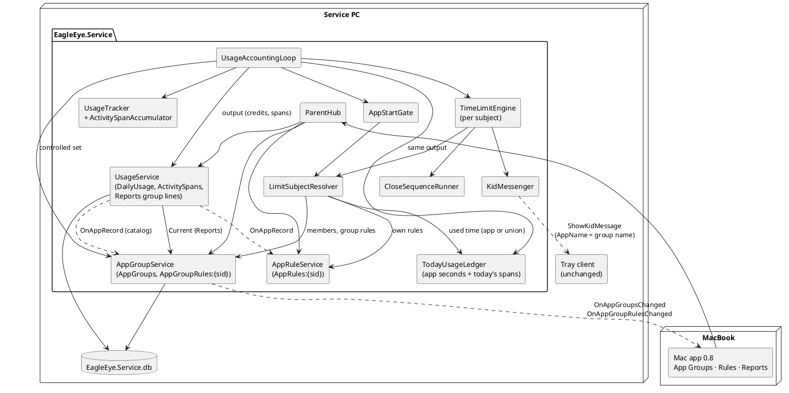
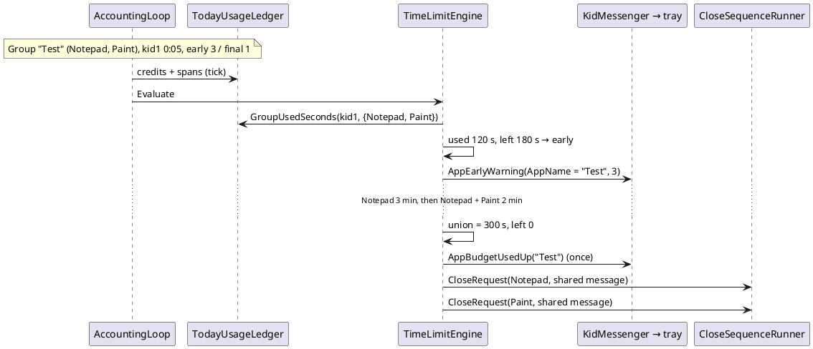

# Implementation Plan: US-008 — App Groups with a Shared Daily Budget (service and Mac app)

**Status**: Draft, revision 1 (for Michael's approval)
**Date**: 2026-10-31
**Author**: ARC
**User story**: `02_Implementation/docs/requirements/user-stories/US-008/user-story.md` (approved 2026-10-31; scope change of commit f23da5a: AC-44 removed, 43 active ACs, no mixed versions, Windows parent app only compiles and passes its unit tests)
**Requirements**: `02_Implementation/docs/requirements/general-product-requirements.md` v1.8 amendment (FR-APP-042 to FR-APP-044, FR-APP-062, TC-026; TC-020, TC-033, FR-SVC-011/020/022/032/047 changed)
**Branch**: `feature/US-008-app-groups`
**New ADR** (Proposed, for approval with this plan): ADR-021 — App groups: shared budgets computed from activity spans, enforced per limit subject (`02_Implementation/docs/architecture/decisions/ADR-021-app-groups-and-activity-spans.md`)

**Amendments to apply after approval** (ARC, on the branch, before Step 2): ADR-010 (two new state areas; refetch of usage on a group change), ADR-012 (activity spans), ADR-015 (§2 group used time, §4 warning keys per subject, §5 grace per subject, §7 group close batch), arc42 (header, §5.2, §5.5, §8.4, §8.6, §9, §11), coding guidelines §10.1 (folders `Service/Groups`, `ParentApp.Core/Groups`).

**Revision 1 (2026-10-31, Michael: "Keep it simple", no version mixing)**:
- Removed: all old/new version compatibility (additive-only contracts, wire tests with frozen 0.7 records, the AC-44 check, the Windows feature switch, the log note for own rules of grouped apps, handling of a missing `Groups` list).
- Removed: the 0.7.0 Windows regression step (old Step 2) and old Q-3 and Q-5.
- Removed: estimated activity spans for days before the update (backfill, `Estimated` column, `PendingBackfills` table). Group lines start with 0.8.0 (Q-2).
- Q-1 and Q-4 resolved (Michael accepted; story updated in f23da5a).

---

## Summary

The service learns **app groups**: it stores groups once per PC, records **activity spans** (when each app was active), computes a group's used time as the **union** of its current members' spans, and enforces group rules with the US-006 engine, reorganized around **limit subjects** (an app, or the group it belongs to). The Mac app gets the **App Groups** page (drag-and-drop and a "≡" button with a "Move to …" menu), an **App group rules** section on Rules, and **group lines** on Reports. The **tray client needs no code change**: kid messages reuse the US-006 reasons with the group name in place of the app name.

Michael updates service, tray client and Mac app together; no mixed versions are supported. The **Windows parent app** shares Core and Shared code: it only has to **compile and keep its unit tests green**; it is not used against the 0.8 service and is not packaged. Its views stay unchanged; known breakage (below) is accepted until US-009, which delivers all four assets as 0.9.0.

**Order**: a short **drag-and-drop spike on the MacBook** first (biggest UI unknown, and Michael is on the MacBook now). Then the **Windows** block (Shared contracts, service, installer 0.8.0, install on the service PC). Then the **MacBook** block (Core, Mac views, `.dmg` 0.8.0, US-007 F-2 documentation). Then a short **Windows** close-out (build and all tests green).

---

## Technical Issues and Risks

*Checked against the code on `feature/US-008-app-groups` (= `main` 0.7.0 + story docs). **Summary: feasible as one story. The real new piece is the activity-span recording that the union needs (TI-1). The engine change is a reorganization, not a new mechanism. The biggest UI unknown is MAUI drag-and-drop on Mac Catalyst (TI-9, spike first).***

| # | Issue | Impact | Solution in this plan |
|---|---|---|---|
| **TI-1** | **The union cannot be computed from today's data.** Usage is stored as seconds per app and day (`DailyUsage`); `AppInstances` include locked and sleep time. AC-22 (time before joining) and AC-36 (past days with current members) need the union for **any** member set, later. | Blocker for AC-19 to AC-22, AC-35, AC-36. | **Activity spans** (ADR-021 §2): the tracker records when each app record was credited; `UsageService` persists them per tick; group time = union of the current members' spans (Decision 3). Per-app usage unchanged (AC-23). |
| **TI-2** | **No spans before the update.** | Group time of the update day only counts from the update on; earlier days have no group lines. | Accepted (Q-2): group lines start with 0.8.0. |
| **TI-3** | **The engine evaluates apps, not groups.** Warnings, closes and graces are keyed per app (ADR-015). AC-26, AC-27, AC-32 want them once per group. | Repeated messages; one close message per app. | **Limit subjects** (ADR-021 §4, Decision 6). Close of a group = one message shared by all member close requests (the existing break-batch pattern). |
| **TI-4** | **Grace detection after a membership change.** A move changes an app's subject and a group's used time (pre-join time counts, AC-22), also when the moved app is not running (AC-32 bullet 3, AC-34). | Missed or wrong graces. | Per running app: end under the **previous** snapshots (incl. used time with the previous members) vs end under the current ones; `GracePolicy` unchanged. The app takes part in the grace of its **new** subject (Decision 6). |
| **TI-5** | **App list of the App Groups page** spans accounts: one entry per program path with a record in at least one **controlled** account (AC-3); ticking an account changes it. | List not updated. | `AppGroupService` keeps an app catalog (from `AppRecords`, kept current by the app-record observer) and the controlled set (passed by the accounting loop each tick); broadcast only when the listed set changes (Decision 4). |
| **TI-6** | **Group lines after a group change** (AC-36, AC-37): every day may change. | Stale Reports. | No re-broadcast of past days: the Mac app's Reports model fetches the account's usage again on an `AppGroups` change. Today's line updates with the normal 5 s push. |
| **TI-7** | **Group name rules** (AC-8): trimmed, 1 to 40 characters, emojis allowed, unique ignoring case. SQLite `NOCASE` folds ASCII only. | "Ä"/"ä" duplicates; emoji counted as 2. | `AppGroupNames` in Shared: NFC, trim, length in **text elements**, no control characters, key = `ToUpperInvariant`; `NameKey` column `UNIQUE`. Same code in service and Mac app. |
| **TI-8** | **History** (AC-31): the group name "in the reason"; `BlockedStarts.Reason` has a `CHECK` with three values. | Migration conflict. | Two nullable columns `GroupId`, `GroupName` (D-4). |
| **TI-9** | **MAUI drag-and-drop on Mac Catalyst** (AC-11): drags inside a `ScrollView` with the trackpad, drop highlight repaint, in-app data, empty sections as targets, a right-click menu next to drags. | AC-11. | **Step 1 spike** with a decision rule (Decision 9). Fallbacks: native interactions through a Mac-only handler, or menu only (Michael decides). |
| **TI-10** | **Catalyst repaint lesson (US-007).** A visual state that sets a background needs an explicit background in "Normal". The Mac `Button` style has an empty "Normal" next to a "Disabled" background. | Highlight or disabled colour stuck. | Every new state with a background sets "Normal" explicitly; the Mac `Button` style gets explicit "Normal" setters (Mac only). DEV verifies on screen with screenshots (Step 9). |
| **TI-11** | **Buttons on heading bars.** Mac buttons use the accent colour (US-007 G-11); "Rename"/"Delete" sit on an accent-coloured bar (AC-2). | Invisible buttons. | Mac-only style `HeadingBarButton`: transparent fill, border and text in the heading-bar text colour, explicit "Normal". |
| **TI-12** | **Name dialog must stay open with an inline message** (AC-8); `DisplayPromptAsync` closes on OK. | AC-7 to AC-9. | Re-prompt: an invalid name opens the prompt again at once with the message and the typed name (Decision 8). Escape and Cancel are native. A modal page only if the spike shows the re-prompt feels wrong. |
| **TI-13** | **Windows parent app** shares Core, Shared and the XAML views. | Must compile and pass its unit tests. | Shared XAML is changed for the Mac; the Windows build compiles it. The Windows app is not run or packaged (`package-windows.ps1 -Target Service`). Known breakage accepted until US-009: untested group UI on WinUI, possibly no drag-and-drop if the spike chooses a Mac-only handler, Windows 10 unsupported. |

---

## Machine Assignment

| Work | Machine |
|---|---|
| This plan and ADR-021 (ARC) | MacBook (done here) |
| **Step 1**: drag-and-drop spike | **MacBook** |
| **Steps 2 to 7**: Shared contracts, service, installer 0.8.0, smoke check, install on the service PC | **Windows Developer Machine** (service PC `192.168.1.37`) |
| **Steps 8 to 10**: `ParentApp.Core`, Mac views, `.dmg` 0.8.0, F-2 documentation | **MacBook**, connected to the service 0.8.0 on the service PC |
| **Step 11**: Windows build and all tests of the final branch, implementation report | **Windows Developer Machine** |
| Manual test run (Michael, guided by TES) | Service PC (service, tray) + MacBook (Mac app 0.8.0) |

**Handover points** (commit, push, Michael switches machines, `git pull` there):

| # | After | From → To | Pushed |
|---|---|---|---|
| H1 | Step 1 | MacBook → Windows | `US-008/spike-drag-drop.md` |
| H2 | Step 7 | Windows → MacBook | Shared contracts, service, report §Windows; service 0.8.0 **installed** on the service PC |
| H3 | Step 10 | MacBook → Windows | Core, Mac views, READMEs, report §Mac (the `.dmg` stays on the MacBook: `03_Delivery` binaries are git-ignored) |

`EagleEye.Shared/Contracts/` changes land first, on Windows (Step 2, ADR-007).

---

## Impact Assessment

| Component | Impact |
|---|---|
| **EagleEye.Shared** | `IParentHub`: 8 new methods. `IParentClientCallback`: `OnAppGroupsChanged`, `OnAppGroupRulesChanged`. New DTOs `AppGroupsDto`, `AppGroupDto`, `GroupableAppDto`, `AppGroupRulesDto`, `AppGroupRuleDto`, `GroupUsageDto`. `DayUsageDto` gets `Groups`. Constants `AppGroupNames`. Doc only: `KidMessageDto.AppName` may hold a group name. |
| **EagleEye.Service** | **Data**: migration 6 (`AppGroups`, `AppGroupMembers`, `AppGroupRules`, `ActivitySpans`; `BlockedStarts` + 2 columns), `AppGroupRepository`, `UsageRepository` (spans, purge), `BlockedStartRepository`. **Statistics**: `ActivitySpanAccumulator`, tracker spans, `UsageService` (persist spans, group lines, several app-record observers). **Groups** (new folder): `AppGroupService`, `AppGroupsSnapshot`, `AppGroupChangeLog`, `SpanUnion`, `GroupUsageCalculator`. **Enforcement**: `LimitSubject`, `LimitSubjectResolver`, `TodayUsageLedger`, `AppStartGate`, `TimeLimitEngine`, `AppEndCalculator` (rule parameter), `WarningLedger`, `KidMessageFactory`, `CloseRequest`, `EnforcementLog`. **Communication**: `ParentHub`, broadcaster. `Program`: start order. |
| **EagleEye.TrayClient** | **No code change.** Version 0.8.0; unit tests for info lines with a group name. |
| **EagleEye.ParentApp.Core** | Hub client and gateway (2 events, 8 calls). `Groups/AppGroupsModel`, `Groups/AppGroupNameRules`, `Rules/AppGroupRulesModel`. View models `AppGroupsViewModel`, `AppGroupSectionViewModel`, `GroupableAppViewModel`, `AppGroupRulesSectionViewModel`, `AppGroupRuleRowViewModel`; changed `AppRulesSectionViewModel`, `DayUsageViewModel`, `ReportsViewModel`, `MainViewModel`; `IDialogService`. Texts de/en. |
| **EagleEye.ParentApp** | New `Views/AppGroupsView`; `RulesView`, `ReportsView`, `MainPage`; `MauiDialogService`; Mac styles. |
| **Installers** | `EagleEye-Setup-0.8.0.exe` (service + tray) and `EagleEye-ParentApp-0.8.0.dmg`. No Windows parent app installer. Migration 6 runs at the first service start. |
| **Version** | `Directory.Build.props` → `0.8.0`. |

---

## New ADRs Required

- **ADR-021** (Proposed): groups by program path; activity spans; union with current members; limit subjects; contracts and the Windows parent app until US-009.

---

## API Changes (SignalR Contracts)

*API-first: Step 2. ADR-010 shape: snapshot with revision and correlation id, query, broadcast to all paired apps, field-level writes with `requestId` returning `StateWriteAckDto`. Paired-only. Each accepted write gives one revision and one broadcast, also for no-ops. No compatibility with older apps or services is kept or tested.*

### State area `AppGroups` (global) — `IParentHub`

```csharp
/// <summary>Groups and listed apps (state area "AppGroups", FR-APP-042). Listed: every program path with an app record in
/// at least one controlled account, once, without the enforcement ignore list (AC-3). Called after every (re)connect.</summary>
Task<AppGroupsDto> GetAppGroups();

/// <summary>Creates an empty group; name rules of AppGroupNames (AC-8). "A group with this name already exists."</summary>
Task<StateWriteAckDto> CreateAppGroup(Guid requestId, string name);

/// <summary>Renames a group (AC-9); the own name, also re-cased, is valid. "The group no longer exists." if gone.</summary>
Task<StateWriteAckDto> RenameAppGroup(Guid requestId, long groupId, string name);

/// <summary>Deletes a group with its members and the group rules of all accounts (AC-10).</summary>
Task<StateWriteAckDto> DeleteAppGroup(Guid requestId, long groupId);

/// <summary>Moves a listed app into a group, or out of every group with groupId = null (AC-11 to AC-13).</summary>
Task<StateWriteAckDto> MoveAppToGroup(Guid requestId, string programPath, long? groupId);
```

### State area `AppGroupRules:{accountSid}` — `IParentHub`

```csharp
/// <summary>The group rules of one account: a row for every group, 0:00 and no day when not stored (AC-7, AC-15, AC-39).</summary>
Task<AppGroupRulesDto> GetAppGroupRules(string accountSid);

/// <summary>Hours or minutes of a group's budget, combined with the stored other part (as SetAppBudget).</summary>
Task<StateWriteAckDto> SetAppGroupBudget(Guid requestId, string accountSid, long groupId, AppBudgetPart part, int value);

/// <summary>Ticks or unticks one weekday of a group rule; every combination is valid.</summary>
Task<StateWriteAckDto> SetAppGroupDay(Guid requestId, string accountSid, long groupId, DayOfWeek day, bool isAllowed);
```

Hub error texts: `Invalid request.`, `Unknown account.`, `A group with this name already exists.`, `The group no longer exists.`, `The app no longer exists.`, `The change could not be saved.`. The Mac app validates before sending; any rejection shows "The change could not be saved. Please try again." (AC-14).

### `IParentClientCallback`

```csharp
/// <summary>Groups, names, members or the listed apps changed (incl. a new listed app, AC-4). Apply if the revision is higher.
/// A parent app showing Reports fetches the selected account's usage again.</summary>
Task OnAppGroupsChanged(AppGroupsDto snapshot);

/// <summary>The group rules of one account changed, or a group was created or deleted.</summary>
Task OnAppGroupRulesChanged(AppGroupRulesDto snapshot);
```

### `EagleEye.Shared/Models/`

```csharp
public sealed record AppGroupDto(long GroupId, string Name);
/// <param name="DisplayName">As on Reports; of the most recently seen record when accounts differ.</param>
/// <param name="GroupId">The app's group, or null for "Not in any group".</param>
public sealed record GroupableAppDto(string ProgramPath, string DisplayName, long? GroupId);
public sealed record AppGroupsDto(long Revision, Guid? LastChangeRequestId, IReadOnlyList<AppGroupDto> Groups, IReadOnlyList<GroupableAppDto> Apps);
public sealed record AppGroupRuleDto(long GroupId, int BudgetMinutes, BreakTimeDays Days);
public sealed record AppGroupRulesDto(long Revision, Guid? LastChangeRequestId, string AccountSid, IReadOnlyList<AppGroupRuleDto> Rules);
/// <summary>Used time of one group on one day: union of the current members' activity (TC-026, AC-35).</summary>
public sealed record GroupUsageDto(long GroupId, string Name, long Seconds);

// Changed:
public sealed record DayUsageDto(
    long Revision, Guid? LastChangeRequestId, string AccountSid, DateOnly Day, DateOnly ServiceToday,
    IReadOnlyList<AppUsageDto> Apps, IReadOnlyList<GroupUsageDto> Groups);
```

`AppRulesDto` is unchanged and lists all app records; the Mac app hides grouped apps by joining with `AppGroupsDto` (simplest: a move then needs no re-broadcast of every account's app rules). `AppGroupNames` (Shared constants): `MaxLength = 40` (text elements), `MaxCodeUnits = 160`, `Normalize` (NFC + trim), `IsValid`, `Key`. Budgets reuse `AppRuleRules`.

---

## Component Design

### Overview



### Decision 1: the Mac app joins the areas

Grouped apps (by path from `AppGroupsDto.Apps`) are hidden from "Application rules"; group names and members on Rules come from `AppGroupsDto`; group rules from `AppGroupRulesDto`. The service does not filter `AppRulesDto`; own rules of grouped apps are kept and apply again when the app leaves its group (AC-17).

### Decision 2: activity spans (ADR-021 §2, TI-1)

**Tracker.** `UsageTracker.Credit` already splits `[wallNow − length, wallNow]` per local day. Each part (day, start, end) also goes to `ActivitySpanAccumulator` (new, `Statistics/`, pure): per (sid, path) one open span; a part that starts at most **1 s** after the open span's end extends it, otherwise a new span starts (new day, gap, clock jump). `TakeOutput(includeUsage: true)` adds `Spans` (`SpanUpdate(SpanKey, AccountSid, ProgramPath, Day, StartUtc, EndUtc)`) for every span created or extended since the last output. All apps of an account credited in one `Advance` end at the same instant, so overlaps are exact.

**Persistence.** `UsageService.ApplyAsync` maps `SpanKey` → `SpanId` in memory and passes inserts and end updates to `IUsageRepository.ApplyAsync(increments, seen, spans)` in the **same transaction** as `DailyUsage`; a failed write is retried with the next tick (as today). After a restart, new spans start. **Retention**: spans with `Day < cutoff` go with `DailyUsage` (90 days); app record deletion cascades.

### Decision 3: group used time (TC-026, AC-19 to AC-23)

`Groups/SpanUnion` (pure): sort, merge, sum; whole seconds. `Groups/GroupUsageCalculator` (pure): seconds per group and day from the account's spans and the current memberships.

- **Enforcement**: `TodayUsageLedger` keeps today's spans per (sid, path) (loaded with the account via `GetSpansAsync(sid, today, today)`, then fed by `ApplySpans(output.Spans)` in the same loop step as the credits). New: `GroupUsedSeconds(sid, memberPaths, day)`. App subjects keep `UsedSeconds` (the Reports figure, ADR-015 §2).
- **Reports**: `GetAccountUsageAsync` loads the account's spans of the 90 days (one query), `PublishDayAsync` those of the day; both fill `DayUsageDto.Groups` with `IAppGroupsView.Current`. A group is listed on a day when it has spans and at least one current member is in that day's app table ("00:00" for less than a minute, AC-35); deleted groups are gone (AC-36). Days before 0.8.0 have no spans and so no group lines (Q-2).

Michael's examples (AC-19): together 5 → 5; Notepad 2 then both 10 → 12; Notepad 3 then Paint 4 → 7. AC-22: Paint 50 min alone, moved into "Test" (1:00) → 10 min left.

### Decision 4: `AppGroupService` — state owner (AC-2 to AC-18, AC-38 to AC-40)

`Groups/AppGroupService` (one `SemaphoreSlim`, one revision counter for both areas):
- `InitializeAsync()` (in `Program` after `AppRuleService`): loads groups, members, rules and the **app catalog** (`AppRecords`: sid, path, display name, last seen; ignore list excluded) into an immutable `AppGroupsSnapshot`. Log: "App groups loaded: {Groups} groups with {Members} apps, {Rules} group rules."
- `Current` (lock-free, `IAppGroupsView`): `GroupOf(path)`, `Members(groupId)`, `RuleFor(groupId, sid)` (default 0:00, no day), `NameOf(groupId)`.
- Writes (`requestId`, device name): validate → store → swap snapshot → revision++ → log → broadcast → ack. Create and delete also broadcast `AppGroupRulesDto` for every standard account of the inventory (a row per group). Move writes or deletes the member row.
- `IAppRecordObserver` (second observer; `UsageService` takes `IEnumerable<IAppRecordObserver>`): catalog updates; broadcast if the listed set or a listed name changed (AC-4).
- `OnControlledAccounts(sids)`: called by the accounting loop each tick with the set it already reads; broadcast only on a change (TI-5). The set is passed in, so the service never calls `IUserAccountService` from a call the account service makes under its own lock.
- `IAccountDataPurger`: deletes `AppGroupRules` of deleted SIDs and their catalog records; groups and members stay (AC-39).

### Decision 5: limit subjects (ADR-021 §4, AC-24, AC-29, AC-30)

`LimitSubject` (record): `Kind` (`App` | `Group`), `Key` (`app|PATH` / `group|{id}`), `Name`, `GroupId?`, `Rule` (`LimitRule(BudgetMinutes, Days)`), `UsedSeconds`, `MemberPaths`. `LimitSubjectResolver` (pure): group subject if the path is a member (the account's group rule, group used time), else app subject (own rule or default, app used time). `AppEndCalculator.Compute` takes `LimitRule?` instead of `AppRuleEntry?` (mechanical).

### Decision 6: gate and engine per subject (AC-25 to AC-34)

**Gate** (`AppStartGate.DecideByRule`): same order (ignore list, open, closing, break → rule); the rule step uses the subject. Blocked → message `AppEnd(reason, budgetText, subject.Name)`; `CloseRequest` with `GroupId`, `GroupName`, `Rule` = subject rule and used time. A blocked start adds no used time.

**Engine** (`TimeLimitEngine.Evaluate`), per session of a controlled account:
1. Resolve each running app's subject; group running apps by subject key.
2. Per subject: `end = AppEndCalculator.Compute(subject.Rule, subject.UsedSeconds, breaks, now)` once.
3. **Grace detection** when the account's break or app rules, the `AppGroupsSnapshot`, or the account's group rules changed since the last tick. For each running app not first seen: `oldEnd` with the **previous** snapshots (previous members, so previous group used time) vs the new end; `GracePolicy.Starts`. If true for any app of a subject, the subject gets the grace (key `(session, subjectKey)`), one `AppGracePeriod` message with `subject.Name`, final level marked shown. This covers all AC-32 cases, including a **not-running** app moved into a group with running members (Q-1, AC-34). A rename moves no end: no grace, no message.
4. **Warnings** per subject (`WarningLedger.SubjectKey(sid, subject.Key, day)`; app keys keep their format). Break ends unchanged (AC-28).
5. **Close** at `left ≤ 0` or grace end: app subject as today; group subject → one `ShowAsync(AppEnd(reason, budgetText, groupName))` and one `CloseRequest` per running member with `SharedMessageState` (AC-27).
6. At most one message per session and tick (US-006 outbox priority).



### Decision 7: logging and history (AC-14, AC-16, AC-31)

See "Logging". `BlockedStarts` rows of group subjects carry `GroupId`, `GroupName`; `BudgetMinutes`/`BudgetDays`/`UsedSeconds` hold the group rule and group time.

### Decision 8: Mac app (AC-1 to AC-18, AC-35 to AC-37)

**Core** (platform-neutral, tested on both machines):
- `Groups/AppGroupsModel`: global replica (pattern of `WarningSettingsModel`): fetch on connect, revision rule, writes with pending/confirm, 4 s timeout, refetch when the outcome is unknown.
- `Groups/AppGroupNameRules`: `AppGroupNames` plus duplicates against the replica (ignoring the group being renamed).
- `Rules/AppGroupRulesModel`: `SelectedAccountModel<AppGroupRulesDto>`.
- `AppGroupsViewModel`: states NotConnected / NoData / Loading / Ready (AC-5); `Sections`: groups sorted by name (current culture, ignoring case, then id), then "Not in any group"; merged by key, new entries in place (AC-4); `AddGroupAsync`, `RenameAsync`, `DeleteAsync` (confirm, AC-10), `MoveAsync(app, target)` (own section → nothing), `MoveTargets(app)` (AC-12), `DraggedApp`, `ErrorText`. Section VM: `GroupId?`, `Title`, `Apps` (by display name, then path), `EmptyText`, `IsDropTarget`. App VM: `ProgramPath` (tooltip), `DisplayName`, `GroupId?`.
- Name dialog: `IDialogService.PromptAsync` gets a kind parameter (`Host` | `Text`: max length, keyboard). Loop: cancel → stop; invalid → prompt again with the message and the typed name; valid → send. "Move to …": new `IDialogService.ChooseAsync(title, cancel, options)` (action sheet).
- `AppGroupRulesSectionViewModel` + `AppGroupRuleRowViewModel`: like app rules (AC-16); row = name + members line (sorted, comma-separated; "(no apps)"); `ShowNoGroups`. DEV may extract a shared row base; app rule behaviour unchanged.
- `AppRulesSectionViewModel`: hides grouped apps; a returning app shows its stored own rule (AC-17).
- `DayUsageViewModel`: `GroupRows` sorted by seconds descending, then name. `ReportsViewModel`: refetch the selected account's usage on an `AppGroups` change (AC-36, AC-37).
- `MainViewModel`: "Settings", "App Groups", "Rules", "Reports" (AC-1); start page unchanged.

**MAUI head**:
- `AppGroupsView`: header, explanation (wrap, max width 900), "Add group", sections in a `ScrollView`. Section: heading bar (title with `SectionHeader`, "Rename"/"Delete" with `HeadingBarButton`), entries below with a minimum height of one row (empty groups are drop targets). Entry: display name (tooltip = path) and a "≡" button → `ChooseAsync` (Q-4). Drag-and-drop by the Step 1 technique. Highlight: `IsDropTarget` → `DropHighlight`; "Normal" sets the explicit section background (TI-10).
- `RulesView`: section "App group rules" between break times and "Application rules" (columns 220 | 64 | 64 | 7 × 48), hint sentence in the app rules explanation (AC-17).
- `ReportsView`: under each day's app table, "App groups" and the table 360 | 160 when `HasGroupRows`.
- `MainPage`: fourth view. `MacStyles.xaml`: `HeadingBarButton`, `DropHighlight`, explicit "Normal" for `Button`.

### Decision 9: drag-and-drop spike and decision rule (Step 1, TI-9)

Throwaway prototype (not committed; findings committed): three sections in a `ScrollView`, ten entries, MAUI `DragGestureRecognizer`/`DropGestureRecognizer`, in-app data via the view model, highlight on `DragOver`/`DragLeave`/`Drop`, a right-click `ContextFlyout`, a "≡" button with an action sheet, the name prompt loop.

| Check | Pass |
|---|---|
| Drag with mouse and trackpad inside the `ScrollView` | Drag starts; the page does not scroll instead |
| Drop on another, an empty, the own section, outside | Moves, moves, nothing, nothing |
| Highlight follows and always clears (light and dark) | No stuck colour after 20 drags |
| Right-click menu on a draggable entry | Opens; no drag starts |
| Name prompt loop | Opens again with message and text; Escape cancels |

Rule: all pass → MAUI recognizers in shared XAML. Drag or highlight unreliable → `#if MACCATALYST` handler with `UIDragInteraction`/`UIDropInteraction` (tried the same day). Both fail → stop; Michael decides on menu only (AC-11 deferred). Right-click menu unreliable → "≡" button only (Q-4).

---

## Data Model Changes

### Service — `EagleEye.Service.db`, migration 6

```sql
CREATE TABLE AppGroups (
    GroupId     INTEGER PRIMARY KEY AUTOINCREMENT,
    Name        TEXT NOT NULL,                    -- AppGroupNames.Normalize, 1..40 text elements
    NameKey     TEXT NOT NULL UNIQUE,             -- ToUpperInvariant(Name): unique ignoring case (AC-8)
    CreatedUtc  TEXT NOT NULL,
    ChangedUtc  TEXT NOT NULL
);
CREATE TABLE AppGroupMembers (                    -- one group per app (AC-13); not tied to an account (AC-40)
    ProgramPath TEXT PRIMARY KEY NOT NULL COLLATE NOCASE,
    GroupId     INTEGER NOT NULL REFERENCES AppGroups (GroupId) ON DELETE CASCADE,
    ChangedUtc  TEXT NOT NULL
);
CREATE INDEX IX_AppGroupMembers_Group ON AppGroupMembers (GroupId);
CREATE TABLE AppGroupRules (                      -- no row = 0:00, no day (AC-7, AC-39)
    GroupId       INTEGER NOT NULL REFERENCES AppGroups (GroupId) ON DELETE CASCADE,
    AccountSid    TEXT NOT NULL COLLATE NOCASE,
    BudgetMinutes INTEGER NOT NULL CHECK (BudgetMinutes BETWEEN 0 AND 1439),
    Days          INTEGER NOT NULL CHECK (Days BETWEEN 0 AND 127),
    ChangedUtc    TEXT NOT NULL,
    PRIMARY KEY (GroupId, AccountSid)
);
CREATE TABLE ActivitySpans (                      -- ADR-021 §2; Unix milliseconds UTC (volume, arithmetic)
    SpanId      INTEGER PRIMARY KEY AUTOINCREMENT,
    AppId       INTEGER NOT NULL REFERENCES AppRecords (AppId) ON DELETE CASCADE,
    Day         TEXT NOT NULL,                    -- local day yyyy-MM-dd (spans are split at midnight)
    StartUtcMs  INTEGER NOT NULL,
    EndUtcMs    INTEGER NOT NULL CHECK (EndUtcMs >= StartUtcMs)
);
CREATE INDEX IX_ActivitySpans_AppDay ON ActivitySpans (AppId, Day);
CREATE INDEX IX_ActivitySpans_Day ON ActivitySpans (Day);
ALTER TABLE BlockedStarts ADD COLUMN GroupId INTEGER NULL;
ALTER TABLE BlockedStarts ADD COLUMN GroupName TEXT NULL;
```

- One migration, one transaction, forward-only. After the update there are no groups (AC-6).
- Purge: `AppGroupRules` by SID; `ActivitySpans` 90 days and by app record; groups and members never purged automatically.
- Volume: typically 5 to 30 spans per app and day; 3 accounts × 30 apps × 90 days ≈ 80 000 rows (≈ 5 MB).

Parent app: no database change.

---

## Implementation Steps

All steps on `feature/US-008-app-groups`. Commit after each step (`US-008: …`) and push. Each step ends with **"Michael sees"**.

| Step | Content | Machine |
|---|---|---|
| **1** | Drag-and-drop spike (Decision 9) | **MacBook** |
| — | **H1**: push; Michael switches to Windows | |
| 2 | Version 0.8.0; Shared contracts, `AppGroupNames`, stubs | **Windows** |
| 3 | Service data: migration 6, repositories | Windows |
| 4 | Activity spans: tracker, persistence, ledger, union, Reports group lines | Windows |
| 5 | `AppGroupService`, hub methods, broadcaster, observer, purger, logs | Windows |
| 6 | Enforcement per subject: resolver, gate, engine, messages, history, logs | Windows |
| 7 | Tray tests, service installer 0.8.0, smoke check, install on the service PC, performance | Windows |
| — | **H2**: push; Michael switches to the MacBook | |
| 8 | `ParentApp.Core`: client, gateway, models, view models, texts | **MacBook** |
| 9 | Mac views: App Groups page, Rules section, Reports groups; on-screen check | MacBook |
| 10 | `.dmg` 0.8.0, update over 0.7.0; F-2 documentation; report (Mac part) | MacBook |
| — | **H3**: push; Michael switches to Windows | |
| 11 | Windows build (0 warnings) and all four test projects; report; story → `Implemented` | **Windows** |

### Step 1: Drag-and-drop spike (MacBook, about half a day)
1. `git pull`; `pwsh 02_Implementation/scripts/env-check.ps1`.
2. Prototype per Decision 9 (Debug, not committed).
3. `US-008/spike-drag-drop.md`: checks, chosen technique, reusable fragments, screenshots in `US-008/evidence/`. If the rule says "stop", report to Michael before H1.

**Michael sees**: a rough page on his MacBook where he drags apps between sections with mouse and trackpad, sees the target highlighted, and opens "Move to …".

### Step 2: Shared contracts (Windows)
1. `git pull`. `Directory.Build.props` → `0.8.0`.
2. DTOs, `DayUsageDto.Groups`, `AppGroupNames`, `IParentHub` (8), `IParentClientCallback` (2), `KidMessageDto` doc.
3. Stubs so the build stays green (hub methods throw `HubException("The change could not be saved.")`; `DayUsageDto` callers pass `[]`; Core client and gateway members added).

**Michael sees**: nothing visible; build and tests green.

### Step 3: Service data (Windows)
1. Migration 6. `AppGroupRepository` (load incl. catalog, create, rename, delete, set/delete member, upsert/delete rule — default deletes the row, purge by SID). `UsageRepository`: `ApplyAsync` with spans, `GetSpansAsync`, purge. `BlockedStartRepository`: group columns.
2. Tests on a real version-5 file (data kept, no groups).

**Michael sees**: nothing visible.

### Step 4: Activity spans and group time (Windows)
1. `ActivitySpanAccumulator`, tracker spans, `TrackerOutput.Spans`.
2. `UsageService`: persist spans; observers as `IEnumerable<IAppRecordObserver>`; group lines in `GetAccountUsageAsync` and `PublishDayAsync`.
3. `SpanUnion`, `GroupUsageCalculator`; `TodayUsageLedger.ApplySpans`, `GroupUsedSeconds`.

**Michael sees**: nothing visible.

### Step 5: Groups state owner and hub (Windows)
1. `AppGroupsSnapshot`, `AppGroupChangeLog`, `AppGroupService` (Decision 4), broadcaster methods.
2. `ParentHub` (8 methods: validation, safe texts, device name); loop passes the controlled set; purger registration; start order: database → accounts → usage → app rules → **app groups** → warning settings → break times → ledger → dangling history → host.

**Michael sees**: nothing visible.

### Step 6: Enforcement per subject (Windows)
1. `LimitRule`, `LimitSubject`, `LimitSubjectResolver`; `AppEndCalculator` parameter.
2. `AppStartGate`, `TimeLimitEngine` (Decision 6), `WarningLedger.SubjectKey`, `KidMessageFactory`, `CloseRequest`, `EnforcementLog`, history columns.
3. **All US-006 engine and gate tests stay green** with only mechanical signature changes (AC-30).

**Michael sees**: nothing visible yet.

### Step 7: Tray, installer, smoke, install (Windows)
1. TrayClient.Tests: `KidMessageText` with a group name for every app reason, de and en.
2. `package-windows.ps1 -Target Service` → `03_Delivery/windows/EagleEye-Setup-0.8.0.exe`.
3. Smoke check (US-006 dev setup: console service with `EAGLEEYE_DATA_DIR`, `EAGLEEYE_DEV_WATCH_SID`, `EAGLEEYE_DEV_PORT_OFFSET`, Debug tray). Seed group "Test" (Notepad, Paint) and a group rule with `sqlite3` before the start:
   1. "Test" 0:05, early 3 / final 1: Notepad 3 min, then both 2 min → early and final once each with "Test: …", both closed at 5 min with **one** dialog; `BlockedStarts` rows with `GroupName = Test`;
   2. start Paint again → blocked "Test: time budget used up.";
   3. stop, delete Paint's member row, start → Paint uses its own rule again (AC-24, AC-30);
   4. an ungrouped app with its own rule behaves as in US-006.
4. Install over 0.7.0 on the service PC (AC-42): log shows migration 6 and "App groups loaded: 0 groups"; REG-001-01 to -05 of `docs/testing/regression-checklist.md`.
5. Performance (AC-41): 20 groups, 100 apps, 10 members running: tick duration and service CPU as in US-006 Step 11; record.
6. `implementation-report.md` §Windows. Commit, push (**H2**).

**Michael sees**: the service 0.8.0 on the service PC; in the dev smoke, one kid dialog "Test: …" for two programs.

### Step 8: ParentApp.Core (MacBook)
1. `git pull`. Client and gateway (2 events, 8 calls, registered before `StartAsync`).
2. Models, name rules, `IDialogService` changes, view models (Decision 8), menu, texts.
3. `test.ps1` on the Mac (Shared.Tests, ParentApp.Tests).

**Michael sees**: nothing visible yet; tests green.

### Step 9: Mac views (MacBook, against the service 0.8.0)
1. `AppGroupsView` with the Step 1 technique; Rules section; Reports groups; `MainPage`; `MauiProgram`; `MauiDialogService`; Mac styles.
2. **On-screen check by DEV before handing over** (light/dark, Larger Text, accent blue and yellow): create, rename, delete, drag and "Move to …", highlight never stuck, heading-bar buttons readable, Rules section, Reports group lines. Screenshots in `US-008/evidence/`.

**Michael sees**: "App Gruppen" in the menu; he creates "Games", drags apps into it, sets "Games" 1:00 for `kid1`, and sees "Games" on Reports.

### Step 10: Delivery and documentation (MacBook)
1. `package-macos.ps1` → `03_Delivery/macos/EagleEye-ParentApp-0.8.0.dmg`; install over 0.7.0 (pairing and appearance kept, at most two Keychain prompts) (AC-42, US-007 F-3). Spot check AC-43.
2. **US-007 F-2 folded in** (same files): `src/EagleEye.ParentApp/README.md` (Mac platform layer, data locations, Keychain, first light; App Groups view, drag-and-drop technique), `src/EagleEye.ParentApp.Core/README.md` (US-007 and new classes); DEV proposes `dev-environments.md` §5 lessons (Catalyst "Normal" background rule, spike result) to the Orchestrator. Service and Shared READMEs (groups, spans, tables, logs).
3. `implementation-report.md` §Mac. Commit, push (**H3**).

**Michael sees**: the `.dmg` 0.8.0 installed over his 0.7.0 app, still paired, with the new page.

### Step 11: Windows close-out (Windows)
1. `git pull`; `build.ps1` (0 warnings, incl. the Windows parent app), `test.ps1` (all four projects green). The Windows parent app is not run or packaged (TI-13).
2. Report: "How to test", deviations, UI texts as implemented; story → `Implemented`; push.

**Michael sees**: everything green on Windows; ready for TES.

---

## Acceptance Criteria → Steps and Unit Tests

| AC | Step | Unit tests (key) | Manual |
|---|---|---|---|
| AC-1 menu | 8 | order | yes |
| AC-2 layout | 8, 9 | section order, "Not in any group" last, culture sort | yes |
| AC-3 listed apps | 5, 8 | same path in two accounts → one entry; uncontrolled only → not listed; ignore list; latest name; empty texts | yes |
| AC-4 new app ≤ 15 s | 5, 8 | new record → broadcast; known path → none; in-place insert | yes |
| AC-5 states, look | 8, 9 | NotConnected / NoData / Loading | light/dark, Larger Text |
| AC-6 after update | 3 | v5 file → no groups; engine without groups = US-006 | after install |
| AC-7 create, default rule | 5, 8 | create; row 0:00/none for every account; cancel → nothing | yes |
| AC-8 name rules | 2, 5, 8 | "", spaces, 41 elements, 40 emojis OK, "games"/"Games", "Ä"/"ä", control chars | yes |
| AC-9 rename | 5, 8 | own/re-cased name valid; members and rules unchanged | yes |
| AC-10 delete | 3, 5, 8 | cascade; apps ungrouped; rules broadcast per account | yes |
| AC-11 drag-and-drop | 1, 9 | `MoveAsync` same section → no call | mouse, trackpad |
| AC-12 "Move to …" | 8, 9 | targets | yes |
| AC-13 one section per app | 3, 5 | move into B leaves A | yes |
| AC-14 immediate, log, error | 5, 8 | one revision + broadcast + log; rejection/timeout → message, stored state | log |
| AC-15 group rules section | 8, 9 | rows, members line, "(no apps)", no-groups text | yes |
| AC-16 edit like app rules | 5, 8 | US-006 AC-8 inputs; combine; log | yes |
| AC-17 grouped apps hidden | 8 | hidden; back with stored own rule | yes |
| AC-18 Rules follows ≤ 5 s | 5, 8 | `AppGroups` change updates names, members, rows | yes |
| AC-19 union | 4 | three examples; overlap, containment, adjacency | stopwatch |
| AC-20 lock, midnight, restart | 4 | inactive → no span; midnight split; reload | lock |
| AC-21 per account | 4 | kid1 never in kid2 | switch user |
| AC-22 current members | 4, 6 | Paint 50 min → 10 left; move out removes; move shortening running members → grace | yes |
| AC-23 per-app unchanged | 4 | US-004 usage tests unchanged | Reports |
| AC-24 own rule ignored | 6 | own 0:00 in "Test" 1:00 → allowed | yes |
| AC-25 blocked start | 6 | not allowed / exhausted → blocked with group name, no used time | yes |
| AC-26 warnings once per group | 6 | two members → one warning; matching warning at start | yes |
| AC-27 close all, one message | 6 | one `ShowAsync`, shared by requests | yes |
| AC-28 breaks win | 6 | break before group end → break warnings only | yes |
| AC-29 per account, exemptions | 6 | kid1 1:00 / kid2 0:00; ignore list | switch user |
| AC-30 ungrouped = US-006 | 6 | US-006 tests unchanged | regression |
| AC-31 logs, history | 3, 6 | templates; group columns | log, DB |
| AC-32 grace on changes | 6 | rule cut; move in; not-running move; delete with own 0:00; one message; full final minutes | yes |
| AC-33 early at once, no re-arm | 6 | as US-006 per subject | yes |
| AC-34 rename, not-running move | 6 | rename → nothing; Michael's Notepad/Paint example | yes |
| AC-35 Reports table | 4, 8, 9 | sort; 00:00 listed; hidden when none | yes |
| AC-36 current members, past days | 4, 8 | move → past day (with spans) changes; delete → gone; days before 0.8 → no group lines | yes |
| AC-37 live, group change ≤ 5 s | 4, 8 | refetch on `AppGroups` change | yes |
| AC-38 persistence | 3 | reload | restart, reboot, re-install |
| AC-39 new account, untick, purge | 5 | purge drops rules only | delete account |
| AC-40 membership survives untick | 3, 5 | not listed, kept | yes |
| AC-41 performance | 4, 6 | union of 20 × 100 spans < 1 ms (guard) | Step 7 values |
| AC-42 delivery | 7, 10 | — | yes |
| AC-43 Mac 0.7 behaviour kept | 8, 9 | existing tests green | spot check |

---

## Unit Test Requirements

100 % line and branch coverage for every new or changed class marked **unit**. Not unit-tested (manual): MAUI views, drag-and-drop, `MauiDialogService`, `ParentHubClient`, `Program`, installers. Fake time providers and test zones (DST); in-memory SQLite and a real version-5 file.

| Class | Project | Key scenarios |
|---|---|---|
| New DTOs, `AppGroupNames` | Shared.Tests | JSON round trip; AC-8 name rules incl. text elements, NFC, control characters, key |
| Migration 6, `AppGroupRepository`, `UsageRepository` (spans), `BlockedStartRepository` | Service.Tests | schema 6 on a v5 file keeps everything; `NameKey` unique; one member per path; cascades; purge by day and by record |
| `ActivitySpanAccumulator`, `UsageTracker` (spans) | Service.Tests | extend within 1 s; new span after gap, inactive time, midnight, clock jump; credited time only; same end in one advance |
| `SpanUnion`, `GroupUsageCalculator` | Service.Tests | AC-19 examples; overlap/containment/adjacency; per account; current members; deleted group absent |
| `UsageService` (changed) | Service.Tests | spans in the same transaction; retry; group lines in both paths; several observers after the lock |
| `TodayUsageLedger` (changed) | Service.Tests | spans loaded/applied; `GroupUsedSeconds`; account unloaded → forgotten |
| `AppGroupService`, `AppGroupsSnapshot`, `AppGroupChangeLog` | Service.Tests | each write: validation, store, revision, broadcasts, log, ack; duplicate; gone; not listed; no-op; catalog; controlled set; purge; storage failure → snapshot unchanged |
| `ParentHub` (changed) | Service.Tests | 8 methods: delegation, device name, invalid input, safe texts, unpaired filter |
| `LimitSubjectResolver`, `AppEndCalculator` | Service.Tests | group vs app subject; default group rule; existing calculator cases |
| `AppStartGate`, `TimeLimitEngine` (changed) | Service.Tests | all US-006 cases unchanged; AC-25 to AC-28, AC-32 to AC-34 scenarios; subject change on move; grace shared by later member starts; group deleted → state cleared |
| `WarningLedger`, `KidMessageFactory`, `EnforcementLog` | Service.Tests | subject keys; names; group templates |
| `KidMessageText` | TrayClient.Tests | every app reason with a group name, de/en |
| `ParentHubGateway` | ParentApp.Tests | two events forwarded from the current client |
| `AppGroupsModel`, `AppGroupRulesModel`, `AppGroupNameRules` | ParentApp.Tests | fetch, stale, revision, writes, 4 s timeout, refetch, disconnect |
| Group view models; `AppRulesSectionViewModel`, `DayUsageViewModel`, `ReportsViewModel`, `MainViewModel` (changed) | ParentApp.Tests | states, sort, merge, dialog loop, confirm, move targets, error text; rows, members, commits; hidden grouped apps; group rows; refetch; menu |
| `AppTexts` | ParentApp.Tests | every new key de/en |

---

## Localization Impact

*German neutral, English satellite. English from the story; German from the story's brackets, otherwise ARC's proposal (DEV may adjust; wording differences are notes).*

| Key | German | English | AC |
|---|---|---|---|
| `MenuAppGroups` | App Gruppen | App Groups | AC-1 |
| `GroupsExplanation` | Hier kannst du Apps, die zusammengehören, in eine Gruppe legen, z. B. ein Spiel mit seinem Launcher. Auf der Seite Regeln legst du dann für jedes deiner Kinder ein Zeit-Budget für die ganze Gruppe fest. Eine neue Gruppe ist gesperrt, bis du ihre Regel einstellst. Jede App kann nur in einer Gruppe sein. | Here you can put apps that belong together into a group, e.g. a game with its launcher. On the Rules page you then set one time budget for the whole group, for each of your kids. A new group is blocked until you set its rule. Each app can be in only one group. | AC-2 |
| `GroupsAdd` | Gruppe hinzufügen | Add group | AC-2 |
| `GroupsRename` | Umbenennen | Rename | AC-2 |
| `GroupsDelete` | Löschen | Delete | AC-2, AC-10 |
| `GroupsUngrouped` | In keiner Gruppe | Not in any group | AC-2 |
| `GroupsEmpty` | Keine Apps in dieser Gruppe. Apps hierher ziehen. | No apps in this group. Drag apps here. | AC-3 |
| `GroupsAllGrouped` | Alle Apps sind in einer Gruppe. | All apps are in a group. | AC-3 |
| `GroupsNewTitle` | Neue App-Gruppe | New app group | AC-7 |
| `GroupsRenameTitle` | App-Gruppe umbenennen | Rename app group | AC-9 |
| `GroupsNameLabel` | Name | Name | AC-7 |
| `GroupsInvalidName` | Bitte einen Namen mit 1 bis 40 Zeichen eingeben. | Enter a name with 1 to 40 characters. | AC-8 |
| `GroupsDuplicateName` | Es gibt bereits eine Gruppe mit diesem Namen. | A group with this name already exists. | AC-8 |
| `GroupsDeleteConfirm` | Gruppe „{0}" löschen? Ihre Apps kommen nach „In keiner Gruppe" und verwenden wieder ihre eigenen Applikations-Regeln. | Delete the group "{0}"? Its apps move to "Not in any group" and use their own app rules again. | AC-10 |
| `GroupsMoveTo` | Verschieben nach … | Move to … | AC-12 |
| `RulesSectionGroupRules` | App-Gruppen-Regeln | App group rules | AC-15 |
| `RulesGroupRulesExplanation` | Hier legst du ein Zeit-Budget pro App-Gruppe fest. Alle Apps einer Gruppe teilen es sich: Die Zeit zählt, solange mindestens eine App der Gruppe verwendet wird. Die Gruppen legst du auf der Seite App Gruppen fest. | Here you set one time budget per app group. All apps of a group share it: the time counts while at least one app of the group is in use. You define the groups on the App Groups page. | AC-15 |
| `RulesColumnGroup` | App-Gruppe | App group | AC-15 |
| `RulesNoGroups` | Noch keine App-Gruppen. Du kannst sie auf der Seite App Gruppen anlegen. | No app groups yet. You can create them on the App Groups page. | AC-15 |
| `RulesGroupNoApps` | (keine Apps) | (no apps) | AC-15 |
| `RulesAppRulesExplanation` (changed) | + „Apps in einer App-Gruppe werden unter App-Gruppen-Regeln eingestellt." | + "Apps in an app group are set under App group rules." | AC-17 |
| `ReportsGroupsHeading` | App-Gruppen | App groups | AC-35 |
| `ReportsColumnGroup` | App-Gruppe | App group | AC-35 |

Reused: OK/cancel, `AccountsNoData`, `AccountsLoading`, `AccountSaveFailed` (AC-14), `ReportsColumnUsage`, day, hours and minutes headers and messages.

**Tray client**: no new keys. With the group as `{0}`: "Games: noch 5 Minuten." / "Games: 5 minutes left."; "Games: Zeit-Budget aufgebraucht."; "Games: heute nicht erlaubt."; grace "Games: Deine Eltern haben die Regeln geändert. Games wird in 1 Minute geschlossen." (story: "beendet"; D-2).

**Service**: log texts English.

---

## Logging

`%ProgramData%\EagleEye\logs\EagleEye.Service-NNN.log`, English, Information. Change entries end with ` (request {RequestId}, revision {Revision}).` Group names are logged (AC-14, AC-31); parent message texts never.

| When | Template |
|---|---|
| Group change (AC-14) | `App groups changed by {DeviceName}: app group created: {Name}` · `app group renamed: {Old} → {New}` · `app group deleted: {Name}` · `app moved: {DisplayName} → {Group}` · `app moved: {DisplayName} → not in any group` |
| Group rule (AC-16) | `Group rules of account {UserName} ({AccountSid}) changed by {DeviceName}: group rule changed: {Group}, {H:MM}, {Days or "no day"}` |
| Start | `App groups loaded: {Groups} groups with {Members} apps, {Rules} group rules.` |
| Warning | `Warning: account {UserName}, group {Group} ({Running}), {early\|final} warning, {N} min left ({reason}); message {State}.` |
| Grace | `Grace period: account {UserName}, group {Group} ({Running}): the rules changed ({reason}); closes in {N} min at {HH:MM:SS}; message {State}.` |
| Blocked start | `Blocked start: account {UserName}, {DisplayName} ({ProcessName}, {ProgramPath}), process {Pid}, group {Group}, {reason} (group rule {H:MM}, {Days}, group used {H:MM:SS}); closing the app.` |
| Closes | `Closing app: account {UserName}, {DisplayName} (…), group {Group}, {reason}{, after grace period}.` / `App closed: …, group {Group}, {reason}: {Outcome}; message {State}.` |
| Errors (Warning) | spans could not be persisted (kept, retried); broadcast failed (ADR-010 §9) |

---

## Manual Verification Notes

*For TES. Not test cases.*

| What | Where / how |
|---|---|
| Artifacts | `03_Delivery/windows/EagleEye-Setup-0.8.0.exe` (service PC, over 0.7.0); `03_Delivery/macos/EagleEye-ParentApp-0.8.0.dmg` (MacBook, over 0.7.0). The Windows parent app is not part of this run. |
| After the update (AC-6) | No groups; own rules unchanged; log shows migration 6 and "App groups loaded: 0 groups". |
| New group = blocked | A new group has 0:00, no day for every kid: its apps are blocked at once (running ones get the grace period). |
| Timing | Ticks every 5 s (US-006): warnings and closes about 1 to 6 s after the level or end. |
| Group time | Counts while at least one member is active in the kid's unlocked session; overlap once. Starts with the 0.8.0 update: the update day counts from the install, earlier days show no group lines (Q-2). Moves change past days' lines (OQ-3). |
| Kid dialog | The info line names the group; two running members → one dialog. |
| Database | `AppGroups`, `AppGroupMembers` (path → group), `AppGroupRules` (no row = 0:00, no day), `ActivitySpans`; `BlockedStarts.GroupId`, `GroupName`. |
| Drag-and-drop | Mouse and trackpad; target highlighted; outside → nothing; "≡" → "Move to …". |
| Mac look | Light/dark, Larger Text, accent colours. |

---

## Deviations from the Story and Interpretations

| # | Point | Plan |
|---|---|---|
| D-1 | AC-25 info line when not allowed today | "Games: not allowed today." (US-006 reason); "time budget used up" when exhausted. |
| D-2 | Grace info line wording | US-006 text: "geschlossen" (story: "beendet"); a wording note. |
| D-3 | "Once per change" (AC-32) when one change gives several subjects a grace (deleted group, members back to own 0:00 rules) | One message per session and tick (most urgent); the others logged "not shown (replaced in the same tick)"; every subject still gets its grace. |
| D-4 | "Group name in the reason" (AC-31) | Own columns `GroupId`, `GroupName`. |
| D-5 | Name dialog "stays open" (AC-8) | Re-opens at once with message and typed name (TI-12). |
| D-6 | Days before the update | No group time (Q-2). |

---

## Open Questions for Michael

| ID | Question | Recommendation | Answer |
|---|---|---|---|
| Q-1 | Moving a not-running app into a group whose apps are running, when its earlier time uses up their time. | Treat it as a rule change: grace period for the running apps. | **Resolved** (Michael, 2026-10-31): accepted; AC-22, AC-32, AC-34 updated by PRO (f23da5a). |
| **Q-2** | **Group times before the update.** 0.7 only stored totals per app, so overlaps are unknown. | **No group times before 0.8.0**: the service records activity from the update on. Group lines on Reports start with 0.8.0 (the update day counts from the install); earlier days show only per-app lines. For the budget on the update day, the group's time before the install is not counted. | open |
| Q-4 | "Move to …" control (AC-12). | "≡" button with a menu on every entry; right-click menu only if the spike shows it works. | **Resolved** (Michael, 2026-10-31): accepted. |

(Q-3 and Q-5 of the first draft are void with the scope change.)

---

## Risks

| # | Risk | Probability | Impact | Mitigation |
|---|---|---|---|---|
| R-1 | MAUI drag-and-drop unusable on Catalyst | Medium | High (AC-11) | Spike first, native fallback, menu-only decision by Michael |
| R-2 | Engine reorganization changes US-006 behaviour (AC-30) | Medium | High | US-006 tests unchanged and green; TES repeats key US-006 cases |
| R-3 | Span recording adds load or size | Low | Medium | Same tick and transaction; ~5 MB / 90 days; AC-41 measurement |
| R-4 | Kids blocked after a group is created (default 0:00) | High (by design) | Medium | Explanation text (AC-2); grace for running apps |
| R-5 | Stuck colours or invisible buttons on the Mac | Medium | Low | Explicit "Normal", `HeadingBarButton`, on-screen check |
| R-6 | Windows parent app breaks functionally against 0.8 | Certain | None now | Accepted until US-009 (TI-13); it only has to compile and pass its unit tests |
| R-7 | Machine switches lengthen the story | Medium | Low | Three handovers; self-contained blocks |

---

*End of Implementation Plan*
