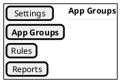
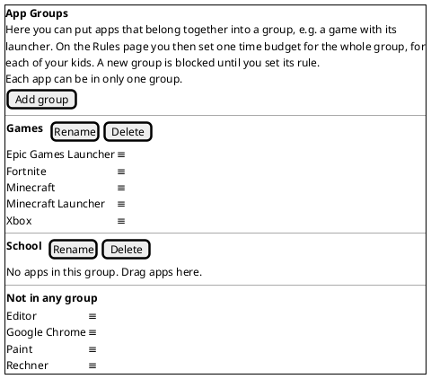
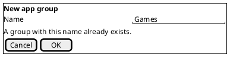
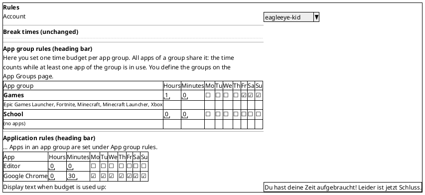
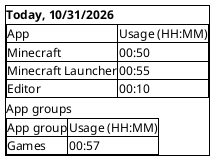
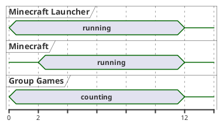

# US-008: App Groups with a Shared Daily Budget (service and Mac app)

**Status**: New
**Created**: 2026-10-31
**Approved**: by Michael, 2026-10-31, with OQ-1 to OQ-5 answered as proposed
**Component(s)**: EagleEye.Service, EagleEye.TrayClient, EagleEye.Shared, EagleEye.ParentApp
**Platform(s)**: Windows (service and tray client) · ParentApp macOS. The Windows parent app gets the group UI in US-009; in this story it only has to stay safe (group K).

---

## User Story

As a **parent**, I want to put several apps that belong together (e.g. a game, its launcher, its anti-cheat program and the store app) into a group with a name I choose, and give that group one daily time budget and allowed weekdays per kid, so that my kid gets, for example, "1 hour of games per day" in total, however many programs a game needs to run.

---

## Background

US-006 gave every app record its own daily budget and weekdays. In the pilot of the Mac app 0.7.0, Michael got this feedback: modern games need several programs at the same time (launcher, anti-cheat, the game itself, Epic Games Store, Xbox app). With one budget per program, parents cannot set "1 hour of games per day". Michael's text (2026-10-31, relayed by the Orchestrator) is the scope of this story:

> We need a feature that allows to group monitored applications and configure budgets for the entire group. [...] The parents want to be able to group all these apps into a custom-labeled group (e.g. "Games") and define a time budget for it (e.g. 1 hour per day). For that, there should be a new tab called "App Groups"/"App Gruppen" where a user can define such groups. [...] By default, all new registered applications are not mapped to any group. The tab should show all applications in the bottom of the screen under a "Not in any group" section. New user-defined groups (there is an "Add" button) are shown above, each as an own section. Users shall be able to drag-and-drop apps between any group and the non-grouped section. [...] The user may delete a group which makes all associated apps fall back to "not in a group" status. [...] All apps that are not in a group shall be shown and configured as today, but all apps that are in a group do not show here anymore. Instead the rules are applied to groups. [...] When at least one app out of the group is used [...], it counts to the group's usage time. [...] When the launcher runs for 2 minutes and then the main game is started and both run for 10 minutes, it counts 2 + 10 [...]. Reporting shall still be done as today (per application) but reporting shall be extended to also show the calculated usage times per group.

The story adds four things:

1. **App Groups page** ("App Gruppen"), a new page of the parent app. The parent creates, renames and deletes groups and moves apps between groups and "Not in any group" by drag-and-drop or with a "Move to …" menu. Groups are defined **once for the service PC** and apply to all controlled accounts (Michael, answer 3).
2. **Group rules** on the Rules page: one daily budget and seven weekday ticks per group **and per account**, like an app rule. Apps in a group are no longer listed under "Application rules".
3. **Group usage time** and **enforcement** in the service. A group's used time is the time during which **at least one** of its apps is active. When the group's budget is used up, or the group is not allowed today, all its apps are closed or blocked, with warnings before, as in US-006.
4. **Group lines on Reports**: each day also shows the used time of each group.

**Order of the work** (Michael, 2026-10-31): the service part is built and tested on the **Windows Developer Machine**, the parent-app part in the **Mac app** on the **MacBook**. ARC assigns the steps to the machines in the implementation plan. The Windows parent app gets the same features, together with Windows 10 support, in **US-009**, which is written after this story is closed.

All state in the parent app follows ADR-010: the app fetches data when a page opens and when it (re)connects. The service stores every change and broadcasts it to all connected parent apps. The app never polls.

References: FR-SVC-011, FR-SVC-012, FR-SVC-020, FR-SVC-022, FR-SVC-025, FR-SVC-032, FR-SVC-040, FR-SVC-044, FR-SVC-047, FR-APP-040, FR-APP-041, FR-APP-053, FR-APP-054, FR-APP-060, FR-APP-082, FR-APP-110, TC-020, TC-024, TC-033, MU-011, MU-014, NFR-L-010 to NFR-L-012. Their changes are in the amendment section below.

**Terms used in this story**

- *Service PC*, *account*, *controlled account*, *app*, *app record*, *start*, *blocked start*, *break time*, *break display text*, *budget text*, *warning levels*, *kid dialog*, *grace period*: as in US-004 to US-006.
- *App (on the App Groups page)*: one program of the service PC, identified by its program path, as US-004 identifies app records (US-004 OQ-2). The same program used by `kid1` and `kid2` is **one** app on the App Groups page, although each account has its own app record.
- *App group* (short *group*): a named set of apps, defined once for the service PC. Every app is in **at most one** group.
- *Grouped app*: an app that is in a group. *Ungrouped app*: an app in "Not in any group".
- *Group rule*: the daily budget (hours and minutes) and the seven weekday ticks of one group for one account.
- *Own rule*: the app rule of US-006 of an app record. For a grouped app it is kept but not used (AC-17).
- *Group used time*: for one account and one day, the time during which **at least one** current member app of the group was active for that account (US-004 AC-12: open while the account's session is in use). Times when several member apps run together count once. This includes time before an app joined the group (AC-22).
- *Group remaining budget*, *group exhausted*, *group allowed today*: as the US-006 terms, with the group rule and the group used time.

---

## Product requirement amendment (v1.8, approved with this story)

`02_Implementation/docs/requirements/general-product-requirements.md` gets a v1.8 amendment for app groups, written into the file on this branch. It took effect with Michael's approval of this story on 2026-10-31. The **Windows 10** part (§2.1 Devices, §9.4, §9.5, FR-APP-092) is written with **US-009**, because it belongs to that story's scope.

- **FR-APP-042** (new): app groups, defined once per service PC on the "App Groups" page; create, rename, delete; every app in at most one group; new apps are not in a group; deleting a group returns its apps to "Not in any group".
- **FR-APP-043** (new): moving apps between groups and "Not in any group" by drag-and-drop and by a menu.
- **FR-APP-044** (new): a group rule per group and account on the Rules page (daily budget and weekdays, default 0:00 and no day ticked). Grouped apps are not shown under "Application rules"; their own rules are kept and apply again when they leave the group.
- **FR-APP-062** (new): Reports show, per day, the used time of each group in addition to the per-app usage.
- **TC-026** (new): group used time is the time during which at least one member app is active (no double counting), per account and day, computed with the current members.
- **TC-020, FR-SVC-011, FR-SVC-020, FR-SVC-022** (changed): a grouped app is limited by its group's rule and group used time, not by its own rule.
- **TC-033** (made precise): the grace period also applies to group changes (group rule changed, app moved, group deleted).
- **FR-SVC-032, FR-SVC-047** (made precise): the configuration of the service PC includes the groups and their members; the configuration per account includes the group rules. Purging an account removes its group rules, not the groups.
- **§4.3 step 12a** (new): the parent groups apps that belong together and sets one rule per group.

---

## Acceptance Criteria

> **Language of UI texts** (NFR-L-010 to NFR-L-012): all UI texts are **English examples**; the German wording is in brackets. The Mac app and the tray client show every text of their own in German or English, following the language of the Mac (US-007 AC-12) or the kid's Windows display language.

> **Test setup**: the service PC at `192.168.1.37` (Windows 11, EagleEye service and tray client of this story's build, installed over 0.7.0) with the parent's admin account, the standard accounts `kid1` and `kid2` (under parental control) and `kid3` (not under parental control). The Mac app of this story's build on Michael's MacBook, paired with the service. For group K only: the Windows parent app 0.7.0 on a Windows 11 PC, paired with the same service. `kid1` and `kid2` have used Notepad ("Editor"), Paint and Calculator ("Rechner") before, so that they have app records. Short budgets and warning levels (e.g. early 3, final 1) keep the tests short, as in US-006. The service and tray client are built and installed on the **Windows Developer Machine**; the Mac app is built and installed from its `.dmg` on the **MacBook**. Michael runs all tests.

> **Service log**: entries are checked in the admin-only log folder `%ProgramData%\EagleEye\logs\` on the service PC (US-003 AC-14).

> **Precondition**: the open Windows regression of 0.7.0 (US-007 test report F-1) is done before any Windows build of this story is installed on the service PC.

### A. App Groups page

- [ ] **AC-1**: The navigation menu of the Mac app has a new entry "App Groups" ("App Gruppen"). The menu order is "Settings", "App Groups", "Rules", "Reports" (OQ-1). The start page stays as in US-007 AC-7.
- [ ] **AC-2**: From top to bottom, the App Groups page shows:
  - an explanatory text, with line wrap. English example: "Here you can put apps that belong together into a group, e.g. a game with its launcher. On the Rules page you then set one time budget for the whole group, for each of your kids. A new group is blocked until you set its rule. Each app can be in only one group.";
  - the button "Add group" ("Gruppe hinzufügen");
  - one section per group, sorted alphabetically by name, ignoring upper and lower case. Each section has a heading bar (US-007 AC-10) with the group name and the buttons "Rename" ("Umbenennen") and "Delete" ("Löschen"), and below it the group's apps;
  - at the bottom, the section "Not in any group" ("In keiner Gruppe") with all ungrouped apps.

  The page has **no** account selection: groups apply to all controlled accounts (Michael, answer 3).
- [ ] **AC-3**: The page lists every app that has an app record in at least one controlled account (US-006 AC-3), each **once** (identified by its program path), with its display name as on Reports. Windows Explorer is never listed. Within each section the apps are sorted alphabetically by display name, ignoring case. Two apps with the same display name but different program paths are two entries; each entry shows its program path as a hint (e.g. a tooltip), as in US-006 OQ-12. A group without apps shows "No apps in this group. Drag apps here." ("Keine Apps in dieser Gruppe. Apps hierher ziehen."). When there are no ungrouped apps, "Not in any group" shows "All apps are in a group." ("Alle Apps sind in einer Gruppe.").
- [ ] **AC-4**: An app found for the first time (a new app record in any controlled account) is ungrouped. While the App Groups page is open, it appears in "Not in any group" within 15 seconds, in its alphabetical place, without any action by the parent (as US-006 AC-4). An app that already has a record in another account does not appear a second time.
- [ ] **AC-5**: The page states of US-005 AC-6 apply: not connected, no controlled account ("No data available"), and "Loading …" ("Wird geladen …"). The page is readable and usable in light and dark appearance and at "Larger Text" (US-007 AC-11).
- [ ] **AC-6**: When the service PC was updated from 0.7.x, there are no groups at first: every app is in "Not in any group", and every app keeps its own rule and behaves exactly as before the update.

### B. Creating, renaming and deleting groups

- [ ] **AC-7**: "Add group" opens a dialog "New app group" ("Neue App-Gruppe") with the field "Name" and the buttons "OK" and "Cancel" ("Abbrechen"). With a valid name (AC-8), "OK" creates the group: it appears as a new, empty section in its alphabetical place. For every controlled account it gets the group rule **0:00, no weekday ticked** (Michael, answer 6). "Cancel" or Escape creates nothing.
- [ ] **AC-8**: A group name is trimmed (leading and trailing spaces removed) and then has **1 to 40 characters**; emojis are allowed. No two groups may have the same name, ignoring upper and lower case. When the name is invalid, the dialog stays open and shows "Enter a name with 1 to 40 characters." ("Bitte einen Namen mit 1 bis 40 Zeichen eingeben.") or "A group with this name already exists." ("Es gibt bereits eine Gruppe mit diesem Namen."). Examples of invalid names: empty, only spaces, 41 characters, "games" when "Games" exists.
- [ ] **AC-9**: "Rename" opens the same dialog, titled "Rename app group" ("App-Gruppe umbenennen") and filled with the current name, with the rules of AC-8 (the unchanged name is valid). Renaming changes only the name: members, group rules, used time and warnings already shown stay as they are.
- [ ] **AC-10**: "Delete" asks "Delete the group "Games"? Its apps move to "Not in any group" and use their own app rules again." ("Gruppe „Games" löschen? Ihre Apps kommen nach „In keiner Gruppe" und verwenden wieder ihre eigenen Applikations-Regeln.") with the buttons "Delete" ("Löschen") and "Cancel" ("Abbrechen"). On "Delete", the group and its group rules of all accounts are removed, and its apps appear in "Not in any group" with their own rules (AC-17). Running apps affected by this follow AC-32.

### C. Moving apps

- [ ] **AC-11**: The parent can drag an app from any section and drop it onto any other section: another group (also an empty one) or "Not in any group". While dragging, the section under the pointer is highlighted. Dropping onto the app's own section, or outside any section, changes nothing. Dragging works with the mouse and with the trackpad.
- [ ] **AC-12**: Each app also has a "Move to …" ("Verschieben nach …") menu (Michael, answer 12), e.g. as a context menu (right click or two-finger click) or a button on the entry. It lists every group except the app's current one, and "Not in any group" if the app is in a group. Choosing an entry moves the app as a drop would.
- [ ] **AC-13**: An app is always in exactly one section: in at most one group, or in "Not in any group". Moving an app into a group removes it from its previous group.
- [ ] **AC-14**: Every create, rename, delete and move is sent to the service at once, without a "Save" button. Within 5 seconds the service has stored it, and the page shows the stored state. The service writes a log entry (level Information), e.g. "app group created: Games", "app group renamed: Games → Gaming", "app group deleted: Gaming", "app moved: Minecraft Launcher → Games" or "app moved: Paint → not in any group". When the service cannot store a change, the app shows "The change could not be saved. Please try again." ("Die Änderung konnte nicht gespeichert werden. Bitte erneut versuchen.") and the page returns to the stored state (as US-006 AC-12).

### D. Rules page

- [ ] **AC-15**: The Rules page has a new section "App group rules" ("App-Gruppen-Regeln") between the break times section (US-005) and "Application rules" (US-006), with a heading bar (US-007 AC-10). It belongs to the account selected in "Account" ("Konto"). From top to bottom it shows:
  - an explanatory text. English example: "Here you set one time budget per app group. All apps of a group share it: the time counts while at least one app of the group is in use. You define the groups on the App Groups page.";
  - a table with the same columns as "Application rules" (US-006 AC-2): "App group" ("App-Gruppe"), "Hours", "Minutes", "Mo" to "Su". Each row shows the group name and, below it in smaller text, the names of its apps, separated by commas (OQ-4). Rows are sorted alphabetically by group name, ignoring case. Empty groups are listed too.

  When there are no groups, the table area shows "No app groups yet. You can create them on the App Groups page." ("Noch keine App-Gruppen. Du kannst sie auf der Seite App Gruppen anlegen.").
- [ ] **AC-16**: The group rule is edited exactly like an app rule: the rules of US-006 AC-7 to AC-9 (direct editing, hours 0..23, minutes 0..59, validation messages, 0:00 blocks every day), AC-11 (stored within 5 seconds, log entry, e.g. "group rule changed: kid1, Games, 1:00, Sa Su") and AC-12 (error) apply.
- [ ] **AC-17**: The "Application rules" table lists only the account's **ungrouped** apps. Its explanatory text gets the sentence "Apps in an app group are set under App group rules." ("Apps in einer App-Gruppe werden unter App-Gruppen-Regeln eingestellt."). When an app joins a group, its row disappears from "Application rules"; its own rule is **kept** but not used. When it leaves the group (moved to "Not in any group" or the group is deleted), the row appears again with the **own rule it had before** (Michael, answer 5). The budget text below the table applies to groups too.
- [ ] **AC-18**: While the Rules page is open, a change on the App Groups page (group created, renamed, deleted, app moved) shows on the Rules page within 5 seconds, without any action by the parent.

### E. Group used time

- [ ] **AC-19**: For each controlled account, the service counts the group used time per group and day: the time during which **at least one** member app is active for that account (US-004 AC-12). Times when several member apps are active together count once. Examples (Michael's), with the group "Test" = Notepad and Paint:
  - Notepad and Paint run together for 5 minutes → "Test" 5 minutes;
  - Notepad runs alone for 2 minutes, then Paint starts and both run for 10 minutes → "Test" 12 minutes;
  - Notepad runs for 3 minutes, is closed, then Paint runs for 4 minutes → "Test" 7 minutes.

  Tolerance as in US-004 AC-24: ± 1 minute on Reports.
- [ ] **AC-20**: The group used time follows the US-004 rules: it does not count while the session is locked, switched away or asleep; it resets at local midnight (TC-024), and time across midnight is split between the days (US-004 AC-14); it is kept across service restarts (NFR-R-013).
- [ ] **AC-21**: Group used time is counted per account. Use by `kid1` never counts for `kid2`'s group time. Apps of `kid3` and of admin accounts never count.
- [ ] **AC-22**: The group used time is always computed with the **current** members of the group (Michael, answer 8; OQ-3). Moving an app into a group adds that app's active time of the day, also from before the move, without counting overlaps twice. Moving it out removes it. Example: Paint ran 50 minutes today, then the parent puts Paint into "Test" (1:00, nothing else used today) → "Test" has 10 minutes left.
- [ ] **AC-23**: The used time of each app (its US-004 usage, shown per app on Reports) is counted as before, whether the app is grouped or not.

### F. Enforcement of group rules

- [ ] **AC-24**: A grouped app is limited **only by its group rule** and the group used time. Its own rule is ignored while it is in the group (Michael, answer 5). Example: Paint has the own rule 0:00 (blocked) and is in "Test" with 1:00 and today ticked → Paint can be started.
- [ ] **AC-25**: When a controlled account starts a grouped app and its group is **not allowed today** or **exhausted**, the service blocks the start as in US-006 AC-19 (detected within 10 s, graceful close, force after 20 s, gone within 30 s). The kid dialog shows the account's budget text with the line "Games: time budget used up." ("Games: Zeit-Budget aufgebraucht."), naming the group. A blocked start adds no used time.
- [ ] **AC-26**: When a group's remaining budget reaches the early or final warning level while at least one member app is running, the kid dialog shows that warning, with the line naming the group, e.g. "Games: 5 minutes left." ("Games: noch 5 Minuten."), at the latest 10 seconds after that moment. Each level is shown **at most once per group and day** (Michael, answer 10), however many member apps run. Starting a member app when the group's remaining budget is already at or below a level shows the matching warning, as US-006 AC-22. Member apps get no warnings of their own.
- [ ] **AC-27**: When a group is exhausted while member apps are running, the service closes **all** running member apps of that account as in US-006 AC-25 (request within 10 s, force after 20 s, all gone within 30 s). The kid dialog shows the budget text **once**, with the line "Games: time budget used up.", not once per app. Example: "Test" with 0:05; Notepad runs 3 minutes, then Notepad and Paint together 2 minutes → both are closed at 5 minutes of group time.
- [ ] **AC-28**: Break times win over group rules, as US-006 AC-21 and AC-31: during a break every start is blocked with the break display text. For running member apps, the earlier end counts (group budget end or break start), and only the warnings of that end are shown. Midnight counts as an end for a group not allowed on the new day (TC-024).
- [ ] **AC-29**: Group rules of one account never affect another account (as US-006 AC-26). Example: "Games" with 1:00 for `kid1` and 0:00 for `kid2` → `kid1` can play, `kid2` is blocked. Apps of `kid3` and admin accounts are never warned, blocked or closed. The exemptions of US-006 AC-27 apply.
- [ ] **AC-30**: An ungrouped app behaves exactly as in US-006, with its own rule.
- [ ] **AC-31**: The service writes the log entries of US-006 AC-37 for groups as well. They name the group and the app, e.g. "warning shown: kid1, group Games, early, 5 min left", "start blocked: kid1, Fortnite, group Games, budget used up", "app closed: kid1, Minecraft Launcher, group Games, budget used up, closed gracefully". Blocked starts and enforced closes go into the history of blocked starts with the group name in the reason.

### G. Changes during the day

- [ ] **AC-32**: These changes take effect for running apps within 5 seconds after the Mac app shows the confirmed change:
  - a group rule is changed (budget, today's tick);
  - a running app is moved into a group, out of a group, or to another group;
  - a group with running apps is deleted (its apps fall back to their own rules).

  The grace rule of US-006 AC-32 applies (Michael, answer 9): if the change ends the allowed time of a running app, or leaves it less than the final-warning minutes, the app gets a grace period of the full final-warning minutes. The kid dialog shows the final warning at once, **once per change** (not once per app), with a line such as "Games: your parents changed the rules. Games closes in 1 minute." ("Games: Deine Eltern haben die Regeln geändert. Games wird in 1 Minute beendet."), naming the group, or the app when the app now uses its own rule. When the grace period ends, the affected apps are closed with the budget text. Examples with final 1:
  - Paint is running with its own rule and enough time; the parent moves it into "Test", which is exhausted → final warning at once, Paint closed about 1 minute later;
  - "Test" is deleted while Paint runs; Paint's own rule is 0:00 → final warning at once, Paint closed about 1 minute later.
- [ ] **AC-33**: If the change leaves at least the final-warning minutes but no more than the early level, the early warning is shown at once (if not yet shown today for that group or app), as in US-006 AC-32. A change that gives more time lets the kid start the apps again; it does not bring back warnings already shown. If no member app is running, the change applies to the next start, without a grace period.
- [ ] **AC-34**: Renaming a group, and moving an app that is not running, never starts a grace period and never shows a kid dialog.

### H. Reports

- [ ] **AC-35**: On the Reports page, each day block (US-004 AC-18) keeps its app table unchanged. Below it, the block shows "App groups" ("App-Gruppen") with a table "App group" / "Usage (HH:MM)" ("App-Gruppe" / "Nutzung (HH:MM)"), sorted by usage, highest first. It lists every group with group used time on that day (AC-19), including "00:00" for less than one minute. If no group has used time on that day, the "App groups" part is not shown.
- [ ] **AC-36**: Group lines on Reports follow the current members and names, also for past days (OQ-3): after moving an app or renaming a group, past days are shown with the current members and the new name. A deleted group no longer appears, also not for past days. Days older than 90 days are not shown (FR-SVC-043).
- [ ] **AC-37**: While the Reports page is open, today's group usage updates by itself through the service's push, with a lag of at most 15 seconds (as US-004 AC-22). A group change (AC-14) shows on an open Reports page within 5 seconds.

### I. Storage and accounts

- [ ] **AC-38**: Groups, their members and the group rules survive a restart of the Mac app, a restart of the service, a reboot and a re-install (update) of the service.
- [ ] **AC-39**: When an account is ticked for the first time after groups exist, it gets the group rule 0:00, no weekday ticked, for every group. When an account is unticked or becomes an admin account, its group rules are kept but not applied, and they apply again when it is ticked again (as US-006 AC-18). When an account is deleted on the service PC, its group rules are purged within 60 seconds; the groups and their members stay.
- [ ] **AC-40**: An app stays in its group when the account it was recorded for is unticked, so that it is still in the group when the account is ticked again, even though the app may then not be listed (AC-3).
- [ ] **AC-41**: Starting allowed apps is not noticeably slower than before this story, and the service's load stays within US-004 AC-25 (NFR-P-010), also with 20 groups and 100 apps (OQ-5).

### J. Delivery

- [ ] **AC-42**: The service and tray client are delivered by the Windows installer of the new version **0.8.0**, installed over 0.7.0 as earlier updates, keeping all configuration, usage and pairings. The Mac app is delivered as `03_Delivery/macos/EagleEye-ParentApp-0.8.0.dmg` and can be installed over 0.7.0 as in US-007, keeping the pairing and the appearance (US-007 test report F-3).
- [ ] **AC-43**: All other parent-app behaviour of the Mac app 0.7.0 (US-007 AC-1) is unchanged. Spot check: one break time change, one app rule change, Reports of today for `kid1`.

### K. Windows parent app until US-009 (OQ-2)

- [ ] **AC-44**: The Windows parent app 0.7.0, connected to the service 0.8.0, keeps working without error messages: it connects, keeps its pairing, and shows and edits Settings, break times, app rules and Reports as before. It shows no groups. On its Rules page it may still list grouped apps with their own rules; changing such an own rule is stored and confirmed, but has **no effect** on enforcement while the app is in a group (AC-24), and is used again when the app leaves the group (AC-17). Its Reports show the per-app usage only.

---

## UI / Interaction Notes

### Navigation (AC-1)

### App Groups page (AC-2 to AC-14)

"≡" marks the "Move to …" control of an entry (AC-12). The heading bars are full width in the macOS accent colour (US-007 AC-10).

### New / rename dialog (AC-7 to AC-9)

### Rules — App group rules section (AC-15 to AC-17)

### Reports — day block with groups (AC-35)

"Games" shows 00:57, not 01:45: launcher and game ran together most of the time (AC-19).

### Group used time — Michael's example (AC-19)

Launcher alone 2 minutes, then both 10 minutes: the group counts 12 minutes, each app counts its own time (launcher 12, game 10).

---

## Out of Scope

- **Windows parent app features**: App Groups page, App group rules and group lines on Reports in the Windows parent app, and **Windows 10 support** for the Windows parent app. Both are **US-009**, written after this story is closed. Until then, group K applies.
- **Two parent apps showing groups at the same time** (US-006 AC-17 for groups). There is only one Mac in the test setup and the Windows app has no group UI yet. The service broadcasts every group change as for other configuration (ADR-010); the sync test between two apps with group UI is part of US-009.
- A Mac app 0.8.0 connected to a service older than 0.8.0. The service PC is updated first.
- Groups per account (Michael, answer 3: per service PC). An app in several groups at once. Nested groups.
- Different budgets per weekday for groups (as for apps).
- A total daily screen-time budget across all apps, unless the parent builds it as one group.
- Group-specific warning levels or texts, or a budget text per group. The account's budget text and the global warning levels apply.
- Recalculating past days with the members a group had on that day (OQ-3: current members are used).
- Showing "used vs. budget" on Reports (FR-APP-061), events to the parent (FR-APP-070), the history of blocked starts in the app.
- Device management: listing and removing paired devices, including the orphan devices of US-007 (US-007 test report F-4). Not in Michael's feedback.
- The open follow-ups of US-006 (test report §6 and §7), apart from the regression that this story's test run naturally repeats.

---

## Open Questions (resolved, answered by Michael, 2026-10-31)

All five questions are **resolved**. Michael: "All 5 question proposals are ok with me." The ACs already follow the recommendations and are unchanged.

| ID | Question | Recommendation | Answer |
|---|---|---|---|
| OQ-1 | **Where does "App Groups" go in the menu?** | "Settings", "App Groups", "Rules", "Reports": groups are set up before their rules (AC-1). || Agreed. — **Resolved** (Michael, 2026-10-31): proposal accepted (AC-1 unchanged). |
| OQ-2 | **Windows parent app 0.7.x between US-008 and US-009.** The service enforces groups, but the Windows app cannot show them. Options: (A) do not use the Windows app 0.7.x with the 0.8 service at all; (B) the 0.8 service stays compatible with 0.7.x, which keeps working but ignores groups, and edits of grouped apps' own rules have no effect while they are grouped (AC-44); (C) a minimal Windows app update in US-008 that hides grouped apps. | **B, plus a usage note**: give the pilot no Windows parent app until US-009 (the pilot's Windows 10 PC cannot install it anyway), and Michael uses the Windows app only for the regression in AC-44. B keeps US-008 Mac-only for the UI; C would bring Windows UI work into this story. If ARC finds that B cannot be done without changing the Windows app, ARC raises it in the plan. || Agreed. — **Resolved** (Michael, 2026-10-31): proposal accepted (AC-44 unchanged). |
| OQ-3 | **Group lines for past days on Reports.** Computed with the **current** members (simple, consistent with today's budget, AC-22) or with the members **on that day** (needs a history of memberships). | **Current members** (AC-36). Moving an app changes the group lines of past days; per-app lines never change. || Agreed. — **Resolved** (Michael, 2026-10-31): proposal accepted (AC-22, AC-36 unchanged). |
| OQ-4 | **Members shown on the Rules page.** All apps of the group, or only those the selected kid has used? | **All members** of the group (one group definition for the PC), comma-separated under the group name (AC-15). || Agreed. — **Resolved** (Michael, 2026-10-31): proposal accepted (AC-15 unchanged). |
| OQ-5 | **Limits.** | No fixed limit on groups or apps per group. Performance is checked with **20 groups and 100 apps** (AC-41). Group sections sorted alphabetically (AC-2). || Agreed. — **Resolved** (Michael, 2026-10-31): proposal accepted (AC-2, AC-41 unchanged). |

---

## Related

- Prerequisite stories: US-004 (app records, usage, Reports), US-005 (Rules page, break times, kid dialog), US-006 (app rules, warnings, grace period), US-007 (Mac app 0.7.0)
- Follow-up story: **US-009** — Windows 10 support for the Windows parent app, and the Windows parent app on par with the Mac app (App Groups page, App group rules, Reports group lines). Written after this story is closed (Michael, 2026-10-31).
- Dependency: Windows regression of 0.7.0 (`02_Implementation/docs/testing/US-007/test-report.md` §6, F-1) before any Windows build of this story.
- Also due with this story: US-007 F-2 (Step 9 documentation, with step c) and F-3 (Mac update over an installed version, repeated by AC-42).
- General product requirements: v1.8 amendment (groups), see the amendment section; the Windows 10 part follows with US-009.
- Architecture: ADR-006 (graceful-then-force termination), ADR-010 (event-driven state propagation), ADR-011 (session agent), ADR-020 (Mac app)
- Implementation Plan: `US-008/implementation-plan.md` (added by ARC)
- Issues: `US-008/issues/` (added by TES)
- Manual tests: `docs/testing/US-008/` (added by TES)

### Change Log

| Date | Change | Source |
|---|---|---|
| 2026-10-31 | Pilot feedback items 1 (Windows 10) and 2 (app groups) received; scoping questions answered: Windows 10 only for the Windows parent app (service and tray stay Windows 11; the Windows 10 PC is a parent PC on the LAN), minimum Windows 10 22H2 (build 19045) x64; groups defined per service PC, rules per account; answers 4 to 13 agreed as PRO recommended (app list, own rule kept and reused, default 0:00 no days, group rules table on Rules, pre-join time counts, grace period for group changes, warnings once per group and day with the group named, name 1..40 unique, "Move to …" menu, Reports group lines with current members) | Michael (via the Orchestrator) |
| 2026-10-31 | Story split decided: US-008 = app groups in the service and the Mac app; US-009 = Windows 10 support plus Windows parent app parity | Michael (via the Orchestrator) |
| 2026-10-31 | Story created (status `New`), v1.8 amendment (groups) written; OQ-1 to OQ-5 open | PRO |
| 2026-10-31 | Story approved; OQ-1 to OQ-5 answered as proposed, ACs unchanged; v1.8 amendment (groups) in effect. Status stays `New` until the implementation plan is approved | Michael (via the Orchestrator), recorded by PRO |
