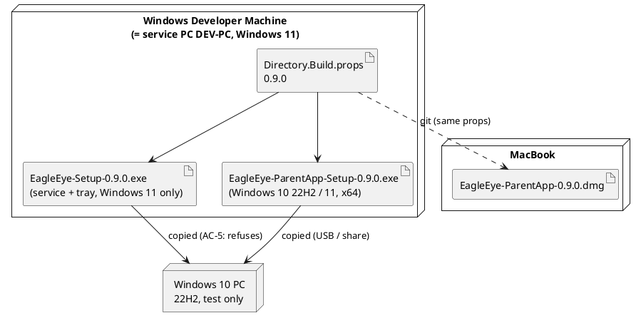

# Implementation Plan: US-009 — Windows Parent App on Windows 10, and Windows Parent App Parity (0.9.0)

**Status**: Approved by the project owner (2026-10-31), with Q-1 to Q-4 answered (Q-1: "trackpad" on both platforms, no new text pair; Q-2 to Q-4 as recommended), incl. the amendments of ADR-009, ADR-019, ADR-007, arc42 §7 and coding guidelines §16.1
**Date**: 2026-10-31
**Author**: ARC
**User story**: `02_Implementation/docs/requirements/user-stories/US-009/user-story.md` (approved 2026-10-31, 38 ACs, OQ-1 to OQ-7 resolved)
**Requirements**: `02_Implementation/docs/requirements/general-product-requirements.md` v1.9 (in effect: §2.1, §9.1, §9.5, FR-APP-092, Q-8)
**Branch**: `feature/US-009-windows-parent-app-parity`
**Inputs checked**: US-008 plan, implementation report and test report (`02_Implementation/docs/testing/US-008/test-report.md`, F-1, F-2), US-007 test report F-1, ADR-007, ADR-009, ADR-019, ADR-021, and the code on this branch (= `main` 0.8.0 + story docs).

**Amended** (Accepted, approved by the project owner with this plan, 2026-10-31; applied by ARC on the branch): ADR-009 (installer minimum Windows 10 22H2), ADR-019 (Windows row of the platform table), ADR-007 (third, test-only machine), arc42 (header, §7, §7.4), coding guidelines §16.1. The Windows 10 test PC row in `02_Implementation/docs/dev-process/dev-environments.md` §1 is added by the Orchestrator. No new ADR.

**Changed during step c** (the project owner, 2026-10-31; no re-approval needed): the Windows parent app 0.6.2 had been uninstalled earlier and no Windows parent app is installed anywhere, so **AC-33 is a fresh installation of the Windows app 0.9.0 on Windows 11**; the update from 0.6.2 is not tested (story OQ-5 and Out of Scope, `90a1379`; implementation report R-2). Updated here: TI-11, TI-12, Decision 2 (dev check), Step 3, the AC-33 row, Manual Verification Notes (starting points, install order).

**Guidance for DEV (the project owner, 2026-10-31)**: where the requirements allow either way, choose the option with **less code**. No mixed-version or compatibility handling: only the four 0.9.0 assets together are supported.

---

## Summary

US-009 needs **no new feature code**. The Windows parent app already compiles every page, view model and style of the Mac app 0.8.0 (shared Core and shared XAML, US-008 Step 11). What is missing is:

1. **Windows 10**: the parent app installer refuses everything below Windows 11 (`MinVersion=10.0.22000`). One line changes to `10.0.19045`. The app itself already targets `10.0.19041` (csproj), so no build change is needed.
2. **Running it on Windows**: the US-007 and US-008 code has never run on WinUI. DEV runs the Windows app, checks every page on screen, and fixes what WinUI renders or handles differently. Fixes stay Windows-only or are neutral for the Mac (OQ-6, AC-35).
3. **Delivery**: version 0.9.0 for all four assets (one line in `Directory.Build.props`), three installers/packages, and the test-code warning clean-up (F-2).

The service, the tray client and the Mac app change their **version number only** (OQ-6). There is **no contract change** in `EagleEye.Shared`.

**Order**: Windows block first (version, warnings, installer, Windows app on screen, installers 0.9.0). Then a short **pre-check on the Windows 10 PC** by the project owner (install, connect, uninstall). Then the **MacBook** (Mac build, tests, `.dmg` 0.9.0). The manual test run follows on all three machines.

---

## Technical Issues and Risks

*Checked against the code on `feature/US-009-windows-parent-app-parity`. **Summary: small story in code, large in testing. The risk is not the logic (unit-tested on both machines) but how WinUI renders and handles the US-007/US-008 UI that was only ever seen on Mac Catalyst.***

| # | Issue | Impact | Solution in this plan |
|---|---|---|---|
| **TI-1** | **Installer refuses Windows 10.** `installer/windows/parentapp-setup.iss` has `MinVersion=10.0.22000`. | AC-2 to AC-4 | `MinVersion=10.0.19045` (Windows 10 22H2). Older builds and 32-bit Windows get Inno Setup's built-in message ("This program requires Windows … or later" / "… 64-bit"), in German or English, and nothing is installed (AC-4). No `[Code]` check (less code). |
| **TI-2** | **Service installer on Windows 10.** | AC-5 | Nothing to do: `installer/windows/setup.iss` keeps `MinVersion=10.0.22000`, so Inno Setup refuses Windows 10 with its built-in message. |
| **TI-3** | **App minimum version.** WinUI and the Windows App SDK (self-contained) need Windows 10 1809+; the csproj sets `SupportedOSPlatformVersion`/`TargetPlatformMinVersion` `10.0.19041.0`. | None | No build change. Only the comments in the csproj and the `.iss` that say "Windows 11" are corrected. |
| **TI-4** | **US-007 and US-008 code never ran on WinUI** (US-007 F-1, US-008 TI-13): connection/start-up error handling, menu, App Groups page, group rules, Reports group lines, outlined headings (D-18), icon buttons (D-19). | AC-1, AC-10 to AC-23, AC-34 | Step 2: DEV runs the Windows app (Debug, own data folder) against the installed service and checks every page on screen with a check list (Decision 2). Fixes per Decision 3. |
| **TI-5** | **Drag-and-drop on WinUI.** The US-008 spike proved the MAUI recognizers on Mac Catalyst only. On WinUI they map to `CanDrag`/`AllowDrop`; known quirks: the drag shows a "Copy" caption, `DragLeave` order between neighbouring targets, drags started on a `Label` inside a `ScrollView`. | AC-16 | Checked first in Step 2 with a decision rule (Decision 4). "≡" and the right-click menu are the fallback that always exists (AC-17). |
| **TI-6** | **Dialogs on WinUI** are `ContentDialog`s. WinUI allows only one open `ContentDialog`; the name-dialog loop (US-008 D-5) opens the next prompt right after the previous one closes. | AC-15, AC-17 | Check the loop, the delete confirmation and "Move to …" in Step 2. If WinUI throws "only a single ContentDialog", DEV yields once (`await Task.Yield()`) before re-prompting in `MauiDialogService` (Windows path only). |
| **TI-7** | **`ImageButton` on WinUI** (pencil, trash can, D-19) may draw its own hover/pressed background or ignore `Padding`. | AC-14 | Check on screen in both themes; if needed, Windows-only setters in the `IconButton` style (`OnPlatform`) or a handler mapping in `MauiProgram` (`#if WINDOWS`), like the existing `CheckBox` mapping. |
| **TI-8** | **Text "mouse or trackpad"** in the App Groups explanation (US-008 D-14). AC-13 wants "touchpad" in the Windows wording. Core is platform-neutral. | AC-13, AC-28 | **Q-1 resolved** (the project owner, 2026-10-31): keep "trackpad" on both platforms. No new text pair, no code; Windows shows the 0.8.0 explanation text. TES records no wording issue for it. |
| **TI-9** | **Windows 10 rendering differences**: no Segoe UI Variable (WinUI falls back to Segoe UI, slightly different widths); the Windows 10 emoji font lacks the newest emojis (shown as boxes or split); no rounded corners or Mica (out of scope). | AC-8 | No code. DEV's Step 2 check uses 150 % scaling and the 900 × 600 minimum; the Windows 10 pre-check (Step 4) covers the rest. TES should use common emojis (e.g. 🎮 😀) for AC-8 and AC-15. |
| **TI-10** | **TLS from Windows 10.** Windows 10 SChannel has TLS 1.3 off by default; the service certificate is ECDSA P-256/SHA-256 and Kestrel uses the OS defaults. | AC-6 | No code: Windows 10 negotiates TLS 1.2 with ECDHE-ECDSA, which Windows 11 offers. Proven by Step 4. |
| **TI-11** | **Fresh installation of the Windows app 0.9.0 on Windows 11** (changed during step c, 2026-10-31: 0.6.2 had been uninstalled earlier; the update from 0.6.2 is not tested). | AC-33 | Nothing to migrate. DEV must **not** install the Windows app 0.9.0 on the service PC (an account without a Windows parent app is the AC-33 starting point). |
| **TI-12** | **Test starting points must stay untouched** until the test run: service 0.8.0 (AC-31), no Windows parent app installed in the project owner's account (AC-33, fresh installation; changed during step c, 2026-10-31), Mac app 0.8.0 (AC-32), no app on the Windows 10 PC (AC-2). | Test validity | DEV uses the Debug build with `EAGLEEYE_DEV_APP_DATA_DIR` (US-005 D-5) and does not run any installer on the service PC or the MacBook. The Windows 10 pre-check ends with an uninstall (Step 4), which also exercises AC-3. |
| **TI-13** | **Test-code warnings** (US-008 F-2): 8 × CS8631, 1 × xUnit2029. | Delivery note | Step 1 (Decision 5). |

---

## Machine Assignment

| Work | Machine |
|---|---|
| This plan and the ADR amendments (ARC) | Windows Developer Machine (done here) |
| **Steps 1 to 3**: version, warnings, installer, Windows app on screen and fixes, installers 0.9.0 | **Windows Developer Machine** (= service PC `DEV-PC`, Windows 11) |
| **Step 4**: pre-check of the Windows app installer | **Windows 10 PC** (the project owner's third, physical PC, Windows 10 22H2, test only: no repo, no agent, no build) |
| **Step 5**: Mac build, tests, `.dmg` 0.9.0, Mac check of any shared change | **MacBook** |
| **Step 6** (only if Step 5 changed code): final build and tests | Windows Developer Machine |
| Manual test run (the project owner, guided by TES) | Service PC (service, tray, Windows app on Windows 11) + Windows 10 PC + MacBook |

**Handover points**:

| # | After | From → To | How |
|---|---|---|---|
| H1 | Step 3 | Windows → Windows 10 PC | Commit and push. The project owner copies `03_Delivery/windows/EagleEye-ParentApp-Setup-0.9.0.exe` and `EagleEye-Setup-0.9.0.exe` to the Windows 10 PC (USB stick or network share; the installers are git-ignored). Step 4 check list is in the implementation report. |
| H2 | Step 4 | Windows 10 PC → Windows | The project owner reports the result; DEV records it in the implementation report and fixes a Windows 10 finding (back to Step 2/3), then pushes. |
| H3 | Step 4 recorded | Windows → MacBook | Pushed: all code, report §Windows and §Windows 10. The project owner switches to the MacBook, `git pull`. |
| H4 | Step 5 | MacBook → Windows (test run) | Pushed: report §Mac. The `.dmg` stays on the MacBook (git-ignored). |

There is no `EagleEye.Shared/Contracts/` change, so the API-first ordering rule (ADR-007) has nothing to order.

---

## Impact Assessment

| Component | Impact |
|---|---|
| **EagleEye.Shared** | No change (version only). |
| **EagleEye.Service** | No change (version only). |
| **EagleEye.TrayClient** | No change (version only). |
| **EagleEye.ParentApp.Core** | No change expected (Q-1: no new text pair). Possibly small, platform-neutral fixes found in Step 2 (with unit tests). |
| **EagleEye.ParentApp** (MAUI head) | Windows-only fixes from Step 2 (no explanation-text change, Q-1): `#if WINDOWS` in `MauiProgram`/`MauiDialogService`, `OnPlatform` setters in `Styles.xaml`, or code under `Platforms/Windows/`. csproj comment. |
| **Installers** | `installer/windows/parentapp-setup.iss`: `MinVersion=10.0.19045` + comment. `setup.iss` unchanged. Outputs: `03_Delivery/windows/EagleEye-Setup-0.9.0.exe`, `03_Delivery/windows/EagleEye-ParentApp-Setup-0.9.0.exe`, `03_Delivery/macos/EagleEye-ParentApp-0.9.0.dmg`. |
| **Version** | `Directory.Build.props` → `0.9.0` (all four assets; tray *App Infos*, Mac `CFBundleShortVersionString` and the installers follow automatically). |
| **Tests** | F-2: `EagleEye.Service.Tests/Data/BlockedStartRepositoryTests.cs`, `AppRuleRepositoryTests.cs`, `AppGroupRepositoryTests.cs`; `EagleEye.ParentApp.Tests/ViewModels/RulesViewModelTests.cs`. |
| **Docs** | `src/EagleEye.ParentApp/README.md` (platform table: Windows 10 22H2 or 11), `03_Delivery/windows/README.md` (parent app runs on Windows 10 22H2 and 11; service on 11 only). After approval, ARC applies: arc42 §7 deployment (Windows parent app node and table row "Windows 10 22H2 / 11"), coding guidelines §16.1 (minimum OS enforced by the installer: 10.0.19045). |

---

## Architecture Changes

None in structure. The **deployment view** changes: the Windows parent app runs on Windows 10 22H2 (build 19045+) or Windows 11, x64; on Windows 10 always as a remote parent app, because the service needs Windows 11 (§9.1, FR-APP-091). arc42 §7 and coding guidelines §16.1 are updated by ARC after approval (listed above).

## New ADRs Required

None. **Proposed amendments** (text in the ADR files, marked "Proposed — US-009"):

| ADR | Amendment |
|---|---|
| **ADR-009** §1 and Implementation Notes D-3 | The Windows parent app installer requires **Windows 10 22H2 (10.0.19045) or newer, x64** (`MinVersion=10.0.19045`, `ArchitecturesAllowed=x64compatible`). Older or 32-bit Windows: Inno Setup's built-in refusal message, nothing installed (FR-APP-092 v1.9, OQ-2). The service installer stays at Windows 11. |
| **ADR-019** §1 | Platform table row "Windows 11" → "Windows 10 22H2 (19045+) or Windows 11, x64"; Windows 10 only as a remote parent app. |
| **ADR-007** §1/§3 | A third machine for **manual testing only**: the project owner's Windows 10 22H2 PC. No repo, no agent sessions, no builds; installers are copied to it. `02_Implementation/docs/dev-process/dev-environments.md` §1 gets the matching row (Orchestrator, after approval). |

ADR-021 needs no amendment: its §5 already says the Windows parent app gets its group UI in US-009; nothing in that decision changes.

---

## API Changes (SignalR Contracts)

**None.** `IParentHub`, `IParentClientCallback` and all DTOs stay as in 0.8.0. The Windows app uses the client code the Mac app 0.8.0 uses.

---

## Component Design

### Decision 1: Windows 10 support is an installer setting

```
; parentapp-setup.iss
; Windows 10 22H2 (build 19045) or Windows 11, x64 (FR-APP-092 v1.9, ADR-009). The service stays Windows 11 (setup.iss).
MinVersion=10.0.19045
```

Nothing else is Windows-10-specific in code: no OS version checks, no Windows-10 code paths, no feature switches. Out of scope (OQ-2): older Windows 10, 32-bit (refused), ARM, S mode, LTSC. Note: `x64compatible` would also let the installer run on Windows 11 on ARM (x64 emulation). That stays untested and unsupported; no code is added to block it (less code, D-2).

### Decision 2: Windows on-screen check (Step 2)

DEV runs the Windows app **Debug** build on the Windows Developer Machine with `EAGLEEYE_DEV_APP_DATA_DIR` set to a folder under `02_Implementation/artifacts/` (git-ignored), so the AC-33 starting point (no Windows parent app installed) stays untouched (TI-12; changed during step c, 2026-10-31: 0.6.2 had been uninstalled earlier). DEV pairs it with the installed service 0.8.0; the project owner reads out the pairing code (the service is on this PC). There is no contract change, so the 0.8.0 service is a valid counterpart for this dev check.

Check list (screenshots in `US-009/evidence/`, light and dark, 100 % and 150 %, two accent colours, window at 900 × 600):

| # | What | Source |
|---|---|---|
| 1 | Start paired → Reports; unpaired → Settings with host dialog; host that cannot be reached → error naming the host; "Forget pairing on this device" when unreachable | AC-6, AC-10, AC-34 |
| 2 | Menu: four entries in order; only the selected one highlighted after clicking through all four twice | AC-10 |
| 3 | Every section heading outlined in the Windows accent colour, text in normal colour; change the accent colour while running → frames follow at the latest on window activation; buttons distinct from headings | AC-11 |
| 4 | App Groups: explanation (same text as on the Mac, "trackpad", Q-1), "Add group", sections sorted, "Not in any group" last, tooltips with program path, empty texts, states "Not connected", "no controlled account", "Loading …" | AC-13 |
| 5 | Pencil and trash-can icon buttons: size, no stray background, tooltips, both themes | AC-14 |
| 6 | Name dialog loop (empty, 41 characters, duplicate, emoji via Windows key + .), Escape/Cancel, rename pre-filled, delete confirmation with title | AC-15, TI-6 |
| 7 | Drag-and-drop with mouse and touchpad (Decision 4), highlight follows and clears, small window with scrolling | AC-16, TI-5 |
| 8 | "≡" and right-click → "Move to …" with the right targets, Cancel | AC-17 |
| 9 | Rules: "App group rules" section, members line, "(no apps)", grouped apps hidden, "Loading …" for both sections after reconnect, checkbox columns at 150 % | AC-19 to AC-21 |
| 10 | Reports: "App groups" table under a day, refresh after a move without "Loading …" | AC-22, AC-23 |
| 11 | Existing pages: Settings ticks, break times with trash can, app rules, warning minutes and texts (spot) | AC-34 |

The full US-008 retest and the Windows 10 checks remain TES's job; this list is DEV's smoke check so that the test run does not start with obvious WinUI defects.

### Decision 3: where a Windows fix goes (OQ-6, AC-35)

In this order of preference:

1. **Windows-only**: `#if WINDOWS` in the MAUI head (`MauiProgram` handler mappings, `MauiDialogService`), code under `Platforms/Windows/`, or `OnPlatform` values in XAML/styles. The Mac build does not see the change.
2. **Shared and platform-neutral** (Core logic, a shared XAML change that is visually identical on the Mac): allowed, with unit tests for Core. Each such change is listed in the implementation report and checked on the Mac in Step 5 (probe screenshots as in US-008, compared with the US-008 evidence).
3. **Anything that would change the Mac app's behaviour or look**, or that touches the service, tray client or Shared beyond the version: stop and ask the project owner through the Orchestrator (OQ-6).

No Windows-only copy of a page. A dedicated Windows style dictionary (like `MacStyles.xaml`) is created only if more than a few `OnPlatform` setters are needed.

### Decision 4: drag-and-drop decision rule on WinUI (first item of Step 2)

| Check | Pass |
|---|---|
| Drag with mouse and with touchpad from any section, also with the page scrolled | Drag starts; the page does not scroll instead |
| Drop on another, an empty, the own section, outside | Moves, moves, nothing, nothing |
| Highlight follows the pointer and always clears (light and dark) | No stuck highlight after 20 drags |
| Right-click on an entry | Menu opens; no drag starts |

Rule: all pass → no change. A WinUI quirk with a small fix (e.g. a `DragLeave` order problem, the "Copy" caption via `e.PlatformArgs` on Windows) → Windows-only fix, at most about half a day. Drag unusable on WinUI → stop and report to the project owner before going on; the fallback is "≡" and right-click only (AC-16 failed knowingly), the project owner decides.

### Decision 5: test-code warnings (F-2)

- **CS8631** (8×): `Assert.Equal` with a collection expression containing `null` binds to the `ReadOnlySpan` overload. Fix: give the expected value an explicit array type (e.g. `new long?[] { 1, null }`) or compare `actual.ToArray()`, whichever is shorter per line. Test meaning unchanged.
- **xUnit2029** (1×, `RulesViewModelTests.cs`): use the assertion the analyzer suggests (`Assert.DoesNotContain(…)` instead of `Assert.Empty(….Where(…))`).
- Result: `pwsh 02_Implementation/scripts/test.ps1` builds with **0 warnings** on Windows (and on the Mac, Step 5). No warning suppression (`#pragma`, `NoWarn`).

### Decision 6: versions

`Directory.Build.props` `VersionPrefix` 0.8.0 → **0.9.0**. Service and tray: assembly version (tray *App Infos* "0.9", service `EagleEye_v0.9`). Windows app: `ApplicationDisplayVersion` and the installer `AppVersion` from `package-windows.ps1`. Mac app: `CFBundleShortVersionString` (checked by `package-macos.ps1`). No other version constants exist.



---

## Data Model Changes

None. Service database stays at schema 6 (US-008); the service installer 0.9.0 runs no migration. Parent app database unchanged since 0.6.2.

---

## Implementation Steps

All steps on `feature/US-009-windows-parent-app-parity`. Commit after each step (`US-009: …`) and push. Each step ends with **"the project owner sees"**.

| Step | Content | Machine |
|---|---|---|
| 1 | Version 0.9.0, test-code warnings (F-2), installer minimum Windows 10 22H2, comments and READMEs | **Windows** |
| 2 | Windows app on screen (Decisions 2 to 4), Windows fixes | Windows |
| 3 | `package-windows.ps1 -Target All` → both installers 0.9.0; report §Windows | Windows |
| — | **H1**: push; the project owner copies the installers to the Windows 10 PC | |
| 4 | Pre-check on the Windows 10 PC (the project owner, DEV's check list) | **Windows 10 PC** |
| — | **H2**: result recorded and any fix pushed on Windows; **H3**: the project owner switches to the MacBook | |
| 5 | Mac build and tests, Mac check of shared changes, `.dmg` 0.9.0; report §Mac; story → `Implemented` | **MacBook** |
| — | **H4**: push; the project owner switches to Windows for the test run | |
| 6 | Only if Step 5 changed code: build and all four test projects on Windows | Windows |

### Step 1: Version, warnings, installer (Windows)

1. `git pull`; `pwsh 02_Implementation/scripts/env-check.ps1`.
2. `Directory.Build.props` → `0.9.0`.
3. F-2 (Decision 5).
4. `parentapp-setup.iss`: `MinVersion=10.0.19045` and comment (Decision 1). csproj comment ("the minimum OS, Windows 10 22H2, is enforced by the installer"). `src/EagleEye.ParentApp/README.md` and `03_Delivery/windows/README.md` platform lines.
5. `build.ps1` and `test.ps1`: 0 warnings, all four projects green.

**The project owner sees**: nothing visible; build and tests green with 0 warnings.

### Step 2: Windows app on screen (Windows)

1. Drag-and-drop check first (Decision 4); stop and report if the rule says so.
2. Check list of Decision 2; fixes per Decision 3. Unit tests for any Core change.
3. Q-1 (resolved): no Windows text; the App Groups explanation keeps "trackpad" on both platforms. Nothing to implement.
4. Q-3: keep the native WinUI menu selection; use the Mac template on Windows only if check item 2 shows more than one entry highlighted (Windows-only fix). Q-4: keep the 0.6.2 Windows button style.
5. Screenshots in `US-009/evidence/`; list of fixes, each marked "Windows-only" or "shared (Mac check in Step 5)".

**The project owner sees**: the Windows app (Debug window) with "App Gruppen" in the menu, outlined headings in their Windows accent colour, groups dragged with the mouse, group rules and group lines on Reports.

### Step 3: Windows installers (Windows)

1. `pwsh 02_Implementation/scripts/package-windows.ps1 -Target All` → `03_Delivery/windows/EagleEye-Setup-0.9.0.exe` and `EagleEye-ParentApp-Setup-0.9.0.exe`; check the file versions (Explorer *Properties*) and SHA-256 in the report.
2. **No installer is run on this PC** (TI-12): service 0.8.0 and "no Windows parent app installed" (AC-33, fresh installation; changed during step c, 2026-10-31) stay as test starting points.
3. `implementation-report.md` §Windows incl. the Step 4 check list. Commit, push (**H1**).

**The project owner sees**: the two 0.9.0 installers in `03_Delivery/windows/`.

### Step 4: Pre-check on the Windows 10 PC (the project owner, guided by DEV's check list)

1. Note the Windows version (`winver`: 22H2, build 19045.x).
2. Run `EagleEye-Setup-0.9.0.exe` → message that Windows 11 is needed, nothing installed (AC-5).
3. Run `EagleEye-ParentApp-Setup-0.9.0.exe` without admin rights → completes; start from the Start menu.
4. Host dialog → `DEV-PC` → connected, no certificate warning; pair with a device name (e.g. "Windows 10 pre-check").
5. Open the four pages once; create a group, drag one app into it and back, delete the group.
6. Settings → "Remove pairing"; uninstall via *Settings → Apps → Apps & features*.
7. Report to DEV (H2): pass/fail per point, screenshots of anything odd.

The pairing of step 4 is removed again in step 6, so it leaves no orphan device (US-007 F-4). The PC ends without the app, so AC-2 is still a fresh installation in the test run.

**The project owner sees**: the Windows app installs, connects and works on their Windows 10 PC.

### Step 5: MacBook

1. `git pull`; `build.ps1` and `test.ps1` (Shared, ParentApp): 0 warnings, green.
2. For each change marked "shared" in Step 2: Mac probe and `screencapture` as in US-008 §8.3, compared with the US-008 evidence; Mac must look and behave as 0.8.0 (AC-35). No shared change → nothing to check.
3. `pwsh 02_Implementation/scripts/package-macos.ps1` → `03_Delivery/macos/EagleEye-ParentApp-0.9.0.dmg`; SHA-256 in the report. DEV does **not** install it over the project owner's 0.8.0 (AC-32 starting point, US-008 D-17).
4. Report §Mac, "How to test" for TES (artifacts, starting points, install order, UI texts as implemented); story → `Implemented` if Step 6 is not needed. Commit, push (**H4**).

**The project owner sees**: the `.dmg` 0.9.0 on the MacBook; everything ready for TES.

### Step 6: Windows close-out (only if Step 5 changed code)

`git pull`; `build.ps1`, `test.ps1` (0 warnings, four projects); story → `Implemented`; push.

---

## Acceptance Criteria → Steps and Unit Tests

| AC | Step | Unit tests | Manual |
|---|---|---|---|
| AC-1 parity rule | 2 | existing Core tests (US-007, US-008) | test run |
| AC-2 install on Windows 10 | 1, 3, 4 | — | W10 |
| AC-3 Apps & features, repair, uninstall | 3, 4 | — | W10 |
| AC-4 older Windows refused | 1 | — | if available |
| AC-5 service installer refuses Windows 10 | — (unchanged) | — | W10 |
| AC-6 connection from Windows 10 | 4 | existing | W10 |
| AC-7 pages on Windows 10 | 4 | existing | W10 |
| AC-8 look on Windows 10 | 2, 4 | — | W10 |
| AC-9 language on Windows 10 | — | existing `AppTexts` tests | W10 |
| AC-10 menu | 2 | `MainViewModel` (existing) | W11, W10 |
| AC-11 outlined headings, accent | 2 | `HeadingBarPalette` (existing) | W11, W10 |
| AC-12 light/dark, 150 % | 2 | — | W11 |
| AC-13 App Groups content | 2 | existing (no new key, Q-1) | W11 |
| AC-14 icon buttons | 2 | — | W11 |
| AC-15 dialogs | 2 | existing dialog-loop tests | W11 |
| AC-16 drag-and-drop | 2 | existing | W11, W10 |
| AC-17 "≡", right-click | 2 | existing | W11 |
| AC-18 saved at once, error | 2 | existing | W11, SVC |
| AC-19 to AC-21 Rules | 2 | existing | W11 |
| AC-22, AC-23 Reports | 2 | existing | W11 |
| AC-24 to AC-26 two parent apps | — | existing (revision rule) | W10/W11 + Mac |
| AC-27 group rule from Windows takes effect | — | existing (service) | W11, SVC |
| AC-28 texts de/en | 2 | `AppTexts` key tests (existing) | W11, W10 |
| AC-29 kid texts | — | existing | SVC |
| AC-30 versions | 1, 3, 5 | — | all |
| AC-31 service update | 3 | — | SVC |
| AC-32 Mac update | 5 | — | Mac |
| AC-33 Windows app 0.9.0 fresh installation on Windows 11 (changed during step c, 2026-10-31) | 3 | — | W11 |
| AC-34 Windows regression | 2 | existing | W11 |
| AC-35 Mac = 0.8.0, US-008 Mac ACs in full | 5 | existing | Mac |
| AC-36 service/tray = 0.8.0 | 1 | existing | SVC |
| AC-37 US-008 retest (service) | — | existing | SVC + W11 or Mac |
| AC-38 optional pilot checks | — | AC-41 guard (existing) | optional |
| Delivery note F-2 | 1 | 0 warnings | — |

---

## Unit Test Requirements

- All existing tests stay green on both machines: Windows 3 002 (baseline at US-008 Step 11) or more; Mac Shared + ParentApp.
- **0 compiler warnings** in `build.ps1` and `test.ps1` (F-2).
- New or changed Core code from Step 2: 100 % line and branch coverage (dev-process §9). New resx keys (none planned): covered by the existing `AppTexts` de/en key test pattern.
- Not unit-tested (manual): MAUI views, styles, handler mappings, `MauiDialogService`, `Platforms/Windows/*`, installers.

---

## Localization Impact

No new or changed texts (Q-1: the App Groups explanation keeps "mouse or trackpad" / „Maus oder Trackpad“ on Windows too).

All texts are those of the Mac app 0.8.0 (US-008 implementation report §9), unchanged. Installer texts: Inno Setup's built-in German/English messages for the version refusal (AC-4, AC-5).

---

## Logging

No change. Service log entries for group changes made in the Windows app are the US-008 ones (`AppGroupChangeLog`), with the Windows app's device name.

---

## Manual Verification Notes

*For TES. Not test cases.*

| What | Where / how |
|---|---|
| Artifacts | `03_Delivery/windows/EagleEye-Setup-0.9.0.exe`, `03_Delivery/windows/EagleEye-ParentApp-Setup-0.9.0.exe` (Windows Developer Machine; copy to the Windows 10 PC), `03_Delivery/macos/EagleEye-ParentApp-0.9.0.dmg` (MacBook). All git-ignored. |
| Starting points (untouched by DEV) | Service and tray 0.8.0 on the service PC; no Windows parent app in the project owner's admin account (AC-33 is a fresh installation; changed during step c, 2026-10-31); Mac app 0.8.0; no EagleEye on the Windows 10 PC (Step 4 ended with an uninstall). |
| Suggested install order | Service 0.9.0 over 0.8.0 first (AC-31, REG-001), then the Windows app fresh in the project owner's admin account (AC-33), the Windows 10 PC (AC-2), the Mac app (AC-32). No mixed versions are tested. |
| Version refusal | Inno Setup built-in message (German or English, by the wizard language), no custom text. AC-4 needs a Windows 10 older than 22H2 or 32-bit; usually "not tested". |
| Windows 10 look | No Segoe UI Variable, no rounded corners or Mica (out of scope). Use common emojis (🎮, 😀); newest emojis may not exist in the Windows 10 font. |
| Language on Windows | Windows display language; switching needs signing out and in again (AC-9). |
| Accent colour | *Settings → Personalization → Colors*; the frames follow at the latest when the window is activated again (AC-11). |
| Windows 10 network | The Windows 10 PC needs TCP 5443 to `DEV-PC` (the existing service firewall rule; same as the Mac). A failed ping proves nothing. |
| Two parent apps | Each paired app is a separate device on the service; "Remove pairing" in one does not affect the others (AC-24). |
| Service log | `%ProgramData%\EagleEye\logs\EagleEye.Service-NNN.log` (group changes name the Windows app's device name). |
| DEV evidence | `US-009/evidence/` (Step 2 screenshots), `US-009/implementation-report.md` (Step 4 result, SHA-256 of all artifacts). |

---

## Deviations from the Story and Interpretations

| # | Point | Plan |
|---|---|---|
| D-1 | AC-4 "shows a message that this Windows version is not supported" | Inno Setup's built-in `MinVersion` / architecture message (German or English). No own text (less code). |
| D-2 | Windows 11 on ARM | Not blocked by the installer (`x64compatible`), not supported, not tested. |
| D-3 | AC-13 "touchpad" | Q-1 resolved: "trackpad" stays on both platforms (the project owner, 2026-10-31). TES records no wording issue. |

---

## Open Questions for the project owner (all resolved 2026-10-31)

| ID | Question | Recommendation | Answer |
|---|---|---|---|
| Q-1 | "Trackpad" in the App Groups explanation on Windows (AC-13). The Mac text says "mouse or trackpad". The story allows "touchpad" on Windows. Same text on both (no code), or a Windows wording (one new text pair, one `OnPlatform` line)? | **Windows wording** with "touchpad"; the Mac text stays as in 0.8.0. Small and matches AC-13's intent. If you prefer zero code, both keep "trackpad" and TES records a wording note. | **Resolved** (the project owner, 2026-10-31): keep "trackpad" on both platforms. No new text pair, no code; TES records no wording issue. |
| Q-2 | Pre-check on the Windows 10 PC before TES (Step 4: install, connect, pair, short tour, remove pairing, uninstall; about 15 minutes). | **Yes.** It is the only Windows 10 check before the test run; finding a Windows 10 blocker in the test run would cost a whole loop. It leaves the PC clean for AC-2 and no orphan device. | **Resolved** (the project owner, 2026-10-31): yes, the project owner does the Windows 10 pre-check (Step 4) before TES. |
| Q-3 | Menu selection look on Windows (AC-10). The Mac uses its own template (accent fill, US-007 fix for Catalyst). WinUI has a native selection highlight that already marks only one entry. | **Keep the native WinUI selection** (less code). Use the Mac template on Windows too only if Step 2 shows more than one entry highlighted. | **Resolved** (the project owner, 2026-10-31): as proposed: native Windows menu highlight; the Mac template only if Step 2 shows a problem. |
| Q-4 | Button look on Windows. The Mac buttons use the accent colour (Mac-only style). Windows buttons keep their current style (app primary colour). AC-11 only requires buttons to be clearly distinct from the outlined headings. | **Keep the Windows button style** as in 0.6.2 (less code, no Mac change). | **Resolved** (the project owner, 2026-10-31): yes, keep the 0.6.2 Windows button style. |

---

## Risks

| # | Risk | Probability | Impact | Mitigation |
|---|---|---|---|---|
| R-1 | WinUI renders or handles the US-007/US-008 UI differently (dialogs, `ImageButton`, drag-and-drop, highlight) | High (first run on WinUI) | Medium | Step 2 check list with decision rules; Windows-only fixes; "≡" fallback for drags |
| R-2 | Drag-and-drop unusable on WinUI | Low to medium | High (AC-16) | Checked first (Decision 4); the project owner decides on menu only |
| R-3 | A Windows fix changes the Mac app | Low | High (AC-35) | Decision 3 order; Mac check in Step 5; stop rule (OQ-6) |
| R-4 | Windows 10 specifics (fonts, emoji font, TLS 1.2, Windows App SDK runtime) | Low | Medium | No Windows-10 code; Step 4 pre-check on the real PC; TES uses common emojis |
| R-5 | Windows 10 end of support (2025-10-14): no security updates for the pilot PC | Certain | Outside the product | The project owner's decision for the pilot (story note); the parent app holds only the pairing token (DPAPI, per user) |
| R-6 | Large test run (US-008 retest + three machines) | Certain | Medium (time) | Accepted by the project owner with the story; TES combines AC-27, AC-31, AC-36, AC-37 |
| R-7 | A test starting point is destroyed by a dev install | Low | Medium | TI-12: Debug build with its own data folder; no installer runs on the service PC or the MacBook before the test run |
| R-8 | Machine switches | Medium | Low | One Windows block, one Windows 10 visit, one MacBook block |

---

*End of Implementation Plan*
