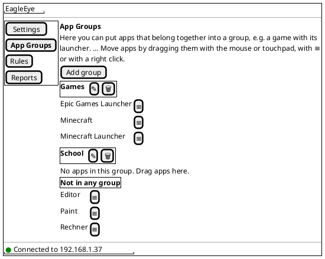
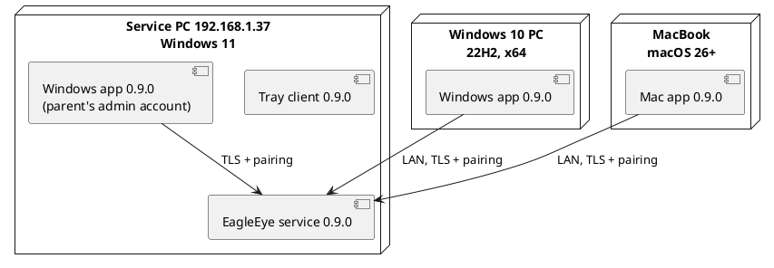

# US-009: Windows Parent App on Windows 10, and Windows Parent App Parity (0.9.0)

**Status**: Analyzed
**Created**: 2026-10-31
**Approved**: by Michael, 2026-10-31, with OQ-1 to OQ-7 as resolved (OQ-5 wording confirmed) and the larger test run accepted
**Component(s)**: EagleEye.ParentApp (incl. EagleEye.ParentApp.Core). EagleEye.Service, EagleEye.TrayClient, EagleEye.Shared: no behaviour change expected, new version 0.9.0 and regression only (group J)
**Platform(s)**: ParentApp Windows (Windows 10 22H2 and Windows 11, Windows Developer Machine and Michael's Windows 10 test PC) · ParentApp macOS (version only, regression, MacBook) · Windows service/tray (version only, regression, Windows 11)

---

## User Story

As a **parent**, I want to install the EagleEye parent app on my Windows 10 PC as well as on a Windows 11 PC, and use it exactly like the Mac app, including app groups, group rules and the group lines on Reports, so that I can manage my kids' rules from any of my computers with the same features and the same look.

---

## Background

Two items of the pilot feedback of 2026-10-31 (Michael, relayed by the Orchestrator) lead to this story:

1. **Windows 10.** The pilot family manages the kids from a **Windows 10 PC**. The Windows parent app does not install there: it supports Windows 11 only (§9.5). Michael decided (US-008 planning, 2026-10-31): the **Windows parent app** also supports **Windows 10 22H2 (build 19045), x64**. The **service and the tray client stay Windows 11 only**. The Windows 10 PC is therefore always a parent PC on the LAN that connects to a service PC with Windows 11 (FR-APP-091).
2. **Windows parity.** US-007 (Mac app 0.7.0) and US-008 (app groups in the service and the Mac app, 0.8.0) were built for the Mac app only. The Windows parent app shares its logic and pages with the Mac app (ParentApp Core), but in US-008 it only had to compile and pass its unit tests (US-008 note "Windows build", plan TI-13, arc42 R-18). It has **not been installed, run or tested since build 0.6.2**: no Windows parent app installer of 0.7.x or 0.8.x was built (US-007 test report §2, §4 Step 8). This story brings the Windows parent app up to the Mac app 0.8.0 (FR-APP-082, FR-APP-090).

**Decided before this story (do not reopen)** (Michael, 2026-10-31, US-008 planning and plan revision 1):

- Windows 10 support for the parent app only: 22H2, build 19045, x64. Service and tray client: Windows 11 only.
- Windows parity includes app groups: groups per service PC, group rules per kid (US-008 AC-2, AC-15).
- All **four assets** (service, tray client, Windows parent app, Mac app) get version **0.9.0** and are distributed together.
- **No mixed versions** and no compatibility code between versions (US-008 Out of Scope "Mixed versions").
- Where the requirements allow either way, the option with **less code** is preferred.

**What the Windows parent app lacks today, compared with the Mac app 0.8.0 (the parity reference)**

| Capability of the Mac app 0.8.0 | Defined in | Windows parent app 0.6.2 |
|---|---|---|
| Menu "Settings", "App Groups", "Rules", "Reports"; only the selected entry highlighted | US-008 AC-1; US-007 menu fix (US-007 report §1) | menu without "App Groups" |
| App Groups page: sections, "Add group", rename, delete, drag-and-drop, "≡" "Move to …", right-click menu, drop highlight | US-008 AC-2 to AC-14; US-008 report D-9, D-14 to D-16 and the group-heading buttons (D-19) | missing |
| Rules: "App group rules" section; grouped apps hidden from "Application rules"; "Loading …" until both areas are loaded | US-008 AC-15 to AC-18; D-11, D-13 | missing |
| Reports: "App groups" lines per day; refresh after a group change without "Loading …" | US-008 AC-35 to AC-37; D-12 | missing |
| Section headings **outlined** in the accent colour (no solid fill), heading text in the normal text colour | US-008 report D-18 (Michael's finding on 0.8.0) | solid accent-filled bars (ISSUE-007) |
| Shared logic of US-007 (connection, start-up errors, language choice, accent palette, texts) | US-007 implementation report | never built and run on Windows (US-007 F-1) |

References: FR-APP-042 to FR-APP-044, FR-APP-062 (v1.8, US-008), FR-APP-081 to FR-APP-083, FR-APP-090 to FR-APP-092, FR-APP-110, NFR-L-010 to NFR-L-012, §2.1, §9.1, §9.5. Architecture: ADR-009 (Windows parent app packaging, per-user installer), ADR-010, ADR-019, ADR-021 (US-008). Follow-ups: US-007 test report F-1 and the not verified US-007 AC-25 and AC-33; US-008 Out of Scope "Two parent apps showing groups at the same time".

> **Note on Windows 10**: Microsoft ended regular support for Windows 10 on 2025-10-14. Supporting Windows 10 22H2 for the parent app is Michael's decision for the pilot. This story does not add anything for Windows 10 beyond what it needs to install and run.

**Terms used in this story**

- *Windows app*: the EagleEye parent app for Windows (US-002 to US-006, and the build of this story).
- *Mac app*: the EagleEye parent app for macOS (US-007, US-008, and the build of this story).
- *Windows 10 PC*: Michael's third, physical Windows PC with Windows 10 22H2, build 19045 or newer, x64, in the same LAN as the service PC (OQ-1).
- *Service PC*, *account*, *controlled account*, *app*, *app group*, *group rule*, *grouped app*, *group used time*, *kid dialog*, *heading bar*: as in US-003 to US-008.
- *Parity rule*: AC-1 below.

---

## Product requirement amendment (v1.9, in effect since Michael approved this story on 2026-10-31)

US-008 (v1.8) is merged into `main` and `main` into this branch. The **v1.9 amendment** is now written into `02_Implementation/docs/requirements/general-product-requirements.md`; it took effect with Michael's approval of this story on 2026-10-31. US-008's v1.8 note announces it.

- **§2.1 Parent, Devices**: "Windows 10 22H2 (build 19045 or newer, x64) or Windows 11 PC (x64), or Mac (macOS 26+, Apple Silicon)". The kid's device stays "Windows 11 PC only".
- **§9.5 Windows (ParentApp), OS**: "Windows 10 22H2 (build 19045 or newer) or Windows 11, x64". New row note: on Windows 10 the parent app runs only as a remote parent app, because the service needs Windows 11 (§9.1, FR-APP-091).
- **§9.1 Windows (Service + TrayClient)**: unchanged (Windows 11 x64); note "(v1.9: stays Windows 11 only; Windows 10 is supported for the parent app only)".
- **FR-APP-092**: add "The installer runs on every Windows version of §9.5 and refuses older versions with a message (v1.9)."
- **§11.1**: new answered question Q-8 "Does the parent app run on Windows 10?" — Michael, 2026-10-31: yes, the Windows parent app on Windows 10 22H2 (build 19045) x64; service and tray client stay Windows 11 only.

---

## Acceptance Criteria

> **Language of UI texts** (NFR-L-010 to NFR-L-012): all UI texts are **English examples**, with the German wording in brackets. The Windows app shows every text in the Windows display language (German or English; any other language → German), as before. The new texts are the ones of the Mac app 0.8.0, in the same wording; TES uses the texts as implemented in the Mac app (US-008 report D-14 to D-16). Differences in wording between the two apps are Fails in this story (parity), differences from the English examples here are notes.

> **Test setup**: the service PC at `192.168.1.37` (Windows 11, service and tray client 0.9.0 installed over 0.8.0) with the parent's admin account, the standard accounts `kid1` and `kid2` (under parental control) and `kid3` (not under parental control); `kid1` and `kid2` have used Notepad ("Editor"), Paint and Calculator ("Rechner"). The **Windows app 0.9.0** is installed (1) on the service PC in the parent's admin account, over the existing 0.6.2, and (2) on the **Windows 10 PC** (fresh installation). The **Mac app 0.9.0** is installed on Michael's MacBook over 0.8.0. All three parent apps are paired with the service. Short budgets and warning levels (e.g. early 3, final 1) keep the tests short, as in US-006 and US-008. Michael runs all tests.

> **Where each AC is checked** (tag after the AC number):
>
> | Tag | Machine |
> |---|---|
> | **[W10]** | needs the **Windows 10 PC** (OQ-1) |
> | **[W11]** | Windows app on Windows 11 (the service PC, or another Windows 11 PC) |
> | **[Mac]** | Mac app on the MacBook |
> | **[SVC]** | service PC (service, tray client, log, kid's session) |
>
> An AC with several tags is checked on each of them. "[W10 or W11]" means one of the two is enough.

> **Windows equivalents of Mac terms** used in the referenced US-007 and US-008 ACs:
>
> | In the Mac ACs | For the Windows app |
> |---|---|
> | the macOS language | the Windows display language |
> | the macOS appearance, light/dark | the Windows app mode (light/dark) |
> | the macOS accent colour | the Windows accent colour (*Settings → Personalization → Colors*) |
> | "Larger Text" | display scaling 150 % |
> | mouse and trackpad | mouse and touchpad |
> | right click or two-finger click | right click (mouse) or the touchpad's right-click gesture |
> | Character Viewer | Windows emoji panel (Windows key + .) |
> | `.dmg`, *Applications*, Finder *Get Info* | installer, Start menu, *Settings → Apps → Installed apps* (Windows 10: *Settings → Apps → Apps & features*) |
> | Return | Enter |

> **Service log**: entries are checked in `%ProgramData%\EagleEye\logs\` on the service PC (US-003 AC-14).

### A. Parity rule

- [ ] **AC-1** [W11]: Every parent-app acceptance criterion of **US-008** (AC-1 to AC-18, AC-35 to AC-37, AC-43) and the Mac-app decisions recorded in the US-008 implementation report (D-9, D-12 to D-16, D-18 and the group-heading buttons D-19) also hold for the **Windows app**, read with the Windows equivalents above. Where a US-008 AC names "the Mac app", the Windows app takes that role. Exceptions are only the ones this story states. Groups C to F spell out the checks; where they quote a referenced AC, its limits and texts apply unchanged.

### B. Windows 10: installation and use (FR-APP-092, §9.5)

- [ ] **AC-2** [W10]: On a Windows 10 22H2 PC (x64) with no other software installed for EagleEye (in particular no separately installed .NET runtime), the Windows app installer `EagleEye-ParentApp-Setup-0.9.0.exe` runs as a guided wizard with default settings, without admin rights, and completes. The app then starts from the Start menu without any further step (US-002 AC-2). The installer is in German or English like the earlier versions.
- [ ] **AC-3** [W10]: On the Windows 10 PC, *Settings → Apps → Apps & features* shows "EagleEye Parent App" with the publisher "Michael Adler" and version 0.9.0 (US-002 AC-3). Running the same installer again (repair) completes without errors and keeps the pairing and the appearance (US-002 AC-4). Uninstalling removes the app completely: no program files, no Start menu entry and no stored connection or pairing data remain (US-002 AC-5).
- [ ] **AC-4** [W10]: On a Windows version **older than Windows 10 22H2** (build below 19045), or on 32-bit Windows, the Windows app installer shows a message that this Windows version is not supported and installs nothing (OQ-2). *Checked only if such a Windows is available; otherwise TES records "not tested".*
- [ ] **AC-5** [W10]: On the Windows 10 PC, the **service installer** `EagleEye-Setup-0.9.0.exe` shows a message that Windows 11 is needed and installs nothing (service and tray client stay Windows 11 only, §9.1).
- [ ] **AC-6** [W10]: The Windows app on the Windows 10 PC connects to the service PC as in US-002: the host dialog on the first start; the IPv4 address `192.168.1.37` connects; TLS without any certificate warning or step (US-002 AC-7); pairing with the 6-digit code and a device name (e.g. "Michael's Windows 10 PC"), including the wrong-code case (US-002 AC-13 to AC-20); the status bar texts and colours (US-002 AC-10); connect on its own within 30 seconds after start, red within 30 seconds when the service stops, green again within 60 seconds after it starts (US-002 AC-21, AC-22). A host that cannot be reached gives the connection error that names the host (US-002 AC-12).
- [ ] **AC-7** [W10]: All four pages work on the Windows 10 PC. Spot check: tick and untick `kid2` (Settings), change one warning minute value (Settings), create the group "Games" and move Paint into it once by drag-and-drop, once with "≡" and once with the right-click menu (App Groups), set the group rule "Games" for `kid1` and add one break time entry (Rules), and see today's app and group lines for `kid1` (Reports). Each change is confirmed by the service as in AC-18.
- [ ] **AC-8** [W10]: Look on Windows 10 as in group C: menu, outlined headings in the Windows accent colour, light and dark mode, display scaling 100 % and 150 %, window minimum size 900 × 600 with scrolling pages. No text is cut off, no control is unreachable, checkboxes and the trash-can icon are visible, and emojis (e.g. in a group name or the budget text) are shown as emojis.
- [ ] **AC-9** [W10]: Language on Windows 10: with the Windows display language German the Windows app is German, with English it is English (after signing in again, as Windows requires), with any other language German. Unchanged default kid texts are shown in the app's language (US-006 AC-10, AC-14).

### C. Main window, menu and look (FR-APP-081, FR-APP-083; US-007 AC-7, AC-10, AC-11; US-008 AC-1, D-18)

- [ ] **AC-10** [W11] [W10]: The navigation menu of the Windows app shows "Settings", "App Groups", "Rules", "Reports" ("Einstellungen", "App Gruppen", "Regeln", "Berichte") in this order. When paired, the app opens on Reports; when not paired, on Settings with the host dialog (unchanged). Only the selected menu entry is highlighted; an entry that was selected before returns to normal when another entry is chosen (US-007 menu fix).
- [ ] **AC-11** [W11] [W10]: Every section heading on every page (Settings sections, the Rules sections including "App group rules", the App Groups sections, the Reports day headings and "App groups") is **outlined** like in the Mac app 0.8.0 (US-008 D-18): a full-width frame line in the **Windows accent colour**, no solid fill, the heading text bold in the normal text colour. Buttons (e.g. "Add group", "Add new entry") are clearly distinguishable from headings. When the parent changes the Windows accent colour while the app runs, the frames follow at the latest when the app window is activated again.
- [ ] **AC-12** [W11]: All pages, dialogs and the status bar are readable and usable in light and dark mode, at 100 % and 150 % display scaling, without text being cut off (US-007 AC-11, US-008 AC-5). The explanatory texts wrap. The drop highlight (AC-16) is visible in both modes and always cleared after a drag.

### D. App Groups page (FR-APP-042, FR-APP-043; US-008 groups A to C)

- [ ] **AC-13** [W11]: The App Groups page of the Windows app shows the same content as the Mac app (US-008 AC-2 to AC-6): the explanatory text including the sentence on how to move apps (US-008 D-14, with "touchpad" for the Windows wording if the Mac text names the trackpad); "Add group"; one section per group sorted alphabetically ignoring case; "Not in any group" at the bottom; every app once with its display name and its program path as a tooltip; Windows Explorer not listed; the empty-section texts; the page states "Not connected", no controlled account (US-008 D-15) and "Loading …"; a new app appears in "Not in any group" within 15 seconds without any action. The page has no account selection.
- [ ] **AC-14** [W11]: The group heading of each group section shows the group name and the **Rename** and **Delete** controls as in the Mac app 0.8.0 (US-008 D-19, OQ-4): a **pencil** icon button (Rename) and a **trash-can** icon button (Delete), each with the tooltip "Rename" / "Delete" ("Umbenennen" / "Löschen"), visible in light and dark mode. The pencil opens the rename dialog, the trash can the delete confirmation (AC-15). "Not in any group" has no such controls.
- [ ] **AC-15** [W11]: Creating, renaming and deleting groups work as US-008 AC-7 to AC-10: the dialog "New app group" / "Rename app group" with "Name", "OK", "Cancel"; the name rules (trimmed, 1 to 40 characters, emojis allowed, entered with the emoji panel; unique ignoring case) with the two messages; an invalid name brings the dialog back with the message and the typed text; Cancel and Escape create nothing; rename pre-filled; the delete confirmation with its title "Delete app group" ("App-Gruppe löschen", US-008 D-16) and question; after deleting, the apps are in "Not in any group" with their own rules.
- [ ] **AC-16** [W11] [W10]: Drag-and-drop works as US-008 AC-11 with the **mouse and the touchpad**: an app can be dragged from any section onto any other section, including an empty group and "Not in any group"; the section under the pointer is highlighted and the highlight moves with the pointer; dropping onto the app's own section or outside any section changes nothing; the highlight is always cleared afterwards; it also works when the window is small and the page scrolls. Touch screens are not required (OQ-3).
- [ ] **AC-17** [W11]: Each app entry has the "≡" button, and a right click on the entry offers "Move to …" ("Verschieben nach …"); both open the same list of targets (every group except the app's current one, and "Not in any group" if the app is in a group) and "Cancel" (US-008 AC-12, D-9). Choosing a target moves the app as a drop would; "Cancel" moves nothing.
- [ ] **AC-18** [W11] [SVC]: Every create, rename, delete and move made in the Windows app is saved at once without a "Save" button; within 5 seconds the page shows the stored state, and the service writes the log entries of US-008 AC-14. When the service cannot store a change (e.g. it is stopped during the change), the Windows app shows "The change could not be saved. Please try again." and the page returns to the stored state.

### E. Rules page (FR-APP-044; US-008 group D)

- [ ] **AC-19** [W11]: The Rules page of the Windows app has the section "App group rules" ("App-Gruppen-Regeln") between the break-time section and "Application rules", with its explanatory text, the table "App group" / "Hours" / "Minutes" / Mo to Su, the members in smaller text below each group name ("(no apps)" for an empty group), the rows sorted by group name, and the text for "no app groups yet" (US-008 AC-15). A new group shows 0:00 with no day ticked for every controlled account.
- [ ] **AC-20** [W11] [SVC]: The group rule is edited as an app rule (US-008 AC-16): hours 0 to 23 and minutes 0 to 59 with the validation messages of US-006 AC-8, ticks saved at the click, values saved when the parent leaves the field or presses Enter, also when the page or the account is changed right after typing (US-007 AC-32); stored within 5 seconds with the log entry (e.g. "group rule changed: kid1, Games, 1:00, Sa Su").
- [ ] **AC-21** [W11]: "Application rules" lists only ungrouped apps and has the sentence "Apps in an app group are set under App group rules." (US-008 AC-17). An app moved into a group disappears from it; when it leaves the group it comes back with its earlier own rule. Right after the page opens or the app reconnects, both sections show "Loading …" until their data is complete, and grouped apps never show briefly under "Application rules" (US-008 D-13). With the Rules page open, a change on the App Groups page shows within 5 seconds (US-008 AC-18).

### F. Reports page (FR-APP-062; US-008 group H)

- [ ] **AC-22** [W11]: Each day block on Reports shows, below the unchanged app table, "App groups" ("App-Gruppen") with the table "App group" / "Usage (HH:MM)", sorted by usage, highest first, "00:00" for less than one minute, and not shown on days without group used time (US-008 AC-35). The group used time shown is the same as in the Mac app for the same account and day. Example: Notepad alone 2 minutes, then Notepad and Paint together 10 minutes, both in "Test" → "Test" 00:12.
- [ ] **AC-23** [W11]: While Reports is open, today's group lines update by themselves with at most 15 seconds lag; after a rename, move or delete on the App Groups page (in this or another parent app), the group lines of all shown days follow within 5 seconds, without the page showing "Loading …" (US-008 AC-36, AC-37, D-12).

### G. Two parent apps at the same time (US-007 AC-25, AC-33; US-008 Out of Scope "Two parent apps")

- [ ] **AC-24** [W10 or W11] [Mac]: The Mac app and a Windows app are paired with the same service at the same time and both show "Connected to 192.168.1.37". "Remove pairing" in one of them does not affect the other (US-007 AC-25, US-002 AC-29).
- [ ] **AC-25** [W11] [Mac]: With the Windows app and the Mac app open on the same page, every **group change** made in one of them appears in the other within 5 seconds, without any action there, **in both directions**: group created, renamed, deleted, app moved (App Groups page); group rule changed (Rules, same account); group lines after a move (Reports, same account). When both change the same value at about the same time, the last change the service receives wins and both apps then show the same state.
- [ ] **AC-26** [W10 or W11] [Mac]: The same holds, in both directions, for the existing settings (US-007 AC-33): account ticks, a break time entry, the break display text, an app rule, the budget text, a warning minute value and a warning text.
- [ ] **AC-27** [W11] [SVC]: A group rule set in the **Windows app** takes effect on the service PC exactly as one set in the Mac app. Sample (US-008 AC-27): "Test" (Notepad, Paint) with 0:05 and today ticked for `kid1`; Notepad runs 3 minutes, then Notepad and Paint together 2 minutes → the early and final warnings name "Test", and both apps are closed at 5 minutes of group time, with one kid dialog.

### H. Language (NFR-L-010 to NFR-L-012)

- [ ] **AC-28** [W11] [W10]: Every new text in the Windows app comes in German and English with the same wording as in the Mac app 0.8.0: the menu entry, the App Groups page (explanation, "Add group", "Not in any group", empty-section texts, "Move to …", tooltips of the heading buttons), the name and delete dialogs with their messages, the error message, the "App group rules" section (heading, explanation, columns, "(no apps)", "no app groups yet" text, the sentence under "Application rules"), and "App groups" / "App group" / "Usage (HH:MM)" on Reports. No text appears in a third language or as an internal key. Switching the Windows display language between German and English switches all of them.
- [ ] **AC-29** [SVC]: Kid dialog texts that name a group (US-008 AC-25 to AC-27, AC-32) are shown in the kid's Windows display language, German and English, as in 0.8.0 (unchanged).

### I. Versions and update path

- [ ] **AC-30** [SVC] [W11] [W10] [Mac]: All four assets carry the product version **0.9.0**: `03_Delivery/windows/EagleEye-Setup-0.9.0.exe` (service and tray client), `03_Delivery/windows/EagleEye-ParentApp-Setup-0.9.0.exe` (Windows app) and `03_Delivery/macos/EagleEye-ParentApp-0.9.0.dmg` (Mac app). The version is shown as 0.9.0 in *Installed apps* / *Apps & features* (service and Windows app), in the tray client's *App Infos*, and in the Mac app's Finder *Get Info* and "About EagleEye Parent App".
- [ ] **AC-31** [SVC]: The service installer 0.9.0, run over 0.8.0 on the service PC, completes as earlier updates and keeps all configuration, usage, pairings, app groups with their members, group rules and the group lines of past days (US-008 AC-38). REG-001-01 to REG-001-05 of `02_Implementation/docs/testing/regression-checklist.md` pass.
- [ ] **AC-32** [Mac]: The Mac app 0.9.0, installed from its `.dmg` over 0.8.0, starts with its pairing and appearance kept, after at most the macOS Keychain prompts accepted in US-007 OQ-3 (US-007 AC-5, US-008 AC-42).
- [ ] **AC-33** [W11]: The Windows app 0.9.0, installed over the Windows app **0.6.2** on Windows 11 (the last Windows app that was installed; there was no 0.7.x or 0.8.x Windows app, OQ-5), completes without errors and starts with its pairing and appearance kept: it connects without a new pairing code (US-002 AC-4).

### J. Regression

- [ ] **AC-34** [W11]: Apart from the version number and the changes of this story, the Windows app 0.9.0 behaves as 0.6.2 (US-007 F-1). Spot check: a connection error naming the host (US-002 AC-12); "Forget pairing on this device" offered when the service is unreachable (ISSUE-009); one tick and one untick (US-003); one break time added, changed and deleted and the display text changed (US-005); one app rule and the budget text changed (US-006); the warning minutes with one validation message (US-006 AC-15); Reports with today's usage following within 15 seconds (US-004 AC-22).
- [ ] **AC-35** [Mac]: The Mac app 0.9.0 behaves as 0.8.0, apart from the version number. Because US-008 was closed without a test run (US-008 test report F-1), its Mac-app ACs are checked here **in full** on the Mac app 0.9.0: US-008 AC-1 to AC-18, AC-35 to AC-37 and AC-43, including the outlined headings (D-18) and the pencil and trash-can icon buttons (D-19).
- [ ] **AC-36** [SVC]: The service and the tray client 0.9.0 behave as 0.8.0, apart from the version number. Besides REG-001 (AC-31), the sample of AC-27 shows that group enforcement is unchanged.

### K. Retest of US-008 (US-008 test report F-1)

US-008 was closed on 2026-10-31 without a manual test run; Michael: "I will do the tests with US-009 again."

- [ ] **AC-37** [SVC] [W11 or Mac]: The US-008 ACs that were not verified manually hold for the service and tray client 0.9.0, checked as written in US-008 with the Windows app or the Mac app as the parent app ("the Mac app" in those ACs means either): **AC-19 to AC-23** (group used time), **AC-24 to AC-34** (enforcement of group rules, changes during the day with grace period), **AC-38 to AC-40** (storage and accounts). TES may combine these checks with AC-27, AC-31 and AC-36.
- [ ] **AC-38** [SVC], *optional pilot check*: US-008 **AC-41** (performance with 20 groups and 100 apps) and the live group smoke of the US-008 plan (Step 7.3, US-008 implementation report D-8). Michael checks these in pilot operation. TES lists them as optional; "not tested" does not block closing this story.

> **Delivery note (DEV, US-008 test report F-2)**: DEV removes the 9 compiler warnings in test code (8× CS8631, 1× xUnit2029; US-008 implementation report §4), so that `test.ps1` again builds with **0 warnings**. DEV shows this in the implementation report (step c); it is not a manual test.

---

## UI / Interaction Notes

The pages, sections, dialogs and texts are those of the Mac app 0.8.0 (mockups in US-008). Only the Windows frame differs.

### Windows app, App Groups page (AC-10, AC-11, AC-13 to AC-17)

Headings are outlined in the Windows accent colour (AC-11). "✎" and "🗑" stand for the pencil (Rename) and trash-can (Delete) icon buttons of the Mac app 0.8.0 (AC-14, OQ-4); "≡" opens "Move to …" (AC-17).

### Test setup (AC-24 to AC-27)

---

## Out of Scope

- **Service and tray client on Windows 10.** They stay Windows 11 only (§9.1); AC-5 only checks that the service installer refuses Windows 10.
- Windows 10 older than 22H2, 32-bit Windows, Windows on ARM, Windows 10 S mode and LTSC editions (OQ-2).
- **Mixed versions.** Only the four 0.9.0 assets together are supported and tested. Not tested: a 0.9.0 parent app with a 0.8.x service, a 0.8.0 Mac app with a 0.9.0 service, or a Windows app 0.6.2 with a 0.8.x or 0.9.0 service.
- New features for either parent app or the service. Features the Mac app 0.8.0 does not have stay out for both: the list of paired devices and removing other devices, including the orphan devices of first light (rest of FR-APP-015, US-007 test report F-4), "used vs. budget" on Reports (FR-APP-061), events to the parent (FR-APP-070), the history of blocked starts in the app.
- Touch-screen drag-and-drop (OQ-3). Keyboard-only moving is covered by "≡" (AC-17).
- Windows-only extras: notifications, a tray icon for the parent app, Windows 11 visual effects that Windows 10 does not have (e.g. rounded window corners, Mica). The look is defined by AC-11 and AC-12, not by these effects.
- Code signing of the Windows installers (SmartScreen may warn, as before, ADR-009).
- A full manual verification of the US-006 service behaviour beyond the spot checks of this story. (The US-008 service behaviour is retested here, group K, because US-008 was closed without a test run.)
- The US-007 follow-up F-5 (Keychain API, ARC) and the not verified US-007 Mac-only ACs (removal script, sleep/Wi-Fi, Local Network deny); US-007 AC-25 and AC-33 are included (group G).

---

## Open Questions (resolved, answered by Michael, 2026-10-31)

All seven questions are **resolved**. OQ-2, OQ-3, OQ-6 and OQ-7 as proposed; OQ-1, OQ-4 and OQ-5 with Michael's specific answers below. The ACs follow the answers.

| ID | Question | Recommendation | Answer |
|---|---|---|---|
| OQ-1 | **Windows 10 test machine.** Do you have a Windows 10 22H2 x64 PC or virtual machine in the LAN for the ACs tagged [W10] (AC-2 to AC-11, AC-16, AC-28, AC-30; AC-24 and AC-26 can use it instead of Windows 11)? | A virtual machine on the Windows Developer Machine, or the pilot family's Windows 10 PC. | **Resolved** (Michael, 2026-10-31): a **physical third Windows PC with Windows 10** is available for testing the app. It is the *Windows 10 PC* of all [W10] ACs (Terms). |
| OQ-2 | **Older Windows 10 versions.** Should the Windows app installer refuse Windows 10 builds older than 22H2 (19045), or install there untested? | **Refuse** with a message (AC-4). 32-bit, ARM, S mode and LTSC are not supported (Out of Scope). | Agreed. — **Resolved** (Michael, 2026-10-31): proposal accepted (AC-4 unchanged; FR-APP-092 v1.9). |
| OQ-3 | **Touch screens.** Must drag-and-drop also work with a finger on a touch screen? | **No.** Mouse and touchpad (AC-16); on a touch screen the parent can use "≡" (AC-17). | Agreed. — **Resolved** (Michael, 2026-10-31): no touch-screen support required (AC-16, Out of Scope). |
| OQ-4 | **Group heading controls.** Which design of the Rename and Delete controls on the group headings is the reference for Windows? | The Mac app 0.8.0 as delivered when US-008 is closed. | **Resolved** (Michael, 2026-10-31): the Mac design as delivered with the US-008 close: the **pencil** (Rename) and **trash-can** (Delete) icon buttons of US-008 D-19 (AC-14). |
| OQ-5 | **Update starting points.** Is any Windows app 0.7.x or 0.8.x installed anywhere? | **No** (none was built). Service 0.8.0 → 0.9.0 (AC-31), Mac 0.8.0 → 0.9.0 (AC-32), Windows app 0.6.2 → 0.9.0 on Windows 11 (AC-33), fresh installation on Windows 10 (AC-2). | **Resolved** (Michael, 2026-10-31): "all will be on 0.8.0, correct." The starting points stay as recommended: the service, the tray client and the Mac app are on 0.8.0; no Windows app 0.7.x or 0.8.x was ever built (US-007 test report §2, US-008 Step 11), so the Windows app on Windows 11 starts from **0.6.2** (AC-33). **Confirmed** (Michael, 2026-10-31, with the story approval): "all on 0.8.0" applies to the service, the tray client and the Mac app; the Windows app on Windows 11 updates from 0.6.2, and Windows 10 is a fresh installation. |
| OQ-6 | **Changes outside the Windows app.** May the service, the tray client or the Mac app change in this story? | **Version number only.** Shared code (ParentApp Core, shared views or styles) may change if the Mac app behaves exactly as 0.8.0 afterwards (AC-35). Anything else is raised with you before the plan is approved. | Agreed. — **Resolved** (Michael, 2026-10-31): proposal accepted. |
| OQ-7 | **Test depth for the Windows app.** Full re-run of all US-002 to US-006 ACs on Windows, or the new group features in full plus spot checks? | **Group features in full on Windows 11** (groups C to G), **install, connection and a spot check of every page on Windows 10** (group B), **spot checks** for the earlier features (AC-34). | Agreed. — **Resolved** (Michael, 2026-10-31): proposal accepted. Added after the US-008 close: the retest of US-008 (AC-35 in full on the Mac, group K). |

---

## Related

- Prerequisite stories: **US-008** (app groups, service and Mac app 0.8.0), closed by Michael on 2026-10-31 without a test run and merged into `main` (`8f9bd28`); its manual tests are repeated here (AC-35, group K; `02_Implementation/docs/testing/US-008/test-report.md` F-1, F-2). US-007 (Mac app parity); US-002 to US-006 (Windows app features).
- **Branch dependency**: resolved. `main` with US-008 was merged into this branch (`2941688`); the v1.9 amendment is applied.
- Requirements: `02_Implementation/docs/requirements/general-product-requirements.md` §2.1, §3.3.8, §3.3.9, §9.1, §9.5, FR-APP-092, Q-8 (v1.9 amendment above); v1.8 (US-008) FR-APP-042 to FR-APP-044, FR-APP-062.
- Architecture: ADR-009 (the Windows app installer currently requires Windows 11), ADR-010, ADR-019, ADR-021; arc42 R-18 (US-008).
- Follow-ups taken over: US-007 test report F-1 (Windows build and regression, AC-34), not verified US-007 AC-25 and AC-33 (AC-24, AC-26); US-008 Out of Scope "Two parent apps showing groups at the same time" (AC-25).
- Implementation Plan: `US-009/implementation-plan.md` (added by ARC)
- Issues: `US-009/issues/` (added by TES)
- Manual tests: `docs/testing/US-009/` (added by TES)

### Change Log

| Date | Change | Source |
|---|---|---|
| 2026-10-31 | Scope decided with US-008: Windows 10 22H2 (19045) x64 for the Windows parent app only; Windows parent app parity including app groups; all four assets 0.9.0; no mixed versions; less code where the requirements allow either way | Michael (via the Orchestrator) |
| 2026-10-31 | Story created (status `New`), v1.9 requirement change described for after the US-008 merge; OQ-1 to OQ-7 open | PRO |
| 2026-10-31 | OQ-1 to OQ-7 resolved (OQ-1: physical Windows 10 test PC; OQ-4: pencil and trash-can icon buttons of D-19, AC-14 made concrete; OQ-5: starting points unchanged, wording to be confirmed). US-008 close-out taken over: AC-35 now checks the US-008 Mac-app ACs in full; new group K with AC-37 (US-008 AC-19 to AC-34, AC-38 to AC-40) and AC-38 (optional pilot checks: US-008 AC-41, live group smoke); delivery note F-2 (0 test-code warnings). v1.9 amendment written into the product requirements (proposed, takes effect with this story's approval). 38 ACs. Status stays `New`, awaiting Michael's approval | Michael (answers, via the Orchestrator), PRO |
| 2026-10-31 | Story approved: "approved. your 3 points are ok as suggested." OQ-5 confirmed (service, tray client and Mac app start from 0.8.0; the Windows app on Windows 11 updates from 0.6.2; Windows 10 is a fresh installation), clarification note removed; the larger test run (full US-008 retest in group K, AC-35 full Mac checks) accepted; v1.9 amendment (Windows 10 for the Windows parent app) in effect. ACs unchanged. Status stays `New` until the implementation plan is approved | Michael (via the Orchestrator), recorded by PRO |
| 2026-10-31 | Implementation plan (`US-009/implementation-plan.md`) and the amendments of ADR-009, ADR-019 and ADR-007 approved by Michael; plan Q-1 to Q-4 resolved (Q-1: "trackpad" stays on both platforms, no new text pair, TES records no wording issue for AC-13; Q-2: Michael does the Windows 10 pre-check before TES; Q-3: native Windows menu highlight; Q-4: Windows button style of 0.6.2 kept); status → `Analyzed` | Michael (via the Orchestrator), recorded by ARC |
