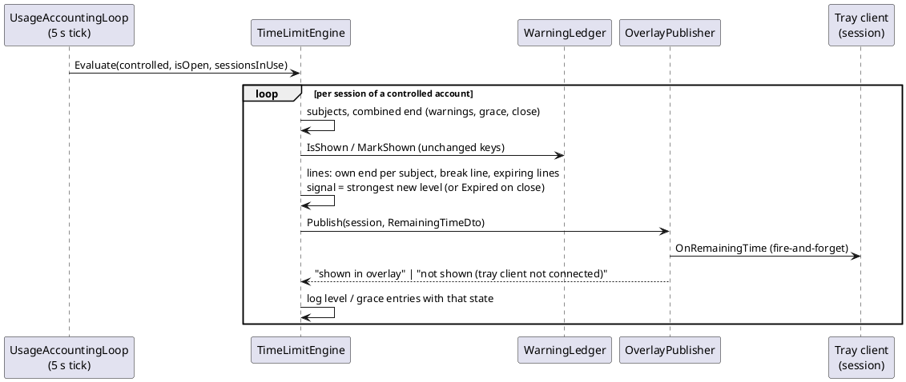
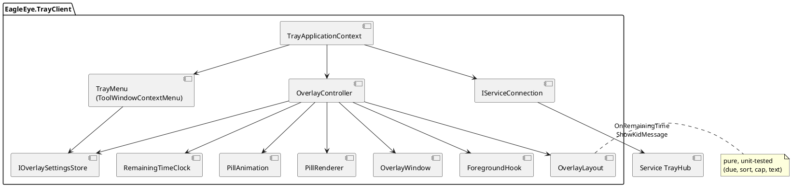

# Implementation Plan: US-010 — Remaining-Time Overlay Replaces the Warning Dialogs (0.10.0)

**Status**: Approved by Michael (2026-11-01), with Q-1 to Q-3 answered with the proposed defaults and one change: no CPU/memory run in Step 5 (AC-27 is verified by Michael in pilot operation); Step 5 kept short. ADR-022 and the amendments of ADR-007, ADR-011, ADR-014, ADR-015 and ADR-016 accepted. **Open for ARC**: the arc42 updates listed in "Architecture Changes" (deferred so DEV can start at once).
**Date**: 2026-11-01
**Author**: ARC
**User story**: `02_Implementation/docs/requirements/user-stories/US-010/user-story.md` (approved 2026-11-01, 38 ACs, OQ-1 to OQ-22 resolved, display threshold 15/30/45/60 min)
**Requirements**: `02_Implementation/docs/requirements/general-product-requirements.md` v1.10 (in effect: FR-TRAY-020, FR-TRAY-030, FR-TRAY-031, FR-TRAY-032, FR-APP-054, TC-030/031/033/040/041, FR-SVC-032, MU-011, §10 note)
**Branch**: `feature/US-010-time-overlay`
**Inputs checked**: feasibility check and spike (`US-010/feasibility-overlay.md`, `US-010/spike-overlay.md` incl. the §2 evaluation written with this plan, `US-010/spike-overlay-results.md`), the spike code at commit **`24f6dea`**, ADR-011, ADR-014, ADR-015, ADR-016, ADR-021, the US-009 plan, and the code on this branch (= `main` 0.9.0 + story docs; no change under `src/` or `tests/`).

**New ADR** (Accepted, approved by Michael with this plan, 2026-11-01): **ADR-022** "Remaining-time overlay in the tray client". **Amendments** (Accepted, 2026-11-01; text at the top of each ADR file): ADR-014, ADR-015, ADR-016, ADR-011, ADR-007. arc42 is still **open for ARC** (list in "Architecture Changes"); it does not block DEV.

**Guidance for DEV (Michael, US-009, still valid)**: where the requirements allow either way, choose the option with **less code**. No mixed-version or compatibility handling: only the four 0.10.0 assets together are supported.

**Host note**: the DEV session on the Windows Developer Machine has **no interactive input and no display** (spike `US-010/spike-overlay.md` §1.2: disconnected session, no input desktop, `SendInput` and screen capture fail). Everything that needs a look at the screen, a click, a key press or the sound is checked by **Michael**, guided by DEV (Step 5).

---

## Summary

The kid's warnings move from the "OK" dialog into a small, half-transparent, click-through pill drawn by the tray client, as proven by the spike. Four parts:

1. **Contract** (`EagleEye.Shared`, API first): a new fire-and-forget push `ITrayClientCallback.OnRemainingTime(RemainingTimeDto)` with one line per running subject and one break line, each with its seconds left and level, plus the level minutes and a signal. The warning texts and the six warning/grace reasons of the kid dialog are removed.
2. **Service**: the time-limit engine keeps deciding *when* a level is reached (unchanged warning ledger, grace periods, closes). Instead of opening a dialog it puts a **signal** into the session's remaining-time model and pushes the model to the session's tray client **every tick (5 s)**. The warning texts disappear from the service and from the database (migration 7).
3. **Tray client**: the spike's overlay window, made production-ready: multi-line pill, local countdown between pushes, display threshold, colours, pulse and sound, four corners, opacity; the overlay settings in the tray menu, stored per Windows account in `HKCU`. Tray menus become tool windows (D-10, FR-TRAY-032).
4. **Parent apps**: the "Display text" column of the warnings table goes away and the explanation changes (shared Core and XAML: Windows and Mac get it from one codebase).

Version **0.10.0** for all four assets.

**Order**: Windows block (Shared → service → tray → Windows parent app → on-screen check with Michael → installers), then the **MacBook** (Mac build, look check, `.dmg`), then Michael's pre-check on the **gaming PC 192.168.1.85**. The manual test run follows.

---

## Technical Issues and Risks

*Checked against the code on `feature/US-010-time-overlay`.*

| # | Issue | Impact | Solution in this plan |
|---|---|---|---|
| **TI-1** | **The tray gets no remaining time today.** The only kid push is `ShowKidMessage` (a request with a result, one message at a time). | AC-1 to AC-12 | New fire-and-forget callback `OnRemainingTime` (Decision 1), pushed each tick. ADR-014 amendment. |
| **TI-2** | **The engine computes one end per subject that already includes breaks** (`AppEndCalculator.Compute`). AC-3 wants app/group lines with their **own** time without breaks, and a separate break line. | AC-3, AC-7 | The model builder computes the own end with the same calculator and **no break entries**, and the break line from `BreakTimeSchedule` (Decision 2). The warning logic keeps the combined end, so "one end, one set of warnings" (AC-8) stays exactly as in 0.9.0. |
| **TI-3** | **End horizon of 60 minutes** (`AppEndCalculator.Horizon`). | AC-3 | Enough: a line is due only below the threshold (at most 60 min) or at the early level (at most 59 min). The service sends every subject whose own end is within the horizon; the tray filters by the threshold (Decision 2). A unit test guards `Horizon ≥ OverlayRules.MaxThresholdMinutes`. |
| **TI-4** | **The display threshold is a tray setting** (per Windows account); the service does not know it. | AC-3, AC-17 | The service sends all lines within 60 minutes; the tray decides which are due (pure `OverlayLayout`), so a threshold change takes effect within 1 s without a service round trip. |
| **TI-5** | **Signals are once per subject and day** (ledger in the service) and "one end, one set" across lines. A tray-side level-crossing detector would repeat them after a tray restart and could not know the break rule. | AC-8, AC-9, AC-12 | The service stays authoritative: the existing `WarningLedger` decides; the push carries the strongest new signal of the tick. The tray only colours by time and plays what the service signals (Decision 8). |
| **TI-6** | **Signal vs colour timing.** The colour follows the tray's countdown (exact second); the signal comes with the next service tick, up to 5 s later. | AC-5, AC-8 | Within the 10-second bound of AC-5. **Q-1** asks Michael to accept the offset (default: accept). |
| **TI-7** | **The 0:00 line**: closing apps are excluded from the engine at once (`CloseRegistry.IsClosing`), so their line would vanish while the close takes up to 20 to 30 s. AC-7 wants a steady red "0:00" until the apps are closed. | AC-7 | The engine keeps an "expiring" line with 0 s while any app of the closed subject (or the break close) is still closing (Decision 2). |
| **TI-8** | **The tray client is `SystemAware`** (`Program.cs`); the overlay must be sharp on any monitor scale. | AC-28 | Process-wide **PerMonitorV2** as in the spike (Decision 6). The existing dialogs (kid dialog, About, pairing code) are re-checked at 150 % in Step 5. |
| **TI-9** | **D-10**: a plain `ContextMenuStrip` popup is a visible, unowned, non-tool top-level window; `AppWindowRule` classifies it as an app. The installed tray client is already never recorded (ADR-011 §5, by full path), but a tray started from elsewhere (Debug build) would be. | AC-26, FR-TRAY-032 | Two layers (Decision 9): the existing path rule, now explicitly unit-tested for the tray, plus tool-window menus, submenus and overlay, with a pure style rule and tests. |
| **TI-10** | **Left mouse button**: `NotifyIcon` opens its `ContextMenuStrip` on the right button only. | AC-15 | On `MouseUp` with the left button the tray calls the same private `NotifyIcon.ShowContextMenu` that WinForms uses for the right button (identical foreground handling); fallback `menu.Show(Cursor.Position)`. A unit test fails if the method disappears in a .NET update (Decision 10). |
| **TI-11** | **Working-set drift in the spike** (+0.25 MB/min over 16 min, GDI/USER flat; per-second `Bitmap`/`Font` allocations). | AC-27 | Fonts cached per DPI; render only when the content changed; reuse the bitmap when the size is unchanged. No measurement in this story: Michael verifies CPU and memory (AC-27) in pilot operation. |
| **TI-12** | **Warning texts are stored** in `WarningSettings.EarlyText/FinalText` (migration 5). | AC-35 | Migration 7 drops both columns (SQLite ≥ 3.35 `ALTER TABLE … DROP COLUMN`; the bundled SQLite of Microsoft.Data.Sqlite 10 is newer). Minutes are kept (Decision 3). |
| **TI-13** | **Enum and DTO changes on the wire** (`KidMessageReason` loses six values, `KidMessageDto` loses `Minutes`, `WarningSettingsDto` loses two fields, `SetWarningText` goes). | AC-38 | Service and tray ship in one installer; the parent apps are 0.10.0 too. No compatibility code (US-009 guidance). |
| **TI-14** | **Test starting points**: AC-35 needs a 0.9.0 → 0.10.0 update, but `ZOCK-O-MAT-V3` (192.168.1.37) has service **0.8.0** and no accounts `kid1`/`kid2`/`kid3` (standard accounts `Micha`, `Sebastian`). The gaming PC 192.168.1.85 is the pilot service PC (version not recorded). | AC-35, test setup | DEV installs nothing on either PC (as US-009 TI-12). **Q-2**: Michael installs 0.9.0 on .37 before the test run; TES maps the accounts. |
| **TI-15** | **No input/display in the DEV session.** | All visible ACs | Step 5: Michael at the console of .37, DEV guides with a check list. |
| **TI-16** | **Pilot PC .85 and the Mac app**: the Mac app is paired with .85 (US-008). A 0.10.0 service with a 0.9.0 Mac app is a mixed version. | AC-38 | Michael updates .85 only after the `.dmg` 0.10.0 exists, or does not use the Mac app against .85 in between (H3). |

---

## Machine Assignment

| Work | Machine |
|---|---|
| This plan, ADR-022, the ADR amendments, the spike evaluation (ARC) | Windows Developer Machine (done here) |
| **Steps 1 to 6**: Shared contracts and version, warning texts removed end to end (incl. Windows parent app), service overlay model, tray client, on-screen check with Michael, installers 0.10.0 | **Windows Developer Machine** `ZOCK-O-MAT-V3` (192.168.1.37, Windows 11) |
| **Step 7**: Mac build and tests, Settings page look check, `.dmg` 0.10.0 | **MacBook** |
| **Step 8** (only if Step 7 changed code): build and tests | Windows Developer Machine |
| **Step 9**: pre-check of 0.10.0 over games (Michael, about 15 min) | **Gaming PC 192.168.1.85** (pilot service PC, kid's games, one monitor; test only: no repo, no agent, no build) |
| Manual test run (Michael, guided by TES) | .37 (service, tray, Windows app; non-game ACs) + .85 (**[GAME]** ACs) + MacBook (AC-32, AC-34) |

**API first** (ADR-007): `EagleEye.Shared/Contracts/` and `Models/` change in Step 1, on Windows, before any consumer.

**Handover points**:

| # | After | From → To | How |
|---|---|---|---|
| H1 | Step 6 | Windows → MacBook | Commit and push: Shared, service, tray, Core, shared XAML, report §Windows. Michael switches to the MacBook, `git pull`. The Windows installers stay on .37 (`03_Delivery/windows/`, git-ignored). |
| H2 | Step 7 | MacBook → Windows | Push: report §Mac, any Mac fix. The `.dmg` stays on the MacBook (git-ignored). Back on Windows: `git pull`; Step 8 only if Step 7 changed code. |
| H3 | Step 8 (or H2) | Windows → gaming PC .85 | Michael copies `03_Delivery/windows/EagleEye-Setup-0.10.0.exe` to .85 (USB stick or share) and installs it over the installed version. Before that, the Mac app paired with .85 is updated to 0.10.0 or not used against .85 (TI-16). Check list for Step 9 is in the implementation report. |
| H4 | Step 9 | gaming PC → Windows | Michael reports the result; DEV records it in the implementation report (and fixes a blocker: back to Steps 3/4, new installers). Story → `Implemented`. |

---

## Impact Assessment

| Component | Impact |
|---|---|
| **EagleEye.Shared** | New: `RemainingTimeDto`, `OverlayLineDto`, `OverlayLineKind`, `OverlayLevel`, `OverlaySignal`, `OverlayRules`; `ITrayClientCallback.OnRemainingTime`. Removed: `WarningSettingsDto.EarlyText/FinalText`, `IParentHub.SetWarningText`, `DefaultTextKind.EarlyWarningText/FinalWarningText` + resx entries, six `KidMessageReason` values, `KidMessageDto.Minutes`. |
| **EagleEye.Service** | Engine: overlay model per session, signals instead of warning/grace dialogs, expiring lines; new `IOverlayPublisher`/`OverlayPublisher`; `MessageOutbox` removed; `KidMessageFactory` reduced to block/close; log entries reworded; `WarningSettings` without texts; `WarningSettingsService.SetTextAsync`, `ParentHub.SetWarningText`, `AppRuleChangeLog.WarningTextChanged` removed; `ServiceDatabase` migration 7; repository SQL. |
| **EagleEye.TrayClient** | New folder `Overlay/` (window, renderer, controller, foreground hook, layout, clock, animation, settings + store, native imports); `UI/ToolWindowMenus.cs`, `UI/TrayWindowStyles.cs`; `TrayApplicationContext` (menu, left click, overlay wiring); `Program.cs` PerMonitorV2; csproj `ApplicationHighDpiMode`; `KidMessageText` without warning reasons; `TrayTexts` resx keys (new menu/overlay keys, warning info lines removed). |
| **EagleEye.ParentApp.Core** | `WarningRowViewModel` minutes only; `WarningSettingsViewModel`, `WarningSettingsModel` (`SetTextAsync` removed), `IParentHubClient`/`ParentHubClient` (`SetWarningTextAsync` removed); `AppTexts` (`WarningsColumnText` removed, `WarningsExplanation` new text de/en). |
| **EagleEye.ParentApp** (shared XAML) | `SettingsView.xaml`: grid without the text column and editors; `SettingsView.xaml.cs`: the two text handlers removed. Windows and Mac. |
| **Installers** | No script change. Outputs: `03_Delivery/windows/EagleEye-Setup-0.10.0.exe`, `03_Delivery/windows/EagleEye-ParentApp-Setup-0.10.0.exe`, `03_Delivery/macos/EagleEye-ParentApp-0.10.0.dmg`. |
| **Version** | `Directory.Build.props` → `0.10.0` (service reports `EagleEye_v0.10`). |
| **Tests** | All four test projects (Decision list in "Unit Test Requirements"). |
| **Docs** | READMEs of Shared, Service, TrayClient; `03_Delivery/windows/README.md` (version only if it names one). ARC after approval: arc42 (see below). |

---

## Architecture Changes

- **Runtime view**: a second kid channel next to the kid dialog. Every 5 s the engine builds a **remaining-time model** per session of a controlled account and pushes it fire-and-forget to the session's newest verified tray connection (ADR-014 §1 binding unchanged). The kid dialog stays for blocked starts and enforced closes only.
- **Tray client**: becomes PerMonitorV2; owns an always-existing, usually hidden overlay window; keeps per-user overlay settings in `HKCU\Software\EagleEye\TrayClient`.
- **Data**: service schema 7 (warning texts dropped).

**arc42 updates — open for ARC** (deferred after the approval so DEV can start; not a DEV task): header amendment (US-010); §5.4 (overlay, tray menu settings, no "optional"); §6 a runtime sequence "remaining-time push and signal"; §7/§8.5 the stale `EagleEye.TrayClient.yaml` example (overlay preferences are per user in `HKCU`; the tray has no YAML file); §8 database list (migration 7); §9 ADR table (ADR-022); §10 QS-09 wording; §11 R-4 (re-assert proven; exclusive fullscreen accepted).

## New ADRs Required

| ADR | Status | Content |
|---|---|---|
| **ADR-022** Remaining-time overlay in the tray client | **Accepted** (2026-11-01; new file `02_Implementation/docs/architecture/decisions/ADR-022-remaining-time-overlay.md`) | Option (a) from the spike: window styles, per-pixel alpha, re-assert, out-of-context foreground hook, monitor following, PerMonitorV2, no handles to game processes, sound fallback, exclusive-fullscreen limit, service-authoritative signals with local countdown, settings per Windows account in `HKCU`, tool-window menus. |
| **ADR-014** amendment | **Accepted — US-010** (2026-11-01) | `OnRemainingTime` push (fire-and-forget, every tick, newest verified connection); warnings and grace periods no longer use `ShowKidMessage`; six reasons and `Minutes` removed; kid dialog for block/close only; message states "shown in overlay" / "not shown (tray client not connected)". |
| **ADR-015** amendment | **Accepted — US-010** (2026-11-01) | §4/§5: the ledger and grace logic are unchanged, but their result is an overlay signal plus a log entry, not a dialog; `MessageOutbox` (one message per tick) replaced by "strongest signal per tick"; the model's own-time lines (display only) and expiring lines; §8 warning texts removed (migration 7). |
| **ADR-016** amendment | **Accepted — US-010** (2026-11-01) | The kinds `EarlyWarningText` and `FinalWarningText` and their defaults are removed; the mechanism stays for the break display text and the budget text. |
| **ADR-011** amendment | **Accepted — US-010** (2026-11-01) | §5 "never recorded" explicitly covers every tray window (FR-TRAY-032), with a unit test; the tray's own popups are tool windows as defence in depth (D-10). |
| **ADR-007** amendment | **Accepted — US-010** (2026-11-01) | A second test-only machine: the kid's gaming PC 192.168.1.85 (pilot service PC, Windows 11, kid's games). No repo, no agent, no build; installers are copied. `02_Implementation/docs/dev-process/dev-environments.md` §1 gets the row (Orchestrator, after approval). |

---

## API Changes (SignalR Contracts)

API first: Step 1, Windows.

### New tray callback

```csharp
// ITrayClientCallback
/// <summary>
/// The remaining-time model of the session (FR-TRAY-020, FR-TRAY-030; ADR-014 as amended by US-010, ADR-022). Fire-and-forget,
/// sent every engine tick (5 s) to the newest verified tray connection of a session of a controlled account. The tray counts
/// down locally between pushes and hides the overlay when no push came for 15 s.
/// </summary>
Task OnRemainingTime(RemainingTimeDto model);
```

### New models (`EagleEye.Shared/Models/`)

```csharp
public enum OverlayLineKind { App, Group, Break }
public enum OverlayLevel { Normal, Early, Final, Expired }          // white, yellow, red, red "0:00"
public enum OverlaySignal { None, Early, Final, Expired }           // pulse + sound, at most one per push

/// <param name="Kind">App (ungrouped), group, or the break line.</param>
/// <param name="Name">Display name (app) or group name as the parent named it; null for the break line.</param>
/// <param name="Seconds">Seconds left, rounded up, ≥ 0: own end of the subject (no breaks), the grace left during a grace
/// period, or seconds until the next break begins (break grace: grace left).</param>
/// <param name="Level">OverlayRules.LevelFor(Seconds, early, final) at the push.</param>
/// <param name="Counting">Whether the time runs down now: wall-clock lines (break, midnight, grace) always; budget lines while
/// the account is in use.</param>
public sealed record OverlayLineDto(OverlayLineKind Kind, string? Name, int Seconds, OverlayLevel Level, bool Counting);

/// <param name="Lines">All lines with Seconds ≤ OverlayRules.MaxThresholdMinutes × 60, unsorted; empty = nothing near.</param>
/// <param name="EarlyMinutes">Early-warning minutes (for the tray's local level as it counts down).</param>
/// <param name="FinalMinutes">Final-warning minutes.</param>
/// <param name="Signal">The strongest level reached in this tick (ledger-checked), or None.</param>
public sealed record RemainingTimeDto(IReadOnlyList<OverlayLineDto> Lines, int EarlyMinutes, int FinalMinutes, OverlaySignal Signal);
```

### New constants (`EagleEye.Shared/Constants/OverlayRules.cs`, pure)

```csharp
public static class OverlayRules
{
    public const int MaxThresholdMinutes = 60;   // the largest display threshold (FR-TRAY-031); the service sends lines up to here
    /// <summary>Expired at 0; Final at ≤ final×60; Early at ≤ early×60; else Normal (same rule as the engine's LevelFor).</summary>
    public static OverlayLevel LevelFor(int seconds, int earlyMinutes, int finalMinutes);
}
```

### Removed / changed

| Item | Change |
|---|---|
| `WarningSettingsDto` | `(long Revision, Guid? LastChangeRequestId, int EarlyMinutes, int FinalMinutes)` — `EarlyText`, `FinalText` removed |
| `IParentHub.SetWarningText` | removed (`GetWarningSettings`, `SetWarningMinutes`, `OnWarningSettingsChanged` unchanged) |
| `DefaultTextKind` | `EarlyWarningText`, `FinalWarningText` removed; `DefaultTexts*.resx` entries removed |
| `KidMessageReason` | `AppEarlyWarning`, `AppFinalWarning`, `BreakEarlyWarning`, `BreakFinalWarning`, `AppGracePeriod`, `BreakGracePeriod` removed; `AppNotAllowedToday`, `AppBudgetUsedUp`, `BreakTime` stay |
| `KidMessageDto` | `Minutes` removed (only warnings and grace periods used it) |
| `ITrayClientCallback.ShowKidMessage` | unchanged signature; doc comment: block/close only |

---

## Carried Over from the Spike

The spike folder is deleted after this plan (story delivery note). Everything production needs is written here. Source: commit **`24f6dea`**, read with `git show 24f6dea:02_Implementation/spikes/US-010-overlay/<file>`. Line ranges refer to that commit.

| # | Technique | Spike source (24f6dea) | Production use |
|---|---|---|---|
| S-1 | **Window styles**: borderless, `ShowInTaskbar=false`, manual position, `AutoScaleMode.None`, created off-screen at 1 × 1; `ShowWithoutActivation => true`; `CreateParams.ExStyle \|= WS_EX_LAYERED \| WS_EX_TRANSPARENT \| WS_EX_TOPMOST \| WS_EX_NOACTIVATE \| WS_EX_TOOLWINDOW` (measured exstyle `0x080900A8`) | `OverlayWindow.cs` 102-114 (ctor), 121 (`ShowWithoutActivation`), 123-131 (`CreateParams`) | `Overlay/OverlayWindow.cs`, unchanged. The extra-style mask comes from `TrayWindowStyles.Overlay` (Decision 9). |
| S-2 | **Input never reaches the window**: `WM_MOUSEACTIVATE → MA_NOACTIVATE`, `WM_NCHITTEST → HTTRANSPARENT`; `WM_DPICHANGED` handled (result 0, no WinForms rescaling, the controller re-renders) | `OverlayWindow.cs` 154-172 | Same. |
| S-3 | **Per-pixel alpha**: GDI+ draws into a 32-bpp ARGB `Bitmap`; `Bitmap.GetHbitmap(Color.FromArgb(0))` yields a premultiplied DIB; select into a memory DC; `UpdateLayeredWindow(hwnd, screenDC, &dst, &size, memDC, &src, 0, &blend{AC_SRC_OVER, 255, AC_SRC_ALPHA}, ULW_ALPHA)`; restore and delete the bitmap, DC and screen DC in `finally` | `OverlayWindow.cs` 200-221; constants `Native.cs` 28-31; imports `Native.cs` 132-158 | Same code. The **uniform-alpha variant** (`OverlayWindow.cs` 223-239, window region) is **not** carried over (spike §2.3). |
| S-4 | **Show/hide/re-assert without activation**: `ShowWindow(SW_SHOWNOACTIVATE)`, `ShowWindow(SW_HIDE)`, `SetWindowPos(HWND_TOPMOST, 0,0,0,0, SWP_NOMOVE\|SWP_NOSIZE\|SWP_NOACTIVATE\|SWP_NOOWNERZORDER)` | `OverlayWindow.cs` 146-152 | Same. |
| S-5 | **Re-assert schedule**: on every foreground change and at most once per second from the timer (`Upkeep`); and after unlock/connect | `SpikeController.cs` 217-220, 319-329, 354-382 (`Reassert` at 376), 470-479 | Re-assert **unconditionally** (SP-14 passed with it on). The **covered check** `FindCoverer` (`SpikeController.cs` 408-447: walk `GW_HWNDPREV` from the overlay, first visible, not cloaked, intersecting window) was diagnostics for the log; **not carried over** (one `SetWindowPos` per second is cheaper than the walk, and the tray has no log). Kept here for reference only. |
| S-6 | **Out-of-context foreground WinEvent hook**: `SetWinEventHook(EVENT_SYSTEM_FOREGROUND, EVENT_SYSTEM_FOREGROUND, 0, callback, 0, 0, WINEVENT_OUTOFCONTEXT)`; callback is a static `[UnmanagedCallersOnly]` function pointer (`delegate* unmanaged<…>`), wrapped in try/catch; `UnhookWinEvent` on shutdown. No DLL is loaded into other processes | `WindowProbe.cs` 17-33, 102-113; `Native.cs` 34-35, 203-208; unhook in `SpikeController.cs` 509 | `Overlay/ForegroundHook.cs`. The callback runs on the UI thread (the hook thread has the WinForms message loop). |
| S-7 | **Monitor following**: on foreground change, `MonitorFromWindow(fg, MONITOR_DEFAULTTONEAREST)`; ignore the tray's own windows (`GetWindowThreadProcessId` = own PID) and the shell classes `Progman`, `WorkerW`, `Shell_TrayWnd`, `Shell_SecondaryTrayWnd`; initial monitor from the foreground window or the primary (`MonitorFromPoint(0,0, MONITOR_DEFAULTTOPRIMARY)`); re-pick on `SystemEvents.DisplaySettingsChanged` | `SpikeController.cs` 18-21, 167-176, 384-406, 487-498 | `OverlayController`. |
| S-8 | **Position**: monitor **bounds** (`GetMonitorInfoW`, `rcMonitor`, not the work area), margin **24 logical px** scaled by the monitor DPI; corner picks left/right and top/bottom | `SpikeController.cs` 16, 296-297, 309-311; `Native.cs` 269-280 | Same. Multi-line: the pill grows away from its corner (bottom corners: `y = bottom − margin − height`). |
| S-9 | **DPI**: process `PerMonitorV2` (`Application.SetHighDpiMode` + `<ApplicationHighDpiMode>`); monitor DPI from `GetDpiForMonitor(MDT_EFFECTIVE_DPI)`, 96 if unknown; all sizes `logical × dpi / 96`; re-render on DPI change | `Program.cs` 36; `OverlaySpike.csproj` 13; `Native.cs` 170-171, 283-284; `SpikeController.cs` 296-306 | Decision 6. |
| S-10 | **No handle to game processes**: only `GetWindowThreadProcessId` (no handle) and `GetClassNameW`. The spike read process names from the system snapshot `Process.GetProcesses()` (never `OpenProcess`/`GetProcessById`), for its log only | `WindowProbe.cs` 6-13, 35-57; spike §1.4 deviation 2 | Production needs **no process names at all** (no log): own-PID and class checks only. Rule in ADR-022: the tray never opens, queries or enumerates another process. |
| S-11 | **Pill drawing**: dark pill `#181818` with background alpha = opacity; rounded rect (radius = half the top-line height + padding); padding 14/6 logical px, line gap 2; font "Segoe UI Semibold" (fallback "Segoe UI" bold), pixel size `pt × dpi / 72`, main **16 pt**, second size **0.6 ×**; anti-aliased text (`TextRenderingHint.AntiAlias`, `StringFormat.GenericTypographic`); colours white, yellow `#FFD600`, red `#FF4646` | `OverlayWindow.cs` 7-91 (13-14 colours, 17-71 `Render`, 42 paddings, 52-57 shape, 73-84 `RoundedRect`, 86-90 font); `SpikeController.cs` 277-283 | `Overlay/PillRenderer.cs`, extended to N lines (Decision 5). |
| S-12 | **Width from a digit-normalised template**: measure the text with every ASCII digit replaced by "0" and take the larger of that and the real width, so the pill does not jitter every second | `OverlayWindow.cs` 30-35 | Per line; pill width = widest line. |
| S-13 | **Countdown display**: seconds = `ceil(remaining)`, never below 0; level from seconds (Expired ≤ 0, Final ≤ final×60, Early ≤ early×60) | `SpikeController.cs` 187-199 | `OverlayRules.LevelFor` (Shared) + `RemainingTimeClock` (tray). |
| S-14 | **Timer cadence**: next tick at the next whole-second boundary + 20 ms (clamped 15…1000 ms), **100 ms while pulsing**; render only when the content (text, colour, alpha), DPI or position changed | `SpikeController.cs` 201-228, 248-263, 288-302 | `OverlayController` with a `System.Windows.Forms.Timer`; stopped while the model is empty. |
| S-15 | **Pulse**: early = quick pulse **3 s at 4 Hz**; final = slow pulse **1 Hz** while red; background alpha = `base×0.25 + (max(base,230) − base×0.25) × (sin(2π·f·t)+1)/2` | `SpikeController.cs` 13-15, 245-246, 265-276 | `Overlay/PillAnimation.cs` (pure). Slow pulse while any shown line is Final and > 0 (AC-8). |
| S-16 | **Sound**: `System.Media.SystemSounds.Exclamation.Play()` (Windows sound "Exclamation"/"Hinweis", system volume, default device) | `SpikeController.cs` 239-242 | Played on a signal when the sound setting is on (Decision 8). |
| S-17 | **Tool-window context menu and submenus (D-10)**: `ContextMenuStrip` subclass and `ToolStripDropDownMenu` subclass that add `WS_EX_TOOLWINDOW` in `CreateParams`; every submenu item gets `DropDown = new ToolWindowDropDown()`; menu exstyle after the fix `0x00010088` → `AppWindowRule` returns no app | `ToolWindowMenus.cs` 1-33; `SpikeController.Actions.cs` 176-202 (building), 187, 193, 199 (`DropDown =`) | `UI/ToolWindowMenus.cs`, unchanged apart from namespace and `TrayWindowStyles`. |
| S-18 | **Check marks**: refresh the `Checked` state of all items on `Opening` and on each submenu's `DropDownOpening` | `SpikeController.Actions.cs` 207-243 | Same, for opacity, position, threshold, sound. |
| S-19 | **Lock/unlock and session end**: `SystemEvents.SessionSwitch` (unlock/connect → re-assert + re-render); `SystemEvents.SessionEnding` → `e.Cancel = false`, unhook, unsubscribe, exit the loop; all `SystemEvents` handlers removed on shutdown (static events) | `SpikeController.cs` 71-73, 470-485, 500-517 | Decision 7 (production additionally **hides** on lock and waits for the next push on unlock). |
| S-20 | **CPU and memory figures** (published single-file exe, disconnected session, 16 min 19 s, both pulse phases): CPU 0.000–0.010 % per 30 s interval (max 0.073 % at start); GDI 28 / USER 27 constant; handles 373–388, no trend; working set 135.6 → 139.5 MB, private bytes 63.5 → 66.5 MB (≈ +0.25 MB/min); 136 MB start was the decompressed self-contained runtime. Measurement method: `Process.TotalProcessorTime` delta / wall / CPU count, `GetGuiResources(GR_GDIOBJECTS/GR_USEROBJECTS)` | spike §1.3 D-11; `SpikeController.cs` 449-461 | Baseline for AC-27. The production tray is framework-dependent (`SelfContained=false`), so its working set is far smaller; the drift is addressed by Decision 5 and measured in Step 5. |

Not carried over: the hotkeys (`HotkeyWindow.cs`, `SpikeController.Actions.cs` 10-61; the story uses the tray menu), the spike log and `SystemInfo`, the JSON settings next to the exe (`SpikeSettings.cs`), the single-instance mutex (`Program.cs` 27-34; ADR-014 keeps "newest verified connection wins"), the feedback second line, the mode guess (`WindowProbe.cs` 59-100).

---

## Component Design

### Decision 1: Remaining-time push (Shared + service communication)

- **Cadence**: the engine pushes the model of **every session of a controlled account in `SessionAppsView`** once per tick (5 s), also when it is empty. No change detection (less code; one small message per session per 5 s). Sessions of accounts that are not controlled get nothing; the tray then never shows a pill (AC-2), and a pill of an account that just stopped being controlled disappears through the tray's 15-s staleness rule.
- **Publisher** (`Communication/IOverlayPublisher.cs`, `OverlayPublisher.cs`):

```csharp
public interface IOverlayPublisher
{
    /// <summary>Sends the model to the newest verified tray connection of the session (not awaited). Never throws.
    /// Returns KidMessageStates.ShownInOverlay or KidMessageStates.NotConnected.</summary>
    string Publish(int sessionId, RemainingTimeDto model);
}
```

  Implementation: `TrayConnectionRegistry.NewestOf(sessionId)`; none → `NotConnected`; else `trayHub.Clients.Client(id).SendAsync(nameof(ITrayClientCallback.OnRemainingTime), model)` with a continuation that logs a failure at Debug level, return `ShownInOverlay`. New constant `KidMessageStates.ShownInOverlay = "shown in overlay"`. The states `Replaced`, `AlreadyOpen`, `ReplacedInTick` stay only if still used by block/close messages (`Replaced` is; `ReplacedInTick` goes with `MessageOutbox`).
- "Shown in overlay" means "sent to the verified tray of the session". The service cannot know whether the pill was visible (exclusive fullscreen); this is the documented limit (ADR-022).

### Decision 2: The overlay model in the engine (service)

`TimeLimitEngine` keeps its structure (subjects per session, `AppEndCalculator`, `GracePolicy`, `WarningLedger`, closes). Changes:

1. **Per subject, after `EvaluateSubject`**, the session context collects one line, built by a new pure helper `Enforcement/OverlayLineBuilder.cs`:
   - `own = AppEndCalculator.Compute(subject.Rule, subject.UsedSeconds, [], now, zone)` (no break entries → own end: budget, not allowed today, midnight);
   - during an **app grace** (grace key present and the subject's end kind is not `Break`): `Seconds = ceil(graceLeft)`, `Counting = true`;
   - else, if `own` is not null: `Seconds = ceil(own.SecondsLeft)`, `Counting = own.Kind != Budget || sessionInUse`;
   - `own` null (no own end within 60 min) → no line;
   - `Kind = subject.GroupId is null ? App : Group`, `Name = subject.Name`, `Level = OverlayRules.LevelFor(Seconds, early, final)`.
2. **Break line** (one per session), only if the session has at least one running subject this tick (AC-10, US-006 AC-28): next break of the account from `BreakTimeSchedule.FirstInEffect` (→ 0) or `NextBegin(entries, now, zone, AppEndCalculator.Horizon)`; during a **break grace** of any subject: the smallest grace left. `Kind = Break`, `Name = null`, `Counting = true`.
3. **Expiring lines (TI-7)**: when `Close` or `CloseForBreak` starts, the engine stores `_expiring[(sessionId, subjectKey or "break")] = (Kind, Name, program paths)`. Each tick, an entry yields a line with `Seconds = 0`, `Level = Expired`, `Counting = false` while `CloseRegistry.IsClosing(sessionId, path)` is true for any of its paths; otherwise the entry is removed. A subject that runs again (new start after the close) replaces it.
4. **Signals replace messages**: `Warn` keeps its ledger check (`IsShown`/`MarkShown`, same keys) and, instead of `context.Outbox.Add(KidMessageFactory.…)`, raises `context.Signal = Max(context.Signal, Early|Final)` and queues the log entry. `StartGrace` (app and break) raises `Final`. `Close` and `CloseForBreak` raise `Expired`. "One end, one set of warnings" is unchanged because `Warn` still works on the combined end.
5. **End of the session's evaluation**: `state = overlayPublisher.Publish(sessionId, new RemainingTimeDto(lines, early, final, signal))`, then the queued log entries are written with that state. `MessageOutbox` is deleted.
6. **Horizon**: unchanged (60 min). Test: `AppEndCalculator.Horizon.TotalMinutes >= OverlayRules.MaxThresholdMinutes`.

`SessionInUse` per session comes from `EnforcementTick.SessionsInUse` (already passed to the enforcement); `AppEnforcement.OnTickAsync` hands the set of session ids in use to `Evaluate` (one new parameter).



### Decision 3: Warning texts removed (Shared, service, database, parent apps, tray)

| Layer | Change |
|---|---|
| Shared | as in "API Changes"; `DefaultTexts` keeps `BreakDisplayText`, `BudgetText` |
| Service rules | `WarningSettings(int EarlyMinutes, int FinalMinutes)`; `TextOf`, `WithText` removed; `WarningSettingsService.SetTextAsync` removed; snapshot DTO without texts; `AppRuleChangeLog.WarningTextChanged` removed ("warning levels changed: early 5 min, final 1 min" unchanged, AC-34) |
| Service hub | `ParentHub.SetWarningText` removed |
| Service data | `StoredWarningSettings(int EarlyMinutes, int FinalMinutes)`; `WarningSettingsRepository` SQL without the text columns; **migration 7** (below) |
| Service enforcement | `KidMessageFactory`: `AppWarning`, `BreakWarning`, `AppGrace`, `BreakGrace` removed; `Minutes(double)` stays (used by the log) |
| Tray | `KidMessageText`: warning/grace reasons and their info-line keys removed (`InfoMinutesLeftOne/Many`, `InfoBreakBegins`, `InfoAppGraceOne/Many`, `InfoBreakGraceOne/Many`) |
| Parent app Core | `WarningRowViewModel`: `Text`, `TextMaxLength`, `CommitText`, `_textDirty`, `ConfirmedParentText`, `Kind` removed; `WarningSettingsModel.SetTextAsync`, `IParentHubClient.SetWarningTextAsync`, `ParentHubClient.SetWarningTextAsync` removed; `AppTexts.WarningsColumnText` removed (both resx); `WarningsExplanation` new text (AC-31) |
| Parent app XAML | `SettingsView.xaml`: `ColumnDefinitions="160,96"`, the column header "Display text" and both `Editor`s removed; `SettingsView.xaml.cs`: `OnEarlyTextUnfocused`, `OnFinalTextUnfocused` removed; the page-leave commit no longer calls `CommitText` |

**Migration 7** (`ServiceDatabase.SchemaMigrations`, appended; existing entries never change):

```sql
ALTER TABLE WarningSettings DROP COLUMN EarlyText;
ALTER TABLE WarningSettings DROP COLUMN FinalText;
```

- Runs in its own transaction at the first start of service 0.10.0 (the installer starts the service), so the parent's warning texts are gone after the update (AC-35, OQ-16); the minutes and every other table are untouched.
- Unit test: a database built with `AllMigrations.Take(6)`, a `WarningSettings` row with minutes 7/2 and both texts, then `InitializeAsync` → schema version 7, columns gone (`PRAGMA table_info`), minutes 7/2 read back by the repository. A second test: fresh database → version 7, defaults 5/1.
- No `VACUUM` (not allowed in a transaction; the parent texts are not secrets).
- Going back to 0.9.0 is not supported (story AC-35).

### Decision 4: The overlay window (tray)

`Overlay/OverlayWindow.cs` = spike S-1 to S-4, per-pixel only. It is created once at tray start (hidden), never closed until the tray exits. `Present(Bitmap, Point)` = S-3. `FormClosing` never cancels (sign-out, AC-25). Native imports in `Overlay/OverlayNative.cs` (`LibraryImport`, the subset of spike `Native.cs` 8-35 and 121-208 that S-1 to S-9 need; `ForegroundHelper` keeps its own).

### Decision 5: Pill content, layout and rendering (tray)

**Pure layout** `Overlay/OverlayLayout.cs` (unit-tested; input = current lines with their *displayed* seconds, the threshold, the culture texts):

1. **Due**: `seconds < threshold × 60` **or** `LevelFor(seconds) ≥ Early` (story AC-3, interpretation in the Change Log). Boundaries on the displayed integer seconds: threshold 30 → 1799 ("29:59") is due, 1800 ("30:00") is not.
2. **Sort**: seconds ascending; ties: break line first, then names `StringComparer.CurrentCultureIgnoreCase`, then ordinal (deterministic). Stable, so lines that only count down keep their order (AC-6).
3. **Cap**: at most 5 lines. With *n* > 5 due lines: the first 4, then "+{n−4} more" / "+{n−4} weitere" (AC-4: the hidden ones are always the longest).
4. **Text**: `"{name} {time}"`, break `"Break in {time}"` / `"Ruhezeit in {time}"`; names longer than 24 characters → first 23 + "…" (text elements, so an emoji is not cut in half: `StringInfo`); time `m:ss` below 3600 s, `h:mm:ss` from 3600 s; 0 → "0:00".
5. **Output**: `PillLayout(IReadOnlyList<PillLine> Lines, bool AnyFinalAboveZero)`, `PillLine(string Text, OverlayLevel Level, bool IsTop)`; empty list → overlay hidden.

**Renderer** `Overlay/PillRenderer.cs` (S-11, S-12): top line main size (16 pt), the others 0.6 ×; each line in its level colour (Normal white, Early yellow, Final/Expired red); the "+N" line white, small; lines left-aligned with the pill's padding (centred text jumps when widths differ). Width = the widest line's template width; height = sum of line heights + gaps + padding; radius = half of the top line's height + vertical padding (as S-11, so a one-line pill looks exactly like the spike).

**Memory (TI-11)**: fonts are created once per DPI and reused; the controller renders only when the layout text, colours, alpha, DPI, corner or monitor changed; when the bitmap size is unchanged it reuses the `Bitmap` (clear + redraw). `GetHbitmap`/`DeleteObject` per present stays (GDI flat in the spike).

### Decision 6: Monitor and DPI (tray)

Spike S-7 to S-9. `Program.cs`: `Application.SetHighDpiMode(HighDpiMode.PerMonitorV2)`; csproj `<ApplicationHighDpiMode>PerMonitorV2</ApplicationHighDpiMode>`. The kid dialog, About and pairing-code dialogs are WinForms forms with font/DPI auto-scaling; Step 5 checks them at 100 % and 150 % (TI-8). If one of them breaks, DEV fixes it in that dialog (no thread-DPI tricks).

### Decision 7: Lifecycle (tray)

| Event | Behaviour |
|---|---|
| Push received | Model replaced, monitor timestamp taken (`TimeProvider.GetTimestamp`), signal handled (Decision 8), timer started if lines exist |
| Between pushes | `displayed = max(0, Seconds − elapsedWholeSeconds)` for counting lines; non-counting lines stay |
| No push for **15 s** | Model cleared → pill hidden (AC-29, OQ-11) |
| Connection lost (`ConnectionChanged(false)`) | Model cleared at once |
| Reconnected | Nothing to do; the next push (≤ 5 s) brings the pill back (AC-29: ≤ 15 s) |
| `SessionSwitch` Lock, ConsoleDisconnect, RemoteDisconnect | Model cleared, pill hidden (AC-25) |
| Unlock, ConsoleConnect, RemoteConnect | Re-pick monitor; the next push shows the correct time (≤ 5 s, AC-25 ≤ 10 s; AC-5 locked time is not used time) |
| `SessionEnding` | `e.Cancel` never set; nothing blocks sign-out (AC-25) |
| Tray exit | Unhook (S-6), remove `SystemEvents` handlers, dispose window and fonts |

Pure part `Overlay/RemainingTimeClock.cs` (model + timestamp → displayed seconds, staleness), unit-tested with a fake `TimeProvider`.

### Decision 8: Signals, pulse and sound (tray)

- **Signal** from the push: `Early` → quick pulse 3 s; `Final` → (sound) and the slow pulse runs by state; `Expired` → sound only (steady red "0:00"). The sound plays once per push with a signal, if the setting is on (AC-11, AC-16). The service sends at most one signal per tick, so "two levels within 5 seconds give one sound" holds by construction (AC-8).
- **Slow pulse** is a **state**: while any *shown* line is `Final` with seconds > 0 (AC-8). The quick pulse overrides it for its 3 s.
- **Colour** of each line from its displayed seconds (`OverlayRules.LevelFor` with the pushed minutes), so a raised budget turns it white/yellow again at once (AC-8).
- A signal arriving while the pill shows no due line (e.g. early level above the threshold cannot happen, the line is due by rule 1) still plays the sound; the pulse is visible only with a pill.
- Pure part `Overlay/PillAnimation.cs`: `(baseOpacity, quickPulseStartedAt, anyFinal, now) → background alpha, needs 100-ms timer` (S-15).

### Decision 9: The tray client is never an app (FR-TRAY-032, D-10)

| Layer | Rule | Unit test |
|---|---|---|
| **1 (authoritative, existing)** | ADR-011 §5: processes under EagleEye's install folder are never recorded; `AgentReportProcessor` drops them before the tracker, the gate and the engine (`ProgramPathPolicy.IsEagleEyeProgram`), `AppCloser` never closes them | **New** explicit tests: a report with `{install}\TrayClient\EagleEye.TrayClient.exe` yields no app, no record, no blocked start; `AppCloser` refuses the path |
| **2 (defence in depth, new)** | The tray's own popups are tool windows: `ToolWindowContextMenu`, `ToolWindowDropDown` for each submenu (S-17), and the overlay (S-1). One pure helper `UI/TrayWindowStyles.cs` with `const int MenuExStyle = WS_EX_TOOLWINDOW` and `OverlayExStyle = …` used by all three `CreateParams` | TrayClient.Tests: both masks contain `WS_EX_TOOLWINDOW` and not `WS_EX_APPWINDOW`. Service.Tests (`AppWindowRuleTests`): windows with the measured tray exstyles `0x00010088` (menu, submenu) and `0x080900A8` (overlay), visible, unowned → `Classify` returns `null` |

The dialogs (kid dialog, About, pairing code) stay normal windows (taskbar button, focus); layer 1 covers them, as since US-004 AC-5. A Debug tray outside the install folder is covered by layer 2 for menus and overlay only; DEV knows this from the spike.

### Decision 10: Tray menu and overlay settings

**Menu** (AC-15), built in `UI/TrayMenu.cs` (or in `TrayApplicationContext`, whichever is shorter):

```
Opacity ▸ 25 % | 50 % | 75 % | 100 %
Position ▸ Top left | Top right | Bottom left | Bottom right
Show from ▸ 60 min | 45 min | 30 min | 15 min
Warning sound            (check item)
────────
About                    (existing item, unchanged)
```

Check marks per S-18. A click changes the setting, stores it, and the controller re-renders within 1 s (AC-17). **Left button** (TI-10): `NotifyIcon.MouseUp` with `MouseButtons.Left` → `typeof(NotifyIcon).GetMethod("ShowContextMenu", NonPublic | Instance)?.Invoke(_notifyIcon, null)`, fallback `_menu.Show(Cursor.Position)` when the method is missing.

**Settings** `Overlay/OverlaySettings.cs`: `record OverlaySettings(int OpacityPercent, OverlayCorner Corner, int ShowFromMinutes, bool Sound)`, `Defaults = (75, TopRight, 30, true)` (AC-16), `static OverlaySettings Sanitize(int? opacity, int? corner, int? showFrom, int? sound)`: each value outside its allowed set (`{25,50,75,100}`, `0..3`, `{15,30,45,60}`, `{0,1}`) falls back to its default.

**Storage decision**: **`HKCU\Software\EagleEye\TrayClient`**, four `REG_DWORD` values `OverlayOpacity`, `OverlayCorner` (0 top left, 1 top right, 2 bottom left, 3 bottom right), `OverlayShowFromMinutes`, `OverlaySound`. Interface `IOverlaySettingsStore { OverlaySettings Load(); void Save(OverlaySettings settings); }`, implementation `RegistryOverlaySettingsStore` (`Microsoft.Win32.Registry.CurrentUser`).

Why `HKCU` (less code, AC-18): it belongs to the Windows account by definition (kid1's never touches kid2's), survives sign-out, restart, tray restart and every update (the installer never touches `HKCU`), needs no file, folder, JSON or write-error handling, and is available in the kid's non-elevated session. A kid who edits the values with regedit can only choose what the menu offers (invalid values → defaults), so the overlay cannot be hidden this way (OQ-9). Load once at start; save on each change; a failing write (policy) keeps the value in memory for this run, no message. Not shown or changed in the parent apps (AC-18).

### Decision 11: Localization (tray)

The tray's UI language rule is unchanged (English → English, any other → German, `TrayTexts`). New keys in `TrayTexts.resx` (German, neutral) and `TrayTexts.en.resx`; listed in "Localization Impact". The overlay labels use the same culture. Names are never translated.

### Decision 12: Version 0.10.0

`Directory.Build.props` `VersionPrefix` 0.9.0 → **0.10.0**. Service `EagleEye_v0.10`, tray *App Infos* 0.10, Windows app `ApplicationDisplayVersion`, installer `AppVersion`, Mac `CFBundleShortVersionString` (checked by `package-macos.ps1`). No other constant.



---

## Data Model Changes

| Item | Change |
|---|---|
| Service database | **Schema 7**: `WarningSettings` without `EarlyText`, `FinalText` (Decision 3). No other table changes. |
| Shared models | New: `RemainingTimeDto`, `OverlayLineDto`, `OverlayLineKind`, `OverlayLevel`, `OverlaySignal`. Changed: `WarningSettingsDto`, `KidMessageDto`, `KidMessageReason`, `DefaultTextKind`. |
| Tray | New per-user registry values (Decision 10). |
| Parent app database | No change (warning settings were never stored there). |

---

## Implementation Steps

All steps on `feature/US-010-time-overlay`. Commit after each step (`US-010: …`) and push. Each step ends with **"Michael sees"**.

| Step | Content | Machine |
|---|---|---|
| 1 | Shared: new contracts and models (additive), version 0.10.0 | **Windows** |
| 2 | Warning texts removed end to end: Shared, service, migration 7, tray kid texts, parent app Core and shared Settings XAML | Windows |
| 3 | Service: overlay model, publisher, signals, log | Windows |
| 4 | Tray client: overlay, layout, settings, menu, PerMonitorV2, FR-TRAY-032 | Windows |
| 5 | On-screen check with **Michael** at the console of .37; CPU/memory hour | Windows (+ Michael) |
| 6 | Installers 0.10.0; implementation report §Windows | Windows |
| — | **H1**: push; Michael switches to the MacBook | |
| 7 | Mac build and tests, Settings look check, `.dmg` 0.10.0; report §Mac | **MacBook** |
| — | **H2**: push; back to Windows | |
| 8 | Only if Step 7 changed code: build and tests | Windows |
| — | **H3**: Michael copies the service installer to the gaming PC | |
| 9 | Pre-check over games (Michael, DEV's check list); story → `Implemented` after **H4** | **Gaming PC 192.168.1.85** |

Every step leaves `build.ps1` and `test.ps1` green with 0 warnings: Step 1 only adds, and Step 2 removes each Shared item together with all its consumers.

### Step 1: Shared contracts, additive (Windows)

1. `git pull`; `pwsh 02_Implementation/scripts/env-check.ps1`.
2. `Directory.Build.props` → `0.10.0`.
3. New models and `OverlayRules` (API Changes); `ITrayClientCallback.OnRemainingTime` (the tray registers no handler yet; SignalR ignores an unhandled push).
4. Shared.Tests: `OverlayRules.LevelFor` boundaries; JSON round trip (`System.Text.Json`, SignalR's protocol) of the new records.
5. `build.ps1`, `test.ps1` green.

**Michael sees**: nothing.

### Step 2: Warning texts removed end to end (Windows)

1. Shared removals (API Changes, "Removed / changed") and `DefaultTexts*.resx`; Shared.Tests (`DefaultTexts` completeness with two kinds).
2. Service rows of Decision 3: `WarningSettings`, `StoredWarningSettings`, repository, **migration 7** with its tests, `WarningSettingsService`, `ParentHub`, `AppRuleChangeLog`, `KidMessageFactory`. Until Step 3 the engine simply sends no warning or grace message (the `Warn`/`StartGrace` message lines go; ledger, graces and closes stay). Adapt `WarningSettingsServiceTests`, `ParentHubAppRulesTests`, `EnginePartsTests`, `TimeLimitEngineTests`, `TimeLimitEngineGroupTests`, `KidMessengerTests`.
3. Tray: `KidMessageText` without the six reasons; `TrayTexts` info-line keys removed; `KidMessageTextTests`, `KidMessagePresenterTests`.
4. Parent app Core and shared XAML rows of Decision 3; `WarningsExplanation` de/en (AC-31); ParentApp.Tests (`WarningSettingsViewModelTests`, row minutes cases kept, text cases removed, `AppRulesModelTests`/`AppRuleRowViewModelTests` where they touch the removed texts, `AppTexts` keys).
5. `build.ps1` (incl. the Windows app) and `test.ps1` green, 0 warnings.

**Michael sees**: nothing yet (the Settings page is checked in Step 5).

### Step 3: Service — overlay model and push (Windows)

1. `IOverlayPublisher`/`OverlayPublisher`, DI registration next to `KidMessenger`.
2. Engine changes of Decision 2: lines, break line, expiring lines, signals, log entries; `MessageOutbox` deleted; `Evaluate` gets the sessions in use.
3. `EnforcementLog`: warning and grace entries end with the overlay state (Logging).
4. Unit tests (Unit Test Requirements, service).
5. `build.ps1`, `test.ps1` green.

**Michael sees**: nothing.

### Step 4: Tray client (Windows)

1. `Program.cs` + csproj PerMonitorV2 (Decision 6).
2. `Overlay/` per Decisions 4 to 8 and "Carried over" S-1 to S-16, S-19.
3. `UI/ToolWindowMenus.cs`, `UI/TrayWindowStyles.cs`, menu and left click (Decisions 9, 10); `TrayApplicationContext` wiring: `IServiceConnection` gets `event Action<RemainingTimeDto>? RemainingTimeReceived` (raised on a thread-pool thread, marshalled to the UI thread like the pairing code).
4. New `TrayTexts` keys (Localization Impact).
5. TrayClient.Tests (Unit Test Requirements, tray).
6. `build.ps1` and `test.ps1`: all Windows projects green, **0 warnings**.

**Michael sees**: nothing yet (no display in the DEV session).
**Michael sees**: nothing yet.

### Step 5: Short on-screen check with Michael (Windows Developer Machine, Michael at the console, about 20 min)

Kept short (Michael, 2026-11-01): only the essentials; everything else is covered by the test run. **No CPU/memory run**: AC-27 (CPU, memory) is verified by Michael in pilot operation, not here and not in the test run. DEV prepares, Michael looks and reports; DEV records the result in the implementation report.

Setup: the Debug console service with its own data folder and port offset and the Debug tray client (US-005 D-5 dev setup; the Debug tray counts as verified, ADR-014 §1), in Michael's session, with the dev account source so Michael's account is controlled; short budgets (Notepad 0:03, Paint 0:35), early 2 / final 1. The installed service (0.8.0) is not touched (TI-14).

| # | Check (Michael looks) | Source |
|---|---|---|
| 1 | Pill top right, "Editor 2:59" yellow with pulse and sound; red with slow pulse and sound at 1:00; "0:00" steady red; Notepad closed, budget text dialog; pill gone. Typing in Notepad never interrupted, click on the pill goes to Notepad | AC-5, AC-7 to AC-9, AC-11, AC-14, AC-20 |
| 2 | Two lines (Notepad and Paint), order, top line large | AC-3, AC-4 |
| 3 | Tray menu with right **and** left button; submenus and check marks; one opacity, one corner, "Show from" 60/30, sound off | AC-15 to AC-17 |
| 4 | 150 % scaling: pill sharp; kid dialog, About and pairing-code dialog still look right | AC-28, TI-8 |
| 5 | Windows app Debug: Settings page without "Display text", new explanation | AC-30, AC-31 |

Findings are fixed in Steps 2 to 4 and re-checked here.

**Michael sees**: the pill over Notepad with real remaining time, its colours, pulse and sound, and the new tray menu.

### Step 6: Installers 0.10.0 (Windows)

1. `pwsh 02_Implementation/scripts/package-windows.ps1 -Target All` → `EagleEye-Setup-0.10.0.exe`, `EagleEye-ParentApp-Setup-0.10.0.exe`; file versions and SHA-256 in the report.
2. **No installer is run** on .37 or .85 by DEV (TI-14).
3. `implementation-report.md` §Windows (incl. Step 5 results and the Step 9 check list). Commit, push (**H1**).

**Michael sees**: the two 0.10.0 installers in `03_Delivery/windows/`.

### Step 7: MacBook

1. `git pull`; `build.ps1` and `test.ps1` (Shared, ParentApp): green, 0 warnings.
2. Mac app Debug build; look check of the Settings page with the Mac probe/`screencapture` pattern of US-008 §8.3 (light and dark): the explanation text (AC-31) and, if a 0.10.0 service is reachable from the Mac, the two-column warnings table. No 0.10.0 service is installed anywhere at this point (TI-14), so the connected table is otherwise checked in the test run (AC-32); the XAML is shared, and Step 5 #5 already saw it on Windows.
3. `pwsh 02_Implementation/scripts/package-macos.ps1` → `03_Delivery/macos/EagleEye-ParentApp-0.10.0.dmg`; SHA-256 in the report. DEV does not install it over Michael's Mac app (test starting point).
4. Report §Mac; commit, push (**H2**).

**Michael sees**: the `.dmg` 0.10.0 on the MacBook.

### Step 8: Windows close-out (only if Step 7 changed code)

`git pull`; `build.ps1`, `test.ps1` (0 warnings, four projects); new installers if service/tray changed; push.

### Step 9: Pre-check on the gaming PC 192.168.1.85 (Michael, about 15 min; Q-3)

After **H3** (the Mac app paired with .85 is updated to 0.10.0 first, or not used against .85 until then, TI-16):

1. Install `EagleEye-Setup-0.10.0.exe` over the installed version; note the old version.
2. Parent app (any 0.10.0) → the kid's account: games group with e.g. 0:20 left today, early 2 / final 1; no break in the next hour.
3. Sign in as the kid: start Minecraft (the mode the kid uses) → the pill "Spiele 19:5x" appears top right within 10 s (threshold 30); "Show from 15 min" → it disappears, back to 30 → it appears.
4. Fortnite in the kid's mode for a few minutes: pill visible, no EAC message.
5. Let the time run to the early level (or lower the budget): yellow, pulse, sound; then set the budget back.
6. Tray menu: opacity 75 %, corner, sound; no kid dialog, the tray is not closed (AC-26 spot check).
7. Report to DEV (H4): pass/fail per point, phone photo of anything odd.

DEV records the result; a blocker goes back to Steps 3/4 (new installers, H3 again). Story → `Implemented` when Step 9 passed.

**Michael sees**: the real overlay over the kid's games with EagleEye 0.10.0.

---

## Acceptance Criteria → Steps and Unit Tests

| AC | Step | Unit tests | Manual |
|---|---|---|---|
| AC-1 pill appears/disappears, threshold | 3, 4 | engine model, `OverlayLayout` due, `RemainingTimeClock` | Step 5 #1, #2; test run |
| AC-2 no pill (not controlled, exemptions, blocked start) | 3 | engine: no push for uncontrolled sessions, no line without running subjects | test run |
| AC-3 lines, threshold, early rule, own time | 3, 4 | builder (own end ignores breaks, groups one line, break line only with a running subject), layout due incl. early-above-threshold | Step 5 #2 |
| AC-4 order, sizes, cap, format | 4 | layout sort/ties/cap/"+N", time format, truncation | Step 5 #2 |
| AC-5 timing vs enforcement, lock | 3, 4 | clock, engine timings | Step 5 #1; test run |
| AC-6 parent changes, re-sort | 3, 4 | engine (rule change → new seconds next tick), layout re-sort | test run |
| AC-7 colours, 0:00 steady | 3, 4 | `LevelFor`, expiring lines | Step 5 #1 |
| AC-8 signals once, one sound, one end | 3, 4 | engine signals per tick, ledger keys, "after break → no signal" | Step 5 #1 |
| AC-9 start below a level | 3 | engine (matching level at once → signal) | Step 5 #1 |
| AC-10 break line | 3 | break line with/without running subject, levels | test run |
| AC-11 sound | 4 | signal → sound decision (setting on/off) | Step 5 #1, #3 |
| AC-12 grace in overlay | 3 | app grace line = grace left, break grace line, signal Final, log | test run |
| AC-13 block/close dialogs stay | 2 | `KidMessageFactory` (block/close), `KidMessageText` | test run |
| AC-14 no warning dialog | 2, 3 | engine sends no `ShowKidMessage` for warnings/grace | Step 5 #1 |
| AC-15 menu | 4 | menu structure/checks (if built in a testable class), left-click method exists | Step 5 #3 |
| AC-16 defaults | 4 | `OverlaySettings.Defaults`, `Sanitize` | test run |
| AC-17 opacity, position, threshold at once | 4 | layout/threshold, settings | Step 5 #3 |
| AC-18 per account, kept | 4 | store with fake registry abstraction / `Sanitize` | test run (two accounts) |
| AC-19 menu never affects time | — | — | test run |
| AC-20 no focus/input | 4 | `TrayWindowStyles` | Step 5 #1 |
| AC-21 [GAME] game matrix | — | — | Step 9; test run on .85 |
| AC-22 re-assert | 4 | — | test run |
| AC-23 exclusive fullscreen limit | — | — | test run on .85 |
| AC-24 [GAME] EAC | — | — | Step 9; test run |
| AC-25 lock, sign-out, fast user switching | 4 | clock clear on lock | test run |
| AC-26 tray never an app | 4 | Decision 9 tests (both layers) | Step 9 #6; test run |
| AC-27 performance | 4 | — | **Michael in pilot operation** (not Step 5, not the test run) |
| AC-28 DPI, monitors | 4 | — | Step 5 #4; second monitor optional |
| AC-29 not connected | 3, 4 | publisher states, clock staleness, disconnect clears | test run |
| AC-30, AC-31 Windows Settings page | 2 | `WarningRowViewModel`, `AppTexts` | Step 5 #5 |
| AC-32 Mac parity | 7 | same Core tests on the Mac | test run |
| AC-33 Rules page unchanged | — | existing | test run |
| AC-34 two apps, log entry | 2 | `WarningSettingsService` (no text path), change log | test run |
| AC-35 update 0.9.0 → 0.10.0 | 2 | migration 7 tests | test run (.37 after Q-2) |
| AC-36 log entries | 3 | `EnforcementLog` texts | test run |
| AC-37 enforcement regression | 2, 3 | all existing engine/gate/close tests green | test run |
| AC-38 versions | 1, 6, 7 | — | all |

---

## Unit Test Requirements

- All existing tests stay green on both machines (Windows baseline: Shared 305, Service 1 493, TrayClient 95, ParentApp 1 109 at US-009; tests of removed features are deleted or rewritten, not skipped). **0 compiler warnings**.
- New or changed logic: 100 % line and branch coverage of the pure classes (dev-process §9): `OverlayRules`, `OverlayLineBuilder`, engine model/signal paths, `OverlayPublisher` (fake registry/hub), migration 7, `OverlayLayout`, `RemainingTimeClock`, `PillAnimation`, `OverlaySettings.Sanitize`, `TrayWindowStyles`, `KidMessageText`, `WarningRowViewModel`.
- **Shared.Tests**: `LevelFor` at 0, 1, final×60, final×60+1, early×60, early×60+1; JSON round trip of `RemainingTimeDto`; `DefaultTexts` completeness (two kinds).
- **Service.Tests**:
  - engine: one line per ungrouped app and per group (two running members → one line); own time ignores a nearer break; break line only with a running subject; break line from a break in effect = 0; subject beyond 60 min → no line; app grace → line seconds = grace left, signal Final; break grace → break line = grace left, app lines keep their own time; close → signal Expired and a 0-s expiring line while `IsClosing`, removed afterwards; signals once per subject and day (second tick at the same level → None); start below early → Early (or Final) at once; a line ending after the break → no signal (the break key gets it); strongest signal per tick (early + final → Final); `Counting` false for a budget line when the session is not in use; every controlled session gets a push each tick, also empty; uncontrolled sessions get none; no `ShowKidMessage` for warnings or graces; log entries carry the publisher state;
  - `OverlayPublisher`: no connection → `NotConnected`, never throws; connection → `ShownInOverlay` and one `SendAsync`;
  - `AppEndCalculator.Horizon ≥ OverlayRules.MaxThresholdMinutes`;
  - migration 7 (v6 → v7 with data, fresh v7); repository round trip; `WarningSettingsService` (no text API; minutes validation unchanged);
  - FR-TRAY-032: `AgentReportProcessor` drops the installed tray path; `AppCloser` refuses it; `AppWindowRule` returns null for the tray exstyles.
- **TrayClient.Tests**: `OverlayLayout` (threshold 15/30/45/60 boundaries 1799/1800 etc., early-above-threshold, sort and ties, cap 5 with "+N", name truncation incl. an emoji at the cut, `m:ss`/`h:mm:ss`, break text de/en); `RemainingTimeClock` (countdown, non-counting lines, floor 0, stale after 15 s, clear); `PillAnimation` (quick 3 s, slow while Final > 0, none at 0); `OverlaySettings` (defaults, sanitize every invalid value, save/load through a fake store); signal → sound only when the setting is on, one per push; `TrayWindowStyles`; `NotifyIcon` has a non-public instance method `ShowContextMenu` (guards TI-10); `TrayTexts` de/en key completeness (existing pattern) incl. the new keys and without the removed ones; `KidMessageText` for the three remaining reasons.
- **ParentApp.Tests**: `WarningRowViewModel`/`WarningSettingsViewModel` minutes behaviour unchanged (validation, commit, snapshots, pending writes, errors); no text members; `AppTexts` key completeness.
- Not unit-tested (manual, Step 5 / test run): `OverlayWindow`, `PillRenderer` pixels, `ForegroundHook`, `RegistryOverlaySettingsStore` (thin), the menu's look, `SystemEvents` handling, installers, MAUI views.

---

## Localization Impact

**Tray client** (`TrayTexts.resx` German neutral / `TrayTexts.en.resx`):

| Key | German | English |
|---|---|---|
| `MenuOpacity` | Deckkraft | Opacity |
| `MenuPosition` | Position | Position |
| `MenuShowFrom` | Anzeigen ab | Show from |
| `MenuWarningSound` | Warnton | Warning sound |
| `OpacityFormat` | {0} % | {0} % |
| `CornerTopLeft` / `CornerTopRight` / `CornerBottomLeft` / `CornerBottomRight` | Oben links / Oben rechts / Unten links / Unten rechts | Top left / Top right / Bottom left / Bottom right |
| `ShowFromFormat` | {0} Min. | {0} min |
| `BreakLineFormat` | Ruhezeit in {0} | Break in {0} |
| `MoreLinesFormat` | +{0} weitere | +{0} more |

Removed: `InfoMinutesLeftOne`, `InfoMinutesLeftMany`, `InfoBreakBegins`, `InfoAppGraceOne`, `InfoAppGraceMany`, `InfoBreakGraceOne`, `InfoBreakGraceMany`. Unchanged: `AboutMenuItem` ("App Infos" in both; AC-15 "unchanged"), the block/close info lines.

**Parent apps** (`AppTexts.resx` / `AppTexts.en.resx`): `WarningsColumnText` removed. `WarningsExplanation`:
- German: "Hier kannst du 2 Zeitpunkte einstellen, zu denen dein Kind gewarnt wird, dass es bald Zeit wird aufzuhören. Dein Kind sieht die verbleibende Zeit am Bildschirm; zu diesen Zeitpunkten wird die Anzeige gelb bzw. rot, mit einem Ton. Dies gilt, wenn das Zeit-Budget für eine Applikation oder App-Gruppe bald erreicht wird, oder bald eine Ruhezeit ansteht."
- English: "Here you can set 2 points in time at which your kid is warned that it will soon be time to stop. Your kid sees the remaining time on the screen; at these points it turns yellow and red, with a sound. This applies when the time budget of an app or app group will soon be used up, or when a break time is about to begin."

**Shared** (`DefaultTexts*.resx`): `EarlyWarningText`, `FinalWarningText` removed.

---

## Logging

Service log (English, arc42 §8.13). The warning and grace entries keep their wording up to the last clause, which now names the overlay:

| Entry | 0.10.0 example |
|---|---|
| App/group warning | "Warning: account kid1, group Games (Minecraft, Minecraft Launcher), early warning, 5 min left (budget); shown in overlay." |
| Break warning | "Warning: account kid1, break time 20:00–23:59 (Sa) begins at 20:00, final warning, 1 min left; shown in overlay." |
| App grace | "Grace period: account kid1, Editor (notepad.exe): the rules changed (budget); closes in 1 min at 18:31:05; shown in overlay." |
| Break grace | "Grace period: account kid1, break time 20:00–23:59 (Sa) begins at 20:00; 2 app(s) close in 1 min at 19:59:35; shown in overlay." |
| Tray not connected | the same entries ending "; not shown (tray client not connected)." (AC-29, AC-36) |

Removed: "early/final warning text changed / reset to the default" (AC-34); "not shown (replaced in the same tick)". Unchanged: close entries and their kid-dialog states, "warning levels changed: early 5 min, final 1 min". Pushes themselves are **not** logged (every 5 s). The tray client has no log (story Out of Scope).

---

## Manual Verification Notes

*For TES. Not test cases.*

| What | Where / how |
|---|---|
| Artifacts | `03_Delivery/windows/EagleEye-Setup-0.10.0.exe` and `EagleEye-ParentApp-Setup-0.10.0.exe` (on .37; copy to .85), `03_Delivery/macos/EagleEye-ParentApp-0.10.0.dmg` (MacBook). All git-ignored. |
| Machines | Non-game ACs on .37 `ZOCK-O-MAT-V3`; **[GAME]** ACs (AC-21, AC-23, AC-24); AC-27 (performance) is not in the test run: Michael verifies it in pilot operation on the gaming PC **192.168.1.85**; AC-32/AC-34 on the MacBook. |
| Accounts on .37 | No `kid1`/`kid2`/`kid3`: standard accounts `Micha`, `Sebastian` exist (spike §1.2). TES maps: two controlled accounts are needed for AC-18 and AC-25 (fast user switching), one not controlled for AC-2 (an admin account also counts for AC-2). Michael ticks them in the parent app. On .85: the kid's real account. |
| Starting points | DEV installed nothing. .37 has service 0.8.0 → **Q-2**: install 0.9.0 first for AC-35. Mac app 0.9.0 on the MacBook; Windows app 0.9.0 on .37 if installed in US-009's test run. |
| Timing | Engine tick 5 s; a push per tick. Expected delays: pill appears ≤ 10 s, parent change ≤ 15 s, connection loss ≤ 15 s; menu settings ≤ 1 s (tray-local). The pulse/sound may come up to 5 s after the colour change (Q-1). |
| Short tests | Early 2 / final 1, budgets 0:03 (AC-5), threshold 15/30/60 to provoke lines. |
| Where settings live | `HKCU\Software\EagleEye\TrayClient` (`OverlayOpacity`, `OverlayCorner`, `OverlayShowFromMinutes`, `OverlaySound`) of the signed-in account; optional regedit check for AC-18. |
| Evidence over games | **Phone photos** (screenshots of fullscreen games may miss the overlay, feasibility §5). |
| Sound | Windows "Exclamation"/"Hinweis" at system volume; muted volume → nothing heard (not a Fail). |
| Service log | `%ProgramData%\EagleEye\logs\EagleEye.Service-NNN.log` (admin). Entries: Logging table. |
| Update check (AC-35) | Before the update enter non-default minutes (e.g. 7/2) and texts in 0.9.0; after the update: minutes kept, no text anywhere. |
| Exclusive fullscreen | Minecraft Java option "exclusive fullscreen" hides the pill (documented limit); the sound still plays. |
| AC-26 check | Rules and Reports pages: no "EagleEye.TrayClient" row; service log: no "start blocked"/"Closing app" for the tray. |

---

## Deviations from the Story and Interpretations

| # | Point | Plan |
|---|---|---|
| D-1 | AC-8 "when any line reaches a level … the whole pill pulses and the sound plays" | The colour changes by the tray's countdown at the exact second; pulse and sound come with the service's signal, up to 5 s later (TI-6, **Q-1**). Within AC-5's 10 s. |
| D-2 | AC-36 example wording "warning shown in overlay: kid1, group Games, early, 5 min left" | The existing entries keep their wording; only the last clause becomes "shown in overlay" / "not shown (tray client not connected)" (Logging). Same information. |
| D-3 | AC-4 "the fifth line reads +3 more" | With *n* > 5 due lines: 4 lines + "+{n−4} more". |
| D-4 | "Shown in overlay" | Means "sent to the session's verified tray client"; the service cannot see whether the pill is visible (exclusive fullscreen). |
| D-5 | AC-15 "About" ("EagleEye – App Infos") | The existing item text stays as it is ("App Infos"), as AC-15 says "unchanged". |

---

## Open Questions for Michael (all answered 2026-11-01)

| ID | Question | Default (if no answer) | Answer |
|---|---|---|---|
| **Q-1** | **Signal timing** (TI-6): the line's colour changes exactly at the level second (tray countdown); the pulse and the sound come with the service's next tick, i.e. **0 to 5 seconds later**. Making both exactly simultaneous would need the tray to decide the signals itself, which breaks "once per subject and day" after a tray restart and the break rule. Accept the offset? | **Accept** (within AC-5's 10 s). | **Answered** (Michael, 2026-11-01): default accepted. |
| **Q-2** | **Test starting point for the update (AC-35)**: .37 has service **0.8.0** (not 0.9.0). Should Michael install `EagleEye-Setup-0.9.0.exe` on .37 before the test run, so AC-35 tests 0.9.0 → 0.10.0 there? | **Yes**, Michael installs 0.9.0 on .37 before the test run (DEV installs nothing). .85 is updated from whatever it runs; that path is not an AC. | **Answered** (Michael, 2026-11-01): default accepted. |
| **Q-3** | **Pre-check on the gaming PC** (Step 9, about 15 min) before the TES test plan, like the Windows 10 pre-check of US-009? | **Yes**: it finds a game-specific blocker before the whole test run. | **Answered** (Michael, 2026-11-01): default accepted. |

---

## Risks

| # | Risk | Probability | Impact | Mitigation |
|---|---|---|---|---|
| R-1 | PerMonitorV2 changes the look of the existing tray dialogs | Low–medium | Low | Step 5 #4 at 150 %; fix per dialog |
| R-2 | The engine change breaks enforcement (AC-37) | Low | High | Warning/grace/close logic kept; only the output changes; all existing engine tests stay green |
| R-3 | Working-set growth in long sessions | Low | Medium | Decision 5; Michael watches it in pilot operation (AC-27) |
| R-4 | A game covers the pill despite the re-assert | Low (spike) | Low | Unconditional re-assert; documented limit; `uiAccess` (a+) stays the fallback idea (ADR-022) |
| R-5 | Anti-cheat reacts later (server side) | Low | High | No injection, no handles (S-10); AC-24 again with 0.10.0; residual risk named in ADR-022 |
| R-6 | `NotifyIcon.ShowContextMenu` disappears in a .NET update | Low | Low | Fallback `menu.Show`; unit test flags it |
| R-7 | Live checks impossible in the DEV session | Certain | Medium | Short Step 5 with Michael; Step 9 pre-check |
| R-8 | Mixed versions on .85 during the rollout (Mac app 0.9.0 vs service 0.10.0) | Medium | Low | H3 order (TI-16) |
| R-9 | Three machines plus the gaming PC: many switches | Medium | Low | One Windows block, one MacBook block, one gaming-PC visit |

---

*End of Implementation Plan*
