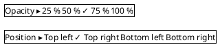
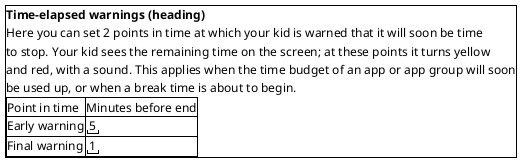
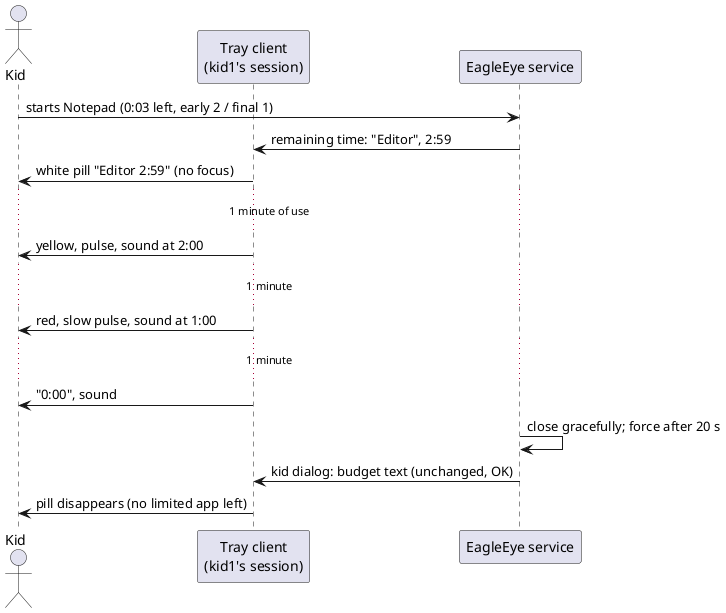

# US-010: Remaining-Time Overlay Replaces the Warning Dialogs (0.10.0)

**Status**: New (draft; Michael answered OQ-1 to OQ-16 on 2026-11-01 and added the multi-line pill; the changed ACs await his final approval, step a)
**Created**: 2026-11-01
**Approved**: *not yet*
**Component(s)**: EagleEye.TrayClient (overlay, tray menu settings), EagleEye.Service (remaining time for the overlay, warning dialogs dropped, warning texts removed), EagleEye.Shared (contracts), EagleEye.ParentApp incl. EagleEye.ParentApp.Core (warning texts removed from the Settings page)
**Platform(s)**: Windows service/tray (Windows 11; Windows Developer Machine, and the kid's gaming PC for the game cases, OQ-12) · ParentApp Windows (Windows Developer Machine) · ParentApp macOS (MacBook)

---

## User Story

As a **kid**, I want to see my remaining time in a small, half-transparent display over my game, which turns yellow and red and plays a sound when my time is about to run out, instead of "OK" dialogs that pull me out of the game, so that I can keep playing, save in time, and am never surprised when the game is closed.

As a **parent**, I want the warnings to reach my kid reliably without taking the keyboard from the game, and I want to keep setting the two warning times as before, so that the warnings are respected rather than clicked away.

---

## Background

Since US-006 the kid sees the **early** (default 5 min) and the **final** (default 1 min) warning in the topmost kid dialog with "OK". In a game this dialog takes the keyboard focus (ADR-014 §3, `ForegroundHelper`), so the kid must leave the game to click it. Michael, 2026-11-01: replace the annoying 5- and 1-minute "OK" dialogs with a half-transparent, always-on-top overlay that shows the remaining time over the running game, as FPS overlays do.

The requirements already foresee this: FR-TRAY-030 ("optionally display a topmost overlay window showing remaining time"), NFR-P-011 ("no noticeable frame drops") and §10 ("True DirectX/game overlay injection is deferred") in `02_Implementation/docs/requirements/general-product-requirements.md`.

**Feasibility and spike** (all on this branch):

- ARC's feasibility check `02_Implementation/docs/requirements/user-stories/US-010/feasibility-overlay.md` recommends option (a): a layered, click-through, top-most, non-activating window drawn by the tray client, fed by a remaining-time push from the service, plus a sound as a fallback. It lists the product questions Q-1 to Q-15 (§8). Their answers are in the table "Feasibility questions" below.
- DEV built the throwaway spike app *OverlaySpike* (`02_Implementation/spikes/US-010-overlay/`, tested build `24f6dea`) and checked it: `02_Implementation/docs/requirements/user-stories/US-010/spike-overlay.md` §1. Finding **D-10**: the WinForms tray context menu popup is not a tool window, so EagleEye's own app detection classified it as an app; opening the menu in a controlled account would have recorded and blocked the spike. Fixed in the spike by making the menu popups tool windows. This story turns the lesson into AC-26.
- Michael ran the spike on the kid's gaming PC on 2026-11-01 (`02_Implementation/docs/requirements/user-stories/US-010/spike-overlay-results.md`). **The spike is a success.** The pill was visible and click-through over Minecraft Java (windowed, F11, several changed fullscreen resolutions), Minecraft Bedrock (windowed, F11), Fortnite *Fenster-Vollbild* and *Vollbild* (no Easy Anti-Cheat reaction, no FPS impact felt), Chrome F11 and YouTube fullscreen, Steam Big Picture, the Xbox app and the Epic Games Launcher; the top-most re-assert works. **Only Minecraft Java's explicit "exclusive fullscreen" option hides the pill**, as it also hides Task Manager; Michael accepts this as a documented limit. Size, colours (white, yellow at the early warning, red at the final warning) and font are good; **75 % opacity worked best**. Michael used the tray icon with the **left mouse button**, not the hotkeys. Not run: SP-15 (lock), SP-16 (two monitors; the PC has one), SP-17 (sign-out), SP-18 (wrap-up), and DEV's open checks D-3 to D-9 and the live D-10 run.

**Michael's direction for the story (2026-11-01, verbatim):**

> "It shall include that we want this solution with some details: The EagleEye tray icon should allow some of the options as the spike app was doing it: Opacity, location of the pill (the 4 corners), sound option. Like the spike app, the tray icon should allow these settings in addition to the existing "App Infos". As a consequence, we do not need the text configurations for the dialog boxes any more - so that might be removed also from the parent apps. The settings for early and final warning times stay as they are."

**What "the text configurations for the dialog boxes" are today** (0.9.0). The parent sets three kinds of kid texts:

| Text | Where the parent sets it | Shown in the kid dialog when … | In this story |
|---|---|---|---|
| **Early warning text**, **final warning text** (FR-APP-054, US-006 AC-13 to AC-16, US-007 AC-28) | Settings → "Time-elapsed warnings" ("Zeit-Ende Warnungen"), column "Display text" ("Anzeigetext"); once for all accounts; defaults in German and English (ADR-016) | early warning, final warning, and the grace periods after a parent change (US-006 AC-32, AC-33; US-008 AC-32) | **Removed** (the overlay replaces these dialogs) |
| **Budget text** (FR-APP-053) | Rules → "Application rules", "Display text when budget is used up:" ("Anzeige Text wenn Budget aufgebraucht:"), per account | a start is blocked (not allowed today, budget used up) or a running app is closed because its time is up | **Kept** (these dialogs stay, OQ-1) |
| **Break display text** (FR-APP-052) | Rules → break times, display text, per account | a start is blocked by a break time, or a break begins and closes the running apps | **Kept** (these dialogs stay, OQ-1) |

The overlay replaces the *warnings*, which come **before** the end, while the game is still running. The budget text and the break display text explain **why** a game is gone; they appear when the start is blocked or after the app has been closed, so they do not interrupt play. The feasibility check (Q-6) recommends keeping them. This story therefore removes only the two warning texts, and asks Michael to confirm it in **OQ-1**.

**Decided before this story (do not reopen)**: option (a) of the feasibility check; the tray icon offers opacity, the four corners and the sound option next to "App Infos"; the warning texts go away in the service and in both parent apps; the warning minutes (early, final; 1..59; early greater than final; global) stay as they are; true exclusive fullscreen is an accepted, documented limit; all four assets get the same version, no mixed versions (US-009); where the requirements allow either way, the option with less code is preferred (US-009).

References: FR-TRAY-020, FR-TRAY-021, FR-TRAY-022, FR-TRAY-030, FR-APP-052 to FR-APP-054, FR-SVC-032, TC-030, TC-031, TC-033, TC-040, TC-041, MU-011, NFR-P-011, NFR-L-010 to NFR-L-012, §10. Architecture: ADR-011 §4 (what counts as an app), ADR-014 (tray channel, kid dialog), ADR-015 (engine, warning levels), ADR-016 (default texts), ADR-021 (groups).

**Terms used in this story**

- *Service PC*, *account*, *controlled account*, *app*, *app group*, *group rule*, *break time*, *budget text*, *break display text*, *warning levels*, *grace period*, *kid dialog*, *exemptions*: as in US-003 to US-008. The exemptions are those of US-006 AC-27 (Windows and background processes, the shell, File Explorer, the EagleEye tray client).
- *Limited app*: a running app of a controlled account that is not an exemption. Because new apps are blocked by default (US-006 AC-5), every app the kid can run is limited by its app rule or its group rule.
- *Subject*: what a limit applies to: the app group for a grouped app, otherwise the app itself (US-008, ADR-021).
- *End*: the end of a subject's allowed time today, as in US-006 (budget used up, not allowed today, midnight when not allowed tomorrow, start of the next break time).
- *Overlay*, *pill*: the small, rounded, half-transparent display with the remaining times, drawn by the tray client in the kid's session ("Restzeit-Anzeige"). It looks and behaves like the pill of the spike app *OverlaySpike*, but it can hold several lines (AC-3).
- *Line*: one entry of the pill: a name and a remaining time. There is one line per running ungrouped limited app, one per app group with at least one running app, and one break line when a break is approaching (AC-3).
- *Top line*: the first line of the pill, the one with the shortest remaining time. It is shown large; the other lines are smaller (AC-4).
- *Own remaining time* (of a subject): the time until the subject's own end (budget used up, not allowed today, midnight when not allowed tomorrow), **without** break times. Breaks have their own line.
- *Signal* (of a warning level): the pulse of the pill plus the sound (if on), given once when a level is reached.
- *Tray menu*: the menu of the EagleEye tray icon. Today it has one item, "About" ("EagleEye – App Infos").
- *Overlay settings*: opacity, position and sound, set by the signed-in user in the tray menu.
- *Gaming PC*: the PC on which Michael ran the spike, with the kids' games installed (OQ-12).

---

## Product requirement amendment (v1.10, proposed; takes effect when Michael approves this story)

Proposed changes to `02_Implementation/docs/requirements/general-product-requirements.md`. PRO writes them into the file after the approval, as for v1.6 to v1.9.

- **FR-TRAY-020** (changed): "The tray client shall show the early and the final warning (TC-030, TC-040) in the remaining-time overlay (FR-TRAY-030): the overlay changes its colour (yellow at the early level, red at the final level), pulses briefly and plays a sound (if the user has not switched it off, FR-TRAY-031). Warnings never open a dialog and never take the keyboard focus. *(v1.10; was: in the topmost dialog of FR-TRAY-022 with the parent's warning text)*"
- **FR-TRAY-021, FR-TRAY-022** (note only): the topmost kid dialog stays for blocked starts and enforced closes (budget text, break display text). *(v1.10: no longer used for warnings and grace periods)*
- **FR-TRAY-030** (changed): "While at least one limited application of a controlled account is running, the tray client in that session shall display a small, half-transparent, topmost overlay with one line per running application that is not in an app group, one line per app group with at least one running application, and one line for an approaching break time. Each line shows the name and the remaining time. The lines are sorted by remaining time, shortest first; the top line is large, the others smaller. Each line takes the colour of its own warning level. The overlay never takes the keyboard focus or mouse input, has no taskbar button and is not in Alt+Tab. It is visible over windowed, borderless and Windows-optimised fullscreen applications; over applications in true exclusive fullscreen it is not visible (accepted limit, §10), and the warning sound still plays. *(v1.10; was: optional overlay)*"
- **FR-TRAY-031** (new): "The tray menu offers the overlay settings next to "App Infos": opacity (25 %, 50 %, 75 %, 100 %; default 75 %), position (one of the four screen corners; default top right) and the warning sound (on/off; default on). The settings belong to the signed-in Windows account, take effect at once and are kept across sign-out, restart and update. *(v1.10)*"
- **FR-TRAY-032** (new): "No window of the tray client (tray menu and its submenus, overlay, dialogs) shall ever be recorded, limited, warned, blocked or closed as an application (FR-SVC-046). *(v1.10, US-010 spike finding D-10)*"
- **FR-APP-054** (changed): the parent sets only the **minutes** of the two levels (1..59, early greater than final, defaults 5 and 1). The warning texts are removed. *(v1.10)*
- **TC-030, TC-040** (changed): "warn the kid via the tray client" means the overlay of FR-TRAY-030 / FR-TRAY-020. **TC-031**: "(minutes, 1..59, early greater than final)", without "and text". **TC-041**: "the same two warning levels", without "and texts". **TC-033**: "the final warning is shown at once" becomes "the overlay shows the grace period at once in the final-warning state (red, pulse, sound)". *(v1.10)*
- **FR-SVC-032, MU-011** (changed): "The two warning levels (FR-APP-054)" instead of "The two warning levels with their texts". *(v1.10)*
- **§10, row "Full-screen DirectX overlay"** (note added): "Over applications in true exclusive fullscreen (e.g. Minecraft Java's "exclusive fullscreen" option) the overlay is not visible; this is accepted (US-010 spike, Michael 2026-11-01). The warning sound still plays, and the kid dialog of a blocked or closed application appears when the game is closed." *(v1.10)*
- **NFR-P-011**: unchanged (the spike showed no felt impact; AC-27 re-checks it).

---

## Acceptance Criteria

> **Language of UI texts** (NFR-L-010 to NFR-L-012, US-001 lessons): all UI texts quoted here are **English examples**, with the intended German wording in brackets. The tray client (tray menu, overlay labels) uses the Windows display language of the signed-in user: English → English, any other language → German. The parent apps use their language as before. App and group names are shown as the parent named them, never translated. Differences from the English examples are notes, not Fails; differences between the Windows app and the Mac app are Fails (parity, US-009 AC-1).

> **Test setup**: the service PC at `192.168.1.37` (Windows 11, service and tray client 0.10.0 installed over 0.9.0) with the parent's admin account, the standard accounts `kid1` and `kid2` (under parental control) and `kid3` (not under parental control). TES maps these names to the real accounts of the PC. `kid1` has used Notepad ("Editor"), Paint and Calculator ("Rechner"); an app group "Games" exists. The Windows app 0.10.0 and the Mac app 0.10.0 are paired with the service. Short budgets (e.g. 0:03) and small warning levels (e.g. early 2, final 1) keep the tests short, as in US-006. The game cases (marked **[GAME]**) run on the gaming PC with EagleEye 0.10.0 (OQ-12); the games' budget must be large enough for the test (spike instructions §6.3 step 3). **Evidence over games is a phone photo**: screenshots of fullscreen games may not show the overlay (feasibility §5).

> **Service log**: as in US-006, `%ProgramData%\EagleEye\logs\EagleEye.Service-NNN.log` (admin only).

### A. The overlay: when it shows and what it shows

- [ ] **AC-1**: When `kid1` starts a limited app (e.g. Notepad with 0:10 and today ticked), the pill appears at the latest **10 seconds** after the start, in the chosen corner of the screen (default **top right**), and shows the app's name and its remaining time, e.g. "Editor 9:59" ("Editor 9:59"). It looks like the spike's pill, which Michael approved: rounded, dark, half-transparent background, clearly readable text in the spike's fonts (AC-4), with a small margin to the screen edge. The pill stays visible as long as at least one limited app is running (OQ-2), and disappears at the latest 10 seconds after the last limited app is closed or ended by the service.
- [ ] **AC-2**: There is **no** pill:
  - in the sessions of `kid3` (not controlled) and of admin accounts;
  - in a session of `kid1` where only exemptions run (desktop, Start menu, File Explorer, the tray client itself);
  - for a start that the service blocks (the kid dialog with the budget text or break display text appears instead, AC-13).
- [ ] **AC-3**: The pill shows **one line per running subject** and one break line (Michael, 2026-11-01, replaces OQ-4):
  - one line for each running limited app that is **not in a group**, with the app's display name as on Reports;
  - one line for each **app group** with **at least one** running member app, with the group name and the group's remaining time (US-008); several running apps of one group give **one** line;
  - one **break line** "Break in 18:30" ("Ruhezeit in 18:30") when the next break time of the account begins within the next **60 minutes** (OQ-19) and at least one limited app runs (OQ-5, US-006 AC-28).

  App and group lines show the subject's **own remaining time** (Terms), so a break does not shorten them; the break has its own line. Every limited app gets a line, also one with a large budget such as 23:59 (OQ-21). Apps not in a group never count twice, and exemptions never get a line. A name longer than 24 characters is shortened with "…".

  Example: `kid1` runs Minecraft and Minecraft Launcher (both in group "Games", 4:12 left), Notepad (not grouped, 42:05 left) and Paint (in group "Drawing", 1:15:00 left); a break begins in 18:30 → the pill has **4 lines**: "Games 4:12", "Break in 18:30", "Editor 42:05", "Drawing 1:15:00" ("Spiele 4:12", "Ruhezeit in 18:30", "Editor 42:05", "Malen 1:15:00"; the group names are the parent's and are not translated).
- [ ] **AC-4**: **Order, size and format**:
  - The lines are sorted by remaining time, **shortest at the top**, longest at the bottom. With equal times (to the second) the break line comes first, then the names in alphabetical order (OQ-18).
  - The **top line** is large, in the spike's main font (Segoe UI semibold 16 pt at 100 % scaling). All other lines use the spike's **smaller second-line size**. The pill grows downwards (top corners) or upwards (bottom corners) from its corner, so the top line always stays in the same place at the corner.
  - At most **5 lines** are shown. When there are more, the fifth line reads "+3 more" ("+3 weitere") instead, counting the hidden lines, which are always the longest ones (OQ-20).
  - Time format: below one hour **minutes:seconds**, e.g. "14:59", "0:42"; from one hour on **hours:minutes:seconds**, e.g. "1:45:00". Each line counts down once per second while its subject's time is used (US-006 AC-23; for a group: while at least one member is active, US-008). The times stop while the session is locked or switched away and continue from the same values. The break line counts down by the clock.
- [ ] **AC-5**: The pill matches the service's enforcement. Measured with a stopwatch from the start of a fresh app (e.g. Notepad with 0:03, nothing used today, early 2, final 1): the pill starts at about "2:59", turns yellow at "2:00" and red at "1:00", each at the latest 10 seconds after the real level (US-006 AC-24), and shows "0:00" when the service closes the app (graceful close request at the latest 10 seconds after the budget reached 0, US-006 AC-25). After a lock of 1 minute and an unlock, the pill shows the same value as before the lock (±10 seconds), because locked time is not used time.
- [ ] **AC-6**: When the parent changes something that moves the end of a running subject (budget raised or lowered, today ticked or unticked, an app moved into or out of a group, a group rule changed, a break time added or moved), the pill shows the new remaining time at the latest **15 seconds** after the parent app shows the confirmed change (5 seconds to take effect, US-006 AC-32, plus 10 seconds). Example: Notepad shows "Editor 5:30"; the parent raises the budget by 10 minutes → "Editor 15:3x".

  **Lines appear, disappear and re-sort** (OQ-22): a line appears at the latest 10 seconds after its first app starts (or after the break comes within 60 minutes), and disappears at the latest 10 seconds after its last app is closed (or when the break begins). Moving an app into or out of a group moves it from its own line to the group's line or back. When the order changes (a new line, a changed budget), the lines re-sort at once, without animation; the new shortest line becomes the large top line. Lines that only count down keep their order. Example: the pill shows "Editor 8:00" (top) and "Paint 12:00"; the parent lowers Paint to 3 minutes left → within 15 seconds "Paint 3:00" is the large top line, "Editor 7:5x" small below it.

### B. Warning levels in the overlay (replaces the warning dialogs)

- [ ] **AC-7**: **Each line has its own colour**, following its own remaining time, as in the spike (OQ-17):
  - more than the early level left: **white**;
  - at or below the **early** level: **yellow**;
  - at or below the **final** level: **red**;
  - at **0:00**: steady red "0:00", until the service has closed the subject's apps.

  Example with early 5 / final 1: "Games 0:42" red (top), "Break in 4:30" yellow, "Editor 42:05" white. After a close, the kid dialog with the budget text (or the break display text) appears as before (AC-13), and the line disappears (AC-6). The colour is never the only signal: the number, the pulse and the sound carry the same information.
- [ ] **AC-8**: **Signals** (OQ-17): when **any line** reaches the early level, the final level or 0:00, the **whole pill** pulses (quick pulse of about 3 seconds at the early level; slow pulse from the final level on, as long as at least one line is red and above 0:00) and the sound plays once (AC-11). Two levels reached within the same 5 seconds give **one** sound. Each level of a subject is signalled at most **once per subject and day**, and once per break occurrence for the break line, under the same rules as the US-006 and US-008 warnings (US-006 AC-24, AC-28; US-008 AC-26). **One end, one set of warnings** (US-006 AC-31): a line whose time is longer than the break line's takes its colour but gives **no** signal, because the break ends it first. When the parent raises a budget, the line's colour goes back to white or yellow; a level already signalled that day is not signalled again (US-006 plan Q-5).
- [ ] **AC-9**: When a subject starts with its remaining time already at or below a level (US-006 AC-22, AC-30), its line appears directly in that level's colour and signals the level once. Example with early 5 / final 1: Notepad with 0:03 and nothing used → the line "Editor 2:59" appears yellow with pulse and sound, and turns red with the sound at "1:00".
- [ ] **AC-10**: Break times (US-006 AC-28, AC-29): the break line (AC-3) turns yellow and red at the levels with the signals, and only while at least one limited app runs (feasibility Q-15, unchanged rule). Example with early 5 / final 1 and a break at 20:00, Paint running with 1:30:00 left: at 19:00 the break line appears and, being the shortest, becomes the large top line "Break in 59:59" ("Ruhezeit in 59:59"), with "Paint 1:30:00" small below; at 19:55 it turns yellow with the signal, at 19:59 red. When the break begins, the service closes all running apps and shows the break display text once (unchanged).
- [ ] **AC-11**: The **sound** is the Windows standard sound "Exclamation" ("Hinweis") at the system volume, on the default audio output. It plays at the early level, at the final level and at 0:00 (AC-7), only when the sound setting is on (AC-16). It also plays when the pill cannot be seen (true exclusive fullscreen, AC-23). With the system volume muted, nothing is heard; that is not a Fail.
- [ ] **AC-12**: **Grace periods** (US-006 AC-32, AC-33; US-008 AC-32 to AC-34) open **no dialog** any more (OQ-3). When a parent change starts a grace period, the affected line (the app's or group's line, or the break line) shows, at the latest 10 seconds after the change takes effect, the grace time of the full final-warning minutes in **red**, moves to the top if it is now the shortest (AC-6), and the pill pulses with the sound, e.g. "Editor 0:59" or "Break in 0:59" ("Ruhezeit in 0:59"). A break grace period affects all running apps; their own lines keep their own times below the break line. When the grace period ends, the app is closed as before, with the kid dialog showing the budget text or the break display text. Example with final 1: Notepad runs with 4 minutes left; the parent sets 0:00 → within 15 seconds the pill turns red with "Editor 0:5x", pulse and sound; about 1 minute later Notepad is closed and the budget text dialog appears.

### C. Which kid dialogs remain

- [ ] **AC-13**: The kid dialog of US-005 and US-006 (topmost, "OK" or Enter, one per session, info line) **stays unchanged** for:
  - a start blocked because the app or group is not allowed today or its budget is used up (budget text, US-006 AC-19, US-008);
  - an app closed because its budget ran out, at midnight, or at the end of a grace period (budget text, US-006 AC-25, AC-32);
  - a start blocked during a break time, and the closing of running apps when a break begins or a break grace period ends (break display text, US-005 AC-30, US-006 AC-21, AC-29, AC-33).
- [ ] **AC-14**: The kid dialog **never** appears any more for the early warning, the final warning or the start of a grace period, neither for apps, groups nor break times. During a whole budget run (AC-5) the kid can keep typing in Notepad (or playing) without any window taking the keyboard focus until the app is closed.

### D. Overlay settings in the tray menu

- [ ] **AC-15**: The tray menu shows, from top to bottom (UI notes):
  - "Opacity" ("Deckkraft") ▸ "25 %", "50 %", "75 %", "100 %";
  - "Position" ("Position") ▸ "Top left" ("Oben links"), "Top right" ("Oben rechts"), "Bottom left" ("Unten links"), "Bottom right" ("Unten rechts");
  - "Warning sound" ("Warnton"), a check item;
  - a separator;
  - "About" ("EagleEye – App Infos"), unchanged (US-001).

  The current opacity and position carry a check mark; "Warning sound" carries a check mark when the sound is on. The menu opens with the **right and the left** mouse button on the tray icon (OQ-8). There is no item to hide the overlay (OQ-9).
- [ ] **AC-16**: Defaults for an account that has never changed them: opacity **75 %**, position **top right**, warning sound **on**.
- [ ] **AC-17**: **Opacity** sets how strongly the pill's dark background covers what is below it: 25 % lets most of the game shine through, 100 % is fully opaque. The time and the name stay fully readable at every step (OQ-6). **Position** moves the pill to that corner of the screen, measured from the screen edge, not from the taskbar (so it sits in the very corner of a fullscreen game). Both take effect at once: when a pill is visible, it changes within 1 second. With the sound off, there is no sound at the levels; the colours and the pulse stay.
- [ ] **AC-18**: The overlay settings belong to the **Windows account** that sets them (OQ-7). They are kept when the user signs out and in again, after a restart of the PC, when the tray client is ended and started again, and when EagleEye is updated. `kid1`'s settings never change `kid2`'s. They can be changed while no pill is shown; the next pill uses them. They are not shown or changed in the parent apps.
- [ ] **AC-19**: Opening and using the tray menu never changes the remaining time, never pauses it and never affects enforcement. The tray menu can be used during a game, but it takes the focus while it is open (Windows behaviour); this is expected.

### E. Behaviour over games and robustness

- [ ] **AC-20**: The pill **never takes the focus or input**. With Notepad under the pill's corner: a click where the pill is goes to Notepad, typed text goes to Notepad, and the pill does not react. The pill has no taskbar button and is not in Alt+Tab. When it appears, changes colour or pulses, the window in front keeps the keyboard (the cursor keeps blinking in Notepad; a game keeps keyboard and mouse).
- [ ] **AC-21**: **[GAME]** The pill is visible and click-through over every case that passed in the spike, now with real remaining time: Minecraft Java windowed, F11 fullscreen and fullscreen with a changed resolution; Minecraft Bedrock windowed and F11; Fortnite *Fenster-Vollbild* and *Vollbild*; Chrome F11 and a YouTube video in fullscreen; Steam Big Picture; the Xbox app; the Epic Games Launcher. The game does not flicker, minimise or leave fullscreen when the pill appears or changes colour.
- [ ] **AC-22**: The pill stays on top when another window puts itself on top: with Task Manager set to *Optionen → Immer im Vordergrund* and moved over the pill's corner, the pill is back above it at the latest 1 second after the next click (spike D-7, SP-14).
- [ ] **AC-23**: **Documented limit, not a Fail**: over an app in **true exclusive fullscreen** (e.g. Minecraft Java with the option "exclusive fullscreen") the pill is not visible, as Task Manager is not. The sound still plays at the levels (AC-11), and the kid dialog of the close appears when the game has been closed. As soon as the app leaves exclusive fullscreen, the pill is visible again.
- [ ] **AC-24**: **[GAME]** During about 10 minutes of Fortnite with the pill visible, including one early and one final level, Easy Anti-Cheat shows no message and does not kick the kid (spike SP-07 to SP-09).
- [ ] **AC-25**: Lock, sign-out and switching users: while the session is locked the pill is not shown; after the unlock it is back at the latest 10 seconds later with the correct time (AC-5). Signing out is not delayed by the tray client (no "This app is preventing sign-out" screen for it). With `kid1` and `kid2` signed in at the same time (fast user switching), each session shows its own pill with its own lines and its own overlay settings.
- [ ] **AC-26**: **EagleEye never treats its own tray client as an app** (spike finding D-10, FR-TRAY-032). In `kid1`'s session, during 5 minutes: open the tray menu with both mouse buttons, open each submenu ("Opacity", "Position"), change each setting once, open "About" and close it, while a pill is shown. Then:
  - the tray client and the pill are still running (nothing was closed after 20 seconds), and no kid dialog appeared;
  - the Rules page and the Reports page for `kid1` show no new row for the tray client or the menu;
  - the service log has no "start blocked" or "app closed" line for the tray client.
- [ ] **AC-27**: Performance (NFR-P-011): **[GAME]** with the pill on and off, Fortnite shows no noticeable difference in frames, stutter or input lag (as in spike SP-09; the FPS figures may be noted but are not required). On the service PC, Task Manager shows the tray client at below 1 % CPU on average over 10 minutes with a pill shown, and its memory does not grow steadily over one hour.
- [ ] **AC-28**: The pill is readable and sharp at 100 % and at 150 % display scaling, at the same physical size relative to the screen. With two monitors, the pill is shown on the monitor of the window in front and follows it at the latest 1 second after a change (OQ-10). *This last sentence is checked only if a second monitor is available; otherwise **Skipped** is fine.*
- [ ] **AC-29**: When the tray client is not running or not connected to the service, there is no pill; the service still blocks and closes apps as before (US-006 AC-35, AC-36), and its log says that the warning could not be shown. When the connection is lost while a pill is shown, the pill disappears at the latest 15 seconds later (it never keeps counting without the service, OQ-11), and it is back at the latest 15 seconds after the connection is restored.

### F. Parent apps: warning texts removed, warning minutes unchanged

- [ ] **AC-30**: **Windows app**: the Settings page section "Time-elapsed warnings" ("Zeit-Ende Warnungen") shows a table with only the columns "Point in time" ("Zeitpunkt") and "Minutes before end" ("Minuten vor Ende"). The column "Display text" ("Anzeigetext") and its two edit boxes are gone. Everything else of the section is unchanged (US-006 AC-13 to AC-16, US-007 AC-28): two fixed rows "Early warning" / "Final warning" ("Frühe Warnung" / "Finale Warnung"), defaults 5 and 1, whole minutes 1 to 59 with early greater than final and the same validation messages, saved on leaving the field or Enter, the error message when the service cannot store a change, the page states, light and dark mode, 150 % scaling.
- [ ] **AC-31**: The explanatory text of the section tells the parent where the warnings appear (OQ-14). English example: "Here you can set 2 points in time at which your kid is warned that it will soon be time to stop. Your kid sees the remaining time on the screen; at these points it turns yellow and red, with a sound. This applies when the time budget of an app or app group will soon be used up, or when a break time is about to begin." German proposal: "Hier kannst du 2 Zeitpunkte einstellen, zu denen dein Kind gewarnt wird, dass es bald Zeit wird aufzuhören. Dein Kind sieht die verbleibende Zeit am Bildschirm; zu diesen Zeitpunkten wird die Anzeige gelb bzw. rot, mit einem Ton. Dies gilt, wenn das Zeit-Budget für eine Applikation oder App-Gruppe bald erreicht wird, oder bald eine Ruhezeit ansteht."
- [ ] **AC-32**: **Mac app**: AC-30 and AC-31 hold in the Mac app in the same way and with the same wording as in the Windows app (parity).
- [ ] **AC-33**: The Rules page is unchanged in both apps: the break display text and the budget text are still edited there, with their defaults, emojis and 500-character limit (US-005 AC-15, AC-16; US-006 AC-10), because the dialogs of AC-13 still show them (OQ-1).
- [ ] **AC-34**: With the Windows app and the Mac app connected at the same time on the Settings page, a warning minute value changed in one of them appears in the other within 5 seconds, in both directions (US-007 AC-33). The service log has the entry "warning levels changed: early 5 min, final 1 min" as before; there are no "warning text changed" entries any more.

### G. Service: update and records

- [ ] **AC-35**: **Update 0.9.0 → 0.10.0** (installed over the old version, as in US-009): the warning minutes are kept (e.g. early 7 and final 2 before the update are still 7 and 2 after it, in both parent apps and in the overlay colours). The warning texts the parent had entered are removed from the service's storage during the update (OQ-16) and appear nowhere afterwards. All other data are kept: accounts, break times and break display texts, app rules, budget texts, app groups and group rules, usage, pairings. Going back to 0.9.0 is not supported (US-008 Out of Scope "Mixed versions").
- [ ] **AC-36**: The service log keeps one Information entry per level reached and per grace period, as in US-006 AC-37 and US-008 AC-31, now saying that the warning went to the overlay, e.g. "warning shown in overlay: kid1, group Games, early, 5 min left" and "grace period started: kid1, Notepad, 1 min (overlay)". When the tray client is not connected, the entry says the warning was not shown (AC-29).
- [ ] **AC-37**: **Enforcement is unchanged** (regression): blocked starts, closes with graceful-then-force and the 10/20/30-second bounds, break times winning over budgets, groups, midnight, grace periods and their timing, and time-zone Warnings behave as in 0.9.0 (US-005, US-006 groups E to J, US-008 enforcement). Spot check: US-006 AC-19 (Calculator with the default rule blocked, budget text dialog), AC-25 (Notepad 0:03 closed), AC-29 (break closes Paint, break display text once), US-008 AC-27 (group "Test" closes both apps at 5 minutes of group time). If the kid ends the tray client, enforcement continues without a pill.

### H. Version and delivery

- [ ] **AC-38**: All four assets have version **0.10.0** and are delivered together (OQ-13): `EagleEye-Setup-0.10.0.exe` (service and tray client), `EagleEye-ParentApp-Setup-0.10.0.exe` (Windows app, also on Windows 10 22H2, US-009) and the Mac app `.dmg`. The tray menu's "About" ("EagleEye – App Infos") and the parent apps show 0.10.0 for themselves and for the service.

> **Delivery notes (not manual tests)**
> - **Spike code**: before the branch is merged into `main`, DEV removes `02_Implementation/spikes/US-010-overlay/` in its own commit ("US-010: remove overlay spike code (evaluated in spike-overlay.md)"), together with the then-empty `02_Implementation/spikes/` folder and the `.gitignore` line `03_Delivery/spikes/` if no other spike uses it (`02_Implementation/docs/requirements/user-stories/US-010/spike-overlay-instructions.md` §2 and §7). The spike is never built into any installer. The orchestrator checks this before the merge (step h).
> - **Spike evaluation**: `02_Implementation/docs/requirements/user-stories/US-010/spike-overlay.md` §2 is still empty. A **short summary** of Michael's results is enough (decision "option (a) with the documented exclusive-fullscreen limit and the sound", the confirmed game matrix, the cases not run). Proposal: **ARC writes it together with the implementation plan** (step b), and names the last spike commit (`24f6dea`).
> - The open DEV checks of the spike (D-3 to D-9, live D-10) are not repeated as spike checks; the production behaviour is covered by AC-20, AC-22, AC-25 and AC-26.

---

## Change Log

| Date | Change | Source |
|---|---|---|
| 2026-11-01 | Story created (draft, status `New`); requirements v1.10 amendment proposed; OQ-1 to OQ-16 open with proposed defaults | Michael's direction of 2026-11-01, the feasibility check, the spike and Michael's spike results; written by PRO |
| 2026-11-01 | Michael answered OQ-1 to OQ-16: all proposals accepted, except OQ-4, replaced by his addition: the pill shows **one line per running ungrouped app, per group with a running app, and an approaching break**, sorted shortest first, top line large and the others in the spike's smaller size. Changed: Terms (line, top line, own remaining time), FR-TRAY-030 in the v1.10 proposal, AC-1, AC-3, AC-4, AC-6, AC-7, AC-8, AC-9, AC-10, AC-12, AC-25, UI notes, Out of Scope. New: OQ-17 to OQ-22 (proposed defaults). Status stays `New` until Michael approves the changed ACs; v1.10 stays proposed | Michael (via the Orchestrator), written by PRO |

---

## UI / Interaction Notes

### The pill (AC-1, AC-3, AC-4, AC-7)

Corner "top right", 75 % background, early 5 / final 1. Text colours as in the spike: white, yellow, red. The top line is large (spike main font), the others small (spike second-line size). Not to scale.

One app running:

Example of AC-3 (Minecraft and Minecraft Launcher in "Games", Notepad ungrouped, Paint in "Drawing", break in 18:30), and the same pill about 14 minutes later:

```plantuml
@startsalt
{
  {+
    <size:16><color:#E0B000><b>Games 4:12</color>
    <size:11>Break in 18:30
    <size:11>Editor 42:05
    <size:11>Drawing 1:15:00
  }
  .
  {+
    <size:16><color:#E0B000><b>Break in 4:30</color>
    <size:11>Editor 28:05
    <size:11>Drawing 1:01:00
  }
}
@endsalt
```

In the second pill the "Games" line is gone: its time ran out, the service closed Minecraft and its launcher, and the kid saw the budget text dialog. The break line is now the shortest, so it is the large top line, yellow and signalled at 5:00. German: "Spiele 4:12", "Ruhezeit in 18:30", "Editor 42:05", "Malen 1:15:00". The group names are the parent's names and are not translated.

More than 5 lines (AC-4): the fifth line reads "+2 more" ("+2 weitere").

### Tray menu (AC-15)

```plantuml
@startsalt
{+
  {+ Opacity           | > }
  {+ Position          | > }
  {+ ✓ Warning sound }
  ---
  {+ About }
}
@endsalt
```

German: "Deckkraft ▸", "Position ▸", "✓ Warnton", "EagleEye – App Infos". Submenus:

### Settings — Time-elapsed warnings (AC-30, AC-31), Windows app and Mac app

### Flow — one app with the overlay

---

## Out of Scope

- Replacing the **block and close dialogs** (budget text, break display text) by the overlay, and removing their texts (OQ-1).
- The remaining-time summary on a tray click (FR-TRAY-011), times of apps that are not running, or minutes drawn into the tray icon. (The pill shows only running subjects and an approaching break.)
- A kid option to hide the overlay, to move it freely (other than the four corners) or to change its size, font or colours (OQ-9).
- Overlay settings set or locked by the parent, or shown in the parent apps (OQ-7).
- A visibility setting ("always" / "only from the early warning") (OQ-2).
- A parent text, emoji or placeholder shown in the overlay; separate sounds per level; a custom sound file.
- Graphics-API hooking or injection to cover true exclusive fullscreen (§10, feasibility option c); the Xbox Game Bar widget (option b); the `uiAccess` variant (a+) (not needed: the re-assert worked in the spike).
- Showing the overlay to accounts that are not controlled, or for exempt programs.
- Changes to the warning levels themselves (per-account levels, more levels, switching them off).
- A log file of the tray client.
- Any change to enforcement, Reports, App Groups or the Rules page.

---

## Open Questions (OQ-1 to OQ-16 answered by Michael, 2026-11-01; OQ-17 to OQ-22 open, with PRO's proposed defaults)

| ID | Question | Proposed default | Answer |
|---|---|---|---|
| OQ-1 | **Which texts are removed?** "The text configurations for the dialog boxes" could mean only the two warning texts, or also the budget text and the break display text. | Remove **only the early and final warning texts** (Settings, column "Display text"). The **budget text** and the **break display text** stay on the Rules page, because their dialogs stay (AC-13): they explain why a game was blocked or closed and appear only after it is gone (feasibility Q-6). *Alternative*: also replace those dialogs by an overlay message and remove their texts (larger story; the kid would then see no reason text). | Agreed. — **Resolved** (Michael, 2026-11-01): proposal accepted. |
| OQ-2 | **When is the pill visible?** (feasibility Q-1) | **Always while a limited app runs**, as an FPS counter (Michael's trigger, the spike counted down from 15:00). No setting. *Alternative*: only from the early level on (fewer pixels on screen most of the time), or a third tray setting "Show: always / only near the end". | Agreed. — **Resolved** (Michael, 2026-11-01): proposal accepted. |
| OQ-3 | **Grace periods**: today they open the dialog with the final warning text and a line "your parents changed the rules … closes in 1 minute". | **No dialog**: the pill turns red with the grace countdown, pulse and sound (AC-12). The final warning text is gone anyway. *Alternative*: keep a dialog for grace periods, with EagleEye's own line only (it takes the focus again). | Agreed. — **Resolved** (Michael, 2026-11-01): proposal accepted. |
| OQ-4 | **What does the pill show, and in which format?** (feasibility Q-2, Q-3) | The **subject that ends first** among the running limited apps (group name for grouped apps), one pill only (AC-3). Format **m:ss** below one hour, **h:mm:ss** from one hour (AC-4), counting every second as in the spike. | Replaced. — **Resolved** (Michael, 2026-11-01): the pill shows **all** running subjects and an approaching break, one line each, shortest on top, top line large (AC-3, AC-4); the time format of the proposal stays. Details in OQ-17 to OQ-22. |
| OQ-5 | **Label for a break**: | "Break in 4:59" ("Ruhezeit in 4:59"). | Agreed. — **Resolved** (Michael, 2026-11-01): proposal accepted. |
| OQ-6 | **Opacity steps and meaning** | Steps **25 %, 50 %, 75 %, 100 %**, default **75 %** (Michael's spike result). The opacity applies to the **background** of the pill; the text always stays fully readable (the spike's per-pixel mode). | Agreed. — **Resolved** (Michael, 2026-11-01): proposal accepted. |
| OQ-7 | **Where do the overlay settings live, and who sets them?** (feasibility Q-10) | Set by whoever is signed in (the kid) in the tray menu, as Michael asked; kept **per Windows account** on that PC (AC-18), not in the parent apps, and not lockable by the parent. Where exactly they are stored is ARC's decision (less code: in the account's own profile). *Alternative*: store them in the service per account and show them on the Rules page (parent control; more code in all four assets). | Agreed. — **Resolved** (Michael, 2026-11-01): proposal accepted. |
| OQ-8 | **Mouse button**: today the tray menu opens with the right button; Michael used the left button in the spike. | The menu opens with **both** buttons (AC-15). | Agreed. — **Resolved** (Michael, 2026-11-01): proposal accepted. |
| OQ-9 | **May the kid hide the overlay?** (feasibility Q-5) | **No.** No "hide" item; the kid can only move it to another corner and make it more transparent (minimum 25 %). | Agreed. — **Resolved** (Michael, 2026-11-01): proposal accepted. |
| OQ-10 | **Several monitors** (feasibility Q-13; not tested in the spike) | The pill follows the monitor of the window in front (AC-28). Tested only if a second monitor is available; otherwise Skipped. | Agreed. — **Resolved** (Michael, 2026-11-01): proposal accepted. |
| OQ-11 | **Connection lost** | The pill disappears within 15 seconds and comes back after the reconnect (AC-29), so it never shows a time the service does not confirm. | Agreed. — **Resolved** (Michael, 2026-11-01): proposal accepted. |
| OQ-12 | **Where do the game cases run?** The spike instructions left open whether the gaming PC is the service PC `ZOCK-O-MAT-V3` (its GPU is an RX 9070 XT) or another PC (spike Q-A). | The game cases **[GAME]** run on the gaming PC with EagleEye 0.10.0 installed and a controlled kid account; everything else on the Windows Developer Machine. If both are the same PC, all Windows cases run there. Michael names the PC and the account for TES. | Agreed. — **Resolved** (Michael, 2026-11-01): proposal accepted. |
| OQ-13 | **Version** | **0.10.0** for all four assets (service, tray client, Windows app, Mac app), since the contracts and both parent apps change (US-009 "no mixed versions"). | Agreed. — **Resolved** (Michael, 2026-11-01): proposal accepted. |
| OQ-14 | **Explanatory text** of the warnings section | The wording of AC-31 (German proposal included). Michael may reword it; wording differences are notes. | Agreed. — **Resolved** (Michael, 2026-11-01): proposal accepted. |
| OQ-15 | **Sound** | The Windows standard sound "Exclamation" ("Hinweis") at the early level, the final level and 0:00, as in the spike (AC-11). | Agreed. — **Resolved** (Michael, 2026-11-01): proposal accepted. |
| OQ-16 | **Stored warning texts on update** | Removed from the service's storage during the update to 0.10.0 (AC-35), so no unused parent data stays behind. *Alternative*: keep them unused. | Agreed. — **Resolved** (Michael, 2026-11-01): proposal accepted. |

### New open questions from the multi-line pill (Michael's addition of 2026-11-01)

| ID | Question | Proposed default | Answer |
|---|---|---|---|
| OQ-17 | **Colours and signals with several lines** | Each line takes the **colour of its own level** (white, yellow, red). When **any** line reaches a level, the **whole pill** pulses and the sound plays once; two levels within 5 seconds give one sound. A line that ends after the break line gives no signal, because the break ends it first (US-006 AC-31). (AC-7, AC-8) | |
| OQ-18 | **Ties** (equal times to the second) | The break line first, then alphabetical by name. (AC-4) | |
| OQ-19 | **When does the break line appear?** ("when a break is approaching") | When the next break begins within **60 minutes** and a limited app runs. *Alternative*: whenever a break is still to come today (then e.g. "Ruhezeit in 6:12:00" all afternoon). (AC-3) | |
| OQ-20 | **Maximum number of lines** | **5**; with more, the fifth line reads "+N more" ("+N weitere") and the longest lines are hidden. (AC-4) | |
| OQ-21 | **Apps with a very large budget** (e.g. 23:59; there is no "unlimited" budget, every limited app has an end) | They get a line like every other running limited app; it sits at the bottom because it is the longest. Exemptions get no line. (AC-3) | |
| OQ-22 | **Appearing, disappearing, re-sorting** | Lines appear and disappear within 10 seconds of the app start or close. When the order changes, the lines re-sort at once without animation, and the new shortest line becomes the large top line; the pill grows away from its corner, so the top line stays in the corner. (AC-4, AC-6) | |

### Feasibility questions Q-1 to Q-15 (`feasibility-overlay.md` §8)

| Q | Topic | Settled by | Result in this story |
|---|---|---|---|
| Q-1 | When visible | **Michael** (OQ-2) | Always while a limited app runs (AC-1) |
| Q-2 | What it shows | **Michael's addition** (OQ-4) | One line per running ungrouped app, per group with a running app, and an approaching break; shortest on top, top line large (AC-3, AC-4; details OQ-17 to OQ-22) |
| Q-3 | Format | **Michael** (OQ-4) | m:ss, h:mm:ss from one hour (AC-4) |
| Q-4 | Position, size, transparency | **Michael's direction** + spike | Four corners and opacity in the tray menu (AC-15 to AC-17); size as the spike; steps 25/50/75/100 % (OQ-6) |
| Q-5 | Kid may move/hide | **Michael's direction** (move) | The kid picks the corner; no hiding (OQ-9, Michael) |
| Q-6 | Replaces the OK dialogs | **Michael's direction** | Early and final warnings replaced (AC-14); block/close dialogs stay (AC-13, OQ-1); grace periods OQ-3 |
| Q-7 | Behaviour at the levels | **Spike** (Michael: colours good) + **Michael's direction** (no texts) | White/yellow/red, pulse, sound (AC-7); no parent text in the overlay |
| Q-8 | Fallback when off or not shown | **Follows from the direction** | The overlay cannot be switched off, so there is no dialog fallback; no tray → no pill, enforcement continues (AC-29) |
| Q-9 | Sound | **Michael's direction** | Sound on/off in the tray menu, default on (AC-16, OQ-15) |
| Q-10 | Setting scope | **Michael's direction** (tray menu) | Per Windows account, set in the tray (AC-18, OQ-7), not on the Rules page |
| Q-11 | Localization | Rules NFR-L-010 to 012, US-001 lessons | Tray menu and overlay labels in German and English; names as entered |
| Q-12 | Accessibility | **Spike** (Michael: size, font good) | Spike size, readable at 150 %, colour never the only signal (AC-7, AC-28) |
| Q-13 | Multi-monitor | **Michael** (OQ-10) | Follow the window in front; tested only with a second monitor (AC-28) |
| Q-14 | Exclusive fullscreen as a documented limit | **Michael** (spike results) | Accepted (AC-23, §10 note) |
| Q-15 | Break-only phases | Existing rule US-006 AC-28 | "Break in …" only while a limited app runs (AC-10) |

---

## What is removed, for ARC's plan (as found in the code at 0.9.0)

For orientation only; the implementation plan decides the details (API first, ADR-007).

| Area | Item |
|---|---|
| Parent apps (shared MAUI pages, Windows and Mac) | Settings, warnings table: the "Display text" column and its edit boxes (`WarningsColumnText` in `AppTexts*.resx`, the text part of `WarningRowViewModel` / `WarningSettingsViewModel`); the text-editing path for warnings |
| `EagleEye.Shared` | `WarningSettingsDto.EarlyText` / `FinalText`; `IParentHub.SetWarningText`; `DefaultTextKind.EarlyWarningText` / `FinalWarningText` and the default texts `EarlyWarningText` / `FinalWarningText` in `DefaultTexts*.resx`; the warning and grace reasons of `KidMessageReason` as dialog reasons (`AppEarlyWarning`, `AppFinalWarning`, `BreakEarlyWarning`, `BreakFinalWarning`, `AppGracePeriod`, `BreakGracePeriod`) |
| `EagleEye.Service` | the `EarlyText` / `FinalText` columns of the `WarningSettings` table (data cleanup on update, AC-35); the warning and grace messages to the kid dialog (`KidMessageFactory`); the "warning text changed" log entries |
| `EagleEye.TrayClient` | the dialog path and the info-line texts of the warning and grace reasons (`InfoMinutesLeft*`, `InfoBreakBegins`, `InfoAppGrace*`, `InfoBreakGrace*` in `TrayTexts*.resx`) |
| Docs | US-006 AC-13 to AC-16 and AC-34, US-007 AC-14, AC-16 and AC-28 mention warning texts; they stay as history; this story supersedes them |

New items (for the plan): a remaining-time push from the service to the session's tray (feasibility §5), the overlay window and its settings in the tray client, the tray menu items, and the D-10 safeguard for the tray menu popups.

---

## Related

- Prerequisite stories: US-001 (tray client, "App Infos"), US-005 (kid dialog, break times), US-006 (budgets, warning levels, grace periods), US-007 (Mac app), US-008 (app groups), US-009 (Windows app parity, 0.9.0)
- Inputs: `02_Implementation/docs/requirements/user-stories/US-010/feasibility-overlay.md`, `02_Implementation/docs/requirements/user-stories/US-010/spike-overlay-instructions.md`, `02_Implementation/docs/requirements/user-stories/US-010/spike-overlay.md`, `02_Implementation/docs/requirements/user-stories/US-010/spike-overlay-results.md`
- General product requirements: v1.10 amendment proposed above (FR-TRAY-020, FR-TRAY-030 changed; FR-TRAY-031, FR-TRAY-032 new; FR-APP-054, TC-030, TC-031, TC-033, TC-040, TC-041, FR-SVC-032, MU-011 changed; §10 note)
- Architecture: ADR-011 §4, ADR-014, ADR-015, ADR-016, ADR-021; new ADRs expected with the plan (overlay technique, remaining-time push, amending ADR-014; feasibility §9)
- Implementation Plan: `US-010/implementation-plan.md` (added by ARC)
- Issues: `US-010/issues/` (added by TES)
- Manual tests: `docs/testing/US-010/` (added by TES)
